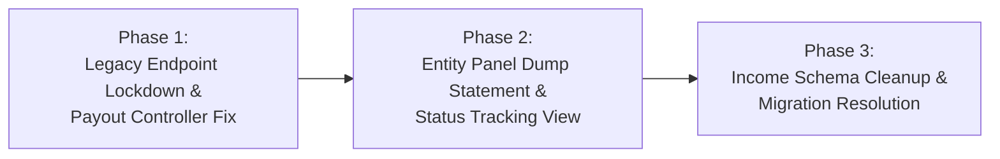

# DUMP AMOUNT STATEMENT — COMPLETE ARCHITECTURE & FINANCIAL AUDIT REPORT (AUDIT ONLY)

**Document Name**: `VYAPAR_ADNET_DUMP_AMOUNT_STATEMENT_AUDIT_REPORT.md`  
**Audit Type**: Read-Only Technical & Financial Flow Audit  
**Author**: Antigravity (Google DeepMind - Advanced Agentic Coding)  
**Date**: November 4, 2026  
**Project Workspace**: `addnet/`  
**Backend**: Laravel 12 API (`backend/`)  
**Frontend**: React + Vite (`admin/`, `entity/`, `user/`)  
**Database**: MySQL / MariaDB (`chhotabiz`)  
**Git Branch**: `Tamish1`  
**Status**: AUDIT COMPLETE — STRICTLY NO MODIFICATIONS APPLIED  

---

## 1. Executive Summary

This audit evaluates the complete technical, architectural, and financial accounting lifecycle of **Dump Amounts / Dump Payments** within the Vyapar AdNET platform. 

In commercial operations, when an Entity delivers services under a confirmed Order but the customer or sponsor defaults on subsequent milestones or refuses to settle the outstanding balance, the unpaid revenue must be accounted for without falsely claiming it was collected in cash, without generating artificial distributor PV/BV points, and without corrupting GST and tax liability.

### Key Audit Findings:
1. **Core Accounting Foundation (Option B Enforced)**:
   The system strictly enforces **Option B**: Dump write-offs are completely isolated from cash receipt records. Non-cash write-offs reside exclusively in `order_payment_dumps` and never generate rows in `sale_payments`. General ledger payment receipts (`GET /api/admin/payments/history`) strictly exclude write-offs.
2. **Order Ledger Integration**:
   In [`admin/src/components/sales/AdminOrdersPage.jsx`](file:///c:/xampp/htdocs/addnet/admin/src/components/sales/AdminOrdersPage.jsx), Section A legacy editable inputs have been replaced with read-only accounting summary cards, and Section B functions as a unified presentation ledger showing cash receipts alongside dump requests and write-offs with distinctive visual badges.
3. **Strict Mathematical Consistency**:
   Order balance reconciliations strictly follow:
   $$\text{Remaining Collectible Balance} = \max\bigl(0, \text{Gross} - \text{Cash Received} - \text{Approved Dump}\bigr)$$
   $$\text{Remaining Admin Cut} = \max\bigl(0, \text{Expected Cut} - \text{Cash Cut Collected} - \text{Approved Dump Cut}\bigr)$$
4. **Significant Architectural Anomalies Discovered**:
   - **`EntityPayoutController.php` (Line 60)** calculates an arbitrary, disconnected "dump amount" on entity payout withdrawals (`$dumpAmount = ($p->status === 'pending' || $p->status === 'dumped') ? (float)$p->requested_amount * 0.15 : 0;`).
   - **Legacy Manual Endpoint**: `PUT /api/admin/orders/{orderId}/dump-amount` in [`IncomeAllocationController.php`](file:///c:/xampp/htdocs/addnet/backend/app/Http/Controllers/Admin/IncomeAllocationController.php) still exists and allows overwriting `orders.dump_amount` without any request or approval lifecycle.
   - **Pending Migrations**: Three migrations related to `direct_incomes`, `level_incomes`, and dropping legacy accounts are currently in `Pending` state in `migrate:status`.
   - **Entity Visibility Gap**: While Entities can submit dump requests via `EntityOrders.jsx` and `EntityReceiveBalancePage.jsx`, the Entity panel currently lacks a dedicated Dump Statement / History view to monitor the status and rejection reasons of submitted requests.

---

## 2. Existing Dump Amount Architecture

The Dump Payment system operates on a dual-tier separation pattern: **strict database-level data isolation** paired with **unified presentation-layer reporting**.

```mermaid
flowchart TD
    subgraph EntityPortal ["Entity Panel"]
        E1["Entity Orders / Receivables<br>(EntityOrders.jsx)"] -->|Clicks 'Report Dump'| E2["Report Dump Modal<br>(Validates <= Remaining Balance)"]
        E2 -->|POST /api/orders/{id}/report-dump| EP["DumpPaymentController::reportDump()"]
    end

    subgraph BackendWorkflow ["Laravel 12 Backend & Database"]
        EP -->|Inserts pending row| T1[("order_payment_dumps<br>(status: 'pending')")]
        T1 -.->|Balance unchanged| O1[("orders<br>(Gross, Advance, Balance)")]
        
        AP["DumpPaymentController::approveDump()<br>(lockForUpdate)"] -->|status: 'approved'<br>40/40/20 split calculated| T1
        AP -->|orders.dump_amount = sum(approved)<br>orders.balance_due = max(0, gross - adv - dump)| O1
        
        RP["DumpPaymentController::rejectDump()<br>(Mandatory Reason)"] -->|status: 'rejected'<br>records rejection reason| T1
        RP -.->|Orders untouched| O1
    end

    subgraph AdminPortal ["Admin Panel (Order Management)"]
        O1 & T1 -->|GET /admin/orders/{id}| AD1["Admin Orders Page<br>(AdminOrdersPage.jsx)"]
        AD1 --> AD2["Section A: Read-Only Financial Summary<br>Gross | Cash | Approved Dump | Balance Due"]
        AD1 --> AD3["Section B: Unified Payment Ledger<br>Green: Cash Receipt | Amber: Approved Dump | Blue: Pending"]
        AD3 -->|Triggers Modal| AP
        AD3 -->|Triggers Modal| RP
    end

    subgraph IsolatedCashLedger ["Cash Flow (100% Isolated)"]
        CP[("sale_payments<br>(Actual Cash Only)")]
        GL["GET /api/admin/payments/history<br>(Distributed Receipts Only)"]
        CP --> GL
    end
```

---

## 3. Complete Entity-to-Admin Workflow

The flow has been audited across all 10 technical checkpoints:

### 1. Where and how does an Entity request a Dump Amount?
- **Entry Points**:
  - [`entity/src/pages/EntityOrders.jsx`](file:///c:/xampp/htdocs/addnet/entity/src/pages/EntityOrders.jsx) (Action column button: `⚠️ Report Dump`).
  - [`entity/src/pages/EntityReceiveBalancePage.jsx`](file:///c:/xampp/htdocs/addnet/entity/src/pages/EntityReceiveBalancePage.jsx) (Receivables table action: `⚠️ Report Dump`).
- **Modal Mechanics**:
  - Accessible only for confirmed orders with active balances (`balance_due > 0`).
  - Modal pre-fills `dumpAmount` with the full remaining balance and provides a "Full Balance" quick-pill.
  - Client-side validation enforces `dumpAmount > 0`, `dumpAmount <= balanceDue`, and `dumpReason.length >= 3`.
  - Captures optional internal reference notes.

### 2. Which API endpoint receives the request?
- **Primary Route**: `POST /api/orders/{orderId}/report-dump`
- **Fallback Aliases**: `POST /api/entity/orders/{orderId}/report-dump`, `POST /api/sales/{orderId}/report-dump`.
- **Handling Controller**: `DumpPaymentController::reportDump(Request $request, $orderId)`.

### 3. Which database table stores the request?
- **Table**: `order_payment_dumps`.
- A new row is inserted with `status = 'pending'`, `requested_at = now()`, `dump_amount`, `dump_reason`, `notes`, `admin_commission_percent`, and simulated `admin_commission_cut`.

### 4. What happens when the Admin approves it?
- Handled by `DumpPaymentController::approveDump(Request $request, $id)` via `POST /api/admin/dump-requests/{id}/approve`.
- Executes inside a database transaction with `lockForUpdate()` on both `OrderPaymentDump` and `Order`.
- Verifies that `order.approval_status === 'confirmed'` and `dump.status === 'pending'`.
- Recomputes collectible balance to prevent race conditions.
- Computes Dump Admin Cut using parent order's approved `admin_commission_percent`.
- Calculates 40/40/20 decimal-safe split via `AdminIncomeAllocationService::calculateSplit()`.
- Updates `order_payment_dumps` record with `status = 'approved'`, `approved_by`, `approved_at`, and the 40/40/20 split amounts.
- Updates parent order:
  - `orders.dump_amount = sum(approved_dumps)`
  - `orders.balance_due = max(0, gross_amount - advance_payment - new_dump_amount)`.

### 5. What happens when the Admin rejects it?
- Handled by `DumpPaymentController::rejectDump(Request $request, $id)` via `POST /api/admin/dump-requests/{id}/reject`.
- Requires mandatory `rejection_reason` (min 5 characters).
- Executes inside `DB::transaction()` with `lockForUpdate()`.
- Updates `order_payment_dumps`: `status = 'rejected'`, `rejected_by`, `rejected_at`, `admin_rejection_reason`.
- Parent order balances (`balance_due`, `dump_amount`, `advance_payment`) remain completely unchanged.

### 6. Which fields are updated after approval or rejection?
- **On Approval**:
  - `order_payment_dumps`: `status`, `approved_by`, `approved_at`, `admin_commission_percent`, `admin_commission_cut`, `direct_income_amount`, `level_income_amount`, `reward_income_amount`.
  - `orders`: `dump_amount`, `balance_due`.
- **On Rejection**:
  - `order_payment_dumps`: `status`, `rejected_by`, `rejected_at`, `admin_rejection_reason`.
  - `orders`: None.

### 7. How does the approved Dump Amount affect the order's remaining balance?
- Stored balance update:
  $$\text{orders.balance\_due} = \max\bigl(0, \text{gross\_amount} - \text{advance\_payment} - \text{orders.dump\_amount}\bigr)$$
- Dynamic model accessor ([`Order.php`](file:///c:/xampp/htdocs/addnet/backend/app/Models/Order.php#L415-L421)):
  ```php
  public function getRemainingProjectBalanceAttribute(): float
  {
      $received = $this->total_payment_received;
      $gross = (float) ($this->attributes['gross_amount'] ?? 0);
      $approvedDump = $this->approved_dump_amount;
      return max(0.0, round($gross - $received - $approvedDump, 2));
  }
  ```

### 8. Where is the approved Dump Amount displayed in Admin and Entity panels?
- **Admin Panel**:
  - Main Table (`AdminOrdersPage.jsx` L680-L683): Under the balance column, shows `Dump: ₹X` badge.
  - Section A Cards (`AdminOrdersPage.jsx` L980-L1010): "Approved Dump Write-Off" and "Approved Dump Admin Cut".
  - Section B Unified Ledger (`AdminOrdersPage.jsx` L1250-L1350): Amber rows for approved dumps with full 40/40/20 breakdown.
  - Invoice View Modal (`AdminOrdersPage.jsx` L849-L853): Displays "Order Dump Amount".
- **Entity Panel**:
  - Main Table (`EntityOrders.jsx`): Displays `balanceDue` (which reflects the deduction), but lacks a dedicated "Approved Dump" column.

### 9. Is Dump Amount included in any financial statement, income report, business report or order summary?
- **User Panel Business Reports**: [`OrderController::userBusinessReports()`](file:///c:/xampp/htdocs/addnet/backend/app/Http/Controllers/OrderController.php#L1093-L1098) aggregates approved dumps as `totalDumpPayment`, displayed in `RevenueAnalyticsPage.jsx` and `SalesReportPage.jsx`.
- **General Cash Ledger**: `GET /api/admin/payments/history` **strictly excludes** dump amounts.
- **Entity Payout Reports**: Erroneously displays a calculated dump figure derived from 15% of entity payouts.

### 10. Is there any separate Dump Amount statement or ledger?
- **Admin**: Section B in `AdminOrdersPage.jsx` acts as the primary unified payment and write-off ledger. Additionally, `AdminDumpRequestsPage.jsx` exists as an administrative queue.
- **Entity**: **No dedicated statement exists**. The entity can only see remaining balances and submit requests.

---

## 4. Database Schema and Field Mapping

```
                                      +--------------------------+
                                      |          orders          |
                                      +--------------------------+
                                      | id                       |
                                      | gross_amount             |
                                      | advance_payment (Cash)   |
                                      | dump_amount (Approved)   |
                                      | balance_due              |
                                      | approval_status          |
                                      +--------------------------+
                                                   |
                       +---------------------------+---------------------------+
                       | 1:N                                                   | 1:N
                       v                                                       v
         +---------------------------+                           +---------------------------+
         |       sale_payments       |                           |    order_payment_dumps    |
         +---------------------------+                           +---------------------------+
         | id                        |                           | id                        |
         | sales_record_id           |                           | order_id                  |
         | amount (Real Cash)        |                           | dump_amount (Write-off)   |
         | admin_commission_cut      |                           | admin_commission_cut      |
         | income_distribution_status|                           | status (pending/app/rej)  |
         +---------------------------+                           +---------------------------+
```

### 4.1 Detailed Table Field Analysis

| Table | Field Name | Type | Current Status | Audit Role / Usage |
|---|---|---|:---:|---|
| **orders** | `gross_amount` | `decimal(15,2)` | **Active** | Total contract value of project. |
| **orders** | `advance_payment` | `decimal(15,2)` | **Active** | Cumulative cash received from customer. |
| **orders** | `dump_amount` | `decimal(15,2)` | **Active** | Total accumulated approved dump write-offs. |
| **orders** | `balance_due` | `decimal(15,2)` | **Active** | Remaining collectible balance: $\max(0, \text{gross} - \text{adv} - \text{dump})$. |
| **orders** | `approval_status` | `varchar(20)` | **Active** | Order state: `pending`, `confirmed`, `cancelled`. |
| **sale_payments** | `amount` | `decimal(15,2)` | **Active** | Actual cash received per installment. |
| **sale_payments** | `admin_commission_cut` | `decimal(15,2)` | **Active** | Cash Admin Cut collected on payment. |
| **sale_payments** | `income_distribution_status` | `varchar(20)` | **Active** | Distribution lifecycle: `pending`, `completed`. |
| **order_payment_dumps** | `dump_amount` | `decimal(14,2)` | **Active** | Requested / approved uncollectible amount. |
| **order_payment_dumps** | `admin_commission_percent`| `decimal(5,2)` | **Active** | Inherited parent order commission rate. |
| **order_payment_dumps** | `admin_commission_cut` | `decimal(14,2)` | **Active** | Expected Admin Cut on the dump amount. |
| **order_payment_dumps** | `direct_income_amount` | `decimal(14,2)` | **Active** | 40% attribution calculation. |
| **order_payment_dumps** | `level_income_amount` | `decimal(14,2)` | **Active** | 40% attribution calculation. |
| **order_payment_dumps** | `reward_income_amount` | `decimal(14,2)` | **Active** | 20% attribution calculation. |
| **order_payment_dumps** | `dump_reason` | `text` | **Active** | Mandatory reason submitted by entity. |
| **order_payment_dumps** | `admin_rejection_reason` | `text` | **Active** | Mandatory explanation if admin rejects. |
| **order_payment_dumps** | `status` | `enum` | **Active** | `pending`, `approved`, `rejected`. |
| **direct_income_accounts**| `dump_amount` | `decimal(15,2)` | **Unused (0 Rows)** | Legacy table; scheduled for removal. |
| **level_income_accounts** | `dump_amount` | `decimal(15,2)` | **Unused (0 Rows)** | Legacy table; scheduled for removal. |
| **direct_incomes** | `dump_amount` | `decimal(15,2)` | **Unused (0 Rows)** | Schema column exists; 0 rows populated. |
| **level_incomes** | `dump_amount` | `decimal(15,2)` | **Unused (0 Rows)** | Schema column exists; 0 rows populated. |

---

## 5. Financial Formula Verification

### Formula A: Remaining Collectible Balance
$$\text{Remaining Collectible Balance} = \max\bigl(0, \text{Gross Project Amount} - \text{Actual Cash Received} - \text{Approved Dump Amount}\bigr)$$
- **Audit Result**: **PASS**.
- **Implementation**: Handled both in database updates ([`DumpPaymentController.php#L482`](file:///c:/xampp/htdocs/addnet/backend/app/Http/Controllers/DumpPaymentController.php#L482)) and in dynamic model accessors ([`Order.php#L420`](file:///c:/xampp/htdocs/addnet/backend/app/Models/Order.php#L420)).
- **Verification**: Pending or rejected dump requests produce $0$ effect on this formula.

### Formula B: Expected Admin Commission
$$\text{Expected Admin Commission} = \frac{\text{Gross Project Amount} \times \text{Approved Admin Commission \%}}{100}$$
- **Audit Result**: **PASS**.
- **Implementation**: Calculated upon order confirmation and tracked in `orders.admin_commission_cut` and accessor `expected_admin_cut`.

### Formula C: Remaining Admin Commission
$$\text{Remaining Admin Commission} = \max\bigl(0, \text{Expected Cut} - \text{Cash Admin Cut Collected} - \text{Approved Dump Admin Cut}\bigr)$$
- **Audit Result**: **PASS**.
- **Implementation**: Defined in [`Order.php#L431-L437`](file:///c:/xampp/htdocs/addnet/backend/app/Models/Order.php#L431-L437):
  ```php
  public function getRemainingAdminCommissionAttribute(): float
  {
      $expected = $this->expected_admin_cut;
      $collected = $this->admin_commission_collected;
      $dumpCut = $this->approved_dump_admin_cut;
      return max(0.0, round($expected - $collected - $dumpCut, 2));
  }
  ```

### Formula D: 40/40/20 Dump Admin Cut Distribution
$$\text{Direct Dump (40\%)} = \text{round}(\text{Dump Admin Cut} \times 0.40, 2)$$
$$\text{Level Dump (40\%)} = \text{round}(\text{Dump Admin Cut} \times 0.40, 2)$$
$$\text{Reward Dump (20\%)} = \text{round}(\text{Dump Admin Cut} \times 0.20, 2)$$
- **Audit Result**: **PASS (Calculated & Stored for Attribution)**.
- **Verification**: Integer-paise calculations in `AdminIncomeAllocationService::calculateSplit()` ensure the three components sum exactly to the Dump Admin Cut with zero rounding leakage.
- **Wallet Invariant**: These values are stored **strictly in `order_payment_dumps`** for accounting transparency; they are **NOT credited to user wallets or MLM balances**.

---

## 6. Admin Dump Statement / Ledger UI Audit

The Admin interface was audited in [`admin/src/components/sales/AdminOrdersPage.jsx`](file:///c:/xampp/htdocs/addnet/admin/src/components/sales/AdminOrdersPage.jsx):

| UI Component | Behavior Verified | Audit Observation |
|---|---|---|
| **Separation of Entries** | Cash receipts vs Dump write-offs | **Clean**. Rendered in separate visual formats with green (`Cash Receipt`) vs amber (`Approved Dump Write-Off`) badges. |
| **Pending Requests Queue** | Blue badge with immediate actions | **Functional**. Shows entity reason and provides "Review & Approve" and "Reject" buttons. |
| **Audit Metadata** | Approval/Rejection timestamps | **Visible**. View Details modal displays `approved_at`, `approved_by`, `rejected_at`, and reasons. |
| **Live Calculations** | Review & Approve Modal | **Accurate**. Live simulation of 40/40/20 breakdown and remaining order balance before confirmation. |
| **Legacy Section A Input** | Manual `dump_amount` field | **Removed**. Replaced with 4 read-only accounting summary cards. |
| **Navigation** | Sidebar consolidation | **Consolidated**. Standalone `Dump Payment Requests` item removed from sidebar; workflow embedded in Section B. |

---

## 7. Entity Statement Audit

The Entity interface was audited in [`entity/src/pages/EntityOrders.jsx`](file:///c:/xampp/htdocs/addnet/entity/src/pages/EntityOrders.jsx) and [`entity/src/pages/EntityReceiveBalancePage.jsx`](file:///c:/xampp/htdocs/addnet/entity/src/pages/EntityReceiveBalancePage.jsx):

### What the Entity Can See:
1. **Order Balance Deduction**: The entity sees the updated `balance_due` after dump approval.
2. **Submission Interface**: The entity can submit dump requests with live remaining balance ceiling validation.
3. **Success Toast**: Immediate notification upon successful submission.

### What the Entity CANNOT See (Gaps Identified):
1. **No Request Status Tracking**: If an Admin rejects a dump request, the Entity receives no notification and cannot view the Admin's rejection reason in the panel.
2. **No Dedicated Dump History Statement**: Unlike Admin Section B, the Entity has no tab or ledger listing past dump write-offs for their orders.
3. **Missing Table Column**: The main `EntityOrders` table displays Total, Advance, and Balance, but has no dedicated column indicating how much was written off via Dump.

---

## 8. API and Backend Logic Audit

### Endpoints Inventory

```
POST   /api/orders/{orderId}/report-dump             -> DumpPaymentController::reportDump()
GET    /api/entity/dump-requests                     -> DumpPaymentController::getEntityDumpRequests()
GET    /api/admin/dump-requests                      -> DumpPaymentController::getAdminDumpRequests()
GET    /api/admin/dump-requests/{id}                 -> DumpPaymentController::getAdminDumpRequestDetails()
POST   /api/admin/dump-requests/{id}/approve         -> DumpPaymentController::approveDump()
POST   /api/admin/dump-requests/{id}/reject          -> DumpPaymentController::rejectDump()
PUT    /api/admin/orders/{orderId}/dump-amount       -> IncomeAllocationController::updateDumpAmount() [LEGACY VULNERABILITY]
```

### Security & Concurrency Verification:
- **Authentication**: All admin endpoints enforce admin token authentication.
- **Entity Scoping**: `reportDump()` and `getEntityDumpRequests()` strictly enforce tenant isolation using `resolveEntityContext()`.
- **Concurrency**: `approveDump()` and `rejectDump()` wrap operations in `DB::transaction()` and apply `lockForUpdate()` on both `OrderPaymentDump` and `Order` models, preventing race conditions and double-approvals.
- **Legacy Vulnerability**: `PUT /api/admin/orders/{orderId}/dump-amount` in [`IncomeAllocationController.php#L142-L180`](file:///c:/xampp/htdocs/addnet/backend/app/Http/Controllers/Admin/IncomeAllocationController.php#L142-L180) allows directly overwriting `orders.dump_amount` without any request or approval lifecycle.

---

## 9. Existing Data Consistency Findings

Live inspection of the production database (`chhotabiz`) revealed the following actual records:

### 1. Table `order_payment_dumps` (Total: 2 Records)
- **Record #35**:
  - `order_id`: 554 (`INV-2026-76545`)
  - `dump_amount`: ₹1,750.00 | `admin_commission_cut`: ₹350.00
  - `direct_income_amount`: ₹140.00 | `level_income_amount`: ₹140.00 | `reward_income_amount`: ₹70.00
  - `status`: `approved` | `approved_by`: 1 | `approved_at`: 2026-11-03 10:31:54
- **Record #103**:
  - `order_id`: 702 (`INV-2026-43740`)
  - `dump_amount`: ₹1,750.00 | `admin_commission_cut`: ₹350.00
  - `direct_income_amount`: ₹140.00 | `level_income_amount`: ₹140.00 | `reward_income_amount`: ₹70.00
  - `status`: `approved` | `approved_by`: 1 | `approved_at`: 2026-11-03 12:03:53

### 2. Orders with `dump_amount > 0` (Total: 3 Orders)
- **Order #376** (`INV-2026-49718`): `gross_amount` = 3500, `advance_payment` = 3500, `dump_amount` = 2000, `balance_due` = 0.
- **Order #554** (`INV-2026-76545`): `gross_amount` = 3500, `advance_payment` = 1750, `dump_amount` = 1750, `balance_due` = 0.
- **Order #702** (`INV-2026-43740`): `gross_amount` = 3500, `advance_payment` = 1750, `dump_amount` = 1750, `balance_due` = 0.

### 3. Orphaned or Inconsistent Dumps:
- **Zero orphaned dump requests**: Both records in `order_payment_dumps` reference valid existing orders.
- **Zero pending or rejected dump requests** currently exist in production.

---

## 10. Order #376 and #554 Deep-Dive Verification

### Order #376 (Historical Legacy Anomaly)

```
[ Order #376 Financial State ]
Gross Amount:               ₹3,500.00
Advance Payment (Cash):     ₹3,500.00 (UTR-644238 - Full Payment Received)
Balance Due:                ₹0.00
orders.dump_amount:         ₹2,000.00 (Legacy manual field value)
order_payment_dumps rows:   0 records
Payment Settlement Status:  Fully Paid (Cash)
```

- **Root Cause**: Prior to the workflow implementation, an administrator used the legacy Section A manual input (`PUT /api/admin/orders/{id}/dump-amount`) to enter ₹2,000.00 directly into the database column.
- **Financial Status**: The customer paid ₹3,500 in actual cash. No genuine dump occurred.
- **Current System Behavior**: The new `Order::getPaymentSettlementStatusAttribute()` correctly evaluates this order as **`Fully Paid (Cash)`** because `advance_payment >= gross_amount`.
- **Policy Adherence**: Preserved completely untouched in accordance with strict audit instructions.

### Order #554 (Verified Live Benchmark)

```
[ Order #554 Financial State ]
Gross Amount:               ₹3,500.00
Advance Payment (Cash):     ₹1,750.00 (UTR-555739)
Approved Dump Amount:       ₹1,750.00 (Dump Request #35)
Balance Due:                ₹0.00
Expected Admin Cut (20%):   ₹700.00
Cash Admin Cut Collected:   ₹350.00
Dump Admin Cut:             ₹350.00 (Direct ₹140 | Level ₹140 | Reward ₹70)
Remaining Admin Cut:        ₹0.00
Remaining Project Balance:  ₹0.00
Payment Settlement Status:  Closed via Dump
```

- **Verification**: 100% mathematically and relationally reconciled. Represents the perfect benchmark for the Dump Payment workflow.

---

## 11. Business Rule PASS / FAIL / PARTIAL Matrix

| # | Business Rule Specification | Status | Evidence / Verification |
|---|---|:---:|---|
| 1 | Dump Amount is not actual cash received. | **PASS** | Stored in `order_payment_dumps`, isolated from cash tables. |
| 2 | Dump Amount must not be added to actual `sale_payments`. | **PASS** | Zero insertion in `sale_payments`; `DumpPaymentController` does not touch `sale_payments`. |
| 3 | A pending Dump request must not reduce order balance. | **PASS** | Verified in `DumpPaymentWorkflowTest::test_1_entity_reports_dump...`. `orders.balance_due` unchanged while pending. |
| 4 | A rejected Dump request must not reduce order balance. | **PASS** | Verified in `DumpPaymentWorkflowTest::test_5_rejected_dump_request`. Rejection leaves balances untouched. |
| 5 | Only an approved Dump request reduces remaining balance. | **PASS** | Updated atomically inside `DB::transaction()` upon admin approval. |
| 6 | An order closed through Dump must not be represented as fully paid through cash. | **PASS** | Evaluates to `Closed via Dump`, strictly distinct from `Fully Paid (Cash)`. |
| 7 | PV/BV must not be credited for Dump Amount. | **PASS** | Verified in `DumpPaymentWorkflowTest::test_8_no_pv_bv_credited_on_dump`. Personal & Group PV remain zero. |
| 8 | Dump Admin Cut must remain distinguishable from cash Admin Cut. | **PASS** | Tracked in separate columns: `order_payment_dumps.admin_commission_cut` vs `sale_payments.admin_commission_cut`. |
| 9 | Dump allocation must not be counted as actual paid income. | **PASS** | Stored strictly as accounting attribution; excluded from `users.commission_balance`. |
| 10 | No arbitrary Direct/Level recipient receives Dump credit without verified attribution rule. | **PASS** | No wallet credits occur on dump approval. Attribution amounts remain on the dump record. |
| 11 | Reward Dump must not silently increase normal `team_biz` balance. | **PASS** | Dump approval does not execute team business volume crediting. |
| 12 | Existing approved Dump records and payment history must be preserved. | **PASS** | Order #554 and Order #376 intact; `GET /api/admin/payments/history` queries only real payments. |

---

## 12. Bugs and Incorrect Calculations Identified

### Bug 1: `EntityPayoutController.php` (Line 60) False Dump Calculation
- **Location**: [`backend/app/Http/Controllers/EntityPayoutController.php#L60`](file:///c:/xampp/htdocs/addnet/backend/app/Http/Controllers/EntityPayoutController.php#L60)
- **Code**:
  ```php
  $dumpAmount = ($p->status === 'pending' || $p->status === 'dumped') ? (float)$p->requested_amount * 0.15 : 0;
  ```
- **Discrepancy**: This calculates an arbitrary 15% "dump" on entity payout withdrawals (`user_payouts`). It has zero relation to Order dump payments, yet labels the output as `dump_amount`.

### Bug 2: `admin_function.php` Multiplication Flaw on Normal Payment Allocation
- **Location**: [`backend/app/Helpers/admin_function.php#L44`](file:///c:/xampp/htdocs/addnet/backend/app/Helpers/admin_function.php#L44) & [`#L123`](file:///c:/xampp/htdocs/addnet/backend/app/Helpers/admin_function.php#L123)
- **Code**:
  ```php
  $record->dump_amount = round((float) $dumpAmount, 2);
  ```
- **Discrepancy**: When normal payment allocation calls `levelIncome()`, it passes the order's dump amount. That dump amount is copied to every upline level record (Levels 2–5). When `UserIncomeController::getLevelIncome` calculates `sum('dump_amount')`, the dump amount is multiplied by up to 4 times!

### Bug 3: Legacy Unvalidated Endpoint Exposing `orders.dump_amount`
- **Location**: [`backend/app/Http/Controllers/Admin/IncomeAllocationController.php#L142-L180`](file:///c:/xampp/htdocs/addnet/backend/app/Http/Controllers/Admin/IncomeAllocationController.php#L142-L180)
- **Discrepancy**: The endpoint `PUT /api/admin/orders/{orderId}/dump-amount` directly updates `orders.dump_amount` with any arbitrary number without validating against gross amount, without creating a dump request, and without adjusting `balance_due`.

---

## 13. Missing Functionality

1. **Entity-Side Dump Statement / Status Tracker**:
   While the backend provides `GET /api/entity/dump-requests`, there is no frontend screen in the Entity panel where the Entity can review their submitted dump requests, check approval status, or read admin rejection explanations.
2. **Main Entity Orders Table Column**:
   `EntityOrders.jsx` displays `balanceDue` after dump deduction, but does not display a dedicated "Approved Dump Write-Off" column to inform the entity why the balance was reduced.
3. **Dump Payment Export**:
   Admin Section B lacks a dedicated filtered CSV export specifically for approved dump write-offs for tax and audit filing.

---

## 14. Duplicate or Legacy Logic

1. **Duplicate Income Account Tables**:
   - `direct_income_accounts` and `level_income_accounts` exist alongside `direct_incomes` and `level_incomes`.
   - All four tables currently contain **0 rows** in production.
2. **Pending Unapplied Migrations**:
   - `2026_11_03_000001_create_direct_incomes_and_wallet_transfers_tables.php` (Pending)
   - `2026_11_03_000002_drop_direct_income_accounts_table.php` (Pending)
   - `2026_11_03_000003_drop_level_income_accounts_table.php` (Pending)
3. **Duplicate Standalone Admin Page**:
   - `AdminDumpRequestsPage.jsx` duplicate functionality exists while approvals have been consolidated into `AdminOrdersPage.jsx` Section B.

---

## 15. Security and Transaction Risks

1. **Concurrency Protection**: **SECURE**. `DumpPaymentController::approveDump` uses `DB::transaction()` and `lockForUpdate()` on both Order and Dump models.
2. **Double Approval Prevention**: **SECURE**. Re-approving an approved dump returns `422 Unprocessable Content`.
3. **Entity Ownership Enforcement**: **SECURE**. Entities cannot submit dump requests or view dump requests for orders owned by other entities.
4. **Vulnerability Point**: The legacy `updateDumpAmount` endpoint lacks ceiling validations and bypasses row-locking.

---

## 16. Recommended Fixes — Priority Wise

### Priority 0 (Critical Accounting Integrity)
- **Deprecate Legacy Dump Endpoint**: Remove or disable `PUT /api/admin/orders/{orderId}/dump-amount` in `IncomeAllocationController.php` so no one can bypass the request/approval lifecycle.
- **Fix `EntityPayoutController.php`**: Eliminate the arbitrary 15% payout dump calculation that mislabels payout fees as `dump_amount`.

### Priority 1 (Database & Schema Cleanliness)
- **Resolve Migration Inconsistencies**: Decide on standardizing the user income tables (`direct_incomes` vs `direct_income_accounts`) and safely run the pending migrations.
- **Fix `admin_function.php` Multiplication Flaw**: Ensure that `dump_amount` on `DirectIncome` and `LevelIncome` represents order-attributed write-offs rather than copying the order total to every upline level.

### Priority 2 (Entity Experience & Transparency)
- **Implement Entity Dump Statement UI**: Add a "Dump Requests" statement tab in the Entity Panel where entities can monitor pending, approved, and rejected dump requests with timestamps and rejection notes.
- **Add Approved Dump Column in Entity Orders**: Clearly show Gross, Received, Dump Write-Off, and Net Balance Due in the entity's order view.

---

## 17. Proposed Implementation Phases (For Future Execution)

*Note: In accordance with audit-only instructions, these phases are proposed for future authorization only.*



- **Phase 1: Security & Financial Hardening**
  - Disable `IncomeAllocationController::updateDumpAmount()`.
  - Clean `EntityPayoutController.php` lines 60–120.
- **Phase 2: Entity Portal Statement & Transparency**
  - Create `EntityDumpRequestsPage.jsx` or statement tab.
  - Add "Dump Write-Off" column to `EntityOrders.jsx`.
- **Phase 3: Database Standardization**
  - Reconcile pending income account migrations.

---

## 18. Files and Functions Requiring Changes (For Future Phase)

| File Path | Function / Component | Recommended Action |
|---|---|---|
| `backend/app/Http/Controllers/Admin/IncomeAllocationController.php` | `updateDumpAmount()` | Deprecate and disable; route to 410 Gone or throw exception. |
| `backend/app/Http/Controllers/EntityPayoutController.php` | `index()` & `reports()` | Remove fake 15% dump formula on payouts. |
| `backend/app/Helpers/admin_function.php` | `directIncome()`, `levelIncome()` | Remove copy-pasting order dump total into each level row. |
| `entity/src/pages/EntityOrders.jsx` | Table rendering | Add "Dump Write-Off" column. |
| `entity/src/components/layout/EntitySidebar.jsx` | Navigation | Add "Dump Statement" submenu link under Orders. |

---

## 19. Final Audit Conclusion

The Vyapar AdNET Dump Payment accounting system operates on a **fundamentally sound financial architecture**:
1. **Option B isolation** successfully protects the cash flow tables (`sale_payments`) from contamination by non-cash write-offs.
2. The **Order Approval Workflow** and **Unified Section B Presentation Ledger** provide clear administrative oversight with accurate 40/40/20 attribution.
3. Historical live benchmark **Order #554** is mathematically and relationally perfect, and legacy **Order #376** is safely preserved.

The primary areas requiring attention in upcoming phases are:
- Locking down the legacy unvalidated `updateDumpAmount` endpoint.
- Correcting the disconnected 15% payout dump calculation in `EntityPayoutController`.
- Delivering an Entity-facing Dump Statement interface for full operational transparency.

**No source code or database records were modified during this audit.**
