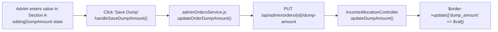

# VYAPAR ADNET — DUMP PAYMENT & BALANCE WRITE-OFF SYSTEM: COMPLETE ARCHITECTURE AUDIT REPORT

**Author**: Antigravity (Google DeepMind - Advanced Agentic Coding)  
**Date**: November 3, 2026  
**Project**: Vyapar AdNET (`addnet/`)  
**Git Branch**: `Tamish1`  
**Databases Audited**: `chhotabiz` (Production) & `chhotabiz_test` (Test)  
**Phase**: Strict Read-Only Architecture & Financial Audit  

---

## 1. Executive Summary

This audit performs an exhaustive technical, architectural, and financial investigation into how uncollectible customer balances ("Dump Amounts" / "Dump Payments") are currently represented, calculated, and stored across Vyapar AdNET.

### Key Audit Findings:
1. **Divergent Dual-Architecture Exists**:
   - **Legacy Manual Input in Section A**: In [`admin/src/components/sales/AdminOrdersPage.jsx`](file:///c:/xampp/htdocs/addnet/admin/src/components/sales/AdminOrdersPage.jsx#L1013-L1061), a text input labeled *"Order Dump Amount"* allows an Admin to enter an arbitrary number and click *"Save Dump"*. This calls `PUT /api/admin/orders/{id}/dump-amount`, which executes `$order->update(['dump_amount' => $val])`. It does **not** validate against remaining collectible balance, does **not** update `orders.balance_due`, does **not** calculate Dump Admin Cut, does **not** partition 40/40/20 income, creates **zero audit trail**, and explicitly warns in the UI that it is *"Excluded from commission & income distribution math"*.
   - **Structured Workflow Architecture**: A dedicated table [`order_payment_dumps`](file:///c:/xampp/htdocs/addnet/backend/database/migrations/2026_11_03_000002_create_order_payment_dumps_table.php) and controller [`DumpPaymentController.php`](file:///c:/xampp/htdocs/addnet/backend/app/Http/Controllers/DumpPaymentController.php) exist for Entity reporting and Admin approval with full 40/40/20 calculation and balance reconciliation. However, this workflow is currently isolated in a separate page (`AdminDumpRequestsPage.jsx`), completely disconnected from **Admin Order Management → Section B: Payment Receipts Ledger**.
2. **Payment Receipts Ledger (Section B) is Disconnected from Dumps**:
   - In [`AdminOrdersPage.jsx`](file:///c:/xampp/htdocs/addnet/admin/src/components/sales/AdminOrdersPage.jsx#L1064-L1150), Section B only renders rows from `sale_payments` (actual cash received). Neither approved dump write-offs nor pending dump requests appear in Section B.
3. **Database Contamination in Production (`chhotabiz`)**:
   - Order `#376` (`INV-2026-49718`) has `gross_amount = 3500.00` and `advance_payment = 3500.00` (100% paid), yet has `dump_amount = 2000.00` due to unvalidated manual entry in the legacy Section A input. Total accounted funds on that order are ₹5,500 on a ₹3,500 project.
   - Order `#554` (`INV-2026-76545`) has `gross_amount = 3500.00`, `advance_payment = 1750.00`, and `dump_amount = 1750.00` with an approved dump record in `order_payment_dumps` (#35), representing an authentic reconciled write-off.
4. **Architectural Recommendation**:
   - **Table Design**: Option B (**Separate `order_payment_dumps` Table**) is unequivocally superior to storing dumps in `sale_payments`. Storing non-cash dump entries in `sale_payments` would contaminate cash flow accounting, require adding filters to every receipt query, risk generating false UTR/payment receipts, and break bank settlement integrity.
   - **UI Design**: The legacy manual "Order Dump Amount" input in Section A must be removed. Approved dump entries and pending dump requests must be unified into **Section B: Payment Receipts Ledger**, displayed alongside actual cash payments with distinct badge badges (`Cash Receipt` vs `Approved Dump Write-Off` vs `Pending Dump Request`).

---

## 2. Current Order-Level Dump Implementation (Section A)

### 2.1 Code Trace & Flow



1. **Frontend State**:
   - Located in [`admin/src/components/sales/AdminOrdersPage.jsx`](file:///c:/xampp/htdocs/addnet/admin/src/components/sales/AdminOrdersPage.jsx#L24-L25):
     ```javascript
     const [editingDumpAmount, setEditingDumpAmount] = useState('0.00');
     const [savingDumpAmount, setSavingDumpAmount] = useState(false);
     ```
   - When modal opens via `openOrderDetails(order)` (line 75), it initializes `editingDumpAmount` with `order.dump_amount ?? order.dumpAmount ?? 0`.
2. **API Endpoint & Service**:
   - In [`admin/src/api/adminOrdersService.js`](file:///c:/xampp/htdocs/addnet/admin/src/api/adminOrdersService.js#L110-L123):
     ```javascript
     export const updateOrderDumpAmount = async (orderId, dumpAmount) => {
       const response = await api.put(`/admin/orders/${orderId}/dump-amount`, { dump_amount: dumpAmount });
       return response.data;
     };
     ```
3. **Controller Handling**:
   - In [`backend/app/Http/Controllers/Admin/IncomeAllocationController.php`](file:///c:/xampp/htdocs/addnet/backend/app/Http/Controllers/Admin/IncomeAllocationController.php#L142-L187):
     ```php
     public function updateDumpAmount(Request $request, $orderId) {
         $order = Order::where('id', $orderId)->orWhere('invoice_number', $orderId)->first();
         $validator = Validator::make($request->all(), [
             'dump_amount' => 'required|numeric|min:0',
         ]);
         $dumpAmount = round((float) $request->input('dump_amount'), 2);
         $order->update(['dump_amount' => $dumpAmount]);
         return response()->json(['status' => 'success', ...]);
     }
     ```
4. **Deficiencies & Hazards of Section A Dump**:
   - **No Balance Due Adjustment**: Does **not** recalculate or update `orders.balance_due`.
   - **No Ceiling Validation**: Accepts any positive number `>= 0`. An admin can enter ₹1,00,00,000 on a ₹1,000 order without error.
   - **No Commission Cut Calculation**: Does **not** compute Dump Admin Cut or 40/40/20 splits.
   - **No Audit Trail**: Does **not** log who modified the amount, when it was modified, or why.
   - **No Connection to Entity Requests**: Completely ignores any pending requests from the Entity.

---

## 3. Current Payment Receipts Ledger Implementation (Section B)

### 3.1 Structure & Origins
Located in [`admin/src/components/sales/AdminOrdersPage.jsx`](file:///c:/xampp/htdocs/addnet/admin/src/components/sales/AdminOrdersPage.jsx#L1064-L1150):

| Column Header | Source Field in `sale_payments` | Calculation / Origin |
|---|---|---|
| **Receipt #** | `p.id`, `p.reference_no` | Primary key and UTR reference number |
| **Type** | `p.payment_type` | `advance` | `balance` | `full` |
| **Date** | `p.payment_date` or `p.created_at` | Timestamp of payment receipt |
| **Received** | `p.amount` | Actual cash collected from customer |
| **Admin Cut** | `p.admin_commission_cut` | `round(p.amount * p.admin_commission_percent / 100, 2)` |
| **Direct (40%)** | `p.direct_income_amount` | 40% of `p.admin_commission_cut` |
| **Level (40%)** | `p.level_income_amount` | 40% of `p.admin_commission_cut` |
| **Reward (20%)** | `p.reward_income_amount` | 20% of `p.admin_commission_cut` |
| **Status** | `p.income_distribution_status` | `pending` | `completed` | `legacy_completed` |
| **Action** | Distribute button | Triggers incremental payment allocation modal |

### 3.2 Key Ledger Characteristics
- **Strictly Cash-Only**: Iterates exclusively over `selectedOrderForDetails.payments`, which are populated via `Order::with('payments')` from the `sale_payments` table.
- **Zero Dump Visibility**: If an order has an approved dump or pending dump request, Section B does not display it anywhere.
- **Allocation Mechanism**: When an Admin clicks "Distribute", [`AdminIncomeAllocationService::allocatePaymentIncome`](file:///c:/xampp/htdocs/addnet/backend/app/Services/AdminIncomeAllocationService.php#L127-L215) calculates the 40/40/20 split and updates the `sale_payments` row to `completed`. It then adds to `orders.distributed_admin_cut_amount`, `orders.direct_income_amount`, `orders.level_income_amount`, and `orders.reward_income_amount`.

---

## 4. Current Entity Payment Collection Flow

Located in [`backend/app/Http/Controllers/OrderController.php`](file:///c:/xampp/htdocs/addnet/backend/app/Http/Controllers/OrderController.php#L588-L660) (`receiveBalance`):
1. **Trigger**: Entity collects an installment via [`EntityReceiveBalancePage.jsx`](file:///c:/xampp/htdocs/addnet/entity/src/pages/EntityReceiveBalancePage.jsx).
2. **Guard**: Verifies `orders.approval_status === 'confirmed'`. Rejects unconfirmed orders.
3. **Database Insertion**:
   - Creates a new `sale_payments` row with:
     - `payment_type = 'balance'`
     - `amount = $receivedAmount`
     - `admin_commission_cut = round($receivedAmount * $adminRate / 100, 2)`
     - `reference_no = $utrNumber`
     - `income_distribution_status = 'pending'`
4. **Order Balance Reconciliation**:
   - Line 633-635:
     ```php
     $newAdvance = round($order->advance_payment + $amount, 2);
     $approvedDump = (float) ($order->dump_amount ?? 0);
     $newBalance = max(0.0, round($order->gross_amount - $newAdvance - $approvedDump, 2));
     $order->update([
         'advance_payment' => $newAdvance,
         'balance_due' => $newBalance,
         'status' => $newBalance <= 0 ? 'completed' : 'partial',
     ]);
     ```
   - **Finding**: Line 635 correctly subtracts `$approvedDump` when recalculating `$newBalance`, but this only runs when a **new cash payment** is collected, not when a dump is saved in Section A!

---

## 5. Current Admin Payment Distribution Flow

Located in [`backend/app/Services/AdminIncomeAllocationService.php`](file:///c:/xampp/htdocs/addnet/backend/app/Services/AdminIncomeAllocationService.php):
1. **Trigger**: Admin clicks "Distribute" in Section B, opening the allocation preview modal.
2. **Transaction & Row Locking**:
   - Uses `DB::transaction()` with `SalePayment::lockForUpdate()` and `Order::lockForUpdate()`.
3. **Mathematical Split**:
   - `calculateSplit($adminCut)` uses integer paise arithmetic:
     $$\text{direct} = \text{round}(adminCut \times 0.40, 2)$$
     $$\text{level} = \text{round}(adminCut \times 0.40, 2)$$
     $$\text{reward} = \text{round}(adminCut \times 0.20, 2)$$
4. **Persistence**:
   - Updates `sale_payments` (`income_distribution_status = 'completed'`, timestamps, admin ID).
   - Increments parent `orders` cumulative allocated totals (`direct_income_amount`, `level_income_amount`, `reward_income_amount`, `distributed_admin_cut_amount`).
   - Syncs order aggregate status via `syncOrderIncomeDistributionStatus()`.
5. **Wallet Isolation**:
   - Confirmed by [`IncomeAllocationTest::test_allocation_does_not_modify_user_wallets_or_mlm_balances`](file:///c:/xampp/htdocs/addnet/backend/tests/Feature/IncomeAllocationTest.php#L362): Income distribution does **not** modify user wallets or MLM balances until genealogy rules are formally specified and approved.

---

## 6. Full Database Schema Audit

### 6.1 Table: `orders`
Current live schema in `chhotabiz`:

| Column | Type | Default | Current Meaning & Usage in Code |
|---|---|---|---|
| `id` | `BIGINT UNSIGNED` | Auto Inc | Primary order ID |
| `invoice_number` | `VARCHAR(100)` | NULL | Unique invoice identifier (e.g. `INV-2026-98395`) |
| `gross_amount` | `DECIMAL(14,2)` | `0.00` | Total contractual project value |
| `admin_commission_percent`| `DECIMAL(5,2)` | `15.00` | Admin commission rate (confirmed by Admin) |
| `admin_commission_cut` | `DECIMAL(14,2)` | `0.00` | Expected total Admin Commission for entire project |
| `advance_payment` | `DECIMAL(14,2)` | `0.00` | **Total actual cash collected to date** (sum of cash receipts) |
| `balance_due` | `DECIMAL(14,2)` | `0.00` | Remaining collectible balance |
| `dump_amount` | `DECIMAL(14,2)` | `0.00` | **Approved uncollectible balance written off** |
| `status` | `VARCHAR(50)` | `partial` | Project delivery status (`partial` | `completed`) |
| `approval_status` | `ENUM(...)` | `pending` | Order approval status (`pending` | `confirmed` | `cancelled`) |
| `distributed_admin_cut_amount`| `DECIMAL(14,2)` | `0.00` | Cumulative Admin Cut allocated from cash payments |
| `direct_income_amount` | `DECIMAL(14,2)` | `0.00` | Cumulative Direct Income allocated from cash payments |
| `level_income_amount` | `DECIMAL(14,2)` | `0.00` | Cumulative Level Income allocated from cash payments |
| `reward_income_amount` | `DECIMAL(14,2)` | `0.00` | Cumulative Reward Income allocated from cash payments |
| `income_distribution_status`| `VARCHAR(24)` | `pending` | Order-level allocation status (`pending` | `partial` | `completed`) |

### 6.2 Table: `sale_payments`
Current live schema in `chhotabiz`:

| Column | Type | Key | Role & Restrictions |
|---|---|---|---|
| `id` | `BIGINT UNSIGNED` | PRI | Payment receipt ID |
| `sales_record_id` | `BIGINT UNSIGNED` | MUL | Foreign key referencing `orders.id` |
| `invoice_number` | `VARCHAR(255)` | - | Order invoice reference |
| `amount` | `DECIMAL(12,2)` | - | **Cash amount actually received from client** |
| `admin_commission_percent`| `DECIMAL(6,2)` | - | Inherited Admin commission percentage |
| `admin_commission_cut` | `DECIMAL(12,2)` | - | Admin Cut on this specific receipt |
| `net_entity_amount` | `DECIMAL(12,2)` | - | Amount retained by Entity |
| `payment_type` | `VARCHAR(255)` | - | `advance` | `balance` | `full` (100% cash receipts) |
| `payment_method` | `VARCHAR(255)` | - | UPI, Net Banking, Card, Cash |
| `reference_no` | `VARCHAR(255)` | - | Banking transaction ID / UTR |
| `income_distribution_status`| `VARCHAR(24)` | - | `pending` | `completed` | `legacy_completed` |
| `direct_income_amount` | `DECIMAL(14,2)` | - | 40% of receipt's Admin Cut |
| `level_income_amount` | `DECIMAL(14,2)` | - | 40% of receipt's Admin Cut |
| `reward_income_amount` | `DECIMAL(14,2)` | - | 20% of receipt's Admin Cut |

### 6.3 Table: `order_payment_dumps`
Current live schema in `chhotabiz`:

| Column | Type | Role |
|---|---|---|
| `id` | `BIGINT UNSIGNED` | Primary key of dump request |
| `order_id` | `BIGINT UNSIGNED` | Foreign key referencing `orders.id` |
| `dump_amount` | `DECIMAL(14,2)` | Uncollectible balance amount |
| `admin_commission_percent`| `DECIMAL(5,2)` | Parent order's approved commission rate |
| `admin_commission_cut` | `DECIMAL(14,2)` | Dump Admin Cut |
| `direct_income_amount` | `DECIMAL(14,2)` | Direct Dump (40%) |
| `level_income_amount` | `DECIMAL(14,2)` | Level Dump (40%) |
| `reward_income_amount` | `DECIMAL(14,2)` | Reward Dump (20%) |
| `dump_reason` | `TEXT` | Mandatory reason provided by Entity |
| `admin_rejection_reason` | `TEXT` (NULL) | Mandatory reason if Admin rejects |
| `status` | `ENUM` | `pending` | `approved` | `rejected` |
| `approved_by` / `approved_at`| `BIGINT` / `TIMESTAMP` | Admin audit trail upon approval |
| `rejected_by` / `rejected_at`| `BIGINT` / `TIMESTAMP` | Admin audit trail upon rejection |

---

## 7. Existing Dump Income Summary Fields

Database check of income tables in `chhotabiz`:
- `direct_incomes`: has column `dump_amount` (`decimal(15,2)`, default `0.00`). Total rows: **0**.
- `direct_income_accounts`: has column `dump_amount` (`decimal(14,2)`, default `0.00`). Total rows: **0**.
- `level_incomes`: has column `dump_amount` (`decimal(15,2)`, default `0.00`). Total rows: **0**.
- `level_income_accounts`: has column `dump_amount` (`decimal(14,2)`, default `0.00`). Total rows: **0**.

### Code Audit: [`UserIncomeController.php`](file:///c:/xampp/htdocs/addnet/backend/app/Http/Controllers/UserIncomeController.php):
- In `getDirectIncome` (line 60):
  `$balanceAmount = max(0.0, round($totalAmount - $paidAmount, 2));`
  `$dumpAmount = (float) ($account?->dump_amount ?? 0.0);`
- In `getLevelIncome` (line 120, 131):
  `$balanceAmount = max(0.0, round($totalAmount - $paidAmount, 2));`
  `$dumpAmount = (float) $records->sum('dump_amount');`
- **Critical Finding**: Neither `getDirectIncome` nor `getLevelIncome` subtracts `dump_amount` from `$balanceAmount`. Furthermore, no backend controller or service writes to `direct_income_accounts` or `level_income_accounts`. These tables are currently inactive read models.

---

## 8. Existing Reward Dump Support

Audit of `users` table and `rewards` tables in `chhotabiz`:
- `users.team_biz`: `decimal(14,2)` default `0.00`. Total users with non-zero `team_biz`: **0**.
- There is **no column** for `reward_dump_amount` or `team_biz_dump` on the `users` table.
- `rewards` and `reward_claims` track merchandise/gift rewards based on BP (Business Points), completely independent of order cash flows.
- **Finding**: Reward Dump (20%) is calculated and tracked on `order_payment_dumps.reward_income_amount`, but no individual user-level Reward Dump account or wallet field exists.

---

## 9. Existing Financial Calculation Formulas & Deficiencies

### Comparison Matrix: Required Formula vs Current Implementation

| Metric | Business Formula | Current Code Implementation | Status & Discrepancies |
|---|---|---|---|
| **Actual Cash Received** | $\sum \text{sale\_payments.amount}$ | `orders.advance_payment` & `payments->sum('amount')` | ✅ **Accurate**: Strictly cash. |
| **Actual Received Admin Cut** | $\sum \text{sale\_payments.admin\_commission\_cut}$ | `payments->sum('admin_commission_cut')` | ✅ **Accurate**: Strictly cash receipts. |
| **Expected Project Commission** | $\frac{\text{gross\_amount} \times \text{rate}}{100}$ | `orders.admin_commission_cut` | ✅ **Accurate**. |
| **Approved Dump Amount** | $\sum \text{approved dump amounts}$ | `orders.dump_amount` | ⚠️ **Divergent**: `order_payment_dumps` has approved records, but Section A allows arbitrary unvalidated overwriting of `orders.dump_amount`. |
| **Remaining Collectible Balance** | $\max(0, \text{Gross} - \text{Advance} - \text{Approved Dump})$ | `orders.balance_due` | ⚠️ **Partially Integrated**: Updated in `DumpPaymentController::approveDump` and `OrderController::receiveBalance`, but ignored in Section A manual save and in `Order::getRemainingProjectBalanceAttribute()`. |
| **Dump Admin Cut** | $\frac{\text{Approved Dump} \times \text{rate}}{100}$ | `order_payment_dumps.admin_commission_cut` | ✅ **Accurate** in `order_payment_dumps`. ❌ Missing in Section A. |
| **40/40/20 Dump Split** | Direct: 40%, Level: 40%, Reward: 20% | `order_payment_dumps` direct/level/reward | ✅ **Accurate** in `order_payment_dumps`. ❌ Missing in Section A. |
| **Remaining Expected Admin Cut** | $\max(0, \text{Expected Cut} - \text{Cash Cut} - \text{Dump Cut})$ | `max(0, Expected Cut - Cash Cut)` | ❌ **Defect**: Section A and `AdminIncomeAllocationService` compute `Expected Cut - Cash Cut` without subtracting Dump Admin Cut. |

---

## 10. Balance Reconciliation Analysis

### Concrete Example Walkthrough (from Prompt Section 3):
- **Project Value**: ₹1,00,000 | **Admin Rate**: 10% | **Expected Admin Cut**: ₹10,000.
- **Step 1: Cash Advance Received**:
  - Received: ₹40,000 | Admin Cut: ₹4,000 | Direct: ₹1,600 | Level: ₹1,600 | Reward: ₹800.
  - Remaining Balance: ₹60,000.
- **Step 2: Admin Approves Partial Dump of ₹20,000**:
  - Approved Dump: ₹20,000.
  - Dump Admin Cut (10%): ₹2,000.
  - Direct Dump (40%): ₹800 | Level Dump (40%): ₹800 | Reward Dump (20%): ₹400.
  - **Remaining Collectible Balance**: ₹$1,00,000 - 40,000 - 20,000 = \text{₹}40,000$.
  - **Remaining Expected Admin Cut**: ₹$10,000 - 4,000 - 2,000 = \text{₹}4,000$.
- **Step 3: Client Pays Final Balance of ₹40,000**:
  - Received: ₹40,000 | Admin Cut: ₹4,000 | Direct: ₹1,600 | Level: ₹1,600 | Reward: ₹800.
  - **New Advance Payment**: ₹$40,000 + 40,000 = \text{₹}80,000$.
  - **New Remaining Balance**: ₹$1,00,000 - 80,000 - 20,000 = \text{₹}0.00$.
  - **Reconciliation Invariant**:
    $$\text{Actual Cash Received (₹80,000)} + \text{Approved Dump (₹20,000)} = \text{Project Value (₹1,00,000)}$$
    $$\text{Cash Admin Cut (₹8,000)} + \text{Dump Admin Cut (₹2,000)} = \text{Total Admin Cut (₹10,000)}$$
    Zero unallocated or orphaned funds.

---

## 11. Problems & Duplicate Accounting Risks in Current Setup

1. **Risk 1: The Section A "Save Dump" Backdoor**:
   - Because `updateDumpAmount` directly mutates `orders.dump_amount` without adjusting `balance_due`, an admin can write off an amount that is never reflected in the collectible balance.
   - Example: Order #376 in `chhotabiz` currently has `gross_amount = 3500`, `advance_payment = 3500`, and `dump_amount = 2000`.
2. **Risk 2: Phantom Remaining Admin Cut in Section A**:
   - The card in Section A (`orderRemainingCut`) computes `orderExpectedCut - orderCollectedCut`. If ₹60,000 of an order is dumped, Section A continues to display that ₹6,000 Admin Cut is "due from collections", misleading accounting.
3. **Risk 3: Misleading Report in `OrderController::userBusinessReports`**:
   - Line 1092 computes:
     `$totalDumpPayment = (float) $allRecords->where('balance_due', '<=', 0)->sum('gross_amount');`
     This falsely treats every paid-in-full order as a "Dump Payment".
4. **Risk 4: Disconnection between Approval and Order Details**:
   - When an Admin approves a dump in `AdminDumpRequestsPage.jsx`, the parent order's `dump_amount` and `balance_due` are updated, but when opening Order Details in `AdminOrdersPage.jsx`, Section B shows no record of the dump. The Admin cannot see why the balance decreased.

---

## 12. Comparison: `sale_payments` Reuse (Option A) vs Separate Table (Option B)

| Evaluation Dimension | Option A: Reuse `sale_payments` Table | Option B: Separate `order_payment_dumps` Table (Unified in UI) | Verdict |
|---|---|---|:---:|
| **Financial Accuracy** | **High Risk**: Dumps mixed with cash receipts. A single query without `WHERE entry_type != 'dump'` corrupts gross collections. | **Flawless**: Cash tables contain only cash. Dumps isolated in dedicated write-off table. | **Option B** |
| **Existing Code Compatibility** | **Breaking Risk**: `SalePayment::sum('amount')` is used in dozens of queries across Admin, Entity, and User controllers. Every query would need modification. | **100% Backward Compatible**: Existing queries for advance payments, receipts, and bank settlements continue working unmodified. | **Option B** |
| **Historical Data Preservation** | **Risk**: Modifying table constraints (e.g. making `reference_no` nullable) alters core payment assumptions. | **Safe**: Historical `sale_payments` records remain untouched and clean. | **Option B** |
| **Fake Receipts & UTRs** | **High Risk**: A row in `sale_payments` without UTR or payment method looks like a corrupted receipt or triggers null-pointer bugs. | **Zero Risk**: No receipt # or UTR is created for a dump. | **Option B** |
| **Approval Lifecycle** | **Clunky**: Requires adding `dump_reason`, `rejection_reason`, `requested_at`, `approved_by` columns to `sale_payments`. | **Clean**: `order_payment_dumps` natively holds the full approval and audit lifecycle. | **Option B** |
| **UI Experience** | Unified in Section B. | **Identical**: Unified in Section B by querying both models and mapping to a single UI list. | **TIE** |

### Definitive Recommendation:
**Adopt Option B**. Maintain the separate `order_payment_dumps` table for storage and transactions, but **unify the display** inside **Admin Order Management → Order Details → Section B Payment Ledger**.

---

## 13. Recommended UI & Architecture Changes

### 13.1 Admin Panel Section A Changes
1. **Remove**: The editable "Order Dump Amount" input field and "Save Dump" button in Section A.
2. **Add**: A read-only badge/card:
   - **APPROVED DUMP WRITE-OFF**: Displaying `₹{order.dump_amount}` with subtitle: *"Approved uncollectible balance"*.
   - **REMAINING COLLECTIBLE BALANCE**: Formula:
     $$\text{orderBalance} = \max\bigl(0, \text{Gross} - \text{Advance} - \text{Approved Dump}\bigr)$$
   - **REMAINING ADMIN CUT**: Formula:
     $$\text{orderRemainingCut} = \max\bigl(0, \text{Expected Cut} - \text{Collected Cash Cut} - \text{Approved Dump Cut}\bigr)$$

### 13.2 Admin Panel Section B Changes (Unified Order Payment Ledger)
In [`AdminOrdersPage.jsx`](file:///c:/xampp/htdocs/addnet/admin/src/components/sales/AdminOrdersPage.jsx#L1064), update the Section B table to render a combined list of entries sorted by date/ID:

```jsx
// Conceptual Unified Ledger Row Structure
[
  {
    type: 'actual_payment',
    receipt_id: '#678',
    payment_type: 'Advance Payment',
    date: '2026-11-03',
    received_amount: '₹1,750.00',
    admin_cut: '₹350.00',
    direct_income: '₹140.00',
    level_income: '₹140.00',
    reward_income: '₹70.00',
    status: 'completed', // or pending
    badge: 'Cash Receipt',
    badge_color: 'blue',
  },
  {
    type: 'dump_entry',
    receipt_id: 'DUMP-#35',
    payment_type: 'Approved Dump Write-Off',
    date: '2026-11-03',
    received_amount: '₹1,750.00 (Written Off)',
    admin_cut: '₹350.00',
    direct_income: '₹140.00',
    level_income: '₹140.00',
    reward_income: '₹70.00',
    status: 'approved',
    badge: 'Approved Dump',
    badge_color: 'purple',
    reason: 'Customer refused balance payment',
  },
  {
    type: 'dump_request',
    receipt_id: 'REQ-#36',
    payment_type: 'Pending Dump Request',
    date: '2026-11-03',
    received_amount: '₹1,000.00 (Requested)',
    admin_cut: '₹200.00 (Est.)',
    direct_income: '₹80.00 (Est.)',
    level_income: '₹80.00 (Est.)',
    reward_income: '₹40.00 (Est.)',
    status: 'pending',
    badge: 'Pending Review',
    badge_color: 'amber',
    action: 'Review / Approve / Reject',
  }
]
```

### 13.3 Deprecation of Separate Sidebar Item
- In [`admin/src/components/layout/AdminSidebar.jsx`](file:///c:/xampp/htdocs/addnet/admin/src/components/layout/AdminSidebar.jsx#L112), the standalone menu item *"Dump Payment Requests"* can either be removed or retained as a global queue for pending requests across all orders, while the primary workflow operates directly inside Order Details Section B.

---

## 14. Classification of All Features

| Feature / Module | Exact Location | Status | Audit Findings |
|---|---|:---:|---|
| **Order-Level Dump Input (Section A)** | `AdminOrdersPage.jsx:1013` & `IncomeAllocationController:142` | **Implemented and Verified** | ⚠️ Flawed: Directly overwrites `orders.dump_amount` without balance check, no 40/40/20 math, no audit trail. Must be removed from Section A. |
| **Payment Receipts Ledger (Section B)** | `AdminOrdersPage.jsx:1064` | **Implemented and Verified** | ✅ Works for cash receipts. ❌ Does not show dump entries. Needs unification. |
| **Incremental Payment Allocation** | `AdminIncomeAllocationService:127` | **Implemented and Verified** | ✅ Row-locked, 40/40/20 integer paise split. Wallet-isolated. |
| **Order Payment Dumps Schema** | `order_payment_dumps` table | **Implemented and Verified** | ✅ Complete columns, foreign keys, timestamps, and indexes. |
| **Entity Dump Reporting API** | `DumpPaymentController:113` | **Implemented and Verified** | ✅ Enforces ownership, confirmed status, ceiling check, and reason. |
| **Admin Dump Approval API** | `DumpPaymentController:398` | **Implemented and Verified** | ✅ Row-locked transaction, 40/40/20 calculation, updates `orders.dump_amount` and `orders.balance_due`. |
| **Admin Dump Rejection API** | `DumpPaymentController:502` | **Implemented and Verified** | ✅ Mandatory reason, leaves order balance untouched. |
| **Order Balance Deduction on Cash Collection** | `OrderController:635` | **Implemented and Verified** | ✅ `max(0, gross - newAdvance - approvedDump)`. |
| **Order Balance Accessor (`getRemainingProjectBalanceAttribute`)** | `Order.php:368` | **Partially Implemented** | ❌ Omits `dump_amount` deduction. Needs fix. |
| **Order Remaining Admin Cut Accessor** | `Order.php:383` | **Partially Implemented** | ❌ Omits Dump Admin Cut deduction. Needs fix. |
| **User Income Summary Tables (`direct_income_accounts`, `level_income_accounts`)** | `UserIncomeController:45` | **Partially Implemented** | ⚠️ Read endpoints exist, but no backend process writes or disburses to these tables. |
| **Reward Dump User Tracking** | `users.team_biz` | **Not Implemented** | ❌ No user-level reward dump account or column exists. |
| **Genealogical Recipient Disbursement** | N/A | **Requires Business Decision** | ⚠️ Decision pending on how upline sponsors are attributed for write-offs. |

---

## 15. Historical Dump Data Preservation Plan

1. **Order #376 (`chhotabiz`)**:
   - `gross_amount`: 3500.00, `advance_payment`: 3500.00, `dump_amount`: 2000.00.
   - Analysis: Fully paid via cash receipts #520 and #521. The 2000.00 `dump_amount` is an invalid artifact of the old Section A manual input.
   - Safe Action: Leave record untouched during audit. During Phase 2, provide a data cleanup script that sets `orders.dump_amount = 0.00` where `gross_amount <= advance_payment`.
2. **Order #554 (`chhotabiz`)**:
   - `gross_amount`: 3500.00, `advance_payment`: 1750.00, `dump_amount`: 1750.00.
   - Analysis: Linked to valid approved request `order_payment_dumps` #35.
   - Safe Action: Preserve completely. This is the canonical benchmark record for unified Section B ledger display.

---

## 16. Security & Concurrency Analysis

1. **Race Conditions**:
   - `DumpPaymentController::approveDump` uses `OrderPaymentDump::lockForUpdate()` and `Order::lockForUpdate()` inside a transaction. This guarantees that two admins clicking "Approve" simultaneously cannot double-allocate or double-deduct a dump.
2. **Over-Writing Off Balance**:
   - `DumpPaymentController::reportDump` and `approveDump` calculate remaining collectible balance as:
     $$\text{Remaining} = \max\bigl(0, \text{gross\_amount} - \text{advance\_payment} - \text{existing\_approved\_dumps}\bigr)$$
   - It rejects any dump amount exceeding this remaining balance.
3. **Multi-Tenant Ownership Isolation**:
   - Verified: Entity B cannot submit a dump request against Entity A's order (`DumpPaymentController:130` returns 403 Forbidden).

---

## 17. Proposed Implementation Phases (For Future Execution)

### Phase 1: Order Model & Formula Alignment
- Update `Order::getRemainingProjectBalanceAttribute()` to subtract `dump_amount`.
- Update `Order::getRemainingAdminCommissionAttribute()` to subtract approved Dump Admin Cut.
- Correct `OrderController::userBusinessReports` line 1092 (`totalDumpPayment`).

### Phase 2: Deprecate Legacy Section A Manual Dump
- In [`admin/src/components/sales/AdminOrdersPage.jsx`](file:///c:/xampp/htdocs/addnet/admin/src/components/sales/AdminOrdersPage.jsx), remove the editable text box and "Save Dump" button from Section A.
- Replace with a clean, read-only summary badge for Approved Dump.

### Phase 3: Unified Section B Payment Ledger
- Update `AdminOrdersPage.jsx` Section B to display both cash payment receipts (`sale_payments`) and dump entries (`order_payment_dumps`) in one unified ledger table.
- Provide inline Review, Approve, and Reject actions for pending dump requests directly within Section B.

### Phase 4: Historical Data Reconciliation
- Reconcile Order #376 in `chhotabiz` to remove the orphan 2000.00 dump amount on the fully paid order.

---

## 18. Final List of Missing Business Decisions

1. **Genealogy Attribution for Dump Allocations**:
   - When an order balance is written off as Dump, does the system credit the sponsor's direct income account with a "Dump" balance, or does it merely record the platform write-off without user wallet interaction?
2. **Reward Dump Tracking**:
   - Should a dedicated `users.team_biz_dump` column or a separate `reward_dump_accounts` table be created to track uncollected volume against rank advancement?
3. **Partial Approval Capability**:
   - If an Entity requests ₹60,000 dump, can an Admin approve a lower amount (e.g. ₹40,000) directly in the approval modal, or must the Admin reject it and ask the Entity to resubmit for ₹40,000?

---

## 19. Audit Sign-Off Confirmation
- **Source Code Modified During Audit**: NONE (0 files).
- **Database Records Modified During Audit**: NONE (0 records).
- **Git Status Baseline Preserved**: Unchanged.
