# VYAPAR ADNET — ENTITY & FREELANCER AUTHENTICATION ARCHITECTURE FIX
## IMPLEMENTATION & VERIFICATION REPORT

**Project:** Vyapar AdNET  
**Workspace:** `addnet/`  
**Branch:** `Tamish1`  
**Backend:** Laravel 12  
**Database:** MySQL (`chhotabiz`)  
**Production Domain:** `https://vyaparadnet.com`  
**Reference Audit:** [`VYAPAR_ADNET_ENTITY_FREELANCER_USER_CREATION_AUDIT_REPORT.md`](file:///c:/xampp/htdocs/addnet/VYAPAR_ADNET_ENTITY_FREELANCER_USER_CREATION_AUDIT_REPORT.md)  
**Date:** November 5, 2026  
**Status:** **COMPLETED & VERIFIED (100% PASS)**

---

## 1. EXECUTIVE SUMMARY

The previous architecture of Vyapar AdNET contained an architectural coupling between business/freelancer entities and standard MLM member user accounts. When an administrator created or updated a Business Entity or Freelancer Entity in the Admin Panel, the backend explicitly executed `User::updateOrCreate()` in the creation controllers. This automatically generated an unwanted row in the `users` table, assigned an unnecessary MLM member code (`CB...`), and initialized empty MLM genealogy and wallet states.

This behavior existed because `BusinessEntity` and `FreelancerEntity` previously extended standard Eloquent `Model` rather than `Authenticatable`, lacking Laravel Sanctum token capabilities (`HasApiTokens`). Consequently, the `EntityAuthController` used the `User` model as an authentication bridge to issue API bearer tokens. Furthermore, login and password reset endpoints contained fallback `User::create()` routines.

### Implemented Solution Overview
1. **Direct Entity Authentication**: Converted both [`BusinessEntity`](file:///c:/xampp/htdocs/addnet/backend/app/Models/BusinessEntity.php) and [`FreelancerEntity`](file:///c:/xampp/htdocs/addnet/backend/app/Models/FreelancerEntity.php) to extend `Illuminate\Foundation\Auth\User as Authenticatable` and added Laravel Sanctum's `HasApiTokens` trait.
2. **Elimination of `User::updateOrCreate()`**: Completely removed `User::updateOrCreate()` from [`BusinessEntityController`](file:///c:/xampp/htdocs/addnet/backend/app/Http/Controllers/Admin/BusinessEntityController.php) and [`FreelancerEntityController`](file:///c:/xampp/htdocs/addnet/backend/app/Http/Controllers/Admin/FreelancerEntityController.php). Password hashes are now stored strictly in `business_entities.password` and `freelancer_entities.password`.
3. **Reworked Entity Authentication Flow**: Refactored [`EntityAuthController::login()`](file:///c:/xampp/htdocs/addnet/backend/app/Http/Controllers/EntityAuthController.php) to verify credentials against the entity tables and issue tokens directly from the entity instance (`$business->createToken('entity_token')` or `$freelancer->createToken('entity_token')`). Removed all fallback `User::create()` routines.
4. **Seamless Frontend Compatibility**: Preserved the exact JSON response contract (`status: 'success'`, `user`, `user.entity_details`, `token`) so **zero frontend changes** are required across `admin/`, `entity/`, and `user/`.
5. **Historical Session Backward Compatibility**: Guaranteed full backward compatibility for historical user-bridged sessions (such as User #19 with 8 active sessions). Legacy tokens continue to resolve and authorize entity operations transparently.
6. **Strict Role Isolation**: Prevented normal MLM member tokens (`user_auth_token`, `social_auth_token`) from ever scoping or spoofing entity context in business controllers ([`OrderController`](file:///c:/xampp/htdocs/addnet/backend/app/Http/Controllers/OrderController.php) and [`DumpPaymentController`](file:///c:/xampp/htdocs/addnet/backend/app/Http/Controllers/DumpPaymentController.php)).
7. **Comprehensive Automated Verification**: Implemented and passed 10 targeted automated feature tests in `EntityDirectAuthTest` (55 assertions, 100% pass) and all 9 existing tests in `EntityAuthLoginTest` (44 assertions, 100% pass).

---

## 2. PROBLEM STATEMENT & ROOT CAUSE CONFIRMATION

### Problem Statement
In the Vyapar AdNET ecosystem, three distinct user actors exist:
1. **Admin**: Platform administrators managing settings, approvals, and entities.
2. **MLM User / Member**: Direct network marketing members earning direct, level, and reward commissions.
3. **Business / Freelancer Entity**: Commercial partners providing products and services, recording customer orders, and receiving client payments.

Previously, whenever an Admin added a local business (e.g., "Skyline Technologies") or a freelancer (e.g., "Priya Sharma"):
- A record was saved in `business_entities` or `freelancer_entities`.
- **An unwanted record was also inserted into the `users` table.**
- The entity received an MLM member user code (e.g., `CB100019`).
- An empty MLM downline / genealogy node was created.
- The `users` table became polluted with non-member commercial entities.

### Root Cause Confirmation
As documented in the audit report ([`VYAPAR_ADNET_ENTITY_FREELANCER_USER_CREATION_AUDIT_REPORT.md`](file:///c:/xampp/htdocs/addnet/VYAPAR_ADNET_ENTITY_FREELANCER_USER_CREATION_AUDIT_REPORT.md)), the unwanted creation was caused by three explicit backend code locations:
1. **Creation & Update Controllers**:
   - `backend/app/Http/Controllers/Admin/BusinessEntityController.php` (lines 81–88 in `store()`, lines 187–193 in `update()`):
     ```php
     // OLD CODE
     User::updateOrCreate(
         ['email' => $request->email],
         ['name' => $request->name, 'password' => $hashedPassword]
     );
     ```
   - `backend/app/Http/Controllers/Admin/FreelancerEntityController.php` (lines 81–88 in `store()`, lines 187–193 in `update()`):
     ```php
     // OLD CODE
     User::updateOrCreate(
         ['email' => $request->email],
         ['name' => $request->name, 'password' => $hashedPassword]
     );
     ```
2. **Entity Portal Login Fallback**:
   - `backend/app/Http/Controllers/EntityAuthController.php` (lines 169–176 and lines 217–224):
     If a business entity existed without a corresponding `users` row, `login()` called `User::create()` on-the-fly to mint a User instance before calling `$user->createToken('entity_token')`.
3. **Password Reset Fallback**:
   - `backend/app/Http/Controllers/EntityAuthController.php` (lines 535–541):
     `resetPassword()` called `User::create()` if no `users` record existed matching the entity's email.

---

## 3. ARCHITECTURAL STRATEGY: DIRECT ENTITY AUTHENTICATION VS. USER MODEL BRIDGE

### Old Architecture (User Bridge Pattern)

```mermaid
flowchart TD
    subgraph Admin Creation
        A1[Admin creates Business/Freelancer] --> A2[Insert into business_entities]
        A2 --> A3[Explicit User::updateOrCreate]
        A3 --> A4[Unwanted record in users table with CB... code]
    end

    subgraph Entity Authentication
        L1[Entity Login /api/entity/login] --> L2[Find User record by email]
        L2 -->|Not Found| L3[User::create fallback]
        L2 -->|Found| L4[$user->createToken 'entity_token']
        L3 --> L4
        L4 --> L5[Token created with tokenable_type: App\Models\User]
    end

    subgraph Request Scoping
        R1[Entity Request e.g. /api/entity/orders] --> R2[Sanctum resolves $request->user as User]
        R2 --> R3[Lookup business_entities by $user->email]
    end
```


### New Architecture (Direct Sanctum Polymorphic Authentication)

```mermaid
flowchart TD
    subgraph Admin Creation
        NA1[Admin creates Business/Freelancer] --> NA2[Insert into business_entities / freelancer_entities]
        NA2 --> NA3[Save password directly on entity table]
        NA3 --> NA4[NO record in users table - Zero side effects]
    end

    subgraph Entity Authentication
        NL1[Entity Login /api/entity/login] --> NL2[Verify credentials on business/freelancer table]
        NL2 --> NL3[$business->createToken 'entity_token']
        NL3 --> NL4[Token created with tokenable_type: App\Models\BusinessEntity]
        NL4 --> NL5[Return full entity payload to frontend]
    end

    subgraph Request Scoping
        NR1[Entity Request e.g. /api/entity/orders] --> NR2[Sanctum resolves $request->user]
        NR2 -->|instanceof BusinessEntity| NR3[Scope directly: $user->id, $user->name]
        NR2 -->|instanceof FreelancerEntity| NR4[Scope directly: $user->id, $user->name]
        NR2 -->|instanceof User| NR5[Legacy Session Check: verify not user_auth_token, resolve by email]
    end
```


### Key Architectural Rationale
Laravel Sanctum's `personal_access_tokens` table is polymorphic by design:
- `tokenable_type`: Stores the fully qualified class name of the authenticating model.
- `tokenable_id`: Stores the primary key ID of that model.

Because `personal_access_tokens` already possessed `tokenable_type` (varchar 255) and `tokenable_id` (bigint unsigned), **no database migration or schema modification was necessary**. By making `BusinessEntity` and `FreelancerEntity` authenticatable, Sanctum natively creates and validates tokens with `tokenable_type: "App\Models\BusinessEntity"` and `"App\Models\FreelancerEntity"`.

---

## 4. CHANGES MADE: DETAILED FILE-BY-FILE BREAKDOWN

### 1. `backend/app/Models/BusinessEntity.php`
- **Link:** [`BusinessEntity.php`](file:///c:/xampp/htdocs/addnet/backend/app/Models/BusinessEntity.php)
- **Modifications:**
  - Imported `Illuminate\Foundation\Auth\User as Authenticatable` and `Laravel\Sanctum\HasApiTokens`.
  - Changed class declaration from `class BusinessEntity extends Model` to `class BusinessEntity extends Authenticatable`.
  - Added traits: `use HasApiTokens, HasFactory;`.
  - Explicitly declared `protected $table = 'business_entities';`.
  - Kept existing `$fillable`, relationships (`category`, `products`, `services`), and custom helper methods intact.

### 2. `backend/app/Models/FreelancerEntity.php`
- **Link:** [`FreelancerEntity.php`](file:///c:/xampp/htdocs/addnet/backend/app/Models/FreelancerEntity.php)
- **Modifications:**
  - Imported `Illuminate\Foundation\Auth\User as Authenticatable` and `Laravel\Sanctum\HasApiTokens`.
  - Changed class declaration from `class FreelancerEntity extends Model` to `class FreelancerEntity extends Authenticatable`.
  - Added traits: `use HasApiTokens, HasFactory;`.
  - Explicitly declared `protected $table = 'freelancer_entities';`.
  - Kept existing `$fillable`, relationships (`category`, `services`), and custom helper methods intact.

### 3. `backend/app/Http/Controllers/Admin/BusinessEntityController.php`
- **Link:** [`BusinessEntityController.php`](file:///c:/xampp/htdocs/addnet/backend/app/Http/Controllers/Admin/BusinessEntityController.php)
- **Modifications:**
  - Removed unused import `use App\Models\User;`.
  - In `store()` (formerly lines 81–88): Completely deleted `User::updateOrCreate(...)`. Password is saved directly in `$businessData['password'] = $hashedPassword;`.
  - In `update()` (formerly lines 187–193): Completely deleted `User::updateOrCreate(...)` when updating password. Password update is handled solely on `$business->update($updateData)`.

### 4. `backend/app/Http/Controllers/Admin/FreelancerEntityController.php`
- **Link:** [`FreelancerEntityController.php`](file:///c:/xampp/htdocs/addnet/backend/app/Http/Controllers/Admin/FreelancerEntityController.php)
- **Modifications:**
  - Removed unused import `use App\Models\User;`.
  - In `store()` (formerly lines 81–88): Completely deleted `User::updateOrCreate(...)`. Password is saved directly in `$freelancerData['password'] = $hashedPassword;`.
  - In `update()` (formerly lines 187–193): Completely deleted `User::updateOrCreate(...)` when updating password. Password update is handled solely on `$freelancer->update($updateData)`.

### 5. `backend/app/Http/Controllers/EntityAuthController.php`
- **Link:** [`EntityAuthController.php`](file:///c:/xampp/htdocs/addnet/backend/app/Http/Controllers/EntityAuthController.php)
- **Modifications:**
  - **`login()`**:
    - Verifies password against `$business->password` or `$freelancer->password`. If a historical entity's password was only set on the `User` record, it safely backfills `password` to the entity table during login.
    - Completely removed `User::create(...)` fallback block.
    - Issues direct Sanctum token: `$token = $business->createToken('entity_token')->plainTextToken;` (or `$freelancer->createToken('entity_token')->plainTextToken;`).
    - Constructs the full response payload matching frontend expectations with `user_code: 'ENT-B...'` / `'ENT-F...'` and rich `entity_details`.
  - **`me()`**:
    - Resolves principal via `$request->user()`. Supports three cases:
      1. Direct `$principal instanceof BusinessEntity`
      2. Direct `$principal instanceof FreelancerEntity`
      3. Legacy `$principal instanceof User` (backward compatibility)
    - Returns identical user and `entity_details` structure.
  - **`forgotPassword()`**:
    - Validates email against `BusinessEntity` and `FreelancerEntity` without requiring or checking the `users` table.
  - **`resetPassword()`**:
    - Updates `password` hash directly on `BusinessEntity` or `FreelancerEntity`.
    - Completely removed `User::create(...)` fallback. If a linked `User` record exists with that email (from historical data), it synchronizes the hash so legacy credentials do not get out of sync, but **never** creates new users.

### 6. `backend/app/Http/Controllers/OrderController.php`
- **Link:** [`OrderController.php`](file:///c:/xampp/htdocs/addnet/backend/app/Http/Controllers/OrderController.php)
- **Modifications:**
  - Updated `resolveEntityContext(Request $request)`:
    - **1A. Direct BusinessEntity**: `if ($user instanceof BusinessEntity)` -> returns `['id' => $user->id, 'name' => $user->name, 'type' => 'business', 'user' => $user]`.
    - **1B. Direct FreelancerEntity**: `if ($user instanceof FreelancerEntity)` -> returns `['id' => $user->id, 'name' => $user->name, 'type' => 'freelance', 'user' => $user]`.
    - **1C. Legacy User Token**: `if ($user instanceof User)` -> checks token name. If the token is `user_auth_token` or `social_auth_token` (an MLM member session), entity scoping is rejected. If it is an old `entity_token`, it resolves the linked entity by email for backward compatibility.

### 7. `backend/app/Http/Controllers/DumpPaymentController.php`
- **Link:** [`DumpPaymentController.php`](file:///c:/xampp/htdocs/addnet/backend/app/Http/Controllers/DumpPaymentController.php)
- **Modifications:**
  - Applied matching `resolveEntityContext()` logic for direct `BusinessEntity`, direct `FreelancerEntity`, and legacy `User` tokens, including MLM token rejection.

---

## 5. PERSONAL ACCESS TOKENS POLYMORPHIC ANALYSIS: BEFORE VS. AFTER

### Before Implementation
In the previous architecture, all tokens created through `/api/entity/login` were issued by the `User` model:

| Column | Value Before |
|---|---|
| `tokenable_type` | `App\Models\User` |
| `tokenable_id` | ID from `users` table (e.g. 19, 1068) |
| `name` | `entity_token` |
| Linkage | Required joining `users.email` -> `business_entities.email` |

### After Implementation
In the new architecture, tokens created through `/api/entity/login` are issued directly by the authenticating entity model:

| Column | Value After (Business) | Value After (Freelancer) |
|---|---|---|
| `tokenable_type` | `App\Models\BusinessEntity` | `App\Models\FreelancerEntity` |
| `tokenable_id` | ID from `business_entities` (e.g. 1, 2) | ID from `freelancer_entities` (e.g. 1, 2) |
| `name` | `entity_token` | `entity_token` |
| Linkage | Direct model binding via Sanctum guard | Direct model binding via Sanctum guard |

### Coexistence in Database
Both token types coexist cleanly in `personal_access_tokens` without conflicts:
- New logins: `tokenable_type: "App\Models\BusinessEntity"` / `"App\Models\FreelancerEntity"`
- Historical active sessions: `tokenable_type: "App\Models\User"` (handled seamlessly by the legacy fallback in `me()` and `resolveEntityContext()`)
- Member user logins: `tokenable_type: "App\Models\User"`, `name: "user_auth_token"`

---

## 6. BACKWARD COMPATIBILITY FOR HISTORICAL USER RECORDS

### Verification of Untouched Historical Records
Per strict project requirements, no historical data was deleted or altered during this architectural upgrade:
1. **User #19**:
   - Email: `contact@apexfinance.in`
   - User Code: `CB100019`
   - Active tokens: 8 historical sessions
   - Status: **Intact & Active** (Verified in database: ID 19 exists and functions).
2. **User #1068**:
   - Email: `adminhtht@gmail.com`
   - User Code: `CB101068`
   - Active tokens: 1 historical session
   - Status: **Intact & Active** (Verified in database: ID 1068 exists and functions).

### How Legacy Sessions Continue Working
When an existing entity user who logged in prior to this fix makes an API call with their existing Bearer token:
1. Sanctum resolves `$request->user()` as an `App\Models\User` (e.g., User #19).
2. The endpoint checks `if ($user instanceof User)`.
3. It confirms that the token is not an MLM member token (`user_auth_token` or `social_auth_token`).
4. It looks up the linked entity using `$user->email`:
   ```php
   $business = BusinessEntity::where('email', $user->email)->first();
   ```
5. It returns the entity payload (or scopes orders/dumps to `$business->id`).
6. **Result**: Legacy users experience zero disruption and do not need to log in again. When they eventually log out and log back in, they will seamlessly receive a direct `App\Models\BusinessEntity` token.

---

## 7. SECURITY ANALYSIS

### 1. Token Isolation & MLM Spoofing Protection
A critical security question is: *What happens if a normal MLM user with a valid member token calls an entity endpoint?*
- A normal MLM member has a token with name `user_auth_token` or `social_auth_token`.
- In `OrderController::resolveEntityContext()` and `DumpPaymentController::resolveEntityContext()`:
  ```php
  if ($user instanceof User) {
      $tokenName = $user->currentAccessToken()?->name;
      if (!$tokenName || !in_array($tokenName, ['user_auth_token', 'social_auth_token'])) {
          // Only legacy entity_token is permitted to scope entity data
      }
  }
  ```
- If an MLM user's token is passed, it is strictly forbidden from scoping or acting as an entity. This is verified by automated **Test I**.

### 2. Password Hashing & Entity Isolation
- Passwords for businesses and freelancers are hashed with `Hash::make()` (Bcrypt) and stored in `business_entities.password` and `freelancer_entities.password`.
- During login, the user must select their entity type and specific entity:
  - If credentials for Business A are provided while selecting Business B, login is rejected (verified by `EntityAuthLoginTest > credentials of another entity cannot authenticate selected entity`).
  - If a member password matches a user record with the same email, but the entity table has its own password, the entity password takes precedence.

---

## 8. TOKEN SCHEMA & FRONTEND RESPONSE COMPATIBILITY

### Exact Response Schema Preserved
The frontend Entity Portal (`entity/src/context/AuthContext.jsx`) expects the following exact structure upon login and profile fetch:

```json
{
  "status": "success",
  "message": "Login successful",
  "user": {
    "id": 1,
    "name": "Skyline Technologies Pvt Ltd",
    "email": "contact@skylinetech.in",
    "user_code": "ENT-B00001",
    "entity_details": {
      "entity_type": "business",
      "entity_id": 1,
      "business_name": "Skyline Technologies Pvt Ltd",
      "owner_name": "Rajesh Sharma",
      "category": "IT & Software Services",
      "registration_no": "U72200MH2020PTC123456",
      "website": "https://skylinetech.in",
      "verification_status": "verified",
      "logo_url": null,
      "documents_count": 0,
      "documents": []
    }
  },
  "token": "43|7z8X...plainTextToken..."
}
```

Because `EntityAuthController::login()` and `EntityAuthController::me()` construct this exact response format without relying on a `users` table row:
- The Entity Portal UI displays the entity name, ID, and category properly.
- All stored authentication tokens continue to work out of the box.
- **Zero changes were required in any frontend application (`admin/`, `entity/`, `user/`).**

---

## 9. AUTOMATED TEST RESULTS: DETAILED MATRIX OF ALL 10 TESTS

A comprehensive test suite was written in [`backend/tests/Feature/EntityDirectAuthTest.php`](file:///c:/xampp/htdocs/addnet/backend/tests/Feature/EntityDirectAuthTest.php) to validate every aspect of the new architecture.

### Test Execution Summary
Command: `php artisan test --filter EntityDirectAuthTest`  
Results: **10 PASSED, 0 FAILED (55 assertions, 1.19s)**

| # | Test Name | Objective & Assertions | Status |
|---|---|---|---|
| **A** | `test_a_business_entity_creation_does_not_create_user_record` | Creates a Business Entity via Admin API endpoint (`POST /api/admin/business-entities`). Asserts status 201, verifies record in `business_entities`, and asserts `User::count()` is unchanged and no `users` record exists with that email. | **PASS** (0.34s) |
| **B** | `test_b_freelancer_creation_does_not_create_user_record` | Creates a Freelancer Entity via Admin API endpoint (`POST /api/admin/freelancer-entities`). Asserts status 201, verifies record in `freelancer_entities`, and asserts `User::count()` is unchanged. | **PASS** (0.04s) |
| **C** | `test_c_entity_updates_do_not_touch_or_create_user` | Updates existing business and freelancer details and passwords via Admin API (`PUT /api/admin/business-entities/{id}` and `PUT /api/admin/freelancer-entities/{id}`). Asserts passwords update on entity tables and `User::count()` is unchanged. | **PASS** (0.05s) |
| **D** | `test_d_business_entity_login_issues_direct_token_without_user` | Logs in via `POST /api/entity/login` as a Business Entity with no `users` record in database. Asserts status 200, checks token in `personal_access_tokens` has `tokenable_type: "App\Models\BusinessEntity"` and `tokenable_id: $business->id`. Confirms `User::count()` is unchanged. | **PASS** (0.04s) |
| **E** | `test_e_freelancer_login_issues_direct_token_without_user` | Logs in via `POST /api/entity/login` as a Freelancer Entity with no `users` record. Asserts status 200, checks token has `tokenable_type: "App\Models\FreelancerEntity"` and `tokenable_id: $freelancer->id`. Confirms `User::count()` is unchanged. | **PASS** (0.04s) |
| **F** | `test_f_entity_me_supports_direct_and_legacy_tokens` | Tests `GET /api/entity/me` using both direct `BusinessEntity` token and legacy `User` token (simulating User #19). Asserts both return 200, status `success`, and matching entity payload. | **PASS** (0.06s) |
| **G** | `test_g_password_reset_updates_entity_without_user` | Resets password via `POST /api/entity/reset-password` using cached OTP. Asserts status 200, verifies new password matches on `business_entities.password`, and confirms `User::count()` is unchanged. | **PASS** (0.07s) |
| **H** | `test_h_entity_operations_work_with_direct_token` | Authenticates with direct entity token, creates a new order (`POST /api/entity/orders`), and submits a dump payment request (`POST /api/entity/orders/{id}/report-dump`). Asserts both operations succeed with status 201 and correct `entity_id`. | **PASS** (0.20s) |
| **I** | `test_i_normal_mlm_user_token_cannot_scope_entity_context` | A normal MLM user creates a token named `user_auth_token` sharing an email with a business. Calls `/api/entity/orders`. Asserts status 403 or empty entity scoping, proving MLM tokens cannot hijack entity access. | **PASS** (0.04s) |
| **J** | `test_j_financial_regression_calculations_match_baseline` | Validates that order accounting formulas (`gross_amount`, `advance_payment`, `balance_due`, `admin_commission_cut`) continue calculating accurately without regressions. | **PASS** (0.03s) |

### Complementary Test Suite: `EntityAuthLoginTest`
Command: `php artisan test --filter EntityAuthLoginTest`  
Results: **9 PASSED, 0 FAILED (44 assertions, 1.03s)**
- `✓ selectable entities endpoint loads registered entities dynamically`
- `✓ correct business credentials and selection allows login`
- `✓ correct freelancer credentials and selection allows login`
- `✓ incorrect password is rejected`
- `✓ incorrect username or email is rejected`
- `✓ credentials of another entity cannot authenticate selected entity`
- `✓ missing entity selection is handled correctly`
- `✓ authenticated entity can access protected entity profile`
- `✓ unauthenticated request to entity me is rejected`

---

## 10. DATABASE BASELINE VERIFICATION: BEFORE VS. AFTER COUNTS

A live database audit on the development database (`chhotabiz`) verified that all baseline records and historical users remain completely intact:

| Metric / Table | Baseline Value | Current Value | Verification Status |
|---|---|---|---|
| **User #19** (`contact@apexfinance.in`) | Exists (CB100019) | Exists (CB100019) | **UNTOUCHED / INTACT** |
| **User #1068** (`adminhtht@gmail.com`) | Exists (CB101068) | Exists (CB101068) | **UNTOUCHED / INTACT** |
| **Total `users`** | 24 | 24 | **ZERO UNWANTED ROWS ADDED** |
| **Total `business_entities`** | 5 | 5 | **INTACT** |
| **Total `freelancer_entities`** | 2 | 2 | **INTACT** |
| **Total `orders`** | 12 | 12 | **INTACT** |

---

## 11. FINANCIAL INTEGRITY VERIFICATION: ORDERS & DUMP PAYMENTS INTACT

All financial metrics and database aggregates match the pre-fix baseline down to the exact paisa:

| Financial Field | Baseline Aggregate | Post-Fix Aggregate | Status |
|---|---|---|---|
| **Total Gross Amount** | ₹2,45,000.00 | ₹2,45,000.00 | **MATCHES EXACTLY** |
| **Total Advance Payment** | ₹2,39,750.00 | ₹2,39,750.00 | **MATCHES EXACTLY** |
| **Total Balance Due** | ₹1,750.00 | ₹1,750.00 | **MATCHES EXACTLY** |
| **Total Admin Commission Cut** | ₹89,545.00 | ₹89,545.00 | **MATCHES EXACTLY** |

---

## 12. DEPLOYMENT CHECKLIST: WHAT HOSTINGER REQUIRES

Because all changes are strictly backend PHP code and utilize the existing database schema:

- [x] **No Database Migrations Required**: The `personal_access_tokens`, `business_entities`, and `freelancer_entities` tables already contain all necessary columns (`tokenable_type`, `tokenable_id`, `password`).
- [x] **No Frontend Rebuild Required**: No files were modified in `admin/`, `entity/`, or `user/`. The existing production builds remain fully functional.
- [x] **Backend Files to Deploy**:
  Upload the following 7 modified PHP files to `backend/app/` on Hostinger:
  1. `app/Models/BusinessEntity.php`
  2. `app/Models/FreelancerEntity.php`
  3. `app/Http/Controllers/Admin/BusinessEntityController.php`
  4. `app/Http/Controllers/Admin/FreelancerEntityController.php`
  5. `app/Http/Controllers/EntityAuthController.php`
  6. `app/Http/Controllers/OrderController.php`
  7. `app/Http/Controllers/DumpPaymentController.php`
- [x] **Clear Application Cache on Hostinger**:
  ```bash
  php artisan config:clear
  php artisan route:clear
  php artisan cache:clear
  ```

---

## 13. FUTURE ENTITY CREATION VERIFICATION PROTOCOL (MANUAL TESTING STEPS)

To manually confirm that new entity creations never generate unwanted `users` records in production:

1. **Log in to Admin Panel**:
   - Navigate to `https://vyaparadnet.com/admin/login` and log in as Administrator.
2. **Create a Test Business Entity**:
   - Go to **Business Entities** -> **Add New Business**.
   - Enter:
     - Entity Name: `Verif Test Enterprises`
     - Owner Name: `Vikram Malhotra`
     - Email: `vikram.test@example.com`
     - Phone: `9876543210`
     - Password: `Password@123`
   - Click **Save / Create**.
3. **Verify Database Records**:
   - Check `business_entities`: Record is created with `name = 'Verif Test Enterprises'` and `password` hashed.
   - Check `users`: **No record exists** with email `vikram.test@example.com`.
4. **Log in to Entity Portal**:
   - Navigate to `https://vyaparadnet.com/login` (Entity Portal Login).
   - Select Type: **Business Entity**.
   - Select Entity: **Verif Test Enterprises**.
   - Enter Password: `Password@123`.
   - Click **Sign In**.
5. **Verify Successful Portal Entry**:
   - The user is redirected to `https://vyaparadnet.com/entity/dashboard`.
   - The profile displays `Verif Test Enterprises`.
   - In `personal_access_tokens`, a new token is created with `tokenable_type = 'App\Models\BusinessEntity'`.
   - In `users`, **still no record exists**.

---

## 14. ROLLBACK PLAN

In the unlikely event that a rollback is required, the previous behavior can be restored by reverting the 7 modified files:

```bash
git checkout HEAD -- \
    backend/app/Models/BusinessEntity.php \
    backend/app/Models/FreelancerEntity.php \
    backend/app/Http/Controllers/Admin/BusinessEntityController.php \
    backend/app/Http/Controllers/Admin/FreelancerEntityController.php \
    backend/app/Http/Controllers/EntityAuthController.php \
    backend/app/Http/Controllers/OrderController.php \
    backend/app/Http/Controllers/DumpPaymentController.php
```

Then clear cache:
```bash
cd backend && php artisan cache:clear
```

---

## 15. SUMMARY OF ARCHITECTURAL BENEFITS

1. **Clean Separation of Concerns**: Commercial entities (`business_entities`, `freelancer_entities`) are strictly separated from network marketing MLM members (`users`).
2. **Zero Database Pollution**: No redundant `users` rows, member codes (`CB...`), or empty genealogy records are created when onboarding vendors.
3. **Idiomatic Laravel Architecture**: Leverages Laravel Sanctum's built-in polymorphic token architecture as intended by framework design.
4. **100% Backward Compatibility**: Zero disruption to existing sessions; historical users remain intact.
5. **Robust Security**: Clear demarcation between member tokens and entity tokens, eliminating context hijacking vulnerabilities.

---

## 16. SIGN-OFF AND STATUS

| Role | Verification Details | Status |
|---|---|---|
| **Automated Test Suite** | 10 of 10 tests passed in `EntityDirectAuthTest` (55 assertions) | **VERIFIED (PASS)** |
| **Login Test Suite** | 9 of 9 tests passed in `EntityAuthLoginTest` (44 assertions) | **VERIFIED (PASS)** |
| **Historical Preservation** | User #19 & User #1068 confirmed intact in MySQL database | **VERIFIED (PASS)** |
| **Financial Integrity** | Gross, Advance, Balance, and Admin Commission aggregates 100% match | **VERIFIED (PASS)** |
| **Frontend Isolation** | Zero modifications to frontend codebases | **VERIFIED (PASS)** |

**Implementation Status:** **FULLY COMPLETE & VERIFIED**
