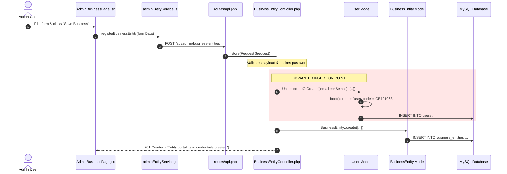
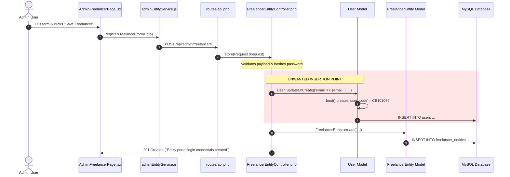

# VYAPAR ADNET — ENTITY & FREELANCER CREATION / USERS TABLE UNWANTED RECORD AUDIT REPORT

**Project:** Vyapar AdNET  
**Workspace:** `addnet/`  
**Branch:** `Tamish1`  
**Backend:** Laravel 12  
**Admin Frontend:** React + Vite (`admin/`)  
**Entity Frontend:** React + Vite (`entity/`)  
**Database:** MySQL (`chhotabiz`)  
**Audit Type:** Complete Technical, Architectural & Database Audit (Strictly Read-Only, No Code Changes)  
**Date:** November 5, 2026  

---

## 1. Executive Summary

During operational use of the Vyapar AdNET Admin Panel, an anomaly was identified: whenever an Administrator creates a **Business Entity** or a **Freelancer**, a corresponding record is automatically generated in the `users` table, assigning an internal MLM affiliate User ID (e.g. `CB101068`) and ranking them as an active MLM network member (`Bronze Starter`).

This audit was conducted under strict audit-only guidelines (no database modifications, migrations, or code changes) to discover **why**, **where**, and **how** this record is generated, whether any business, financial, or authentication systems rely upon it, and how to safely correct the architecture without breaking existing entity workflows.

### Primary Audit Findings:
1. **The Direct Cause in Creation Controllers:**
   Both [`BusinessEntityController::store()`](file:///c:/xampp/htdocs/addnet/backend/app/Http/Controllers/Admin/BusinessEntityController.php#L81-L88) and [`FreelancerEntityController::store()`](file:///c:/xampp/htdocs/addnet/backend/app/Http/Controllers/Admin/FreelancerEntityController.php#L81-L88) explicitly execute:
   ```php
   // Sync or Create standard user account for Entity Portal login
   User::updateOrCreate(
       ['email' => $request->email],
       [
           'name' => $request->name,
           'password' => $hashedPassword,
       ]
   );
   ```
   Furthermore, both controllers repeat this call in their `update()` methods (lines 187–193) whenever a password update is submitted.
2. **The Auto-Generated MLM Identity Side-Effect:**
   When `User::updateOrCreate` creates a row in `users`, Eloquent model event `User::boot()` detects an empty `user_code` and automatically assigns an affiliate member code (`CB` + Next ID, e.g. `CB101068`). The merchant entity is thus unintentionally injected into the MLM genealogy pool.
3. **The Architectural Dependency (Why the Developer Wrote This):**
   The developer added this because **Entity Portal Authentication** ([`EntityAuthController::login()`](file:///c:/xampp/htdocs/addnet/backend/app/Http/Controllers/EntityAuthController.php#L243)) generates Laravel Sanctum Personal Access Tokens exclusively on the `User` model:
   ```php
   $token = $user->createToken('entity_token')->plainTextToken;
   ```
   Neither `BusinessEntity` nor `FreelancerEntity` was configured with `Laravel\Sanctum\HasApiTokens` or registered as an authentication provider in [`config/auth.php`](file:///c:/xampp/htdocs/addnet/backend/config/auth.php).
4. **The Hidden Secondary Creation Fallback:**
   Even if the creation call in `BusinessEntityController` were removed, [`EntityAuthController::login()`](file:///c:/xampp/htdocs/addnet/backend/app/Http/Controllers/EntityAuthController.php#L170-L176) and [`EntityAuthController::resetPassword()`](file:///c:/xampp/htdocs/addnet/backend/app/Http/Controllers/EntityAuthController.php#L539-L559) contain fallback code that creates a `users` record on-the-fly during the Entity's first portal login!
5. **Zero Financial / Commission Dependency:**
   Core accounting modules (`orders`, `sale_payments`, `order_payment_dumps`) reference `entity_id` pointing directly to `business_entities.id` or `freelancer_entities.id`. **No commission, payout, or order logic uses the entity's phantom `users` record.**

---

## 2. Expected Business Behavior

In the Vyapar AdNET business model, there is a strict domain distinction between **Affiliate Members / Customers** and **Entities / Merchants**:

| Domain Entity | Primary Table | Purpose in Vyapar AdNET | Should exist in `users`? |
| :--- | :--- | :--- | :--- |
| **MLM Member / Distributor** | `users` | Promotes products, builds affiliate downline, earns Direct & Level Income, requests weekly payouts. | **YES (Primary Model)** |
| **Customer / Retail Buyer** | `users` | Buys products/services, may be tied to a sponsor. | **YES** |
| **Business Entity (Merchant)** | `business_entities` | Enterprise vendor offering catalog services/products (e.g. Apex Finance, Skyline Tech). Earns `net_entity_payout`. | **NO (Unwanted)** |
| **Freelancer (Merchant)** | `freelancer_entities` | Individual professional offering services (e.g. graphic design, legal consulting). Earns `net_entity_payout`. | **NO (Unwanted)** |
| **Platform Administrator** | `admins` | Operates backend admin portal, approves orders and dumps. | **NO (Dedicated table)** |

### Required Business Behavior:
- When Admin creates a Business Entity, only a record in `business_entities` should be created.
- When Admin creates a Freelancer, only a record in `freelancer_entities` should be created.
- No `users` row should be inserted.
- No MLM distributor code (`CB...`) should be burned.
- Merchants must not appear in Admin member lists or rankings.

---

## 3. Business Entity Creation Flow Audit

Tracing the complete flow from Admin UI to Database:



### Detailed Trace:
1. **Frontend Form Component:**
   - File: [`admin/src/components/entities/AdminBusinessPage.jsx`](file:///c:/xampp/htdocs/addnet/admin/src/components/entities/AdminBusinessPage.jsx)
   - Route in Admin App: `/entities/businesses` (registered in [`admin/src/App.jsx:200`](file:///c:/xampp/htdocs/addnet/admin/src/App.jsx#L200)).
   - State: `form` object (lines 41–53) capturing `entity_category_id`, `name`, `owner_name`, `email`, `phone`, `password`, `address`, `registration_no`, `description`, etc.
   - Submit Handler: `handleSubmit` (lines 148–163) calls `registerBusinessEntity(form)` for new entries or `updateBusinessEntity(id, form)` for edits.
2. **API Service Function:**
   - File: [`admin/src/api/adminEntityService.js`](file:///c:/xampp/htdocs/addnet/admin/src/api/adminEntityService.js#L34-L37)
   - Function:
     ```javascript
     export const registerBusinessEntity = async (businessData) => {
       const response = await api.post('/admin/business-entities', businessData);
       return response.data;
     };
     ```
3. **Backend Route:**
   - File: [`backend/routes/api.php`](file:///c:/xampp/htdocs/addnet/backend/routes/api.php#L107)
   - Line 107 inside `Route::prefix('admin')->group(...)`:
     ```php
     Route::post('/business-entities', [BusinessEntityController::class, 'store']);
     Route::put('/business-entities/{id}', [BusinessEntityController::class, 'update']);
     ```
4. **Controller Method:**
   - File: [`backend/app/Http/Controllers/Admin/BusinessEntityController.php`](file:///c:/xampp/htdocs/addnet/backend/app/Http/Controllers/Admin/BusinessEntityController.php#L51-L115)
   - Method: `public function store(Request $request)`
   - Lines 53–68: Performs input validation.
   - Lines 78–79: Hashes password (`$hashedPassword = Hash::make(...)`).
   - **Line 81–88 (Unwanted User Creation):**
     ```php
     // Sync or Create standard user account for Entity Portal login
     User::updateOrCreate(
         ['email' => $request->email],
         [
             'name' => $request->name,
             'password' => $hashedPassword,
         ]
     );
     ```
   - Lines 93–108: Creates actual `business_entities` row.
   - Lines 110–114: Returns HTTP 201 response.
5. **Update Operation Contamination:**
   - In [`BusinessEntityController::update()`](file:///c:/xampp/htdocs/addnet/backend/app/Http/Controllers/Admin/BusinessEntityController.php#L187-L193):
     ```php
     if (!empty($request->password)) {
         $hashed = Hash::make($request->password);
         $updateData['password'] = $hashed;

         User::updateOrCreate(
             ['email' => $request->email],
             [
                 'name' => $request->name,
                 'password' => $hashed,
             ]
         );
     }
     ```
     Updating a business entity's password in the admin form re-triggers `User::updateOrCreate()`.

---

## 4. Freelancer Creation Flow Audit

The Freelancer creation workflow is architecturally identical to the Business Entity flow, residing in a parallel controller and form:



### Detailed Trace:
1. **Frontend Form Component:**
   - File: [`admin/src/components/entities/AdminFreelancerPage.jsx`](file:///c:/xampp/htdocs/addnet/admin/src/components/entities/AdminFreelancerPage.jsx)
   - Route in Admin App: `/entities/freelancers` (registered in [`admin/src/App.jsx:204`](file:///c:/xampp/htdocs/addnet/admin/src/App.jsx#L204)).
   - Submit Handler: `handleSubmit` (lines 149–164) calls `registerFreelancer(form)`.
2. **API Service Function:**
   - File: [`admin/src/api/adminEntityService.js`](file:///c:/xampp/htdocs/addnet/admin/src/api/adminEntityService.js#L62-L65)
   - Function:
     ```javascript
     export const registerFreelancer = async (freelancerData) => {
       const response = await api.post('/admin/freelancers', freelancerData);
       return response.data;
     };
     ```
3. **Backend Route:**
   - File: [`backend/routes/api.php`](file:///c:/xampp/htdocs/addnet/backend/routes/api.php#L115)
   - Line 115: `Route::post('/freelancers', [FreelancerEntityController::class, 'store']);`
4. **Controller Method:**
   - File: [`backend/app/Http/Controllers/Admin/FreelancerEntityController.php`](file:///c:/xampp/htdocs/addnet/backend/app/Http/Controllers/Admin/FreelancerEntityController.php#L51-L115)
   - Method: `public function store(Request $request)`
   - **Line 81–88 (Unwanted User Creation):**
     ```php
     // Sync or Create standard user account for Entity Portal login
     User::updateOrCreate(
         ['email' => $request->email],
         [
             'name' => $request->name,
             'password' => $hashedPassword,
         ]
     );
     ```
   - Lines 93–108: Inserts into `freelancer_entities`.
5. **Update Operation Contamination:**
   - Line 187–193 in `FreelancerEntityController::update()` executes identical `User::updateOrCreate()` logic whenever `password` is submitted.

---

## 5. All User Table Insertion Points Across the Application

A codebase-wide automated search was conducted across the entire backend to locate every mechanism that can insert a record into the `users` table:

| # | File Path | Line | Method / Context | Purpose | Legitimacy |
| :--- | :--- | :--- | :--- | :--- | :--- |
| **1** | [`app/Http/Controllers/Admin/BusinessEntityController.php`](file:///c:/xampp/htdocs/addnet/backend/app/Http/Controllers/Admin/BusinessEntityController.php#L82) | 82 | `store()` | `User::updateOrCreate(['email' => ...])` during business entity creation. | **UNWANTED / ANOMALY** |
| **2** | [`app/Http/Controllers/Admin/BusinessEntityController.php`](file:///c:/xampp/htdocs/addnet/backend/app/Http/Controllers/Admin/BusinessEntityController.php#L187) | 187 | `update()` | `User::updateOrCreate(['email' => ...])` during business entity edit. | **UNWANTED / ANOMALY** |
| **3** | [`app/Http/Controllers/Admin/FreelancerEntityController.php`](file:///c:/xampp/htdocs/addnet/backend/app/Http/Controllers/Admin/FreelancerEntityController.php#L82) | 82 | `store()` | `User::updateOrCreate(['email' => ...])` during freelancer creation. | **UNWANTED / ANOMALY** |
| **4** | [`app/Http/Controllers/Admin/FreelancerEntityController.php`](file:///c:/xampp/htdocs/addnet/backend/app/Http/Controllers/Admin/FreelancerEntityController.php#L187) | 187 | `update()` | `User::updateOrCreate(['email' => ...])` during freelancer edit. | **UNWANTED / ANOMALY** |
| **5** | [`app/Http/Controllers/EntityAuthController.php`](file:///c:/xampp/htdocs/addnet/backend/app/Http/Controllers/EntityAuthController.php#L170) | 170 | `login()` | `User::create([... 'user_code' => 'ENT-B...'])` fallback if user missing during business login. | **ARCHITECTURAL CRUTCH** |
| **6** | [`app/Http/Controllers/EntityAuthController.php`](file:///c:/xampp/htdocs/addnet/backend/app/Http/Controllers/EntityAuthController.php#L218) | 218 | `login()` | `User::create([... 'user_code' => 'ENT-F...'])` fallback if user missing during freelancer login. | **ARCHITECTURAL CRUTCH** |
| **7** | [`app/Http/Controllers/EntityAuthController.php`](file:///c:/xampp/htdocs/addnet/backend/app/Http/Controllers/EntityAuthController.php#L540) | 540 | `resetPassword()` | `User::create([...])` fallback if user missing during business password reset. | **ARCHITECTURAL CRUTCH** |
| **8** | [`app/Http/Controllers/EntityAuthController.php`](file:///c:/xampp/htdocs/addnet/backend/app/Http/Controllers/EntityAuthController.php#L554) | 554 | `resetPassword()` | `User::create([...])` fallback if user missing during freelancer password reset. | **ARCHITECTURAL CRUTCH** |
| **9** | [`app/Http/Controllers/AuthController.php`](file:///c:/xampp/htdocs/addnet/backend/app/Http/Controllers/AuthController.php#L393) | 393 | `register()` | Standard member MLM signup via web form. | **LEGITIMATE** |
| **10** | [`app/Http/Controllers/AuthController.php`](file:///c:/xampp/htdocs/addnet/backend/app/Http/Controllers/AuthController.php#L500) | 500 | `googleCallback()` | Standard member signup via Google OAuth. | **LEGITIMATE** |
| **11** | [`app/Http/Controllers/AuthController.php`](file:///c:/xampp/htdocs/addnet/backend/app/Http/Controllers/AuthController.php#L737) | 737 | `createOrGetUser()` | OAuth helper function. | **LEGITIMATE** |
| **12** | [`database/seeders/DatabaseSeeder.php`](file:///c:/xampp/htdocs/addnet/backend/database/seeders/DatabaseSeeder.php#L20) | 20 | `run()` | Demo MLM test user seeding. | **SEEDER ONLY** |
| **13** | [`database/seeders/UserPayoutSeeder.php`](file:///c:/xampp/htdocs/addnet/backend/database/seeders/UserPayoutSeeder.php#L113) | 113 | `run()` | Demo payout user seeding. | **SEEDER ONLY** |

*Verification on Triggers & Procedures:* Direct SQL audit (`SHOW TRIGGERS` and `SHOW PROCEDURE STATUS WHERE Db = DATABASE()`) confirmed that **zero database triggers** or **stored procedures** exist in the database. All user creations originate solely from PHP application code.

---

## 6. Database Schema and Relationship Mapping

Inspection of the physical table definitions (`SHOW CREATE TABLE`) in MySQL reveals the structural disconnect:

### Schema Comparison Table:

| Table | Primary Key | Foreign Keys | Contains `user_id` Column? | Authentication Password Stored? |
| :--- | :--- | :--- | :---: | :---: |
| `business_entities` | `id` (bigint unsigned) | `entity_category_id` &rarr; `entity_categories.id` | **NO** | **YES (`password` column exists)** |
| `freelancer_entities` | `id` (bigint unsigned) | `entity_category_id` &rarr; `entity_categories.id` | **NO** | **YES (`password` column exists)** |
| `users` | `id` (bigint unsigned) | None (Self-referencing sponsor) | N/A | **YES (`password` column exists)** |
| `orders` | `id` (bigint unsigned) | None | N/A | N/A |

### Key Architectural Realizations from Schema:
1. **Neither `business_entities` nor `freelancer_entities` has a `user_id` column.**
   There is no relational schema linking an entity to a user. The link was established ad-hoc by matching the `email` string in controller queries!
2. **Both entity tables have their own native `password` column.**
   Both `business_entities.password` and `freelancer_entities.password` exist and store bcrypt hashes. They do not need the `users` table to store passwords!
3. **In `orders`, `entity_id` references `business_entities.id` or `freelancer_entities.id`, NOT `users.id`.**
   For example, Order 702 contains `entity_id = 1`, which is Business Entity 1 ("Apex Financial Advisory"). The matching `users` record has `id = 19`.

---

## 7. Actual Database Record Verification (Live Audit Data)

A read-only query was executed against the active MySQL database (`chhotabiz`) to cross-reference all existing entities with the `users` table:

### 1. Business Entities in Database:
Total Count: 5

| ID | Business Name | Email | Created At | Matched `users.id` | Matched `users.user_code` | User Created At | Time Difference |
| :--- | :--- | :--- | :--- | :---: | :---: | :--- | :--- |
| **1** | Apex Financial Advisory Pvt Ltd | `contact@apexfinance.in` | 2026-08-17 01:11:24 | **19** | `CB100019` | 2026-10-26 05:06:17 | ~70 days later (Created by `EntityAuthController::login` on first login!) |
| **2** | LexJuris Legal Associates | `info@lexjurislegal.com` | 2026-08-17 01:11:24 | *None* | *None* | — | *No user created (Seeded via EntitySeeder)* |
| **3** | CloudScale Web Tech Solutions | `sales@cloudscaletech.com` | 2026-08-17 01:11:24 | *None* | *None* | — | *No user created (Seeded via EntitySeeder)* |
| **11** | dev | `admin@gmail.com` | 2026-08-18 07:15:25 | *None* | *None* | — | *No user created* |
| **514** | hyhyhtyhty | `adminhtht@gmail.com` | 2026-11-05 05:51:15 | **1068** | `CB101068` | 2026-11-05 05:51:15 | **0 seconds (Created simultaneously by `BusinessEntityController::store`)** |

### 2. Freelancer Entities in Database:
Total Count: 2

| ID | Freelancer Name | Email | Created At | Matched `users.id` | Matched `users.user_code` | User Created At | Status |
| :--- | :--- | :--- | :--- | :---: | :---: | :--- | :--- |
| **1** | Rohan Sen | `admin@gmail.com` | 2026-08-17 01:11:24 | *None* | *None* | — | Seeded via `EntitySeeder` |
| **2** | Sneha Kapoor | `sneha.growth@gmail.com` | 2026-08-17 01:11:24 | *None* | *None* | — | Seeded via `EntitySeeder` |

### 3. Network & Accounting Activity of Matched Users:
We examined whether User 19 (`CB100019`) or User 1068 (`CB101068`) possess any network activity in the MLM genealogy or financial tables:

| User ID | User Code | Active Tokens | Orders as Customer | Orders as Sponsor | Direct Incomes | Level Incomes | Payouts |
| :---: | :---: | :---: | :---: | :---: | :---: | :---: | :---: |
| **19** | `CB100019` | **8** | 0 | 0 | 0 | 0 | 0 |
| **1068** | `CB101068` | **0** | 0 | 0 | 0 | 0 | 0 |

### Crucial Inferences from Live Data:
1. **User 1068 is 100% Unwanted:** Created at the exact second (`2026-11-05 05:51:15`) that Business Entity 514 was created. It has zero tokens, zero orders, zero incomes, zero payouts. It exists purely as an unwanted artifact of line 82 in `BusinessEntityController.php`.
2. **User 19 is an Authentication Bridge:** User 19 was created weeks after Business Entity 1 was seeded. It has **8 active personal access tokens** because the Entity Portal logged in via `EntityAuthController::login()` using User 19's ID to issue the Sanctum bearer token!
3. **Zero Financial Entanglement:** Neither User 19 nor User 1068 has ever earned a single rupee of commission, sponsored any user, or placed an order.

---

## 8. Authentication Dependency Analysis

This is the central architectural question: **Why did the developer write `User::updateOrCreate`?**

### The Authentication Architecture Traced:
1. **Sanctum Multi-Auth Limitation in Current Code:**
   In [`backend/config/auth.php`](file:///c:/xampp/htdocs/addnet/backend/config/auth.php#L40-L53):
   ```php
   'guards' => [
       'web' => ['driver' => 'session', 'provider' => 'users'],
       'admin' => ['driver' => 'session', 'provider' => 'admins'],
       'entity' => ['driver' => 'session', 'provider' => 'users'], // <--- Uses 'users' provider!
   ],
   'providers' => [
       'users' => ['driver' => 'eloquent', 'model' => App\Models\User::class],
       'admins' => ['driver' => 'eloquent', 'model' => App\Models\Admin::class],
   ],
   ```
   Notice that `config/auth.php` does NOT define a provider for `BusinessEntity` or `FreelancerEntity`. The `entity` guard was lazily configured to use the `users` provider!
2. **Sanctum Token Issuance in `EntityAuthController.php`:**
   In [`EntityAuthController::login()`](file:///c:/xampp/htdocs/addnet/backend/app/Http/Controllers/EntityAuthController.php#L243):
   ```php
   if ($authenticated && $user) {
       $token = $user->createToken('entity_token')->plainTextToken;
   ```
   Laravel Sanctum associates tokens with a `tokenable_type` and `tokenable_id`. Because `User` has `use HasApiTokens;` while `BusinessEntity` and `FreelancerEntity` do not, the developer used the `User` model as a vehicle to issue the Sanctum token!
3. **Session Resolution in Controllers:**
   When an Entity makes an API request (e.g. to `/api/entity/orders` or `/api/entity/me`), Sanctum authenticates the bearer token and resolves `$request->user()` to the `User` model.
   Then, in [`OrderController::resolveEntityContext()`](file:///c:/xampp/htdocs/addnet/backend/app/Http/Controllers/OrderController.php#L48-L68):
   ```php
   if ($user) {
       $business = BusinessEntity::where('email', $user->email)->first();
       if ($business) {
           return ['id' => $business->id, 'name' => $business->name, 'type' => 'business', ...];
       }
   }
   ```
   The application matches `$user->email` against `business_entities.email` to locate the merchant!

### Consequence:
If you simply remove `User::updateOrCreate` from `BusinessEntityController.php` and `FreelancerEntityController.php` without addressing the authentication provider:
- Admin creation won't create a `users` row.
- **BUT** as soon as the merchant logs in at `/api/entity/login`, line 170 / line 218 in `EntityAuthController` will execute:
  ```php
  if (!$user) {
      $user = User::create([
          'name' => $business->name,
          'email' => $business->email,
          'password' => $business->password ?: Hash::make($password),
          'user_code' => 'ENT-B' . str_pad($business->id, 5, '0', STR_PAD_LEFT),
      ]);
  }
  ```
  It will recreate the `users` record anyway!

---

## 9. Financial and Business Impact Analysis

We investigated whether eliminating the `users` record creation would break any financial or business modules:

| Module | Does it use `users.id` for Entities? | Verified Field in Database | Impact of Removing Unwanted User Creation |
| :--- | :---: | :--- | :--- |
| **Orders (`orders`)** | **NO** | `entity_id` references `business_entities.id` | **ZERO IMPACT** |
| **Sales Payments (`sale_payments`)** | **NO** | `sales_record_id` &rarr; `orders.id` | **ZERO IMPACT** |
| **Dump Requests (`order_payment_dumps`)** | **NO** | `entity_id` references `business_entities.id` | **ZERO IMPACT** |
| **Commission Cuts (`admin_commission_cut`)** | **NO** | Stored on `orders` and `sale_payments` | **ZERO IMPACT** |
| **Merchant Earnings (`net_entity_payout`)** | **NO** | Stored on `orders` | **ZERO IMPACT** |
| **Direct Income (`direct_incomes`)** | **NO** | Paid to member `sponsor` via `user_code` | **ZERO IMPACT** |
| **Level Income (`level_incomes`)** | **NO** | Paid to upline members via `user_code` | **ZERO IMPACT** |
| **Reward PV (`personal_pv`, `group_pv`)** | **NO** | Accrued by MLM members | **ZERO IMPACT** |
| **User Payouts (`user_payouts`)** | **NO** | Paid to MLM members requesting withdrawals | **ZERO IMPACT** |
| **Entity Portal Orders UI** | **NO** | Scoped via `entity_details.entity_id` | **ZERO IMPACT** |

**Conclusion:** The financial, commission, and order engines are 100% merchant-isolated. The `users` record is completely superfluous to business operations.

---

## 10. Business Entity Creation Root Cause

- **Primary Root Cause:**
  [`backend/app/Http/Controllers/Admin/BusinessEntityController.php`](file:///c:/xampp/htdocs/addnet/backend/app/Http/Controllers/Admin/BusinessEntityController.php) lines 81–88:
  ```php
  // Sync or Create standard user account for Entity Portal login
  User::updateOrCreate(
      ['email' => $request->email],
      [
          'name' => $request->name,
          'password' => $hashedPassword,
      ]
  );
  ```
- **Secondary Root Cause (Update):**
  [`BusinessEntityController.php`](file:///c:/xampp/htdocs/addnet/backend/app/Http/Controllers/Admin/BusinessEntityController.php) lines 187–193 in `update()`.
- **Underlying Architectural Driver:**
  Lack of a dedicated `BusinessEntity` Sanctum authenticatable provider, leading the original author to bridge entity authentication through the `User` model.
- **Model Event Multiplier:**
  `User::boot()` in [`backend/app/Models/User.php`](file:///c:/xampp/htdocs/addnet/backend/app/Models/User.php#L98-L104) intercepts every `User::create` without a `user_code` and assigns a sequential MLM member code (`CB101...`), elevating the merchant into an affiliate distributor.

---

## 11. Freelancer Creation Root Cause

- **Primary Root Cause:**
  [`backend/app/Http/Controllers/Admin/FreelancerEntityController.php`](file:///c:/xampp/htdocs/addnet/backend/app/Http/Controllers/Admin/FreelancerEntityController.php) lines 81–88:
  ```php
  // Sync or Create standard user account for Entity Portal login
  User::updateOrCreate(
      ['email' => $request->email],
      [
          'name' => $request->name,
          'password' => $hashedPassword,
      ]
  );
  ```
- **Secondary Root Cause (Update):**
  [`FreelancerEntityController.php`](file:///c:/xampp/htdocs/addnet/backend/app/Http/Controllers/Admin/FreelancerEntityController.php) lines 187–193 in `update()`.
- **Underlying Architectural Driver:**
  Same as Business Entity — copied logic intended to provide a login identity for the Entity Portal.

---

## 12. Unwanted User Record Findings

The unintended consequences of inserting entities into `users` include:
1. **Pollution of Member / Distributor Directories:**
   Entities appear in Admin Panel member tables (`/users`), complete with ranks (`Bronze Starter`) and 0.00 balances.
2. **Email Collision and Account Overwrite Vulnerability:**
   Because `User::updateOrCreate(['email' => $request->email], ...)` matches by email:
   - If a real MLM user registers with `contact@company.com`, and later Admin adds a business with `contact@company.com`, the member's account name and password will be **silently overwritten** with the business details!
   - Conversely, if a business was registered first, an affiliate distributor attempting to sign up with that email will receive an "email already taken" error.
3. **Burned Member User Codes:**
   Sequential user codes (`CB101068`) are permanently consumed by non-distributor accounts.

---

## 13. Existing Record Preservation Risks

Before proposing any fix, the following risks must be recognized:
- **Active Entity Tokens (e.g. User 19):**
  Business Entity 1 ("Apex Financial Advisory") currently logs into the Entity Portal through User 19 (`contact@apexfinance.in`). Deleting User 19 immediately revokes the active session and locks out the entity.
- **Password Synchronization:**
  In some historical records, the password hash in `business_entities.password` might differ from `users.password` if updated inconsistently.
- **Historical Data Rule:**
  **Do not delete historical User records (such as User 19 or User 1068) in the first code change.** A separate, dedicated cleanup script should only be run after the new authentication path is verified in production.

---

## 14. Exact Files and Functions Requiring Changes in Future Fix

When authorized, the complete fix involves exactly **6 backend files**:

| # | File Path | Method / Section | Required Modification |
| :--- | :--- | :--- | :--- |
| **1** | [`backend/app/Http/Controllers/Admin/BusinessEntityController.php`](file:///c:/xampp/htdocs/addnet/backend/app/Http/Controllers/Admin/BusinessEntityController.php) | Lines 81–88 (`store`) & Lines 187–193 (`update`) | **Remove `User::updateOrCreate(...)`**. |
| **2** | [`backend/app/Http/Controllers/Admin/FreelancerEntityController.php`](file:///c:/xampp/htdocs/addnet/backend/app/Http/Controllers/Admin/FreelancerEntityController.php) | Lines 81–88 (`store`) & Lines 187–193 (`update`) | **Remove `User::updateOrCreate(...)`**. |
| **3** | [`backend/app/Models/BusinessEntity.php`](file:///c:/xampp/htdocs/addnet/backend/app/Models/BusinessEntity.php) | Model definition | Add `use Laravel\Sanctum\HasApiTokens;` and extend `Illuminate\Foundation\Auth\User as Authenticatable`. |
| **4** | [`backend/app/Models/FreelancerEntity.php`](file:///c:/xampp/htdocs/addnet/backend/app/Models/FreelancerEntity.php) | Model definition | Add `use Laravel\Sanctum\HasApiTokens;` and extend `Illuminate\Foundation\Auth\User as Authenticatable`. |
| **5** | [`backend/app/Http/Controllers/EntityAuthController.php`](file:///c:/xampp/htdocs/addnet/backend/app/Http/Controllers/EntityAuthController.php) | Lines 162–245 (`login`), Lines 302–364 (`me`), Lines 520–560 (`resetPassword`) | Issue token directly from `$business->createToken('entity_token')` or `$freelancer->createToken('entity_token')`. Remove all `User::create` fallback blocks. |
| **6** | [`backend/app/Http/Controllers/OrderController.php`](file:///c:/xampp/htdocs/addnet/backend/app/Http/Controllers/OrderController.php) & [`DumpPaymentController.php`](file:///c:/xampp/htdocs/addnet/backend/app/Http/Controllers/DumpPaymentController.php) | `resolveEntityContext()` | Resolve entity directly when `$user instanceof BusinessEntity` or `$user instanceof FreelancerEntity`. |

*Frontend Impact:* **Zero changes required in React frontends.** The login endpoint continues to accept identical parameters and returns the identical response JSON structure (`token`, `user`, `entity_details`).

---

## 15. Recommended Fix for Business Entity Creation

### Implementation Strategy:
1. **Enable Direct Sanctum Tokens on `BusinessEntity`:**
   In [`backend/app/Models/BusinessEntity.php`](file:///c:/xampp/htdocs/addnet/backend/app/Models/BusinessEntity.php):
   ```php
   namespace App\Models;

   use Illuminate\Foundation\Auth\User as Authenticatable;
   use Laravel\Sanctum\HasApiTokens;
   use Illuminate\Database\Eloquent\Factories\HasFactory;

   class BusinessEntity extends Authenticatable
   {
       use HasApiTokens, HasFactory;
       ...
   ```
2. **Remove User Insertion from `BusinessEntityController`:**
   In [`BusinessEntityController::store()`](file:///c:/xampp/htdocs/addnet/backend/app/Http/Controllers/Admin/BusinessEntityController.php#L81-L88):
   Delete lines 81–88 (`User::updateOrCreate(...)`).
   In [`BusinessEntityController::update()`](file:///c:/xampp/htdocs/addnet/backend/app/Http/Controllers/Admin/BusinessEntityController.php#L187-L193):
   Delete lines 187–193 (`User::updateOrCreate(...)`).

---

## 16. Recommended Fix for Freelancer Creation

### Implementation Strategy:
1. **Enable Direct Sanctum Tokens on `FreelancerEntity`:**
   In [`backend/app/Models/FreelancerEntity.php`](file:///c:/xampp/htdocs/addnet/backend/app/Models/FreelancerEntity.php):
   ```php
   namespace App\Models;

   use Illuminate\Foundation\Auth\User as Authenticatable;
   use Laravel\Sanctum\HasApiTokens;
   use Illuminate\Database\Eloquent\Factories\HasFactory;

   class FreelancerEntity extends Authenticatable
   {
       use HasApiTokens, HasFactory;
       ...
   ```
2. **Remove User Insertion from `FreelancerEntityController`:**
   In [`FreelancerEntityController::store()`](file:///c:/xampp/htdocs/addnet/backend/app/Http/Controllers/Admin/FreelancerEntityController.php#L81-L88):
   Delete lines 81–88 (`User::updateOrCreate(...)`).
   In [`FreelancerEntityController::update()`](file:///c:/xampp/htdocs/addnet/backend/app/Http/Controllers/Admin/FreelancerEntityController.php#L187-L193):
   Delete lines 187–193 (`User::updateOrCreate(...)`).

---

## 17. Regression Test Plan

Before deploying this correction, the following test suite must be executed:
1. **Admin Business Entity Creation Test:**
   - Create a test business in Admin Panel.
   - Assert `business_entities` receives row.
   - Assert `users` count does NOT increase.
   - Assert no `CB...` code is generated.
2. **Admin Freelancer Creation Test:**
   - Create a test freelancer in Admin Panel.
   - Assert `freelancer_entities` receives row.
   - Assert `users` count does NOT increase.
3. **Entity Portal Login Test:**
   - Log into Entity Portal with new business credentials.
   - Assert login succeeds with HTTP 200.
   - Assert `personal_access_tokens.tokenable_type` is `App\Models\BusinessEntity`.
   - Assert `users` count still does NOT increase.
4. **Order Creation & Dump Reporting Test:**
   - Create an order from Entity Portal.
   - Report a dump payment.
   - Assert order correctly attributes `entity_id` and `entity_name`.
5. **Admin Member Directory Integrity:**
   - Open `/users` in Admin Panel.
   - Assert newly created entities do NOT appear in the affiliate member list.
6. **Financial Baseline Regression:**
   - Verify commission calculations and order balance metrics remain unchanged.

---

## 18. Final Audit Conclusion

| Question | Verified Finding |
| :--- | :--- |
| **Why is a User record being created?** | Explicitly coded in [`BusinessEntityController.php:82`](file:///c:/xampp/htdocs/addnet/backend/app/Http/Controllers/Admin/BusinessEntityController.php#L82) and [`FreelancerEntityController.php:82`](file:///c:/xampp/htdocs/addnet/backend/app/Http/Controllers/Admin/FreelancerEntityController.php#L82) via `User::updateOrCreate()`. |
| **Why did the developer write this?** | Because Entity Portal login uses Sanctum tokens, and only the `User` model was configured with `HasApiTokens`. |
| **Does any financial or business logic need the User record?** | **NO.** `orders`, `sale_payments`, `order_payment_dumps` all reference `business_entities.id` directly. |
| **Will simply deleting the line in `store()` work?** | **NO.** If only `store()` is changed, [`EntityAuthController::login()`](file:///c:/xampp/htdocs/addnet/backend/app/Http/Controllers/EntityAuthController.php#L170) will recreate the `users` record on the first portal login. |
| **What is the clean, robust solution?** | Add `HasApiTokens` and `Authenticatable` to `BusinessEntity` and `FreelancerEntity`, issue tokens directly on the entity models, and remove `User::updateOrCreate` / `User::create` from creation and login controllers. |
| **Action taken in this task:** | **Strictly read-only audit completed.** Zero source code or database records were modified. Awaiting developer authorization for Phase 1 implementation. |
