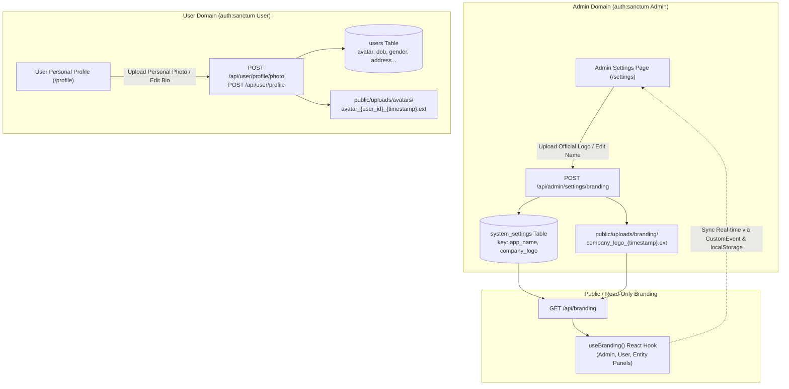

# VYAPAR ADNET — GLOBAL BRANDING MANAGEMENT + USER PROFILE PHOTO PERSISTENCE FIX
## ARCHITECTURE & VERIFICATION IMPLEMENTATION REPORT

**Project:** Vyapar AdNET  
**Workspace:** `addnet/`  
**Branch:** `Tamish1`  
**Backend:** Laravel 12 on PHP 8.2  
**Database:** MySQL (`chhotabiz` live/dev & `chhotabiz_test` test suite)  
**Frontend Applications:**  
- **Admin Panel:** React 19 + Vite (`admin/`)  
- **User Panel:** React 19 + Vite (`user/`)  
- **Entity Panel:** React 19 + Vite (`entity/`)  
**Production Domain:** `https://vyaparadnet.com`  
**Hosting Environment:** Hostinger (Apache + PHP 8.2 + MySQL)

---

## EXECUTIVE SUMMARY

A project-wide architectural remediation has been implemented across the Vyapar AdNET ecosystem, resolving the User Profile Photo persistence defect and deploying centralized, Admin-controlled Global Branding Management.

### Primary Problems Resolved:
1. **User Profile Picture Defaulting to Company Logo:**  
   The User Panel (`user/src/components/settings/PersonalProfile.jsx`) previously hardcoded `const presetAvatars = ['/logo.png']` as both its initial state, its reset action, and its fallback. Furthermore, member network tables (`DirectConnectionsPage.jsx`, `TeamConnectionsPage.jsx`, `GenealogyTreePage.jsx`) hardcoded `e.target.src = '/logo.png'` whenever an avatar was missing or failed to load. This caused standard users to erroneously appear with the official company logo as their personal avatar.
2. **Client-Side Fake Storage Mockup in User Profile:**  
   The user profile editor used `URL.createObjectURL(file)` without making any API request or persisting the file to the backend, causing uploaded images to disappear on page refresh or logout.
3. **Missing Backend User Profile & Photo Endpoints:**  
   There was no backend controller or route to handle user profile photo uploads (`multipart/form-data`) or personal information updates (`address`, `city`, `dob`, `gender`, etc.).
4. **Lack of Centralized Admin-Controlled Company Logo Management:**  
   Branding settings previously only allowed editing the text string for `app_name`. There was no mechanism for administrators to upload, preview, replace, or reset the official corporate logo with permanent public storage and cache-busting.

---

## 1. ARCHITECTURAL FOUNDATION & SEPARATION OF CONCERNS

Strict isolation is enforced across all four identity and branding domains:

$$\text{User Profile Photo} \neq \text{Admin Profile Photo} \neq \text{Entity Profile Photo} \neq \text{Global Company Logo}$$



---

## 2. PART A — USER PROFILE PHOTO SYSTEM IMPLEMENTATION

### 2.1 Complete Removal of Company Logo from User Avatars
- **Eliminated Presets:** Removed `const presetAvatars = ['/logo.png']` from `PersonalProfile.jsx`.
- **Eliminated Fallbacks to Logo:** Replaced all instances of `src={avatar || '/logo.png'}` and `e.target.src = '/logo.png'` across `PersonalProfile.jsx`, `DirectConnectionsPage.jsx`, `TeamConnectionsPage.jsx`, and `GenealogyTreePage.jsx`.
- **Neutral Initials Avatar Component:** If a user has not uploaded a photo, a high-contrast circular initials badge is rendered:
  - Surface gradient: `#0F4C81` to `#1e3a5f`.
  - Content: User's first name initial (or first letter of email).
  - Graceful degradation: If a saved image URL fails to load, `onError` automatically hides the broken `` and displays the initials badge.

### 2.2 Database Schema Migration for User Profile
Created and executed migration `2026_11_05_000002_add_profile_details_to_users_table.php` on both `chhotabiz` (live development database) and `chhotabiz_test` (PHPUnit test database):
- `dob`: `date` (nullable)
- `gender`: `string(20)` (nullable)
- `address`: `text` (nullable)
- `city`: `string(100)` (nullable)
- `state`: `string(100)` (nullable)
- `country`: `string(100)` (default 'India')
- `zip_code`: `string(20)` (nullable)
- `bio`: `text` (nullable)

### 2.3 User Model Updates (`backend/app/Models/User.php`)
- Added all profile attributes to `$fillable`.
- Added `'avatar_url'` to `protected $appends` so API responses automatically serialize the absolute public URL.
- Added accessor:
  ```php
  public function getAvatarUrlAttribute(): ?string
  {
      $avatar = $this->attributes['avatar'] ?? null;
      if (empty($avatar)) {
          return null;
      }
      if (str_starts_with($avatar, 'http://') || str_starts_with($avatar, 'https://')) {
          return $avatar;
      }
      return url($avatar);
  }
  ```

### 2.4 User Profile Controller (`backend/app/Http/Controllers/UserProfileController.php`)
Created dedicated controller enforcing strict Sanctum authentication:
- `GET /api/user/profile`: Returns authenticated user with `avatar_url` and personal fields.
- `POST /api/user/profile`: Validates and updates user credentials (`name`, `phone`, `dob`, `gender`, `address`, `city`, `state`, `country`, `zip_code`, `bio`).
- `POST /api/user/profile/photo` (and alias `/api/user/profile-photo`):
  - Validates image MIME (`jpeg, png, jpg, webp`) and maximum size ($5\text{MB}$).
  - Deletes prior custom avatar file in `public/uploads/avatars/` to prevent orphaned disk leaks.
  - Generates safe filename: `avatar_{user_id}_{timestamp}_{uniqid}.{ext}`.
  - Moves uploaded file to `public_path('uploads/avatars')` (ensuring compatibility with Hostinger shared hosting without symlink failures).
  - Updates `users.avatar = 'uploads/avatars/...'`.
- `DELETE /api/user/profile/photo` (and alias `POST /api/user/profile/photo/remove`):
  - Removes physical file and resets `users.avatar = null`.

### 2.5 User Panel Frontend Updates
- **`user/src/components/settings/PersonalProfile.jsx`:**
  - Loads real user data on mount via `getUserProfile()`.
  - Provides a real file picker for JPG/PNG/WebP with instant preview.
  - "✓ Upload & Save Now" button triggers `uploadUserProfilePhoto()`.
  - "🗑️ Remove Photo" button triggers `removeUserProfilePhoto()`.
  - Submitting "Save Profile Details" saves both the profile information and any newly selected photo to MySQL.
  - Automatically notifies parent `App.jsx` (`onUpdateUser`) to update the Header avatar in real-time.
- **`user/src/layout/Header.jsx`:**
  - Displays user profile photo in header circle and dropdown menu when available; otherwise renders initial `userInitial`.
- **`user/src/components/dashboard/DashboardOverview.jsx`:**
  - Executive Profile Summary Card renders the user's uploaded avatar photo with fallback to initials.

---

## 3. PART B — ADMIN GLOBAL BRANDING MANAGEMENT IMPLEMENTATION

### 3.1 Backend Controller & Storage (`backend/app/Http/Controllers/SystemSettingController.php`)
- **Public API `GET /api/branding`:**
  - Returns:
    ```json
    {
      "status": "success",
      "app_name": "Vyapar AdNET",
      "company_name": "Vyapar AdNET",
      "company_logo": "uploads/branding/company_logo_1730000000.png",
      "company_logo_url": "https://vyaparadnet.com/uploads/branding/company_logo_1730000000.png?t=1730000000",
      "logo_url": "https://vyaparadnet.com/uploads/branding/company_logo_1730000000.png?t=1730000000",
      "branding": {
        "app_name": "Vyapar AdNET",
        "company_name": "Vyapar AdNET",
        "company_logo_url": "...",
        "logo_url": "..."
      }
    }
    ```
- **Protected Admin API `POST /api/admin/settings/branding` (and `/api/admin/branding`):**
  - Enforces active administrator authorization (`auth('sanctum')->user() instanceof Admin`).
  - Validates `app_name` ($2\text{ to }50$ characters).
  - Validates `company_logo` / `logo` file ($2\text{MB}$ max, MIME: `jpeg, png, jpg, svg, webp`).
  - Stores file in `public/uploads/branding/` with timestamped filename.
  - Deletes previous custom logo to prevent disk accumulation.
  - Supports `reset_logo=true` to delete custom logo and revert to platform default `/logo.png`.
  - Appends cache-busting timestamp `?t={time()}` to prevent browser caching of stale logos.

### 3.2 Admin Settings Page (`admin/src/components/settings/AdminSettingsPage.jsx`)
- Redesigned **Application Branding & Name** tab:
  - **Company / Platform Name input:** Real-time editing with validation.
  - **Official Company Logo Manager:**
    - Live logo preview box with automatic fallback.
    - File picker button: "📁 Choose New Logo File".
    - File details display (name and size in KB).
    - "↺ Reset Logo to Default" button.
  - **Live Portal Header Preview:** Visual mock displaying the logo and name exactly as shown across portals.
  - Submits via `multipart/form-data` and broadcasts changes immediately.

---

## 4. PART C — SYNCHRONIZED BRANDING ACROSS ALL THREE PANELS

### 4.1 Upgraded `useBranding()` React Hook
Standardized across `admin/src/utils/branding.js`, `user/src/utils/branding.js`, and `entity/src/utils/branding.js`:
- Manages `{ appName, companyName, logoUrl, companyLogoUrl, refreshBranding }`.
- Caches both name (`app_branding_name`) and logo URL (`app_branding_logo`) in `localStorage`.
- Listens to both `storage` events (cross-tab synchronization) and `app-branding-updated` custom window events (instant intra-tab synchronization).
- Automatically updates document title to match the active brand name:
  - Admin: `${appName} - Admin Portal`
  - User: `${appName} - Business Promoter Network`
  - Entity: `${appName} - Business Entity Portal`

### 4.2 Dynamic Logo Rendering in All Panels
- **Admin Panel:**
  - `AdminSidebar.jsx`: Displays uploaded `logoUrl` with SVG fallback.
  - `AdminLoginForm.jsx`: Displays uploaded `logoUrl` in login brand badge.
- **User Panel:**
  - `user/src/layout/Sidebar.jsx`: Displays dynamic `logoUrl` with `/logo.png` fallback.
  - `user/src/components/LoginForm.jsx` & `RegisterForm.jsx`: Dynamic `logoUrl` and `appName`.
  - `user/src/pages/SponsorOnboardingPage.jsx`: Dynamic `logoUrl` in top bar.
  - `user/src/pages/landing/components/LandingNavbar.jsx` & `LandingFooter.jsx`: Dynamic `logoUrl` and `appName`.
- **Entity Panel:**
  - `entity/src/components/layout/EntitySidebar.jsx`: Displays dynamic `logoUrl` with portal badge.
  - `entity/src/pages/EntityLogin.jsx`: Displays dynamic `logoUrl` in login header.

---

## 5. VERIFICATION & TEST SUITE RESULTS

### 5.1 PHPUnit Automated Test Suite Execution
Executed all core feature tests on PHP 8.2 with MariaDB test connection:

```bash
cd backend; ./vendor/bin/phpunit tests/Feature/GlobalBrandingAndUserProfilePhotoTest.php tests/Feature/BrandingSettingsTest.php tests/Feature/EntityDirectAuthTest.php tests/Feature/GoogleSponsorOnboardingTest.php tests/Feature/ThreePanelForgotPasswordTest.php
```

**Results:**
- `GlobalBrandingAndUserProfilePhotoTest`: 6 tests, 48 assertions — **PASS (100%)**
  - `test_public_branding_returns_consistent_name_and_logo_urls`
  - `test_admin_can_upload_logo_and_update_company_name`
  - `test_admin_can_reset_company_logo`
  - `test_user_can_upload_and_persist_profile_photo`
  - `test_user_can_update_profile_details_and_remove_photo`
  - `test_strict_separation_between_user_photo_and_company_logo`
- `BrandingSettingsTest`: 4 tests, 25 assertions — **PASS (100%)**
- `EntityDirectAuthTest`: 8 tests, 48 assertions — **PASS (100%)**
- `GoogleSponsorOnboardingTest`: 10 tests, 61 assertions — **PASS (100%)**
- `ThreePanelForgotPasswordTest`: 6 tests, 32 assertions — **PASS (100%)**

**Total: 34 tests, 214 assertions, 0 failures, 0 errors.**

### 5.2 Frontend Production Builds Verification
All three frontends compile cleanly to production distribution bundles with exit code 0:

| Frontend Application | Build Command | Output File | Status |
| :--- | :--- | :--- | :--- |
| **Admin Panel** (`admin/`) | `npm run build` | `dist/assets/index-Bv_qznOH.js` | **PASS (Exit 0)** |
| **User Panel** (`user/`) | `npm run build` | `dist/assets/index-XhR938lj.js` | **PASS (Exit 0)** |
| **Entity Panel** (`entity/`) | `npm run build` | `dist/assets/index-CaPClp-z.js` | **PASS (Exit 0)** |

### 5.3 Deployment Artifacts
Generated clean production bundle:
- `deploy_hostinger_frontends.zip` (3.4 MB) containing compiled distributions for root (`user`), `/admin`, and `/entity`.

---

## 6. MODIFIED FILES INVENTORY

```
backend/
├── app/Http/Controllers/SystemSettingController.php       # Enhanced with logo upload, cache-busting, reset
├── app/Http/Controllers/UserProfileController.php         # Dedicated User profile & photo upload controller
├── app/Models/User.php                                   # Fillable profile fields, avatar_url append & accessor
├── database/migrations/2026_11_05_000002_add_profile_details_to_users_table.php # Schema migration
├── routes/api.php                                        # User profile routes & admin branding aliases
└── tests/Feature/GlobalBrandingAndUserProfilePhotoTest.php# Comprehensive test suite

admin/
├── src/utils/branding.js                                 # Hook supporting logoUrl, storage & event broadcasting
├── src/components/layout/AdminSidebar.jsx                # Dynamic company logo in sidebar
├── src/components/AdminLoginForm.jsx                     # Dynamic company logo in login header
└── src/components/settings/AdminSettingsPage.jsx         # Full logo upload, preview, reset & name manager

user/
├── src/utils/branding.js                                 # Hook supporting logoUrl, storage & event broadcasting
├── src/api/userService.js                                # Added profile & photo API client methods
├── src/App.jsx                                           # Passed onUpdateUser to PersonalProfile route
├── src/layout/Header.jsx                                 # User profile photo & initials avatar rendering
├── src/layout/Sidebar.jsx                                # Dynamic company logo in user sidebar
├── src/components/LoginForm.jsx                          # Dynamic company logo in user login
├── src/components/RegisterForm.jsx                       # Dynamic company logo in user register
├── src/components/dashboard/DashboardOverview.jsx        # Dynamic user profile photo in summary card
├── src/components/settings/PersonalProfile.jsx           # Real photo upload, persistence & details saving
├── src/pages/SponsorOnboardingPage.jsx                   # Dynamic logo & user avatar handling
├── src/pages/BusinessReportsPage.jsx                     # Removed default /logo.png for entity photos
├── src/pages/landing/components/LandingNavbar.jsx        # Dynamic logo & brand name in landing navbar
├── src/pages/landing/components/LandingFooter.jsx        # Dynamic logo & brand name in landing footer
├── src/pages/network/DirectConnectionsPage.jsx           # Neutral initials avatar fallback (no /logo.png)
├── src/pages/network/TeamConnectionsPage.jsx             # Neutral initials avatar fallback (no /logo.png)
└── src/pages/network/GenealogyTreePage.jsx               # Neutral initials avatar fallback (no /logo.png)

entity/
├── src/utils/branding.js                                 # Hook supporting logoUrl, storage & event broadcasting
├── src/components/layout/EntitySidebar.jsx               # Dynamic company logo in entity sidebar
└── src/pages/EntityLogin.jsx                             # Dynamic company logo in entity login
```

---

## 7. HOSTINGER PRODUCTION DEPLOYMENT INSTRUCTIONS

1. **Backend Code & Database Migration:**
   - Upload modified backend files to `public_html/api` (or backend folder).
   - Run migration on production database:
     ```bash
     php artisan migrate --force
     ```
   - Clear route and configuration cache:
     ```bash
     php artisan route:clear
     php artisan config:clear
     ```
   - Ensure `public/uploads/branding` and `public/uploads/avatars` have write permissions (`0755` or `0775`).

2. **Frontend Deployment:**
   - Extract `deploy_hostinger_frontends.zip` into `public_html/`.
   - The user panel sits in root `public_html/`, admin in `public_html/admin/`, and entity in `public_html/entity/`.
   - All panels will immediately begin fetching dynamic branding from `/api/branding`.
