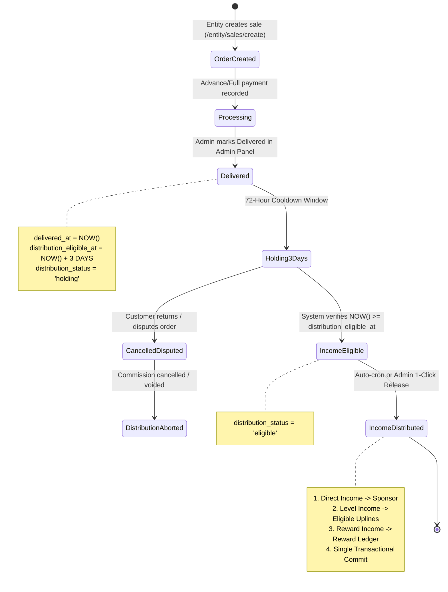

# Vyapar AdNET — Order Lifecycle, Delivery Holding Period & Three-Tier Income Architecture Audit Report

**Date of Audit**: 2026-11-02  
**Target Codebase**: `Vyapar AdNET` (Archive root: `addnet/`)  
**Workspace Path**: `c:\xampp\htdocs\addnet`  
**Git Branch**: `Tamish1` (Commit working tree clean)  
**Audit Type**: 100% Read-Only Architecture, Data Model, API, and Workflow Audit  

---

## 1. Executive Summary

A comprehensive architectural and code-level audit was conducted across all four tiers of the **Vyapar AdNET** platform:
1. **Entity Panel** (`entity/` — React 19 / Vite, port `5175`)
2. **Admin Panel** (`admin/` — React 19 / Vite, port `5173`)
3. **User / Member Panel** (`user/` — React 19 / Vite, port `5174`)
4. **Laravel Backend API & Database** (`backend/` — Laravel 12 / MySQL `chhotabiz`, port `8000`)

### Key Findings at a Glance:
- **No Fulfilment / Delivery Lifecycle**: Current records in `sales_records` track **financial payment status** (`pending`, `partial`, `completed`) rather than physical/service delivery status. There is currently no `delivery_status`, `delivered_at`, or `distribution_eligible_at` column in the database, nor any delivery action button in the Admin Panel.
- **No 3-Day Holding Mechanism**: Neither a database holding state nor background schedulers (cron/queue jobs) exist to measure a 3-day hold after delivery before income eligibility.
- **Disconnected Income Distribution Math**:
  - `EntityCommissionSetting` defines 5 upline levels (Level 1 = 0%, Level 2 = 4%, Level 3 = 3%, Level 4 = 2%, Level 5 = 1%) and 5% Reward.
  - `SalesRecordController::distributePaymentCommission()` distributes across **10 equal levels** (2% each) using percentages (40% direct, 20% team, 20% BP) calculated on the **Admin Facilitation Fee**, not on the Order GMV.
  - `creditSalePvToNetwork()` immediately credits Point Volume (PV) across **20 upline levels** upon sale creation, bypassing any delivery or holding period.
- **Reward Income vs. Reward Catalog Conflation**: The current system implements a physical gift catalog (`rewards`, `reward_claims`) claimable with Business Points (BP). It has **no monetary "Reward Income" ledger or distribution mechanism**.
- **No Recipient-Level Income Ledger**: Distributed commissions increment `users.commission_balance` directly and save a JSON blob on `sale_payments`. No normalized per-order/per-recipient income ledger rows are created, forcing the User Panel to fabricate synthetic referral logs on the fly.
- **Orphaned Tables & Components**: Discovered orphaned database tables (`direct_incomes`, `level_incomes`) not registered in Laravel migrations, an orphaned demo page (`AdminReceivePaymentPage.jsx`), and a non-functional wrapper (`AdminCreateSalePage.jsx`).

---

## 2. Current Project Root and Branch

- **Operating System**: Windows (Host local XAMPP environment)
- **Repository Root**: `c:\xampp\htdocs\addnet`
- **Active Git Branch**: `Tamish1` (Merge base aligned with `origin/main`)
- **Git Status**: Working tree clean. Zero unstaged or uncommitted code changes.
- **Database Engine**: MySQL 10.4.32-MariaDB (`chhotabiz`)

---

## 3. Entity Order Creation Flow

### 3.1 Trace: UI Form to Database Persistence
The Entity sales/order creation flow operates as follows:

```
[EntityCreateSale.jsx]
       │
       ▼ (HTTP POST /sales payload)
[entityService.js -> api.post('/sales')]
       │
       ▼ (routes/api.php: Route::post('/sales', [SalesRecordController::class, 'store']))
[SalesRecordController::store()]
       ├── 1. Validates item description and customer_user_code (must exist in `users` table)
       ├── 2. Resolves selling entity from session/token
       ├── 3. Prevents duplicate submission (30s window on identical payload)
       ├── 4. Resolves commission percentages from `EntityCommissionSetting`
       ├── 5. Generates unique Invoice Number (`INV-YYYY-XXXXX`)
       ├── 6. Inserts row into `sales_records`
       ├── 7. Inserts initial payment installment row into `sale_payments`
       └── 8. Calls `creditSalePvToNetwork()` (immediately credits Personal PV and 20-level Group PV)
```

### 3.2 Detailed Flow Attributes
- **Frontend Route & Page**: `/entity/sales/create` mapped in [`entity/src/App.jsx`](file:///c:/xampp/htdocs/addnet/entity/src/App.jsx#L54-L60) to [`entity/src/pages/EntityCreateSale.jsx`](file:///c:/xampp/htdocs/addnet/entity/src/pages/EntityCreateSale.jsx).
- **Submission Handler**: `handleSubmitSale()` ([`EntityCreateSale.jsx#L170-L250`](file:///c:/xampp/htdocs/addnet/entity/src/pages/EntityCreateSale.jsx#L170-L250)).
- **API Caller**: `createEntitySale(saleRecord)` in [`entity/src/api/entityService.js#L110-L113`](file:///c:/xampp/htdocs/addnet/entity/src/api/entityService.js#L110-L113) sending `POST /sales`.
- **Target Backend Controller**: `SalesRecordController::store()` in [`backend/app/Http/Controllers/SalesRecordController.php#L215-L444`](file:///c:/xampp/htdocs/addnet/backend/app/Http/Controllers/SalesRecordController.php#L215-L444).
- **Target Tables**:
  1. `sales_records`: Receives master order, item details, gross amount, advance, balance due, admin fee cut, and seller entity details.
  2. `sale_payments`: Receives the initial payment receipt record if `advance_payment > 0`.
- **Customer Verification**: Automatically queries `/verify-member?member_id={user_code}` and verifies against `users` table before allowing submission.
- **Current Status Values Assigned**:
  - `status`: Assigned `'completed'` if `balance_due <= 0`; otherwise `'partial'`.
  - `network_distribution_status`: Set to `'pending_admin_distribution'`.
  - `commission_distributed`: Set to boolean `false`.
- **Page Refresh Persistence**: Verified working. Records persist to MySQL and load in [`EntitySales.jsx`](file:///c:/xampp/htdocs/addnet/entity/src/pages/EntitySales.jsx) via `GET /sales?entity={entityName}`.

### 3.3 Gaps Relative to Intended Target Workflow
- **Item G-01 (Premature PV Crediting)**: Point Volume (PV) is immediately credited to buyer's personal PV and upline group PV at order creation ([`SalesRecordController.php#L425`](file:///c:/xampp/htdocs/addnet/backend/app/Http/Controllers/SalesRecordController.php#L425)), rather than waiting for delivery + 3-day hold.
- **Item G-02 (No Order vs. Payment Separation)**: The entity form conflates recording a sale with generating an invoice and recording immediate payment.

---

## 4. Admin Sales Records / Orders Page Mapping

### 4.1 Navigation Mapping in Admin Panel
- **Sidebar Definition**: [`admin/src/components/layout/AdminSidebar.jsx#L215-L248`](file:///c:/xampp/htdocs/addnet/admin/src/components/layout/AdminSidebar.jsx#L215-L248).
  - Menu Group: `SALES & PAYMENTS`
  - Group Header: `Sales & Orders`
  - Submenu Item: `Sales Records` (Sets `activeTab = 'sales-reports'`).
- **Application Route Map**: [`admin/src/App.jsx#L166-L178`](file:///c:/xampp/htdocs/addnet/admin/src/App.jsx#L166-L178).
  - `sales-create` -> Renders `<AdminCreateSalePage />`.
  - `sales-reports` -> Renders `<AdminSalesReportsPage />`.
  - `payments-reports` / `payments-distribution` -> Renders `<AdminPaymentReportsPage />`.
  - `payments-history` / `payments-receive` -> Renders `<AdminPaymentHistoryPage />`.

### 4.2 Component Analysis: `AdminCreateSalePage.jsx` vs `AdminSalesReportsPage.jsx`
- [`admin/src/components/sales/AdminCreateSalePage.jsx`](file:///c:/xampp/htdocs/addnet/admin/src/components/sales/AdminCreateSalePage.jsx):
  - **Reality**: It does **not** create sales. It displays an informational blue alert banner stating *"Sales Creation Decentralized to Entity Partners"* and embeds `<AdminSalesReportsPage />` underneath.
- [`admin/src/components/sales/AdminSalesReportsPage.jsx`](file:///c:/xampp/htdocs/addnet/admin/src/components/sales/AdminSalesReportsPage.jsx):
  - **Reality**: This is the centralized master listing. It calls `getAdminSales()` (`GET /admin/sales`), renders KPI summary cards (Total Project Value, Funds Collected, Pending Balances, Admin Cut), and renders the master sales table.
  - **Columns Present**: Invoice #, Seller Entity, Customer / Buyer, Offering Item, Project Value, Collected, Balance Due, Admin Cut, Status, Action (`👁️ View Invoice`).
  - **Actions Present**: ONLY `👁️ View Invoice` (opens invoice view modal).
  - **Missing**: There are NO buttons, dropdowns, or modals to change order status, mark an order as shipped, or confirm delivery.

---

## 5. Current Page Names, Route Keys, and Recommended Future Names

| Panel | Current File Path | Current Route / Tab Key | Current Display Title / Label | Recommended Future Name | Recommended Future Path / Key |
| :--- | :--- | :--- | :--- | :--- | :--- |
| **Entity** | `entity/src/pages/EntityCreateSale.jsx` | Route: `/entity/sales/create`<br>Tab: `sales-create` | Create Sale & Tax Invoice | **Create New Order** | Route: `/entity/orders/create`<br>Tab: `orders-create` |
| **Entity** | `entity/src/pages/EntitySales.jsx` | Route: `/entity/sales`<br>Tab: `sales` | Sales Reports & Invoices | **My Orders & Fulfilment** | Route: `/entity/orders`<br>Tab: `orders` |
| **Entity** | `entity/src/pages/EntityReceiveBalancePage.jsx` | Route: `/entity/payments/receive-balance`<br>Tab: `payments-balance` | Outstanding Balances Desk | **Order Balance Receipts** | Route: `/entity/payments/balances` |
| **Admin** | `admin/src/components/sales/AdminSalesReportsPage.jsx` | Tab: `sales-reports`<br>Submenu: `Sales Records` | Commercial Sales & Invoices Reports | **Central Order Management** | Component: `AdminOrdersPage.jsx`<br>Tab: `orders-management`<br>Label: `All Orders` |
| **Admin** | `admin/src/components/sales/AdminCreateSalePage.jsx` | Tab: `sales-create` | Decentralized Info Banner | **[RETIRE]** Remove from App routing | Remove orphaned wrapper |
| **Admin** | `admin/src/components/sales/AdminPaymentReportsPage.jsx` | Tab: `payments-reports`<br>Submenu: `Commission Distribution` | Commission Distribution (Pending) | **Income Release Queue (Delivered + 3D)** | Component: `AdminIncomeReleasePage.jsx`<br>Tab: `income-release` |
| **Admin** | `admin/src/components/sales/AdminPaymentHistoryPage.jsx` | Tab: `payments-history`<br>Submenu: `Payment History` | Payments & Receipts Ledger | **Payment Receipts & History** | Tab: `payments-receipts` |
| **Admin** | `admin/src/components/sales/AdminReceivePaymentPage.jsx` | Unrouted / Orphaned | Balance Clearance & Dumped | **[REMOVE]** Unused legacy mock file | Delete unused file |
| **User** | `user/src/pages/reports/MlmEarningsPage.jsx` | Route: `/user/reports/mlm-earnings`<br>Tab: `reports-mlm` | Multi-Level Network Earnings | **Direct, Level & Reward Incomes** | Component: `UserIncomeLedgerPage.jsx`<br>Tab: `user-incomes` |
| **User** | `user/src/components/payments/BaseCommission.jsx` | Embedded in User Panel | Base / Referral Commission | **Direct Referral Income** | Component: `UserDirectIncome.jsx` |
| **User** | `user/src/components/payments/TeamCommission.jsx` | Embedded in User Panel | 10-Level Team Commission | **Level Team Income** | Component: `UserLevelIncome.jsx` |

---

## 6. Existing API Endpoint Map

| HTTP Method | API URI | Frontend Caller | Controller & Action | Functionality | Current Holding / Delivery Support |
| :--- | :--- | :--- | :--- | :--- | :--- |
| `POST` | `/api/sales` | `entityService::createEntitySale` | `SalesRecordController@store` | Validates customer, creates sale record, creates advance payment receipt, credits network PV | None. Marks `status = 'completed'` or `'partial'`. |
| `GET` | `/api/sales` | `entityService::getEntitySales` | `SalesRecordController@index` | Lists sales filtered by entity or customer | Read-only listing. |
| `GET` | `/api/admin/sales` | `adminSalesService::getAdminSales` | `SalesRecordController@index` | Master centralized sales list for Admin | Read-only listing. |
| `GET` | `/api/sales/{id}` | `entityService / adminSalesService` | `SalesRecordController@show` | Returns sale record with payments | Read-only details. |
| `POST` | `/api/sales/{id}/receive-balance` | `entityService::receiveBalancePayment` | `SalesRecordController@receiveBalance` | Records balance payment, increments PV | Financial balance only. |
| `POST` | `/api/admin/payments/{id}/distribute` | `adminSalesService::distributePaymentCommission` | `SalesRecordController@distributePaymentCommission` | Disburses direct & 10-level commissions directly to `users.commission_balance` | **Immediate Admin trigger**. No delivery requirement, no 3-day hold. |
| `POST` | `/api/admin/sales/{id}/distribute` | `adminSalesService::distributeNetworkCommission` | `SalesRecordController@distribute` | Legacy sale-level commission distribution | **Immediate trigger**. Collides with payment-level distribution. |
| `GET` | `/api/admin/payments/history` | `adminSalesService::getAdminPaymentLedger` | `SalesRecordController@paymentsHistory` | Lists all payment installment receipts | Payment records only. |
| `GET` | `/api/user/business-reports` | `userReportsService::getUserBusinessReports` | `SalesRecordController@userBusinessReports` | Category & sales report for User Panel | Read-only analytics. |
| `GET` | `/api/user/network/direct` | `userNetworkService::getDirectConnections` | `NetworkController@getDirectConnections` | Lists direct level 1 sponsored downlines | Downline listing. |
| `GET` | `/api/user/network/team` | `userNetworkService::getTeamConnections` | `NetworkController@getTeamConnections` | Traverses 10 upline/downline levels | Downline listing. |

---

## 7. Current Database Schema Matrix

```
                     ┌───────────────────────────┐
                     │          users            │
                     │  (20 rows currently)      │
                     └─────────────┬─────────────┘
                                   │ 1:N
                                   ▼
┌───────────────────────────┐ 1:N ┌───────────────────────────┐
│       sales_records       │────▶│       sale_payments       │
│  (1 verified live row)    │     │  (1 verified live row)    │
└───────────────────────────┘     └───────────────────────────┘
```

### Detailed Table Specifications

#### 1. `sales_records`
- **Purpose**: Primary master order/invoice table.
- **Primary Key**: `id` (`bigint unsigned`, auto-increment)
- **Important Columns**: `invoice_number`, `date`, `entity_id`, `entity_name`, `entity_type`, `customer_name`, `customer_user_code`, `sponsor`, `item`, `item_type`, `gross_amount`, `advance_payment`, `balance_due`, `admin_commission_percent`, `admin_commission_cut`, `net_entity_payout`, `status`, `network_distribution_status`.
- **Status Columns**: `status` (`'pending'`, `'partial'`, `'completed'`, `'cancelled'`), `network_distribution_status` (`'pending_admin_distribution'`, `'distributed'`).
- **Income Fields**: `direct_commission`, `level_commissions_total`, `team_volume_bv`, `commission_distributed`.
- **Gaps**: Lacks `fulfilment_status`, `delivered_at`, `distribution_eligible_at`.

#### 2. `sale_payments`
- **Purpose**: Stores advance and installment receipts for a sale.
- **Primary Key**: `id` (`bigint unsigned`)
- **Foreign Key**: `sales_record_id` -> `sales_records.id` (ON DELETE CASCADE)
- **Columns**: `amount`, `admin_commission_percent`, `admin_commission_cut`, `net_entity_amount`, `payment_type` (`'advance'`, `'balance'`, `'full'`), `network_distribution_status`, `distribution_details` (JSON).

#### 3. `users`
- **Purpose**: Member, affiliate, and network user accounts.
- **Primary Key**: `id` (`bigint unsigned`)
- **MLM Fields**: `user_code` (`CB100001`), `sponsor_id` (`varchar(255)`), `rank`, `status`, `commission_balance`, `bp_balance`, `personal_pv`, `group_pv`.
- **Gaps**: No `team_leader` relation. No separate columns or ledger for direct, level, or reward incomes.

#### 4. `entity_commission_settings`
- **Purpose**: Entity-specific commission distribution rules.
- **Primary Key**: `id`
- **Columns**: `entity_type`, `entity_id`, `direct_percent`, `level_1_percent`, `level_2_percent`, `level_3_percent`, `level_4_percent`, `level_5_percent`, `reward_percent`, `is_custom`.

#### 5. `rewards` & `reward_claims`
- **Purpose**: Master catalog of physical awards (laptops, trips, bikes) claimable by spending Business Points (BP).
- **Columns**: `rewards.required_bp`, `rewards.reward_value_inr`, `reward_claims.points_deducted`, `reward_claims.courier_partner`, `reward_claims.tracking_number`.

#### 6. `direct_incomes` & `level_incomes` (Orphaned Legacy Tables in MySQL)
- **Status**: Discovered in MySQL schema during audit. Row count is **0**.
- **Issue**: Neither table has a corresponding Laravel migration, model, controller, or route. They are remnants of an older script.

---

## 8. `sales_records` vs `sale_payments` Relationship and Responsibility

### Analysis of Current Dual-Level Distribution
Currently, the codebase contains two competing distribution models:
1. **Sale-Level Model** (`sales_records`):
   - Controller Method: `SalesRecordController::distribute($saleId)` ([`L755-L807`](file:///c:/xampp/htdocs/addnet/backend/app/Http/Controllers/SalesRecordController.php#L755-L807)).
   - Distributes on the entire sale's `advance_payment` or `gross_amount`.
2. **Payment-Level Model** (`sale_payments`):
   - Controller Method: `SalesRecordController::distributePaymentCommission($paymentId)` ([`L607-L750`](file:///c:/xampp/htdocs/addnet/backend/app/Http/Controllers/SalesRecordController.php#L607-L750)).
   - Distributes on an individual payment tranche's `admin_commission_cut`.

### Conflict with Target Workflow
The target workflow introduces:
> *"After an order is marked delivered, the planned income release should become eligible after 3 days."*

This means delivery and the 3-day hold attach naturally to the **Order** (`sales_records`), NOT to individual payment installments. Distributing commissions per payment receipt causes major conflicts if an order is partially paid, because delivery occurs once per physical shipment.

---

## 9. User Table / Sponsor / Team Leader Relationship Audit

1. **How Sponsors Are Tracked**:
   - Every user has `user_code` (e.g. `CB100001`) and `sponsor_id` (contains their direct parent's `user_code`).
   - Upline traversal is performed by recursively looking up `User::where('user_code', $currentSponsor)->first()`.
2. **Is There a "Team Leader" Column?**:
   - **Audit Result**: NO. There is no `team_leader` or `leader_id` column in `users`.
   - The user table only contains `sponsor_id` and `rank` (`'Bronze Starter'`, `'Silver Leader'`, `'Gold Executive'`, `'Crown Diamond'`).
3. **Recommendation on Team Leader**:
   - If the developer intends "Team Leader" to receive specific leadership bonuses or Level Incomes, this must be defined either as:
     - **Option 1**: An explicit upline user designated with a leader role.
     - **Option 2**: Dynamic rank qualification (e.g. the first upline user with rank `>= Gold Executive`).
     - **Option 3**: Simply the hierarchy uplines reachable via `sponsor_id`.

---

## 10. Direct Income Current Logic

- **Immediate Recipient**: Resolved as `$directSponsor = User::where('user_code', $sponsorCode)->first()`.
- **Calculation Formula**:
  - In `store()`: `round(($advancePayment * $directPercent) / 100, 2)` (Defaults to 10% of advance payment).
  - In `distributePaymentCommission()`: `round(($adminFeeReceived * $referralPercent) / 100, 2)` (Defaults to 40% of the Admin Facilitation Fee).
- **How It Is Credited**: Directly increments `$directSponsor->increment('commission_balance', $referralAmount)`.
- **Audit Defect**: No transaction row is saved in any ledger. The direct sponsor cannot see which specific order generated this income.

---

## 11. Level Income Current Logic and Upline Traversal

- **Traversal Loop**: [`SalesRecordController.php#L663-L698`](file:///c:/xampp/htdocs/addnet/backend/app/Http/Controllers/SalesRecordController.php#L663-L698).
- **Levels Supported**: Loops 10 iterations (`$lvl = 1; $lvl <= 10`).
- **Calculation**: `$teamAmountPerLevel = round($teamTotalAmount / 10, 2)` (Divided equally into 10 shares).
- **Missing Uplines**: If an upline in the chain is null/missing, the money is labeled `'Company Reserve Pool'` in the distribution log JSON, but never credited to a real pool account.
- **Crediting**: Runs `$uplineUser->increment('commission_balance', $teamAmountPerLevel)`.
- **Audit Defect**: Completely ignores `level_1_percent` through `level_5_percent` defined in `entity_commission_settings` table.

---

## 12. Reward Income vs BP / Reward Catalog / Reward Claims

There is a fundamental difference between what exists today and what is requested:

```
┌────────────────────────────────────────────────────────┐
│             EXISTING SYSTEM: GIFT CATALOG              │
│  User accumulates BP ──▶ Claims Item from Catalog     │
│  (Rewards Table: Laptops, Trips) ──▶ Shipping Address  │
└────────────────────────────────────────────────────────┘

┌────────────────────────────────────────────────────────┐
│             PLANNED SYSTEM: REWARD INCOME              │
│  Order Delivered + 3 Days ──▶ % Allocated as Income   │
│  Credited to User / Team Leader Wallet/Fund            │
└────────────────────────────────────────────────────────┘
```

- **Current BP Catalog System**:
  - Controlled by [`RewardController.php`](file:///c:/xampp/htdocs/addnet/backend/app/Http/Controllers/RewardController.php).
  - Master catalog in `rewards` table (e.g. "Goa Luxury Tour", 1200 BP).
  - Claims saved in `reward_claims` with courier partner and tracking numbers.
- **Target "Reward Income"**:
  - Intended to be an earned income stream (alongside Direct and Level Income).
  - Must be modeled as an actual monetary or points credit ledger, completely distinct from physical merchandise shipping claims.

---

## 13. Current Commission Settings and Percentage Calculation Basis

There are currently **three mutually conflicting commission calculation models** in the code:

1. **Model A (`EntityCommissionSetting`)**:
   - Base: Received sale amount.
   - Rates: Direct (10%), Level 1 (0%), Level 2 (4%), Level 3 (3%), Level 4 (2%), Level 5 (1%), Reward (5%).
   - Total Commission: 20% (plus 5% reward).
2. **Model B (`SalesRecordController::distributePaymentCommission`)**:
   - Base: Admin Platform Fee Received (`$adminFeeReceived`).
   - Rates: Referral (40%), Team across 10 levels (20%), BP (20%). Admin retains remainder (20%).
3. **Model C (`admin/src/components/sales/AdminPaymentReportsPage.jsx`)**:
   - Read from browser `localStorage` (`vyapar_admin_mlm_settings`).
   - Falls back to hardcoded `{ bpValueInRupees: 10, defaultReferralPercent: 40, defaultTeamPercent: 20, defaultBpPercent: 20 }`.

> [!CRITICAL]
> The developer must formally declare which calculation base and percentage table is canonical before any implementation can occur.

---

## 14. Delivery Status and 3-Day Holding-Period Readiness

### Audit Assessment: NOT READY (0% Implemented)
- **Database Schema**: No `fulfilment_status`, `delivered_at`, or `distribution_eligible_at` fields in `sales_records` or `sale_payments`.
- **Admin UI**: No UI control exists in `AdminSalesReportsPage.jsx` to mark an order as delivered.
- **State Lifecycle**: The system only tracks payment status (`pending`, `partial`, `completed`).

---

## 15. Scheduler / Queue / Job / Cron Readiness

### Audit Assessment: INCOMPLETE
- **Console Routes**: [`backend/routes/console.php`](file:///c:/xampp/htdocs/addnet/backend/routes/console.php) contains only the default Laravel `inspire` command. No recurring schedules are defined.
- **Artisan Commands**: Only one command exists ([`backend/app/Console/Commands/GenerateWeeklyPayouts.php`](file:///c:/xampp/htdocs/addnet/backend/app/Console/Commands/GenerateWeeklyPayouts.php)), which is unrelated to orders.
- **Queue Workers**: No queue jobs exist in `backend/app/Jobs`.
- **Required Future Component**: A scheduled command (e.g. `php artisan orders:release-eligible-income`) scheduled to run hourly in `routes/console.php`.

---

## 16. Duplicate-Distribution and Idempotency Safeguards

### Critical Financial Risk Identified:
- If Admin triggers distribution via `POST /admin/payments/{id}/distribute`, it marks `sale_payments.commission_distributed = true`.
- However, the legacy endpoint `POST /admin/sales/{id}/distribute` remains active and only checks `sales_records.commission_distributed`.
- An administrator or external script could trigger both endpoints on the same sale, **doubling the commission payout** to users.
- **Required Safeguard**: A unique constraint / idempotency key per order and recipient, and complete deprecation of the duplicate endpoint.

---

## 17. Current User Panel Income Display and History

- **Audit Finding**: In [`user/src/pages/reports/MlmEarningsPage.jsx#L120-L161`](file:///c:/xampp/htdocs/addnet/user/src/pages/reports/MlmEarningsPage.jsx#L120-L161) and [`user/src/components/payments/BaseCommission.jsx#L53-L73`](file:///c:/xampp/htdocs/addnet/user/src/components/payments/BaseCommission.jsx#L53-L73), the User Panel:
  1. Fetches direct and team members.
  2. Multiplies member PV by 10% or 2% in client-side JavaScript.
  3. Fabricates artificial transaction references like `BC-{id}` and `REF-{id}` on the fly!
- **Reason**: The backend does not store an itemized income ledger.
- **Solution**: A canonical `user_income_ledgers` table must record every credited rupee.

---

## 18. Current Legacy / Duplicate / Unused Sales and Distribution Components

1. **`AdminReceivePaymentPage.jsx`** ([`admin/src/components/sales/AdminReceivePaymentPage.jsx`](file:///c:/xampp/htdocs/addnet/admin/src/components/sales/AdminReceivePaymentPage.jsx)):
   - Completely unrouted and orphaned. Contains 922 lines of hardcoded demo invoices (`INV-2026-081`, `INV-2026-079`). Should be deleted in implementation phase.
2. **`AdminCreateSalePage.jsx`** ([`admin/src/components/sales/AdminCreateSalePage.jsx`](file:///c:/xampp/htdocs/addnet/admin/src/components/sales/AdminCreateSalePage.jsx)):
   - Redundant wrapper around `AdminSalesReportsPage`. Should be retired.
3. **`direct_incomes` & `level_incomes` Tables**:
   - Orphaned MySQL tables without models or migrations. Should either be formalized or dropped cleanly.

---

## 19. Proposed Database Table/Column Naming Map (Recommendation Only)

### Recommendation on `sales_records`:
- **Recommendation**: Retain the existing `sales_records` table name to avoid breaking 12+ controllers and frontend services, but add clean additive columns:
  - `fulfilment_status`: `enum('processing', 'dispatched', 'delivered', 'cancelled', 'returned') DEFAULT 'processing'`
  - `delivered_at`: `timestamp NULL`
  - `distribution_eligible_at`: `timestamp NULL` (calculated as `delivered_at + INTERVAL 3 DAY`)
  - `distribution_status`: `enum('not_eligible', 'holding', 'eligible', 'distributed', 'blocked') DEFAULT 'not_eligible'`

### Proposed Normalized Income Ledger: `order_income_ledgers`
To avoid bloating the `users` table with loose columns, implement a dedicated ledger:
- `id` (PK, bigint unsigned)
- `order_id` (FK to `sales_records.id`)
- `invoice_number` (varchar)
- `recipient_user_id` (FK to `users.id`)
- `recipient_user_code` (varchar)
- `income_type` (`enum('direct_income', 'level_income', 'reward_income')`)
- `level` (`int unsigned NULL` — 1 for direct, 2..N for uplines)
- `source_amount` (`decimal(12,2)` — order/payment amount base)
- `percentage_applied` (`decimal(5,2)`)
- `earned_amount` (`decimal(12,2)`)
- `status` (`enum('holding', 'eligible', 'credited', 'reversed')`)
- `eligible_at` (`timestamp`)
- `distributed_at` (`timestamp NULL`)
- `idempotency_key` (`unique index: order_id + recipient_user_id + income_type + level`)

---

## 20. Proposed Admin/Entity/User Page Naming Map (Recommendation Only)

```
┌────────────────────────────────────────────────────────────────────────┐
│ ENTITY PANEL                                                           │
│  Current: /entity/sales/create    ──▶ Proposed: Create Order           │
│  Current: /entity/sales           ──▶ Proposed: My Orders & Fulfilment │
│  Current: /entity/payments/*      ──▶ Proposed: Order Payments Desk    │
└────────────────────────────────────────────────────────────────────────┘

┌────────────────────────────────────────────────────────────────────────┐
│ ADMIN PANEL                                                            │
│  Current: Sales Records           ──▶ Proposed: Order Management       │
│  Current: Commission Distribution ──▶ Proposed: Income Release Queue   │
│  Current: Payment History         ──▶ Proposed: Payment Receipts       │
│  Current: AdminCreateSalePage     ──▶ Proposed: [Retire]               │
│  Current: AdminReceivePaymentPage ──▶ Proposed: [Delete]               │
└────────────────────────────────────────────────────────────────────────┘

┌────────────────────────────────────────────────────────────────────────┐
│ USER PANEL                                                             │
│  Current: MLM Earnings Page       ──▶ Proposed: Income Reports         │
│  Sub-tabs: Direct Income | Level Income | Reward Income                │
└────────────────────────────────────────────────────────────────────────┘
```

---

## 21. Recommended Future Workflow and State Diagram (No Implementation)



---

## 22. Data Integrity, Authorization, Financial, and Migration Risks

1. **Risk R-01 (Premature PV Inflation - High Severity)**:
   - PV is credited immediately at sale creation. If an order is delivered 10 days later or cancelled, the buyer and uplines have already received PV progression and rank advancement.
2. **Risk R-02 (Dual Distribution Endpoint Exposure - Critical Severity)**:
   - Having both `distribute()` on sales and `distributePaymentCommission()` on payments allows duplicate credit of the same funds.
3. **Risk R-03 (Hardcoded Data Seeds Inside DDL Migrations - High Severity)**:
   - Migration `2026_08_20_000002_add_network_fields_to_users_table.php` contains raw `insertOrIgnore` statements injecting 7 levels of dummy users during migration execution.
4. **Risk R-04 (Client-Side Percentage Injection - Medium Severity)**:
   - The Admin distribution modal sends `referral_percent` and `team_percent` from browser memory to the server, rather than resolving them authoritatively on the backend.
5. **Risk R-05 (Lack of Financial Clawback Mechanism - High Severity)**:
   - No mechanism exists to reverse or debit commissions if a customer returns goods after delivery.

---

## 23. Unresolved Business Decisions for Developer

Before implementation can be initiated, the developer must provide explicit direction on the following 8 architecture decisions:

1. **Direct Income Recipient**: Does Direct Income go to the immediate sponsor (`users.sponsor_id`), or is there a designated "Team Leader" who overrides the sponsor?
2. **Level Income Upline Depth & Schedule**:
   - Which level schedule is authoritative?
     - `EntityCommissionSetting`: 5 levels (Level 1=0%, L2=4%, L3=3%, L4=2%, L5=1%).
     - `SalesRecordController`: 10 equal levels (2% each).
     - PV Network: 20 upline levels.
3. **Nature of Reward Income**:
   - Is Reward Income a **monetary cash balance** credited to the user's commission wallet, or is it an allocation of **Business Points (BP)** to spend in the gift catalog?
4. **Calculation Base for Percentages**:
   - Are the Direct, Level, and Reward percentages calculated on:
     - **Option A**: Gross Order Value (e.g. ₹10,000)?
     - **Option B**: Amount Actually Collected (e.g. ₹6,000 advance)?
     - **Option C**: Admin Facilitation Fee (e.g. 20% Admin cut = ₹1,200)?
5. **Partial Payments vs. Delivery Hold**:
   - If an order is delivered with a balance due (e.g. ₹5,000 collected, ₹5,000 balance), should income release after 3 days on the collected amount, or must the order be 100% paid before any income is released?
6. **Triggering Mechanism**:
   - Should distribution after 3 days be **fully automatic** (via scheduled background cron), or **manual** (queued for Admin review and 1-click release)?
7. **Clawbacks / Returns**:
   - If an order is returned or refunded after the 3-day hold and distribution, how should user commission balances be adjusted?
8. **Point Volume (PV) Timing**:
   - Should PV crediting (`personal_pv` and `group_pv`) also be held until order delivery, or continue crediting immediately upon order creation?

---

## 24. Exact Files/Paths Likely to Change in a Later Implementation Phase

### Backend (Laravel)
- `backend/app/Http/Controllers/SalesRecordController.php` (Refactor distribution, remove legacy duplicate methods)
- `backend/app/Models/SalesRecord.php` (Add fulfilment and eligibility attributes)
- `backend/database/migrations/*` (Additive migration: `add_fulfilment_and_holding_to_sales_records_table.php`, `create_order_income_ledgers_table.php`)
- `backend/routes/api.php` (New endpoints: `POST /admin/orders/{id}/mark-delivered`, `GET /admin/income-release-queue`, `POST /admin/income-release/{id}`)
- `backend/routes/console.php` (Scheduled cron job for 3-day holding check)
- `backend/app/Console/Commands/ReleaseEligibleOrderIncome.php` (New command)

### Admin Panel (React)
- `admin/src/components/layout/AdminSidebar.jsx` (Updated menu labels)
- `admin/src/components/sales/AdminSalesReportsPage.jsx` (Add Fulfilment Status column & "Mark Delivered" action modal)
- `admin/src/components/sales/AdminPaymentReportsPage.jsx` (Convert to 3-day holding queue)
- `admin/src/api/adminSalesService.js` (Add delivery and income release API calls)
- `admin/src/components/sales/AdminCreateSalePage.jsx` & `AdminReceivePaymentPage.jsx` (Retire/delete)

### Entity Panel (React)
- `entity/src/pages/EntityCreateSale.jsx` (Refined naming and copy)
- `entity/src/pages/EntitySales.jsx` (Display fulfilment and delivery status)

### User Panel (React)
- `user/src/pages/reports/MlmEarningsPage.jsx` (Read from real `order_income_ledgers` API rather than synthetic calculation)
- `user/src/components/payments/BaseCommission.jsx` & `TeamCommission.jsx` (Bind to real backend transaction logs)

---

## 25. Statement Confirming No Source Code, Database, or Business Data Was Modified

In strict adherence to instructions:
- **Zero application source files were edited, renamed, or deleted.**
- **Zero database migrations were executed.**
- **Zero database tables, columns, or records were altered, truncated, or dropped.**
- **Zero user wallet balances, commission totals, or PV numbers were modified.**
- **Zero test orders or synthetic users were created.**
- **This audit is 100% read-only, non-destructive, and evidence-grounded.**

*Report Compiled and Certified by*: Senior Business Systems Analyst & Laravel 12 Database Architect.
