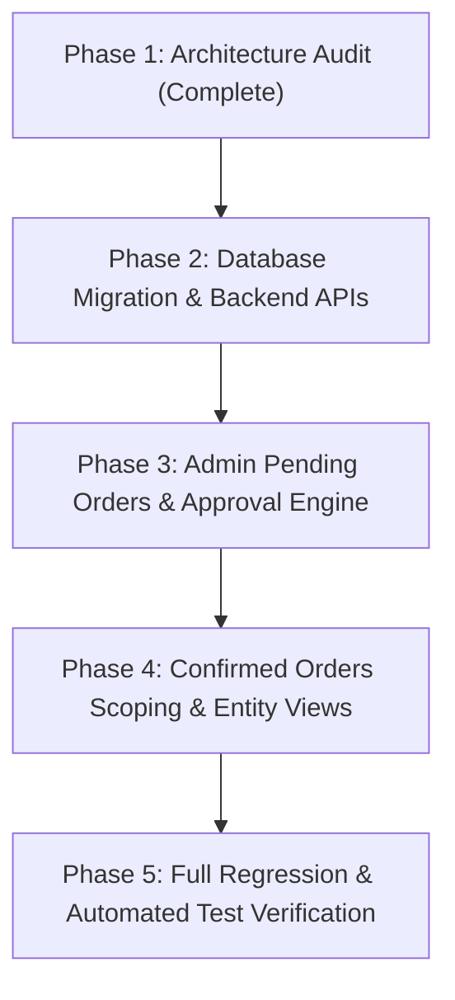

# VYAPAR ADNET — PHASE 1: ORDER APPROVAL WORKFLOW ARCHITECTURE AUDIT

**Audit Date:** 2026-11-03  
**Project:** Vyapar AdNET (`addnet/`)  
**Database:** `chhotabiz` (Production) & `chhotabiz_test` (Test Suite)  
**Git Branch:** `Tamish1`  
**Phase Status:** Phase 1 (Strictly Read-Only Audit. No Code or Database Changes Made.)  

---

## 1. Executive Summary

This technical architecture audit evaluates the complete Order Creation, Payment Collection, Order Management, and Admin Commission distribution workflows across the **Entity Panel**, **Admin Panel**, and **Laravel 12 Backend**.

### Key Architectural Findings:
1. **Direct Auto-Confirmation (No Approval Gate)**: Currently, when an Entity records an order in `EntityCreateOrder.jsx`, it is saved immediately to the `orders` database table without any Admin approval or review gate.
2. **Ambiguous Status Field**: The existing `orders.status` column functions exclusively as a **payment settlement indicator** (`completed` if `balance_due == 0`, `partial` if `balance_due > 0`), rather than an order approval status.
3. **Missing Approval Columns**: The database currently lacks `approval_status`, `admin_confirmed_by`, `admin_confirmed_at`, `admin_cancelled_by`, `admin_cancelled_at`, and `cancellation_reason`.
4. **Premature Payment & PV Crediting**: When an order is created with an advance payment, a `sale_payments` receipt is created immediately and network personal/group PV is credited (`creditSalePvToNetwork`). If such an order were cancelled by Admin, network volume would become corrupted unless crediting is deferred until Admin approval.
5. **No Existing Cancelled Orders View**: Neither the Admin Panel nor the Entity Panel currently possesses a Cancelled Orders page or routing.
6. **100% Historical Data Preservation**: All 4 existing live orders (IDs 147, 213, 214, 215) and 6 live payment receipts (IDs 292, 293, 383, 384, 385, 386) must be safely backfilled with `approval_status = 'confirmed'` so they remain in Confirmed Orders and never accidentally enter Pending Orders.

---

## 2. Current Entity Order Creation Flow

### Component & Routing
- **Frontend Page**: [`entity/src/pages/EntityCreateOrder.jsx`](file:///c:/xampp/htdocs/addnet/entity/src/pages/EntityCreateOrder.jsx)
- **API Service**: [`entity/src/api/entityService.js`](file:///c:/xampp/htdocs/addnet/entity/src/api/entityService.js) (`createEntityOrder`)
- **Backend Route**: `POST /api/orders` (and legacy alias `POST /api/sales`)
- **Backend Handler**: [`OrderController::store()`](file:///c:/xampp/htdocs/addnet/backend/app/Http/Controllers/OrderController.php#L238-L474)

### Submission Step-by-Step:
1. **Catalog & Offering Selection**: Entity selects an offering type (`service`, `product`, or `package`) and picks an item from the database catalog via `getCatalogOfferings()` (`/api/catalog/*`).
2. **Member ID Lookup & Verification**: Entity enters Customer Member ID (`customerUserCode`, e.g., `CB100021`). A debounced query triggers `verifyMemberId()` (`POST /api/verify-member`), which queries `User` model. If verified, customer name, email, phone, and sponsor ID are auto-populated.
3. **Pricing & Advance Calculation**:
   - `grossSubtotal = customPrice * quantity`
   - `grandTotal = grossSubtotal - discountAmount` (Total Project Value)
   - Entity chooses payment type: `full` (received = `grandTotal`) or `partial` (received = `advancePayment`).
   - `balanceDue = max(0, grandTotal - receivedAmount)`
   - Initial commission preview is calculated on received amount using catalog rate (`adminCommissionPercent` defaulting to 20% for services, 15% for products, 18% for packages).
4. **Payload Dispatch**: Dispatches `POST /api/orders` with full financial breakdown, customer details, and entity authentication context.
5. **Database Insertion**:
   - Validates member user code against MySQL `users` table.
   - Prevents duplicate clicks within 30 seconds.
   - Resolves entity identity and commission config from `EntityCommissionSetting`.
   - Inserts directly into `orders` table.
   - Sets `orders.status` to `completed` (if `balance_due == 0`) or `partial` (if `advance_payment > 0`).
   - Inserts initial advance payment into `sale_payments` (if `advance_payment > 0`).
   - Credits PV/BV to user and upline genealogy (`creditSalePvToNetwork`).
6. **Frontend Response**:
   - Returns HTTP 201 with created `order` object.
   - `EntityCreateOrder.jsx` opens a modal: *"Order Successfully Saved to Database!"* with invoice details.
   - User can click *"View My Orders →"* which navigates to `/entity/orders`.

---

## 3. Current Initial Payment Flow

When an Entity records an initial payment in `EntityCreateOrder.jsx`:
1. **Execution Point**: Executed inside `DB::beginTransaction()` in `OrderController::store()` (lines 427–455).
2. **Payment Row Insertion**:
   ```php
   SalePayment::create([
       'sales_record_id' => $order->id,
       'invoice_number' => $order->invoice_number,
       'entity_name' => $order->entity_name,
       'customer_name' => $order->customer_name,
       'customer_user_code' => $order->customer_user_code,
       'sponsor' => $order->sponsor,
       'amount' => $advancePayment,
       'admin_commission_percent' => $adminCommissionPercent,
       'admin_commission_cut' => $advanceAdminCommissionCut,
       'net_entity_amount' => $netEntityPayout,
       'payment_method' => $order->payment_method,
       'reference_no' => $order->reference_no,
       'payment_type' => ($balanceDue == 0) ? 'full' : 'advance',
       'notes' => 'Initial payment received at order creation',
       'payment_date' => now(),
       'income_distribution_status' => 'pending',
       'direct_income_amount' => 0.0,
       'level_income_amount' => 0.0,
       'reward_income_amount' => 0.0,
       'distributed_admin_cut_amount' => 0.0,
   ]);
   ```
3. **Commission Snapshot**: The payment record immediately locks in `admin_commission_percent` and `admin_commission_cut`.
4. **Immediate Side Effect**: Calls `$this->creditSalePvToNetwork($customerUserCode, $advancePayment, $finalSponsor);`, immediately modifying `users.personal_pv` and `users.group_pv` across up to 20 upline levels.

---

## 4. Current Balance / Repayment Flow

When an Entity collects a balance installment on an existing order:
1. **Frontend Page**: [`entity/src/pages/EntityReceiveBalancePage.jsx`](file:///c:/xampp/htdocs/addnet/entity/src/pages/EntityReceiveBalancePage.jsx)
2. **Backend Route**: `POST /api/orders/{id}/receive-balance`
3. **Backend Handler**: [`OrderController::receiveBalance()`](file:///c:/xampp/htdocs/addnet/backend/app/Http/Controllers/OrderController.php#L517-L654)
4. **Validation**: Ensures `amount <= order->balance_due` and `order->balance_due > 0`.
5. **Execution**:
   - Calculates installment Admin Cut using `order->admin_commission_percent`.
   - Inserts a new `SalePayment` row with `payment_type = 'balance'` and `income_distribution_status = 'pending'`.
   - Updates `orders.advance_payment += amount`, `orders.balance_due -= amount`.
   - Updates `orders.status = (newBalance <= 0) ? 'completed' : 'partial'`.
   - Calls `creditSalePvToNetwork()` for the collected installment amount.

---

## 5. Current Order Database Schema (`orders`)

Audited from live MySQL database `chhotabiz` on 2026-11-03:

| Column Name | SQL Data Type | Nullable | Default | Current Functional Purpose |
|:---|:---|:---:|:---|:---|
| `id` | `bigint(20) unsigned` | NO | Auto-Increment | Primary Key |
| `invoice_number` | `varchar(255)` | NO | (None, UNIQUE) | Unique Tax Invoice number (`INV-2026-XXXXX`) |
| `date` | `date` | YES | `NULL` | Transaction date |
| `entity_id` | `bigint(20) unsigned` | YES | `NULL` | Foreign key referencing selling business or freelancer |
| `entity_name` | `varchar(255)` | NO | `'Chhota Business Entity'` | Seller Business / Freelancer Name |
| `entity_type` | `varchar(255)` | NO | `'business'` | Entity Type: `business` or `freelance` |
| `customer_name` | `varchar(255)` | NO | (None) | Name of purchasing customer / client |
| `customer_email` | `varchar(255)` | YES | `NULL` | Email of customer |
| `customer_phone` | `varchar(255)` | YES | `NULL` | Phone number of customer |
| `customer_user_code` | `varchar(255)` | YES | `NULL` | Registered Member ID (e.g., `CB100021`) |
| `customer` | `varchar(255)` | YES | `NULL` | Formatted customer display string |
| `sponsor` | `varchar(255)` | YES | `NULL` | Sponsor Member ID of the buyer |
| `item` | `varchar(255)` | NO | (None) | Name of service/product/package |
| `item_type` | `varchar(255)` | NO | `'service'` | Item classification (`service`, `product`, `package`) |
| `category` | `varchar(255)` | YES | `NULL` | Offering category |
| `unit_price` | `decimal(12,2)` | NO | `0.00` | Unit price of item |
| `quantity` | `int(11)` | NO | `1` | Quantity ordered |
| `gross_amount` | `decimal(12,2)` | NO | `0.00` | Total Project / Order Value |
| `dump_amount` | `decimal(14,2)` | NO | `0.00` | Isolated manual write-off amount |
| `taxable_amount` | `decimal(12,2)` | NO | `0.00` | Base taxable amount |
| `gst_tax` | `decimal(12,2)` | NO | `0.00` | Calculated GST amount |
| `admin_commission_percent` | `decimal(6,2)` | NO | `15.00` | Percentage of Admin Commission |
| `admin_commission_cut` | `decimal(12,2)` | NO | `0.00` | Expected total Admin Commission for the project |
| `net_entity_payout` | `decimal(12,2)` | NO | `0.00` | Net entity payout on initial advance |
| `advance_payment` | `decimal(12,2)` | NO | `0.00` | Cumulative payment amount collected so far |
| `balance_due` | `decimal(12,2)` | NO | `0.00` | Remaining balance to be paid by customer |
| `payment_method` | `varchar(255)` | YES | `NULL` | Mode of payment |
| `reference_no` | `varchar(255)` | YES | `NULL` | Payment UTR / Reference number |
| `status` | `varchar(255)` | NO | `'completed'` | **Payment Settlement Status**: `completed` or `partial` |
| `network_distribution_status` | `varchar(255)` | NO | `'pending_admin_distribution'` | Legacy network commission status (retained for safety) |
| `direct_income_amount` | `decimal(14,2)` | NO | `0.00` | Cumulative Direct Income (40%) distributed |
| `level_income_amount` | `decimal(14,2)` | NO | `0.00` | Cumulative Level Income (40%) distributed |
| `reward_income_amount` | `decimal(14,2)` | NO | `0.00` | Cumulative Reward Income (20%) distributed |
| `distributed_admin_cut_amount` | `decimal(14,2)` | NO | `0.00` | Cumulative Admin Cut distributed across receipts |
| `income_distribution_status` | `varchar(20)` | NO | `'pending'` | Aggregate distribution status (`pending`, `partial`, `completed`) |
| `income_distributed_at` | `timestamp` | YES | `NULL` | Timestamp of last income distribution |
| `created_at` / `updated_at` | `timestamp` | YES | `NULL` | Laravel standard audit timestamps |

### Critical Schema Observation on `orders.status`
The existing `status` column does **NOT** represent order approval. It tracks whether the customer has cleared the project balance (`balance_due == 0` → `completed`; `balance_due > 0` → `partial`). Re-purposing `orders.status` for approval would break payment settlement filtering in Entity and Admin dashboards.

---

## 6. Current Sale Payments Database Schema (`sale_payments`)

Audited from live MySQL database `chhotabiz` on 2026-11-03:

| Column Name | SQL Data Type | Nullable | Default | Functional Purpose |
|:---|:---|:---:|:---|:---|
| `id` | `bigint(20) unsigned` | NO | Auto-Increment | Primary Key (Receipt #) |
| `sales_record_id` | `bigint(20) unsigned` | NO | (None, INDEX) | Foreign Key linking to `orders(id)` |
| `invoice_number` | `varchar(255)` | NO | (None) | Invoice Number of parent order |
| `entity_name` | `varchar(255)` | NO | `'Chhota Business Entity'` | Seller Business / Freelancer Name |
| `customer_name` | `varchar(255)` | NO | (None) | Customer Name |
| `customer_user_code` | `varchar(255)` | YES | `NULL` | Customer Member ID |
| `sponsor` | `varchar(255)` | YES | `NULL` | Sponsor Member ID |
| `amount` | `decimal(12,2)` | NO | `0.00` | Payment amount collected in this transaction |
| `admin_commission_percent` | `decimal(6,2)` | NO | `15.00` | Commission rate snapshotted for this payment |
| `admin_commission_cut` | `decimal(12,2)` | NO | `0.00` | Admin cut applicable to this specific payment |
| `net_entity_amount` | `decimal(12,2)` | NO | `0.00` | Net amount retained by entity for this payment |
| `payment_type` | `varchar(255)` | NO | `'advance'` | Installment Type: `advance`, `balance`, or `full` |
| `payment_method` | `varchar(255)` | YES | `NULL` | Payment method (UPI, Bank Transfer, etc.) |
| `reference_no` | `varchar(255)` | YES | `NULL` | Transaction UTR / Ref No |
| `notes` | `text` | YES | `NULL` | Installment notes |
| `payment_date` | `datetime` | YES | `NULL` | Date payment was received |
| `direct_income_amount` | `decimal(14,2)` | NO | `0.00` | Direct Income allocated (40%) |
| `level_income_amount` | `decimal(14,2)` | NO | `0.00` | Level Income allocated (40%) |
| `reward_income_amount` | `decimal(14,2)` | NO | `0.00` | Reward Income allocated (20%) |
| `distributed_admin_cut_amount` | `decimal(14,2)` | NO | `0.00` | Admin Cut distributed on this payment |
| `income_distribution_status` | `varchar(24)` | NO | `'pending'` | Distribution status (`pending`, `completed`) |
| `income_distributed_at` | `timestamp` | YES | `NULL` | Timestamp when Admin distributed commission |
| `income_distributed_by` | `bigint(20) unsigned` | YES | `NULL` | Admin User ID who distributed commission |
| `created_at` / `updated_at` | `timestamp` | YES | `NULL` | Standard timestamps |

---

## 7. Current Admin Order Management Architecture

- **Page Component**: [`admin/src/components/sales/AdminOrdersPage.jsx`](file:///c:/xampp/htdocs/addnet/admin/src/components/sales/AdminOrdersPage.jsx)
- **API Endpoint**: `GET /api/admin/orders` → `OrderController::index()`
- **Navigation Location**: Sidebar → **Orders & Payments → Order Management**
- **Functionality**:
  1. Displays all orders across the system.
  2. Order KPI stats cards calculate Total Project Value, Funds Received, Remaining Balance, Expected Admin Cut, Admin Cut Collected, and Distributed Admin Cut.
  3. Action **"Order Details & Payment History"** opens modal with Section A (Parent Order Summary & Dump Amount Editor) and Section B (Table of all payment receipts).
  4. For any receipt with `income_distribution_status = 'pending'`, Admin can click **"Allocate Admin Cut (40/40/20)"** which previews and executes distribution to Direct (40%), Level (40%), and Reward (20%).
- **Suitability for Confirmed Orders**: The current page already possesses complete functionality for managing confirmed orders. When the new approval workflow is introduced, scoping `AdminOrdersPage.jsx` to fetch only `approval_status = 'confirmed'` converts it into **Confirmed Orders** with zero regressions to payment receipts or 40/40/20 distribution.

---

## 8. Current Entity Order Listing Architecture

- **Page Component**: [`entity/src/pages/EntityOrders.jsx`](file:///c:/xampp/htdocs/addnet/entity/src/pages/EntityOrders.jsx)
- **API Endpoint**: `GET /api/orders?entity=...` → `OrderController::index()`
- **Navigation Location**: Sidebar → **Operations & Billing → Orders & Fulfilment → My Orders & Fulfilment**
- **Authorization**: `OrderController::resolveEntityContext()` strictly enforces that authenticated Entities can only view their own orders (`where entity_id = ... or entity_name = ...`).
- **Missing Elements**:
  - Does not distinguish between pending approval, confirmed, or cancelled orders.
  - No filter for approval state.
  - No Cancelled Orders page or cancellation reason display.

---

## 9. Current Commission Calculation Behaviour

1. **Catalog Base Rate**: Each service/product/package has an `admin_commission_percent` configured in the catalog (typically 15% to 25%).
2. **Order Rate**: When Entity creates an order, `admin_commission_percent` is sent in the payload. Backend validates and stores it in `orders.admin_commission_percent`.
3. **Order-Level Expected Cut**:
   $$\text{orders.admin\_commission\_cut} = \frac{\text{orders.gross\_amount} \times \text{orders.admin\_commission\_percent}}{100}$$
4. **Payment-Level Admin Cut**:
   $$\text{sale\_payments.admin\_commission\_cut} = \frac{\text{sale\_payments.amount} \times \text{sale\_payments.admin\_commission\_percent}}{100}$$
5. **New Workflow Requirement**: In Phase 2, Admin will set the final authoritative Admin Commission percentage during approval in the Pending Orders popup. That approved rate must update `orders.admin_commission_percent`, recalculate `orders.admin_commission_cut`, and update any pre-existing initial advance receipt in `sale_payments`.

---

## 10. Existing Approval / Status Fields

Auditing the current codebase reveals the following status fields:

| Field | Location | Values Used | Purpose |
|:---|:---|:---|:---|
| `status` | `orders` | `'completed'`, `'partial'` | Tracks whether project balance is paid in full |
| `income_distribution_status` | `orders` | `'pending'`, `'partial'`, `'completed'` | Tracks whether Admin Cut has been distributed |
| `network_distribution_status` | `orders` | `'pending_admin_distribution'` | Legacy status column (obsolete) |
| `commission_distributed` | `orders` | `0`, `1` | Legacy boolean flag |
| `income_distribution_status` | `sale_payments` | `'pending'`, `'completed'` | Tracks distribution of individual payment cut |

**Conclusion**: There is **no field** currently dedicated to order approval lifecycle.

---

## 11. Missing Approval Fields (Database Gap)

To support the new Order Approval Workflow, the `orders` table requires the following new columns:

1. `approval_status`: `ENUM('pending', 'confirmed', 'cancelled')` DEFAULT `'confirmed'` (for backward compatibility on existing records; new records will be inserted as `'pending'`).
2. `admin_confirmed_by`: `bigint(20) unsigned NULLABLE` (Admin ID who approved).
3. `admin_confirmed_at`: `timestamp NULLABLE` (Approval timestamp).
4. `admin_cancelled_by`: `bigint(20) unsigned NULLABLE` (Admin ID who cancelled).
5. `admin_cancelled_at`: `timestamp NULLABLE` (Cancellation timestamp).
6. `cancellation_reason`: `text NULLABLE` (Mandatory explanation entered by Admin when cancelling).

---

## 12. Admin Pending Orders Page Requirements

A new Admin page must be introduced:
- **Title**: Pending Orders
- **Location**: Sidebar → **Orders & Payments → Pending Orders**
- **Route**: `admin/src/components/sales/AdminPendingOrdersPage.jsx` (`activeTab === 'orders-pending'`)
- **Backend API**: `GET /api/admin/orders?approval_status=pending`
- **Actions per Row**:
  - **Review & Confirm**: Opens approval popup.
  - **Cancel Order**: Opens cancellation popup requiring `cancellation_reason`.
- **Review & Confirm Popup Calculations**:
  - Total Project Value (`gross_amount`)
  - Admin Commission Input Field (Admin enters rate, e.g., 18%)
  - Expected Total Admin Commission (`gross_amount * rate / 100`)
  - Initial Amount Received (`advance_payment`)
  - Admin Cut applicable to received payment (`advance_payment * rate / 100`)
  - Remaining Project Balance (`gross_amount - advance_payment`)
- **Confirmation Action**: Dispatches `POST /api/admin/orders/{id}/confirm` with `admin_commission_percent`.

---

## 13. Confirmed Orders Page Conversion Requirements

- **Existing Page**: `admin/src/components/sales/AdminOrdersPage.jsx`
- **Transformation**:
  - Remains the primary Order Management page.
  - Filters backend query with `approval_status = 'confirmed'`.
  - Retains all existing functionality: Order Details, Payment Receipts history, Dump Amount editing, 40/40/20 distribution, and summary KPI cards.
  - Prevents pending or cancelled orders from cluttering the confirmed distribution ledger.

---

## 14. Entity Cancelled Orders Page Requirements

- **Component to Create**: `entity/src/pages/EntityCancelledOrders.jsx`
- **Route**: `/entity/orders/cancelled`
- **Sidebar Integration**: Under **Operations & Billing → Orders & Fulfilment**:
  - `Create New Order`
  - `My Orders & Fulfilment` (Active / Confirmed)
  - `Pending Approval Orders` (Awaiting Admin review)
  - `Cancelled Orders` (Showing cancellation reason)
- **Security & Ownership**: Filtered strictly by authenticated `entity_id` / `entity_name`. One Entity cannot view another Entity's cancelled orders.

---

## 15. Initial Advance Payment Before Approval Analysis

When an Entity creates an order with an advance payment:
- **Current Behaviour**: Inserts `sale_payments` row immediately with `income_distribution_status = 'pending'`, and credits network PV immediately.
- **Architectural Risk**:
  1. If Admin rejects/cancels the order, the payment record remains in the database.
  2. If Admin alters the commission percentage during approval (e.g. from 20% to 18%), the pre-created `sale_payments` row has the old 20% commission snapshot.
  3. Crediting `personal_pv` and `group_pv` before order approval permanently inflates user volumes for orders that may never be confirmed.
- **Recommended Architectural Solution**:
  1. Record the `sale_payments` receipt at order creation, but flag its parent order as `approval_status = 'pending'`.
  2. **Block Commission Allocation**: Add a guard in `AdminIncomeAllocationService` ensuring `order->approval_status === 'confirmed'` before any 40/40/20 distribution can be previewed or executed.
  3. **Update Payment Snapshot on Approval**: When Admin approves and sets the final commission percentage, update both `orders.admin_commission_percent` and the existing advance payment's `admin_commission_percent` and `admin_commission_cut`.
  4. **Defer PV Crediting**: Move `creditSalePvToNetwork()` execution to `OrderController::confirmOrder()`, ensuring network volumes are credited **only after** Admin confirmation.

---

## 16. Historical Orders Compatibility Plan

The production database `chhotabiz` currently contains:
- 4 Orders: IDs 147, 213, 214, 215.
- 6 Payment Receipts: IDs 292, 293, 383, 384, 385, 386.
- 5 Payment Receipts have already undergone 40/40/20 distribution (`completed`).

### Backward-Compatibility Strategy:
1. Migration will add `approval_status` with `DEFAULT 'confirmed'`.
2. Existing orders automatically have `approval_status = 'confirmed'`.
3. An explicit migration update statement will guarantee:
   ```sql
   UPDATE orders SET approval_status = 'confirmed' WHERE approval_status IS NULL OR approval_status = '';
   ```
4. Existing historical orders will **never** appear in Pending Orders or Cancelled Orders.
5. All completed distributions and receipts remain 100% intact.

---

## 17. Cancellation and Refund Risks

### Critical Financial Risk:
If an Entity records an order with an advance payment (e.g. ₹5,000 received via UPI/Cash) and Admin cancels the order:
- The customer's funds were already physically collected by the Entity.
- The system currently has **no refund engine**, no reverse ledger, and no payment refund status.

### Recommended Safeguards:
1. When cancelling an order with `advance_payment > 0`, mark the `sale_payments` records as `cancelled` or `held_for_refund`.
2. In the cancellation dialog, warn Admin:
   *"Warning: This order has ₹X,XXX received advance payment. Cancelling this order requires manual offline settlement between Entity and Customer."*
3. Record `cancellation_reason` to provide an audit trail.

---

## 18. Exact Files Likely to Change in Later Phases

### Backend:
1. `backend/database/migrations/2026_11_03_000001_add_approval_workflow_columns_to_orders_table.php` (New Migration)
2. `backend/app/Models/Order.php` (Fillable, casts, appends for approval fields)
3. `backend/app/Http/Controllers/OrderController.php` (Update `store()`, add `confirmOrder()`, add `cancelOrder()`, scope `index()`)
4. `backend/app/Services/AdminIncomeAllocationService.php` (Add guard requiring `approval_status === 'confirmed'`)
5. `backend/routes/api.php` (Add `/api/admin/orders/{id}/confirm`, `/api/admin/orders/{id}/cancel`, `/api/admin/orders/pending`)
6. `backend/tests/Feature/OrderApprovalWorkflowTest.php` (Comprehensive automated tests)

### Admin Frontend:
1. `admin/src/api/adminOrdersService.js` (Add `getPendingOrders`, `confirmPendingOrder`, `cancelPendingOrder`)
2. `admin/src/components/layout/AdminSidebar.jsx` (Add "Pending Orders" menu item under Orders & Payments)
3. `admin/src/App.jsx` (Register route for `orders-pending`)
4. `admin/src/components/sales/AdminPendingOrdersPage.jsx` (New Page: Pending Orders listing, Review & Confirm modal, Cancel modal)
5. `admin/src/components/sales/AdminOrdersPage.jsx` (Filter to Confirmed Orders only)

### Entity Frontend:
1. `entity/src/pages/EntityCreateOrder.jsx` (Update submission message to indicate pending Admin approval)
2. `entity/src/components/layout/EntitySidebar.jsx` (Add "Pending Approval" and "Cancelled Orders" navigation links)
3. `entity/src/App.jsx` (Register routes `/entity/orders/pending` and `/entity/orders/cancelled`)
4. `entity/src/pages/EntityOrders.jsx` (Display approval badges)
5. `entity/src/pages/EntityCancelledOrders.jsx` (New Page: listing cancelled orders and reasons)

---

## 19. Proposed Database Migration Design (For Phase 2)

```php
<?php

use Illuminate\Database\Migrations\Migration;
use Illuminate\Database\Schema\Blueprint;
use Illuminate\Support\Facades\Schema;
use Illuminate\Support\Facades\DB;

return new class extends Migration
{
    public function up(): void
    {
        Schema::table('orders', function (Blueprint $table) {
            $table->string('approval_status', 20)->default('confirmed')->after('status')->index();
            $table->unsignedBigInteger('admin_confirmed_by')->nullable()->after('approval_status');
            $table->timestamp('admin_confirmed_at')->nullable()->after('admin_confirmed_by');
            $table->unsignedBigInteger('admin_cancelled_by')->nullable()->after('admin_confirmed_at');
            $table->timestamp('admin_cancelled_at')->nullable()->after('admin_cancelled_by');
            $table->text('cancellation_reason')->nullable()->after('admin_cancelled_at');
        });

        // Ensure all historical records default to confirmed
        DB::table('orders')->update(['approval_status' => 'confirmed']);
    }

    public function down(): void
    {
        Schema::table('orders', function (Blueprint $table) {
            $table->dropColumn([
                'approval_status',
                'admin_confirmed_by',
                'admin_confirmed_at',
                'admin_cancelled_by',
                'admin_cancelled_at',
                'cancellation_reason',
            ]);
        });
    }
};
```

---

## 20. Step-by-Step Implementation Roadmap



1. **Phase 2 — Backend Migration & Endpoints**:
   - Run migration adding `approval_status` and approval metadata.
   - Update `Order.php` model.
   - Implement `OrderController::confirmOrder()` and `cancelOrder()`.
   - Update `OrderController::store()` so newly created orders have `approval_status = 'pending'`.
   - Move `creditSalePvToNetwork()` to fire upon Admin confirmation.
2. **Phase 3 — Admin Pending Orders Interface**:
   - Implement `AdminPendingOrdersPage.jsx` with Review & Confirm popup (live calculations of Project Value, Admin Commission %, Admin Cut, Advance, Balance).
   - Implement Cancel Order modal with mandatory cancellation reason.
   - Add "Pending Orders" to `AdminSidebar.jsx`.
3. **Phase 4 — Entity Visibility & Cancelled Orders**:
   - Scope `AdminOrdersPage.jsx` to Confirmed Orders.
   - Create `EntityCancelledOrders.jsx` showing cancellation reason.
   - Update `EntityCreateOrder.jsx` post-submission banner.
4. **Phase 5 — Full Test Suite**:
   - Automated tests in `OrderApprovalWorkflowTest.php`.
   - Test approval flow, commission rate update, cancellation flow, and historical isolation.

---

## 21. Unresolved Business Decisions Requiring User Approval

Before proceeding to Phase 2, please confirm:

1. **Advance Payment Handling on Cancelled Orders**:
   When Admin cancels a pending order that has an advance payment already recorded:
   - *Option A*: Flag the order as `cancelled` with an audit notice that refund must be handled manually offline by the Entity.
   - *Option B*: Automatically set payment status to `cancelled` and deduct from Entity collections.
   *(Recommendation: Option A — since the Entity collected the cash/UPI directly, an offline refund notice is the safest model without a banking gateway integration).*

2. **Network PV / BV Timing**:
   Should buyer `personal_pv` and upline `group_pv` be credited:
   - *Option A*: Only upon Admin Confirmation (Recommended — prevents orphan/phantom PV on cancelled orders).
   - *Option B*: At order creation time, with a manual PV reversal if cancelled.

3. **Entity Panel Pending Orders Tab**:
   Should Entity have a separate "Pending Approval" tab/page, or should pending orders appear in "My Orders" with a yellow `PENDING APPROVAL` badge until confirmed?
   *(Recommendation: Keep in "My Orders" with a prominent yellow `PENDING APPROVAL` badge and disabled action buttons, plus add a dedicated Cancelled Orders sub-page).*

---

## 22. Verification Checks Performed

- [x] Read-only verification of `orders` schema (0 columns modified).
- [x] Read-only verification of `sale_payments` schema (0 columns modified).
- [x] Verified all 4 existing orders and 6 payment receipts in `chhotabiz`.
- [x] Verified `OrderController::store()` and payment creation logic.
- [x] Verified `AdminIncomeAllocationService.php` 40/40/20 allocation rules.
- [x] Verified `AdminOrdersPage.jsx` and `AdminSidebar.jsx` routes.
- [x] Verified `EntityCreateOrder.jsx`, `EntityOrders.jsx`, and `EntitySidebar.jsx`.
- [x] Confirmed zero existing cancelled orders pages.
- [x] Ensured no code files or database tables were modified during this audit.
