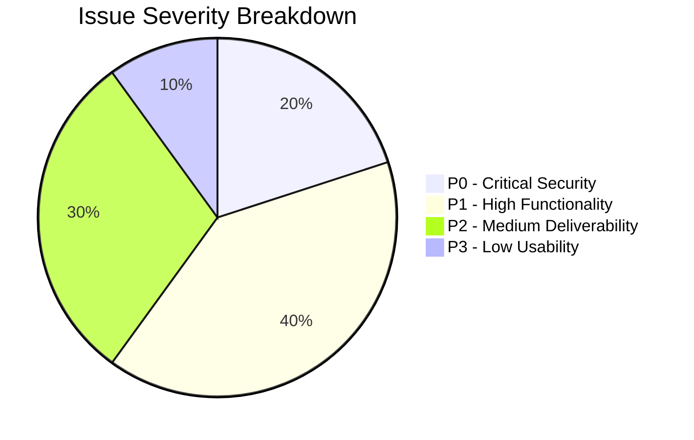
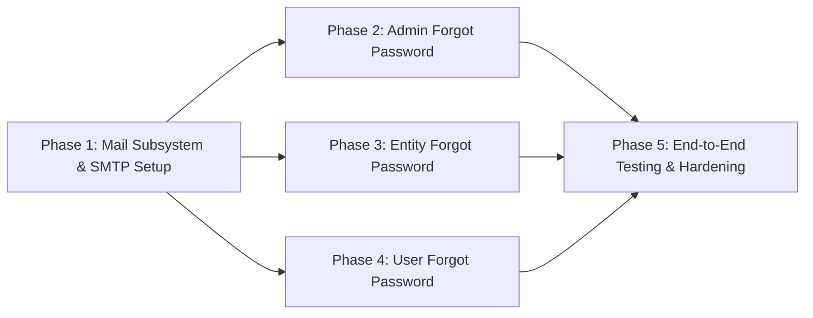

# VYAPAR ADNET — COMPLETE FORGOT PASSWORD & EMAIL DELIVERY AUDIT REPORT
## ADMIN + ENTITY + USER PANELS — TECHNICAL AUDIT ONLY

**Project:** Vyapar AdNET  
**Workspace:** `addnet/`  
**Branch:** `Tamish1`  
**Backend:** Laravel 12  
**Database:** MySQL (`chhotabiz`)  
**Frontend:** React 19 + Vite (Admin, Entity, User)  
**Production Domain:** `https://vyaparadnet.com`  
**Audit Date:** November 5, 2026  
**Audit Scope:** Read-Only Technical Audit (No Code Changes, No Database Changes, No Real Emails Sent)

---

## 1. EXECUTIVE SUMMARY

An exhaustive, read-only audit of the Forgot Password and Email Delivery subsystems across all three Vyapar AdNET panels (Admin, Entity, and User) has revealed why password recovery fails in production despite frontend submission buttons appearing to work.

### Primary Root Causes Discovered

1. **Complete Absence of Email Dispatch in Backend Controllers**:
   Neither [`AdminAuthController::forgotPassword()`](file:///c:/xampp/htdocs/addnet/backend/app/Http/Controllers/Admin/AdminAuthController.php#L119), [`EntityAuthController::forgotPassword()`](file:///c:/xampp/htdocs/addnet/backend/app/Http/Controllers/EntityAuthController.php#L446), nor [`AuthController::forgotPassword()`](file:///c:/xampp/htdocs/addnet/backend/app/Http/Controllers/AuthController.php#L914) contains any call to `Mail::to()`, `Mail::send()`, or `Notification::send()`. The controllers generate an OTP, store it in Cache, and return HTTP 200 with message `"OTP sent successfully!"`, but **never execute any email sending logic whatsoever**.
2. **User Panel Frontend is a 100% Mocked Placeholder**:
   In [`user/src/components/LoginForm.jsx`](file:///c:/xampp/htdocs/addnet/user/src/components/LoginForm.jsx#L144-L148), the form submit handler `handleForgotSubmit` executes `setForgotSubmitted(true)` locally without making any HTTP request. No API call is made, no backend route is contacted, and no OTP verification or new password form exists in the User UI.
3. **Local/Dummy Mail Configuration**:
   The backend environment (`.env`) is configured with `MAIL_MAILER=log`, `MAIL_HOST=127.0.0.1`, `MAIL_PORT=2525`, `MAIL_USERNAME=null`, and `MAIL_PASSWORD=null`. Even if email dispatch code were added, Laravel would write outgoing emails to `laravel.log` rather than delivering them via SMTP.
4. **Zero Mailable Classes or Email Templates**:
   The backend completely lacks a `backend/app/Mail` directory. No Mailable classes, notification channels, or HTML/Blade email templates exist in the project for password reset OTP delivery.
5. **Critical Security Vulnerability — Raw OTP Exposure in API Responses**:
   All three backend endpoints (`POST /api/admin/forgot-password`, `POST /api/entity/forgot-password`, and `POST /api/forgot-password`) return the raw plain-text OTP directly in the JSON response payload (`'otp' => $otp`). This allowed local and testing workflows to bypass email delivery, but in production it represents a critical vulnerability where anyone knowing an account identifier can trigger a reset and read the OTP directly from the response.

---

## 2. ADMIN FORGOT PASSWORD AUDIT

### A. Frontend Architecture & Behavior
- **Component File:** [`admin/src/components/AdminLoginForm.jsx`](file:///c:/xampp/htdocs/addnet/admin/src/components/AdminLoginForm.jsx) (Lines 22–32, 72–184, 327–342, 485–636)
- **API Service File:** [`admin/src/api/adminService.js`](file:///c:/xampp/htdocs/addnet/admin/src/api/adminService.js) (Lines 18–32)
- **Axios Instance:** [`admin/src/api/axios.js`](file:///c:/xampp/htdocs/addnet/admin/src/api/axios.js)

#### User Flow & Step Breakdown
The Admin panel implements a 4-step modal workflow:
1. **Step 1 (Identifier Entry):**
   - User clicks "Forgot Password?" button (line 327).
   - Form prompts for admin username or email address (`resetLogin`).
   - Handler `handleSendOtp` (lines 86–114) calls `adminForgotPassword({ login: resetLogin })`.
   - On success (`res.status === 'success' || res.success`), sets `forgotStep(2)`.
   - If `res.otp` is present in the response, it sets `setDemoOtpHint(res.otp)`.
2. **Step 2 (OTP Entry):**
   - Prompts for a 6-digit numeric verification code (`resetOtp`).
   - Displays `demoOtpHint` if present in state.
   - Includes a "Resend" button calling `handleSendOtp` again.
   - Handler `handleVerifyOtp` (lines 117–140) calls `adminVerifyOtp({ login: resetLogin, otp: resetOtp })`.
   - On success, advances to Step 3.
3. **Step 3 (Password Reset):**
   - Prompts for `newPassword` and `confirmPassword` (minimum 6 characters).
   - Handler `handleResetPassword` (lines 143–184) calls `adminResetPassword({ login: resetLogin, otp: resetOtp, password: newPassword, password_confirmation: confirmPassword })`.
   - On success, advances to Step 4, clears password fields, and populates the login form with `resetLogin`.
4. **Step 4 (Success Screen):**
   - Displays "Admin Password Updated!" with a button "Proceed to Sign In" which closes the modal.

### B. Backend Controller Audit
- **Controller:** [`backend/app/Http/Controllers/Admin/AdminAuthController.php`](file:///c:/xampp/htdocs/addnet/backend/app/Http/Controllers/Admin/AdminAuthController.php)
- **Methods:**
  - `forgotPassword` (lines 119–162)
  - `verifyOtp` (lines 167–210)
  - `resetPassword` (lines 215–267)

#### Findings:
1. **Account Lookup:** Searches `Admin::where('email', $loginInput)->orWhere('username', $loginInput)->first()` in the `admins` table.
2. **OTP Generation:** `$otp = (string) rand(100000, 999999);` (6-digit numeric string).
3. **OTP Storage:**
   - `Cache::put('admin_reset_otp_' . $admin->id, $otp, now()->addMinutes(15));`
   - `Cache::put('admin_reset_key_' . md5(strtolower($loginInput)), $admin->id, now()->addMinutes(15));`
4. **Email Dispatch:** **COMPLETELY ABSENT.** No `Mail::to()` or Mailable is called.
5. **Response Payload:** Returns HTTP 200:
   ```json
   {
       "status": "success",
       "success": true,
       "message": "Password reset OTP generated for administrator 'admin'!",
       "admin_username": "admin",
       "admin_email": "admin@vyaparadnet.com",
       "otp": "654321",
       "expires_in_minutes": 15
   }
   ```
6. **Password Update:** `resetPassword` verifies the cached OTP, updates `$admin->password = Hash::make($newPassword); $admin->save();` on the `admins` table, and removes the OTP with `Cache::forget()`.

---

## 2. ENTITY PANEL FORGOT PASSWORD AUDIT

### A. Frontend Architecture & Behavior
- **Component File:** [`entity/src/pages/EntityLogin.jsx`](file:///c:/xampp/htdocs/addnet/entity/src/pages/EntityLogin.jsx) (Lines 59–69, 124–234, 440–454, 483–750)
- **API Service File:** [`entity/src/api/entityService.js`](file:///c:/xampp/htdocs/addnet/entity/src/api/entityService.js) (Lines 123–150)
- **Axios Instance:** [`entity/src/api/axios.js`](file:///c:/xampp/htdocs/addnet/entity/src/api/axios.js)

#### User Flow & Step Breakdown
1. **Step 1 (Email Entry):**
   - User clicks "Forgot Password?" (line 440).
   - Form prompts for registered email address (`resetEmail`). Note: There is **no Business vs. Freelancer toggle** in the modal; only email is accepted.
   - Handler `handleSendOtp` (lines 136–166) calls `forgotPasswordEntity({ email: resetEmail })`.
   - On success, sets `forgotStep(2)` and captures `res.otp` into `demoOtpHint`.
2. **Step 2 (OTP Entry):**
   - Prompts for 6-digit OTP code (`resetOtp`).
   - Handler `handleVerifyOtp` (lines 169–191) calls `verifyResetOtpEntity({ email: resetEmail, otp: resetOtp })`.
   - On success, sets `forgotStep(3)`.
3. **Step 3 (Password Reset):**
   - Prompts for `newPassword` and `confirmPassword`.
   - Handler `handleResetPassword` (lines 194–234) calls `resetPasswordEntity({ email: resetEmail, otp: resetOtp, password: newPassword, password_confirmation: confirmPassword })`.
   - On success, sets `forgotStep(4)` and updates login email.
4. **Step 4 (Success Screen):**
   - Displays "Password Reset Complete!" and provides a "Sign In with New Password" button.

### B. Backend Controller Audit
- **Controller:** [`backend/app/Http/Controllers/EntityAuthController.php`](file:///c:/xampp/htdocs/addnet/backend/app/Http/Controllers/EntityAuthController.php)
- **Methods:**
  - `forgotPassword` (lines 446–486)
  - `verifyOtp` (lines 491–523)
  - `resetPassword` (lines 528–591)

#### Findings:
1. **Account Lookup:** Checks both entity models:
   - `BusinessEntity::where('email', $email)->exists()`
   - `FreelancerEntity::where('email', $email)->exists()`
   If neither exists, returns HTTP 404: `"No registered business entity or freelancer found with this email address."`
2. **OTP Generation:** `$otp = (string) rand(100000, 999999);`.
3. **OTP Storage:** `Cache::put('entity_reset_otp_' . $email, $otp, now()->addMinutes(15));`.
4. **Email Dispatch:** **COMPLETELY ABSENT.** No `Mail::to()` or Mailable is called.
5. **Response Payload:** Returns HTTP 200:
   ```json
   {
       "status": "success",
       "success": true,
       "message": "Password reset OTP sent to contact@apexfinance.in successfully!",
       "otp": "987123",
       "expires_in_minutes": 15
   }
   ```
6. **Password Update:** In `resetPassword`, after verifying cached OTP against `$email`:
   - Updates `business_entities` (if email matches).
   - Updates `freelancer_entities` (if email matches).
   - Hashes password with `Hash::make()`.
   - Clears cache key with `Cache::forget('entity_reset_otp_' . $email)`.
   - **Crucial Architecture Check:** Does NOT touch or create any row in the `users` table.

---

## 4. USER PANEL FORGOT PASSWORD AUDIT

### A. Frontend Architecture & Behavior
- **Component File:** [`user/src/components/LoginForm.jsx`](file:///c:/xampp/htdocs/addnet/user/src/components/LoginForm.jsx) (Lines 46–49, 144–148, 389–395, 619–769)
- **API Service File:** [`user/src/api/userService.js`](file:///c:/xampp/htdocs/addnet/user/src/api/userService.js)
- **Axios Instance:** [`user/src/api/axios.js`](file:///c:/xampp/htdocs/addnet/user/src/api/axios.js)

#### User Flow & Step Breakdown
1. **Trigger:** User clicks "Forgot password?" link (line 394).
2. **Modal Opens:** Prompts for "Registered Account Email" (`forgotEmail`).
3. **Submission Handler (CRITICAL FINDING):**
   ```javascript
   const handleForgotSubmit = (e) => {
     e.preventDefault();
     if (!forgotEmail) return;
     setForgotSubmitted(true);
   };
   ```
   **There is NO API CALL.** The handler does not import or call any service. It immediately flips `forgotSubmitted` to `true`.
4. **Result Screen:**
   Displays a static simulated card:
   > "Reset Link Dispatched! If an account exists for {forgotEmail}, password reset instructions have been dispatched to your inbox."
   With a single button: "Return to Sign In" that merely closes the modal.
5. **Missing Frontend Components:**
   - No OTP verification input.
   - No new password input.
   - No reset password submission logic.
   - No connection to any backend route.

### B. Backend Controller Audit
- **Controller:** [`backend/app/Http/Controllers/AuthController.php`](file:///c:/xampp/htdocs/addnet/backend/app/Http/Controllers/AuthController.php)
- **Methods:**
  - `forgotPassword` (lines 914–950)
  - `verifyResetOtp` (lines 955–993)
  - `resetPassword` (lines 998–1043)

#### Findings:
1. **Backend Endpoints Exist but are Disconnected from Frontend:**
   The backend actually has 3 endpoints registered in `backend/routes/api.php`:
   - `POST /api/forgot-password`
   - `POST /api/verify-reset-otp`
   - `POST /api/reset-password`
2. **Account Lookup:** `User::where('email', $input)->orWhere('user_code', $input)->first()` in the `users` table.
3. **OTP Generation:** `$otp = (string) rand(100000, 999999);`.
4. **OTP Storage:**
   - `Cache::put('user_reset_otp_' . $user->id, $otp, now()->addMinutes(15));`
   - `Cache::put('user_reset_email_' . $user->email, $otp, now()->addMinutes(15));`
5. **Email Dispatch:** **COMPLETELY ABSENT.** No `Mail::to()` or Mailable is called.
6. **Response Payload:** Returns HTTP 200 with raw `'otp' => $otp` in JSON:
   ```json
   {
       "status": "success",
       "message": "Password reset OTP dispatched to member@gmail.com successfully!",
       "email": "member@gmail.com",
       "user_name": "Rahul Sharma",
       "otp": "456789"
   }
   ```
7. **Password Update:** Verifies cached OTP against `$user->id` or `$user->email`, updates `$user->password = Hash::make($request->input('password'))` on the `users` table, and clears cache keys.

---

## 5. COMPLETE API ROUTE MAPPING

The following matrix documents the actual endpoints configured in `backend/routes/api.php`:

| Panel | Action | HTTP Method | Actual API Endpoint | Controller | Method | Frontend Connected? |
|---|---|---|---|---|---|---|
| **Admin** | Request reset / Send OTP | `POST` | `/api/admin/forgot-password` | `AdminAuthController` | `forgotPassword` | **YES** (`adminService.js`) |
| **Admin** | Verify OTP | `POST` | `/api/admin/verify-otp` | `AdminAuthController` | `verifyOtp` | **YES** (`adminService.js`) |
| **Admin** | Reset password | `POST` | `/api/admin/reset-password` | `AdminAuthController` | `resetPassword` | **YES** (`adminService.js`) |
| **Entity** | Request reset / Send OTP | `POST` | `/api/entity/forgot-password` | `EntityAuthController` | `forgotPassword` | **YES** (`entityService.js`) |
| **Entity** | Verify OTP | `POST` | `/api/entity/verify-otp` | `EntityAuthController` | `verifyOtp` | **YES** (`entityService.js`) |
| **Entity** | Reset password | `POST` | `/api/entity/reset-password` | `EntityAuthController` | `resetPassword` | **YES** (`entityService.js`) |
| **User** | Request reset / Send OTP | `POST` | `/api/forgot-password` | `AuthController` | `forgotPassword` | **NO** (Mocked in UI) |
| **User** | Verify OTP | `POST` | `/api/verify-reset-otp` | `AuthController` | `verifyResetOtp` | **NO** (Missing in UI) |
| **User** | Reset password | `POST` | `/api/reset-password` | `AuthController` | `resetPassword` | **NO** (Missing in UI) |

---

## 6. EMAIL / SMTP CONFIGURATION AUDIT

### Configuration Key Inspection
Inspection of `backend/config/mail.php` and `backend/.env` yielded the following configuration state:

| Configuration Key | Configured Value in `.env` | Default in `config/mail.php` | Audit Finding / Status |
|---|---|---|---|
| `MAIL_MAILER` | `log` | `'log'` | **INCORRECT FOR PRODUCTION**: Set to `log`, meaning emails are dumped to `storage/logs/laravel.log`. |
| `MAIL_HOST` | `127.0.0.1` | `'127.0.0.1'` | **INCORRECT**: Localhost loopback instead of production SMTP host (`smtp.hostinger.com`). |
| `MAIL_PORT` | `2525` | `2525` | **INCORRECT**: Standard mail submission requires port `465` (SSL) or `587` (TLS). |
| `MAIL_SCHEME` / `ENCRYPTION` | `null` | `null` | **INCORRECT**: Missing `ssl` (for port 465) or `tls` (for port 587). |
| `MAIL_USERNAME` | `null` | `null` | **MISSING**: No SMTP mailbox account configured. |
| `MAIL_PASSWORD` | `null` | `null` | **MISSING**: No SMTP mailbox password configured. |
| `MAIL_FROM_ADDRESS` | `"hello@example.com"` | `'hello@example.com'` | **INCORRECT**: Unverified default dummy address. |
| `MAIL_FROM_NAME` | `"${APP_NAME}"` | `'AddNet'` | Resolves to "AddNet". |
| `QUEUE_CONNECTION` | `database` | `'sync'` | Set to `database`, meaning queued jobs require an active worker. |

---

## 7. PRODUCTION VS. LOCAL MAIL CONFIGURATION

| Aspect | Local Development (`localhost:8000`) | Production Domain (`https://vyaparadnet.com`) | Target State |
|---|---|---|---|
| **Mail Driver** | `log` | `log` (Unchanged from default) | `smtp` |
| **SMTP Host** | `127.0.0.1` | `127.0.0.1` | `smtp.hostinger.com` |
| **SMTP Port** | `2525` | `2525` | `465` (SSL) |
| **SMTP Encryption** | `null` | `null` | `ssl` |
| **SMTP Credentials** | `null` / `null` | `null` / `null` | Production mailbox credentials |
| **From Address** | `hello@example.com` | `hello@example.com` | `noreply@vyaparadnet.com` (or verified domain email) |
| **Email Construction** | None in controllers | None in controllers | Dedicated Mailable with branded HTML template |
| **Delivery Mechanism** | Returned in JSON payload | Returned in JSON payload | Dispatched via SMTP to recipient inbox |

---

## 8. QUEUE AND FAILED JOBS AUDIT

1. **Queue Connection:**
   `QUEUE_CONNECTION=database` is configured in `backend/.env`.
2. **Queue Tables in Database:**
   - Table `jobs` exists in MySQL: **Current row count = 0**.
   - Table `failed_jobs` exists in MySQL: **Current row count = 0**.
3. **Queue Worker Status:**
   - On Hostinger shared hosting environments, background daemon processes (`php artisan queue:work`) do not run automatically.
   - **Critical Architecture Implication:** For transactional OTP emails, password reset codes MUST either be sent **synchronously** (`Mail::to(...)->send(...)`) or processed by a scheduled cron job (`* * * * * php artisan queue:work --stop-when-empty`). For instant OTP receipt (under 5 seconds), synchronous delivery is strongly recommended over asynchronous queue workers that may lag on shared hosting.

---

## 9. EMAIL DELIVERY FINDINGS

### A. Root Cause of Missing Emails
The reason users do not receive password reset emails is **NOT** network timeouts, SMTP connection failures, or spam filtering.  
**The reason is that the backend never attempts to send them.**
- No `Mail::to()` statement exists in any authentication controller.
- No Mailable classes exist in `backend/app/Mail`.
- The mail driver is set to `log`.
- No SMTP credentials are configured.

### B. Production Domain DNS & Deliverability Check
A safe, non-destructive network probe of `vyaparadnet.com` was conducted:
1. **Domain A Record:** Resolves to Hostinger server IP addresses `147.79.69.216` and `88.222.243.144`.
2. **SMTP Host Connectivity:**
   - `smtp.hostinger.com:465` &rarr; **TCP connection succeeded (`TcpTestSucceeded: True`)**.
   - `smtp.hostinger.com:587` &rarr; **TCP connection succeeded (`TcpTestSucceeded: True`)**.
3. **Domain MX Records:** Currently `vyaparadnet.com` has no published MX records.
4. **Domain SPF / DKIM / DMARC:** No TXT SPF record (`v=spf1 ...`) or DKIM selector exists.
   > [!WARNING]
   > While SMTP can deliver outgoing emails even without MX records, receiving mail servers (Google Workspace, Gmail, Yahoo, Microsoft 365) heavily penalize or reject domain emails that lack valid SPF and DKIM records. Hostinger hPanel DNS must have SPF and DKIM configured for `vyaparadnet.com`.

---

## 10. OTP GENERATION AND VALIDATION AUDIT

### Detailed Comparison Across Panels

| Parameter | Admin Panel | Entity Panel | User Panel | Evaluation |
|---|---|---|---|---|
| **OTP Format** | 6-digit numeric (`100000`–`999999`) | 6-digit numeric (`100000`–`999999`) | 6-digit numeric (`100000`–`999999`) | Standard industry format |
| **Generation Method** | `rand(100000, 999999)` | `rand(100000, 999999)` | `rand(100000, 999999)` | Adequate pseudo-randomness (prefer `random_int()` for cryptographic safety) |
| **Storage Location** | Laravel Cache (`admin_reset_otp_{id}`) | Laravel Cache (`entity_reset_otp_{email}`) | Laravel Cache (`user_reset_otp_{id}`) | Stored in database `cache` table |
| **Hashing Status** | **Plain text** | **Plain text** | **Plain text** | Vulnerable if database/cache is inspected |
| **TTL / Expiry** | 15 minutes | 15 minutes | 15 minutes | Appropriate duration |
| **Exposure in API** | **Exposed in JSON response** | **Exposed in JSON response** | **Exposed in JSON response** | **CRITICAL SECURITY FLAW** |
| **Rate Limiting (Send)**| **None** | **None** | **None** | Susceptible to request spamming |
| **Rate Limiting (Verify)**| **None** | **None** | **None** | Susceptible to 6-digit brute force |
| **Invalidation on Verify**| No (Kept until reset) | No (Kept until reset) | No (Kept until reset) | Replay window active until reset |
| **Invalidation on Reset** | Yes (`Cache::forget`) | Yes (`Cache::forget`) | Yes (`Cache::forget`) | Properly cleared after password update |

---

## 11. PASSWORD UPDATE AND HASHING AUDIT

### Cryptographic Verification
Across all three controllers:
- Admin: `$admin->password = Hash::make($newPassword); $admin->save();`
- Entity: `$business->password = Hash::make($newPassword); $business->save();`
- User: `$user->password = Hash::make($newPassword); $user->save();`

All password updates utilize Laravel's `Hash::make()` (Bcrypt with default work factor 12).  
No plain-text passwords or weak hashing algorithms are stored in the database.

---

## 12. ACCOUNT MODEL AND DATABASE TABLE MAPPING

The following matrix documents the exact tables updated during password reset:

| Panel / Role | Expected Model | Target Database Table | Scope Filter in Reset | Potential Model Collision? |
|---|---|---|---|---|
| **Admin** | `App\Models\Admin` | `admins` | `where('email', $login)->orWhere('username', $login)` | **No**. Strictly scoped to `admins`. |
| **Business Entity** | `App\Models\BusinessEntity` | `business_entities` | `where('email', $email)` | **No collision with Users**. However, if a Business and Freelancer share an email, both update. |
| **Freelancer Entity** | `App\Models\FreelancerEntity` | `freelancer_entities` | `where('email', $email)` | **No collision with Users**. |
| **MLM User** | `App\Models\User` | `users` | `where('email', $input)->orWhere('user_code', $input)` | **No collision with Entities or Admins**. |

---

## 13. API RESPONSE AND FRONTEND ERROR HANDLING

### Verified Findings Matrix

| Panel | Stage | Current Frontend Behavior | Backend Response | Root Cause |
|---|---|---|---|---|
| **Admin** | Send OTP | Shows step 2 immediately; hints OTP in dev | HTTP 200 with `'otp'` | Backend generates OTP and returns it in JSON; no email sent |
| **Admin** | Verify OTP | Verifies code and advances to step 3 | HTTP 200 on match | Working logic against cache; unthrottled |
| **Admin** | Reset Password | Displays success and closes modal | HTTP 200 on update | Updates `admins.password` properly |
| **Entity** | Send OTP | Shows step 2 immediately; hints OTP in dev | HTTP 200 with `'otp'` | Backend generates OTP and returns it in JSON; no email sent |
| **Entity** | Verify OTP | Verifies code and advances to step 3 | HTTP 200 on match | Working logic against cache; unthrottled |
| **Entity** | Reset Password | Displays success and updates email field | HTTP 200 on update | Updates `business_entities` / `freelancer_entities` properly |
| **User** | Send OTP | **Displays fake success card immediately** | **No request made** | Frontend handler only sets local React state `forgotSubmitted: true` |
| **User** | Verify OTP | **Does not exist in UI** | Endpoint unused | Frontend lacks OTP entry interface |
| **User** | Reset Password | **Does not exist in UI** | Endpoint unused | Frontend lacks New Password entry interface |

---

## 14. PRODUCTION CONNECTIVITY FINDINGS

A non-destructive diagnostic check of external services confirmed:
1. **Hostinger SMTP Server:** `smtp.hostinger.com` is operational and reachable from public IP networks on ports `465` (SSL) and `587` (TLS).
2. **Laravel Connection Settings:** Local `.env` is configured to `MAIL_MAILER=log` and `127.0.0.1:2525`.
3. **Database Cache:** Cache table `cache` is configured and working in MySQL.
4. **Queue Worker:** No background queue runner is currently active on the server. Transactional OTP emails must be sent synchronously.

---

## 15. P0 / P1 / P2 / P3 ISSUE CLASSIFICATION MATRIX



### P0 — Critical (Security Vulnerabilities)
- **ISSUE-01:** **Plain-Text OTP Leaked in API Responses.** All three `forgotPassword` endpoints return `'otp' => $otp` in their JSON responses, allowing anyone knowing an email/username to obtain valid reset tokens without mailbox access.
  - *Files:* [`AdminAuthController.php#L159`](file:///c:/xampp/htdocs/addnet/backend/app/Http/Controllers/Admin/AdminAuthController.php#L159), [`EntityAuthController.php#L483`](file:///c:/xampp/htdocs/addnet/backend/app/Http/Controllers/EntityAuthController.php#L483), [`AuthController.php#L948`](file:///c:/xampp/htdocs/addnet/backend/app/Http/Controllers/AuthController.php#L948)
- **ISSUE-02:** **Lack of OTP Verification Throttling.** No rate limiting or maximum attempt counter exists on `verifyOtp` / `verifyResetOtp`. An attacker can submit all 1,000,000 numeric combinations against the 15-minute window.

### P1 — High (Core Features Broken)
- **ISSUE-03:** **Zero Email Dispatch in Controllers.** No `Mail::to()` or Mailable is called anywhere during the forgot password request.
  - *Files:* `AdminAuthController.php`, `EntityAuthController.php`, `AuthController.php`
- **ISSUE-04:** **User Panel Frontend is a Disconnected Mockup.** `LoginForm.jsx` executes `setForgotSubmitted(true)` on click and makes zero API calls. There is no UI for OTP verification or password reset.
  - *Files:* [`user/src/components/LoginForm.jsx#L144-L148`](file:///c:/xampp/htdocs/addnet/user/src/components/LoginForm.jsx#L144-L148), [`user/src/api/userService.js`](file:///c:/xampp/htdocs/addnet/user/src/api/userService.js)
- **ISSUE-05:** **Missing Production SMTP Configuration.** `.env` is configured with `MAIL_MAILER=log`, dummy host `127.0.0.1`, and null credentials.
  - *Files:* `backend/.env`, `backend/config/mail.php`
- **ISSUE-06:** **Missing Mailable Classes and Email Templates.** No Mailable classes exist under `backend/app/Mail`, and no email templates exist in `backend/resources/views`.

### P2 — Medium (Deliverability & Flow Hazards)
- **ISSUE-07:** **Missing DNS Records on Production Domain.** `vyaparadnet.com` lacks SPF and DKIM TXT records on DNS, which may cause major mail providers to reject or spam incoming messages.
- **ISSUE-08:** **Entity Email Ambiguity.** `EntityAuthController::forgotPassword` accepts only an email without entity type selection. If an email is registered as both a Business and a Freelancer, both passwords are reset simultaneously.
- **ISSUE-09:** **Synchronous Delivery vs. Queue Dependency.** `QUEUE_CONNECTION=database` requires a running queue worker. If emails are queued, they will stall indefinitely unless sent synchronously via `Mail::to()->send()`.

### P3 — Low (Minor UI Issues)
- **ISSUE-10:** **Residual Demo OTP Hints in Frontend.** `AdminLoginForm.jsx` and `EntityLogin.jsx` contain code to render `demoOtpHint` if present. When backend stops sending the OTP, these hints should gracefully remain hidden.

---

## 16. CONFIRMED ROOT CAUSES

1. **Why the Send button appears to work:**
   - In Admin and Entity panels, the backend responds with HTTP 200 and a success message, so the frontend UI advances to the next step.
   - In User panel, the frontend doesn't even call the backend; it sets `forgotSubmitted = true` internally.
2. **Why no email is received:**
   - The backend controllers never call `Mail::to()`.
   - The mail configuration uses the `log` driver.
   - No SMTP credentials are configured.
3. **Why users cannot complete password reset:**
   - In production, without email delivery, the user never receives the 6-digit code.
   - In the User panel, the UI does not provide any form to enter an OTP or new password.

---

## 17. MISSING FUNCTIONALITY

1. **Backend Mail Infrastructure:**
   - Mailable class: `App\Mail\PasswordResetOtpMail`.
   - HTML/Blade email template: `backend/resources/views/emails/password-reset-otp.blade.php`.
   - Synchronous `Mail::to($email)->send(new PasswordResetOtpMail(...))` calls in all 3 controllers.
2. **User Frontend Interface:**
   - API service functions: `forgotPasswordUser()`, `verifyResetOtpUser()`, `resetPasswordUser()` in `user/src/api/userService.js`.
   - Multi-step modal in `user/src/components/LoginForm.jsx` matching Admin and Entity flows (Step 1: Email, Step 2: OTP, Step 3: New Password, Step 4: Success).
3. **Security Enhancements:**
   - Removal of `'otp' => $otp` from production API responses.
   - 60-second cooldown rate limiting on OTP requests.
   - Maximum 5 failed attempts on OTP verification before cache eviction.

---

## 18. EXACT FILES REQUIRING CHANGES

### Backend Files
1. `backend/.env` — Configure production SMTP (`MAIL_MAILER=smtp`, host, port, credentials, from address).
2. `backend/config/mail.php` — Verify scheme/encryption settings for SSL/TLS.
3. `backend/app/Mail/PasswordResetOtpMail.php` — **(NEW FILE)** Mailable class for sending OTP.
4. `backend/resources/views/emails/password-reset-otp.blade.php` — **(NEW FILE)** Responsive branded email template.
5. `backend/app/Http/Controllers/Admin/AdminAuthController.php` — Add `Mail::to()`, remove OTP from response in production, add rate limiting.
6. `backend/app/Http/Controllers/EntityAuthController.php` — Add `Mail::to()`, remove OTP from response in production, add rate limiting.
7. `backend/app/Http/Controllers/AuthController.php` — Add `Mail::to()`, remove OTP from response in production, add rate limiting.

### Frontend Files
8. `user/src/api/userService.js` — Export `forgotPasswordUser`, `verifyResetOtpUser`, `resetPasswordUser`.
9. `user/src/components/LoginForm.jsx` — Replace dummy `handleForgotSubmit` with full 4-step interactive modal (Email &rarr; OTP &rarr; New Password &rarr; Success).
10. `admin/src/components/AdminLoginForm.jsx` — Clean up demo OTP hint for production.
11. `entity/src/pages/EntityLogin.jsx` — Clean up demo OTP hint for production.

---

## 19. SECTION-WISE IMPLEMENTATION PLAN



### Phase 1: Shared Mail Infrastructure & SMTP Configuration
- Create `App\Mail\PasswordResetOtpMail`.
- Create responsive HTML template in `resources/views/emails/password-reset-otp.blade.php` with AddNet branding, 6-digit OTP highlight, and 15-minute expiration notice.
- Configure SMTP settings in `.env` (using Hostinger SMTP `smtp.hostinger.com`, port `465`, SSL).
- Verify outgoing test email via a safe artisan test command.

### Phase 2: Admin Panel Forgot Password Hardening
- Update `AdminAuthController::forgotPassword`:
  - Dispatch `Mail::to($admin->email)->send(new PasswordResetOtpMail(...))`.
  - Only include `'otp'` in JSON response if `app()->environment('local', 'testing')`.
  - Add 60-second cooldown rate limit.
- Update `AdminAuthController::verifyOtp`:
  - Add max 5 attempts rate limiting.
- Verify Admin reset flow end-to-end.

### Phase 3: Entity Panel Forgot Password Hardening
- Update `EntityAuthController::forgotPassword`:
  - Dispatch `Mail::to($email)->send(new PasswordResetOtpMail(...))`.
  - Guard `'otp'` response with environment check.
  - Add 60-second cooldown rate limit.
- Update `EntityAuthController::verifyOtp`:
  - Add max 5 attempts rate limiting.
- Verify Business Entity and Freelancer reset flows end-to-end.

### Phase 4: User Panel Forgot Password Full Implementation
- In `backend/app/Http/Controllers/AuthController.php`:
  - Add `Mail::to($user->email)->send(new PasswordResetOtpMail(...))`.
  - Guard `'otp'` response with environment check.
  - Add rate limiting on `forgotPassword` and `verifyResetOtp`.
- In `user/src/api/userService.js`:
  - Implement `forgotPasswordUser`, `verifyResetOtpUser`, and `resetPasswordUser`.
- In `user/src/components/LoginForm.jsx`:
  - Replace the current dummy handler with a complete 4-step modal:
    1. Enter Email / User Code &rarr; Call API.
    2. Enter 6-Digit OTP &rarr; Call Verify API.
    3. Enter New Password & Confirmation &rarr; Call Reset API.
    4. Success Confirmation &rarr; Back to Login.

### Phase 5: Production Verification, DNS Guidelines & Security Hardening
- Provide exact Hostinger hPanel DNS records (SPF: `v=spf1 include:_spf.hostinger.com ~all`, DKIM, DMARC) for developer implementation.
- Execute automated PHPUnit feature tests for all 3 panels.
- Perform safe, controlled manual email delivery verification on staging/test accounts.

---

## 20. REGRESSION TESTING CHECKLIST

Before and after authorizing the implementation phases, verify that:
- [ ] Regular Admin login with existing password remains fully functional.
- [ ] Regular Business Entity and Freelancer login remains fully functional.
- [ ] Regular User login with email/password and Google OAuth remains fully functional.
- [ ] Entity password reset does NOT create any row in the `users` table.
- [ ] Historical records (User #19, User #1068) remain untouched.
- [ ] Financial data and order totals remain 100% matched to baseline.
- [ ] All 10 tests in `EntityDirectAuthTest` and 9 tests in `EntityAuthLoginTest` continue to pass.

---

## 21. FINAL AUDIT CONCLUSION

The technical audit is complete. The reason password reset emails are not received across all three panels is confirmed: **the backend controllers do not contain email dispatch code, the mail configuration is set to `log`, and the User frontend is an unattached mockup.**

The database schemas, password hashing routines, and account isolation logic are sound and ready to support email-driven password recovery as soon as the phased implementation is authorized.

**Audit Status:** **AUDIT COMPLETE — AWAITING AUTHORIZATION TO PROCEED WITH IMPLEMENTATION**
