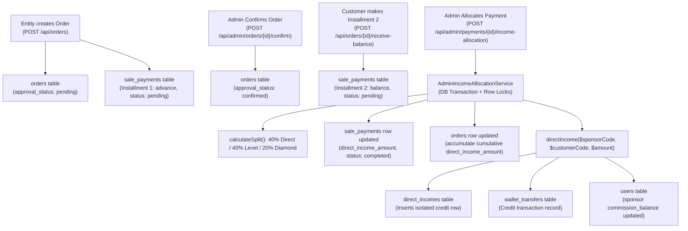
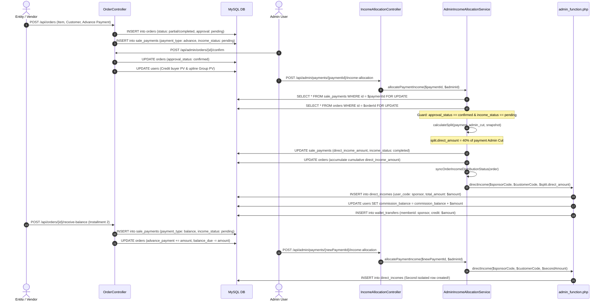

# VYAPAR ADNET – DIRECT INCOME ORDER-WISE SUMMARY SYSTEM
## PHASE 0: READ-ONLY ARCHITECTURE AUDIT & IMPLEMENTATION REQUIREMENTS REPORT

**Date of Audit:** November 13, 2026  
**Auditor:** DeepMind Antigravity Architecture Auditor  
**Scope:** Backend (Laravel 12 / MySQL), Frontend (`user/`, `admin/`, `entity/`), Income Distribution & Dump Accounting  
**Audit Policy:** Strict Read-Only. Absolutely zero database writes, schema migrations, or source code modifications were performed during this audit.

---

## 1. EXECUTIVE SUMMARY

Vyapar Adnet operates an MLM direct-selling and service commission engine powered by Laravel 12 and MySQL. In the current production architecture:
1. **The Core Business Problem:** When an Order is created for a registered Member, payments can be made in multiple installments (e.g., Advance Payment, Balance Payment 1, Balance Payment 2). An Admin allocates and distributes Direct Income separately against each individual payment installment. Currently, each installment distribution appends an isolated row into the `direct_incomes` table and wallet ledger.
2. **The User Panel Deficiency:** In the User Panel (`user/src/pages/income/DirectIncomePage.jsx`), Direct Income is presented as a flat list of isolated records queried directly from `direct_incomes`. This produces multiple disconnected, repetitive entries for the same Order. Critically, the current `direct_incomes` table lacks `order_id`, `invoice_number`, `source_user_code`, or product details. The user cannot see which customer order, invoice, or offering generated the income, nor can they view the cumulative financial progress (Expected vs. Received vs. Pending vs. Dump) for a given Order.
3. **The Target Architecture:** A consolidated **Order-Wise Summary System** that displays **exactly ONE card per Order** in the User Panel. The card displays cumulative figures for that Order. A **"View Full Details"** popup reveals the full installment-wise breakdown (Payment Reference, Installment Amount, Distributed Direct Income, Date, Status, and Dump write-offs). When additional installments are distributed by Admin, the same summary card is updated rather than creating new cards.
4. **Authoritative Ledger vs. Consolidated Summary:**
   - **Table 1 (`direct_incomes` + `sale_payments`):** The authoritative, immutable transaction ledger retaining every individual installment distribution event.
   - **Table 2 (`direct_income_order_summaries`):** A newly proposed summary table storing consolidated metrics per `(user_id, order_id)`.
   - The summary table is strictly dependent and mathematically reconcilable against the underlying transaction ledgers (`sale_payments` and `direct_incomes`). It will never become an untracked, drifting source of truth.
5. **Implementation Phasing:**
   - **User Phase 1:** Database migration, model setup, atomic synchronization inside the existing Admin distribution service, read-only User APIs, and reconciliation commands. (Admin UI is completely untouched).
   - **User Phase 2:** User Panel UI overhaul (`DirectIncomePage.jsx`), introducing Order-wise Cards and the "View Full Details" modal.
   - **Future Admin Roadmap:** Admin Phase 1 & 2 to bring consolidated order-wise inspection and reconciliation tools to the Admin Portal.

---

## 2. EXISTING DIRECT INCOME ARCHITECTURE

### 2.1 Ecosystem Architecture Overview
- **Order Creation (`entity/`):** Business entities and freelancers create orders for registered members (`POST /api/orders`). Orders are recorded in `orders` with an initial advance payment in `sale_payments`. Initial approval status is `'pending'`.
- **Admin Order Confirmation (`admin/`):** Admin inspects and approves the order (`POST /api/admin/orders/{id}/confirm`), setting `orders.approval_status = 'confirmed'`. Personal PV and Group PV are credited across 20 upline levels.
- **Installment Payment Receipts (`entity/`):** Subsequent installment payments are submitted via `POST /api/orders/{id}/receive-balance` and recorded in `sale_payments` with `payment_type = 'balance'` and `income_distribution_status = 'pending'`.
- **Admin Income Allocation (`admin/`):** Admin executes income distribution per payment receipt (`POST /api/admin/payments/{paymentId}/income-allocation`).
- **Splitting Architecture (40/40/20 Rule):**
  Using integer paise arithmetic against the validated active snapshot from `commission_settings`:
  - **40% Direct Income:** Credited exclusively to the direct sponsor of the purchasing member via `directIncome()` helper.
  - **40% Level Income:** Distributed dynamically across upline levels 1–5 via `levelIncome()` helper.
  - **20% Diamond Rewards:** Distributed across Two-Level Diamond Rewards (L1 direct sponsor, L2 sponsor's sponsor) via `DiamondRewardService`.

### 2.2 System Diagram



---

## 3. EXISTING TRANSACTION & LEDGER DATABASE SCHEMA

The live MySQL database (`vyaparadnet`) was inspected. The relevant table definitions, constraints, and relationships are documented below.

### 3.1 Table: `direct_incomes` (Current Direct Income Ledger)
- **Table Name:** `direct_incomes`
- **Total Rows in DB:** 3 records
- **Primary Key:** `id` (`bigint(20) unsigned AUTO_INCREMENT`)
- **Foreign Keys:** None.
- **Unique Constraints:** None.
- **Indexes:** Only `PRIMARY KEY (id)`. *(Notice: `user_code` and `sponsor_id` are NOT indexed in the live database schema)*.
- **Columns:**

| Column Name | Data Type | Nullable | Default | Description |
|---|---|---|---|---|
| `id` | `bigint(20) unsigned` | NO | AUTO_INCREMENT | Unique transaction primary key |
| `user_code` | `varchar(50)` | NO | None | **Beneficiary User Code** (The Sponsor who earned the income) |
| `sponsor_id` | `varchar(50)` | NO | None | **Upline Sponsor of the Beneficiary** (`sponsor->sponsor_id`), NOT the buyer! |
| `total_amount` | `decimal(15,2)` | NO | `0.00` | Distributed direct income amount |
| `paid_amount` | `decimal(15,2)` | NO | `0.00` | Settled/credited amount (equals `total_amount`) |
| `balance_amount`| `decimal(15,2)` | NO | `0.00` | Unpaid balance (always `0.00` in current logic) |
| `dump_amount` | `decimal(15,2)` | NO | `0.00` | Isolated parameter (fixed to `0.00` per Bug 2 fix) |
| `created_at` | `timestamp` | YES | `current_timestamp()` | Creation timestamp |
| `updated_at` | `timestamp` | YES | `current_timestamp()` | Last update timestamp |

- **Related Laravel Model:** `App\Models\DirectIncome`
- **Writers:** `backend/app/Helpers/admin_function.php` (`function directIncome()`).
- **Readers:** `UserIncomeController::getDirectIncome`, `UserIncomeController::getIncomeSummary`, `UserDashboardController::getDashboardStats`, `User::directIncomes()`.
- **Relationship with Order and Payment:** **COMPLETELY UNLINKED**. There are no `order_id`, `sale_payment_id`, or `source_user_code` columns in `direct_incomes`.

### 3.2 Table: `orders`
- **Table Name:** `orders`
- **Total Rows in DB:** 2 records
- **Primary Key:** `id` (`bigint(20) unsigned AUTO_INCREMENT`)
- **Foreign Keys:** None defined at database engine level.
- **Unique Constraints:** `invoice_number` (`sales_records_invoice_number_unique`).
- **Indexes:** `PRIMARY` (`id`), `sales_records_invoice_number_unique` (`invoice_number`), `orders_approval_status_index` (`approval_status`).
- **Key Columns:**
  - `id`: Order ID.
  - `invoice_number`: Unique invoice reference (e.g., `INV-2026-44175`).
  - `date`: Order date (`YYYY-MM-DD`).
  - `entity_id` / `entity_name` / `entity_type`: Offering vendor details.
  - `customer_name` / `customer_user_code`: Purchasing member details.
  - `sponsor`: Direct sponsor code of the purchasing member at order creation.
  - `item` / `item_type` / `category`: Product or service description.
  - `unit_price`, `quantity`, `gross_amount`: Total project value.
  - `advance_payment`: Cumulative cash received across all payments.
  - `balance_due`: Remaining project cash due (`gross_amount - advance_payment - dump_amount`).
  - `dump_amount`: Total approved dump write-offs.
  - `admin_commission_percent`: Admin cut percentage approved on this order (e.g., 25% or 30%).
  - `admin_commission_cut`: Total expected Admin Cut on full project value.
  - `direct_income_amount`: **Cumulative Direct Income** allocated across all payments for this order.
  - `level_income_amount`: Cumulative Level Income allocated.
  - `reward_income_amount`: Cumulative Diamond Rewards allocated.
  - `distributed_admin_cut_amount`: Cumulative Admin Cut allocated.
  - `approval_status`: `'pending'`, `'confirmed'`, `'cancelled'`.
  - `income_distribution_status`: `'pending'`, `'partial'`, `'completed'`.
  - `income_distributed_at`: Timestamp of most recent income distribution.
- **Related Laravel Model:** `App\Models\Order`

### 3.3 Table: `sale_payments`
- **Table Name:** `sale_payments`
- **Total Rows in DB:** 3 records
- **Primary Key:** `id` (`bigint(20) unsigned AUTO_INCREMENT`)
- **Foreign Keys:** `sale_payments_sales_record_id_foreign`: `sales_record_id` $\rightarrow$ `orders.id` (`ON DELETE CASCADE`).
- **Unique Constraints:** None.
- **Indexes:** `PRIMARY` (`id`), `sale_payments_sales_record_id_foreign` (`sales_record_id`).
- **Key Columns:**
  - `id`: Payment receipt ID.
  - `sales_record_id`: Parent Order ID (`orders.id`).
  - `invoice_number`: Parent Order Invoice Number.
  - `customer_user_code`: Buyer user code.
  - `sponsor`: Direct sponsor code eligible for Direct Income.
  - `amount`: Installment amount received.
  - `admin_commission_percent`: Admin commission % applied to this payment.
  - `admin_commission_cut`: Calculated Admin Cut for this specific payment receipt.
  - `direct_income_amount`: **Exact Direct Income amount allocated for this payment receipt**.
  - `level_income_amount`: Level Income allocated for this payment receipt.
  - `reward_income_amount`: Reward Income allocated for this payment receipt.
  - `distributed_admin_cut_amount`: Admin Cut allocated (`0.00` when pending; equals `admin_commission_cut` when completed).
  - `income_distribution_status`: `'pending'`, `'completed'`, `'legacy_completed'`.
  - `income_distributed_at`: Timestamp when Admin confirmed allocation.
  - `income_distributed_by`: Admin ID who confirmed allocation.
  - `payment_type`: `'advance'`, `'balance'`, `'full'`.
  - `reference_no`: UTR/Transaction reference.
  - `payment_date`: Datetime of payment collection.
- **Related Laravel Model:** `App\Models\SalePayment`

### 3.4 Table: `order_payment_dumps`
- **Table Name:** `order_payment_dumps`
- **Total Rows in DB:** 0 records (Active schema)
- **Primary Key:** `id` (`bigint(20) unsigned AUTO_INCREMENT`)
- **Foreign Keys:** `order_payment_dumps_order_id_foreign`: `order_id` $\rightarrow$ `orders.id` (`ON DELETE CASCADE`).
- **Indexes:** `PRIMARY` (`id`), `order_id`, `invoice_number`, `entity_id`, `customer_user_code`, `status`, `approved_by`, `rejected_by`.
- **Key Columns:**
  - `id`: Dump request ID.
  - `order_id`: Parent Order ID.
  - `dump_amount`: Requested write-off amount.
  - `admin_commission_percent`: Commission rate of the parent order.
  - `admin_commission_cut`: Notional admin cut on the dumped amount.
  - `direct_income_amount`: **Notional Direct Income portion (40%) on the dumped amount**.
  - `level_income_amount`, `reward_income_amount`: Notional level and reward cuts.
  - `status`: `'pending'`, `'approved'`, `'rejected'`.
  - `dump_reason`: Explanation submitted by entity.
  - `approved_by` / `approved_at`, `rejected_by` / `rejected_at`.
- **Related Laravel Model:** `App\Models\OrderPaymentDump`

### 3.5 Table: `commission_settings`
- **Table Name:** `commission_settings`
- **Primary Key:** `id` (`bigint(20) unsigned AUTO_INCREMENT`)
- **Unique Constraint:** `setting_key` (`unique`).
- **Columns:** `setting_key` (`'global'`), `direct_percent` (currently `40.00`), `level_1_percent` to `level_5_percent`, `reward_percent` (currently `20.00`), `reward_level_1_percent` (`10.00`), `reward_level_2_percent` (`10.00`).
- **Related Laravel Model:** `App\Models\CommissionSetting`

### 3.6 Table: `users`
- **Table Name:** `users`
- **Key Columns:** `id`, `user_code` (`UNIQUE`), `sponsor_id` (Direct sponsor's `user_code`), `commission_balance` (Wallet balance), `name`, `email`.
- **Sponsor Relationship Mapping:**
  - Every registered user has a `user_code` (e.g., `CB100006`) and a `sponsor_id` (e.g., `CB100005`).
  - When User $B$ (`CB100006`) purchases an order, their direct sponsor is User $A$ (`CB100005`).
  - User $A$ is the sole beneficiary eligible for Direct Income from User $B$'s order.

---

## 4. TRACE OF THE INSTALLMENT-WISE DIRECT INCOME FLOW

The exact step-by-step lifecycle from Order initiation to Sponsor wallet credit was traced across all codebase layers:



### 4.1 Verification of Stored Transaction Attributes

| Required Attribute | Where Is It Stored Currently? | In `direct_incomes`? | In `sale_payments`? | In `orders`? |
|---|---|---|---|---|
| `order_id` | `sale_payments.sales_record_id`, `orders.id` | ❌ **NO** | ✅ YES | ✅ YES |
| `user_id` / Beneficiary ID | `direct_incomes.user_code`, `sale_payments.sponsor`, `orders.sponsor` | ⚠️ Only `user_code` | ⚠️ Only `user_code` | ⚠️ Only `user_code` |
| `sale_payment_id` | `sale_payments.id` | ❌ **NO** | ✅ YES (PK) | ❌ N/A |
| Applicable Percentage | `sale_payments.admin_commission_percent`, `commission_settings.direct_percent` | ❌ **NO** | ✅ YES (Admin %) | ✅ YES (Admin %) |
| Allocated Direct Amount | `sale_payments.direct_income_amount`, `orders.direct_income_amount`, `direct_incomes.total_amount` | ✅ YES (`total_amount`) | ✅ YES | ✅ YES (Cumulative) |
| Distribution Status | `sale_payments.income_distribution_status`, `orders.income_distribution_status` | ❌ **NO** | ✅ YES | ✅ YES |
| Approval Status | `orders.approval_status` | ❌ **NO** | ❌ N/A | ✅ YES |

---

## 5. AUDIT FINDINGS: TABLE 1 (LEDGER) VS. TABLE 2 (ORDER SUMMARY)

### 5.1 Is `direct_incomes` Currently an Authoritative Ledger?
**Finding:** `direct_incomes` is authoritative for **wallet credits**, but it is **relational-blind**.
- It reliably records every single wallet credit event (`total_amount = $amount`, `paid_amount = $amount`).
- However, it **does not know which order or which payment generated the credit**.
- Meanwhile, `sale_payments` is the authoritative order-installment ledger. It records `sales_record_id`, `invoice_number`, `sponsor`, `customer_user_code`, and `direct_income_amount`.
- **Architectural Conclusion:** To make Table 1 (`direct_incomes`) a fully traceable transaction ledger, User Phase 1 should add nullable foreign keys (`order_id`, `sale_payment_id`, `source_user_code`, `percentage`) to `direct_incomes`. This bridges the transaction ledger directly to the order and payment.

### 5.2 Table 2: Proposed New Summary Table Design (`direct_income_order_summaries`)

To satisfy the business requirement of **one consolidated Order Card per Order** in the User Panel, a dedicated summary table is feasible and recommended.

#### Evaluated Table Name:
`direct_income_order_summaries` (conforms to Laravel pluralized convention and existing table names `diamond_reward_audits`, `order_payment_dumps`).

#### Evaluated Fields:

| Field Name | Type | Key / Constraint | Description |
|---|---|---|---|
| `id` | `bigint(20) unsigned` | PRIMARY KEY AUTO_INCREMENT | Unique summary row ID |
| `user_id` | `bigint(20) unsigned` | INDEX / FK `users.id` | Beneficiary User ID (Sponsor) |
| `user_code` | `varchar(50)` | INDEX | Beneficiary Member Code (e.g., `CB100005`) |
| `order_id` | `bigint(20) unsigned` | INDEX / FK `orders.id` | Target Order ID |
| `invoice_number` | `varchar(255)` | INDEX | Cached invoice number for fast UI display |
| `source_user_code`| `varchar(50)` | INDEX | Customer / Buyer User Code (e.g., `CB100006`) |
| `source_user_name`| `varchar(255)` | None | Customer Name |
| `item_name` | `varchar(255)` | None | Product / Service offering name |
| `order_gross_amount` | `decimal(14,2)` | None | Total project cost (`orders.gross_amount`) |
| `total_expected_amount` | `decimal(14,2)` | None | Expected full Direct Income on gross project |
| `total_distributed_amount`| `decimal(14,2)` | None | Cumulative Direct Income distributed to date |
| `total_pending_amount` | `decimal(14,2)` | None | Remaining eligible direct income pending |
| `total_dump_amount` | `decimal(14,2)` | None | Direct Income portion written off via approved Dump |
| `distribution_count` | `int(10) unsigned`| None | Number of installment distributions recorded |
| `distribution_status` | `varchar(24)` | INDEX | `'pending'`, `'partial'`, `'completed'` |
| `last_distribution_at` | `timestamp` | NULLABLE | Timestamp of most recent installment distribution |
| `created_at` | `timestamp` | NULLABLE | Record creation datetime |
| `updated_at` | `timestamp` | NULLABLE | Last update datetime |

#### Evaluated Uniqueness:
**CRITICAL REQUIREMENT:** There must never be duplicate summary rows for the same Order and Beneficiary.
- **Recommended Unique Constraint:**
  ```sql
  UNIQUE KEY `unique_user_order` (`user_id`, `order_id`)
  ```
- **Why `(user_id, order_id)`?**
  In Vyapar Adnet, a customer order has exactly one direct sponsor. Therefore, exactly one beneficiary is eligible for Direct Referral Income from an order. An order will never legitimately produce two distinct Direct Income summary cards for the same sponsor.
  Having this compound unique constraint at the database storage engine level guarantees that even under high concurrency, race conditions cannot create duplicate summary cards.

---

## 6. SYNCHRONIZATION, ROW LOCKING & IDEMPOTENCY

### 6.1 Synchronization Point
The synchronization must occur inside `App\Services\AdminIncomeAllocationService::allocatePaymentIncome()`.
This method already wraps the entire distribution inside a single database transaction:
```php
return DB::transaction(function () use ($paymentId, $adminId) {
    // 1. Lock payment receipt row
    $payment = SalePayment::lockForUpdate()->findOrFail($paymentId);
    
    // 2. Lock parent order row
    $order = Order::lockForUpdate()->findOrFail($payment->sales_record_id);
    
    // 3. Guards against double distribution
    if (in_array($payment->income_distribution_status, ['completed', 'legacy_completed'])) {
        throw new InvalidArgumentException("Payment #{$payment->id} already allocated.");
    }
    
    // ... calculateSplit ...
    
    // 4. Update payment & order
    $payment->update([...]);
    $order->update([...]);
    
    // 5. Helper credits ledger and wallet
    \directIncome($sponsorCode, $order->customer_user_code, $split['direct_amount'], 0.00);
    
    // 6. SYNCHRONIZATION OF ORDER-WISE SUMMARY (USER PHASE 1 INJECTION POINT):
    // Find or create summary row with lockForUpdate()
    // Accumulate total_distributed_amount += $split['direct_amount']
    // Increment distribution_count += 1
    // Update last_distribution_at = now()
    // Recalculate total_pending_amount
});
```

### 6.2 Concurrency & Idempotency Rules
1. **Row-Level Locking:** Locking the parent `Order` row and the matching `DirectIncomeOrderSummary` row ensures that sequential or concurrent installment distributions for the same order are serialized.
2. **Payment Receipt Guard:** A payment receipt row has `income_distribution_status = 'pending'` and `distributed_admin_cut_amount == 0`. Once allocated, it transitions to `'completed'`. Re-submitting the same payment ID throws an immediate 422 exception.
3. **Database Uniqueness Guard:** If two processes simultaneously attempt to initialize the summary row for an order, the `UNIQUE KEY (user_id, order_id)` prevents a second row from being created.
4. **All-or-Nothing Atomic Rollback:** If the summary row update fails, the `DB::transaction()` automatically rolls back the payment update, order cumulative totals, `direct_incomes` entry, and wallet balance.

### 6.3 Anti-Drift & Reconciliation
The summary table must never drift from the underlying transaction ledger.
- **Authoritative Source:** `sale_payments` (order installments) and `direct_incomes` (wallet credits) remain the primary source of truth.
- **Reconciliation Command:** User Phase 1 must include an Artisan command:
  `php artisan direct-income:reconcile-summaries {--user=} {--order=} {--dry-run}`
  This command will recalculate `total_distributed_amount`, `total_pending_amount`, and `total_dump_amount` directly from `sale_payments`, `orders`, and `order_payment_dumps`, validating against `direct_incomes` and updating the summary table.

---

## 7. USER PANEL ORDER-WISE CARD DATA SPECIFICATIONS

The planned User Panel page will show **one consolidated Card per Order**.

```
+---------------------------------------------------------------------------------------------------+
|  [SERVICE] MLM Software Development                           Order Date: 12 Nov 2026            |
|  Invoice: INV-2026-44175  •  Order ID: #1                     Status: Partially Distributed       |
|  Customer: Test Six (CB100006)                                Offering Type: Custom Service       |
+---------------------------------------------------------------------------------------------------+
|  [ Expected Direct ]    [ Total Received ]    [ Pending Direct ]    [ Approved Dump ]             |
|       ₹10,800.00            ₹7,200.00             ₹3,600.00              ₹0.00                    |
|  (40% of Project Cut)   (2 Distributions)    (Eligible Unpaid)      (Write-Off Cut)               |
+---------------------------------------------------------------------------------------------------+
|  [ View Full Details -> ]                                                                         |
+---------------------------------------------------------------------------------------------------+
```

### 7.1 Order Information Elements
1. **Order ID:** `orders.id` (Displayed as `#1`).
2. **Invoice Number:** `orders.invoice_number` (Displayed as `INV-2026-44175`).
3. **Order Date:** `orders.date` (Formatted to local Indian Standard Time via `formatDate`).
4. **Product / Service Name:** `orders.item` (e.g., `"MLM SOFTWARE"`).
5. **Offering Category / Type:** `orders.category` and `orders.item_type` (`service` or `product`).
6. **Purchaser / Source Member Details:** `orders.customer_name` and `orders.customer_user_code`. *(Note: Under privacy guidelines, only the buyer's member code and public display name are shown; contact phone/email are omitted)*.
7. **Order Status:** `orders.status` (`'completed'`, `'partial'`, `'pending'`).

### 7.2 Financial Summary Metrics (Supported by Existing Rules)

| Metric | Business Definition | Exact Mathematical Formula | Source Data Fields |
|---|---|---|---|
| **Expected Direct Income** | Full direct referral commission expected if the entire order project value were collected in cash. | $$\text{Round}\left(\frac{\text{orders.admin\_commission\_cut} \times \text{direct\_percent}}{100}, 2\right)$$ | `orders.admin_commission_cut`, `commission_settings.direct_percent` (40%) |
| **Total Received Direct Income** | Cumulative direct referral income successfully credited to the sponsor's wallet for this order across all allocated installments. | $$\sum \text{sale\_payments.direct\_income\_amount}$$ *(where status = 'completed')* | `orders.direct_income_amount` or sum of completed `sale_payments` |
| **Pending Direct Income** | Direct income expected on remaining uncollected or unallocated cash balance. | $$\text{Expected Direct} - \text{Total Received} - \text{Dump Direct}$$ | Calculated from `balance_due` and pending payments |
| **Dump Amount (Direct Portion)** | The direct income commission portion that was permanently written off due to approved Dump payment requests. | $$\text{Round}\left(\frac{\text{orders.approved\_dump\_admin\_cut} \times \text{direct\_percent}}{100}, 2\right)$$ | `order_payment_dumps` (status = 'approved'), `orders.approved_dump_admin_cut` |
| **Distribution Status** | The aggregate income allocation progress of the order. | If received == 0: `'pending'`<br>If received > 0 and balance > 0: `'partial'`<br>If balance == 0 or all collected allocated: `'completed'` | `orders.income_distribution_status` |

---

## 8. VIEW FULL DETAILS POPUP (MODAL DATA REQUIREMENTS)

When the user clicks **"View Full Details"** on any Order Card, a detailed modal will display the top metrics and the complete installment distribution history.

### 8.1 Modal Top Summary Cards
- **Expected Direct Income:** Total expected from order.
- **Total Direct Income Received:** Cumulative actual credited.
- **Pending Direct Income:** Remaining eligible direct income.
- **Dump Write-off (Direct Portion):** Written-off direct income.
- **Total Installments Distributed:** Count of completed payment distributions (e.g., 2).
- **Total Project Cash Received:** `orders.advance_payment`.

### 8.2 Installment-wise Transaction Table Specification

| Column Header | Source Field | Example Display | Description |
|---|---|---|---|
| **# / Receipt ID** | `sale_payments.id` | `RCPT-1` | Payment receipt identifier |
| **Installment Type** | `sale_payments.payment_type` | Advance Payment / Balance Installment | Type of payment receipt |
| **Payment Reference** | `sale_payments.reference_no` | `UTR-588035` | Bank UTR / Payment reference |
| **Installment Amount** | `sale_payments.amount` | ₹40,000.00 | Cash received from customer |
| **Admin Cut Cut** | `sale_payments.admin_commission_cut` | ₹12,000.00 (30%) | Admin commission collected |
| **Distributed Direct Income**| `sale_payments.direct_income_amount`| ₹4,800.00 (40%) | Actual Direct Income credited to user |
| **Distribution Status** | `sale_payments.income_distribution_status` | `✓ Distributed` | Allocation state |
| **Distribution Date** | `sale_payments.income_distributed_at` | 12 Nov 2026, 11:36 AM | Datetime when Admin allocated payment |

### 8.3 Approved Dump Section in Popup
If an Order has approved dump write-offs, they must appear in a dedicated section within the modal:
- **Dump Request ID:** `DUMP-12`
- **Write-Off Amount:** ₹15,000.00
- **Direct Income Loss:** ₹1,800.00 (Written-off; not credited to wallet)
- **Status:** Approved Write-Off
- **Approved Date:** Date of Admin approval
- **Reason:** Reason provided by Entity

---

## 9. BACKEND API REQUIREMENTS AUDIT

### 9.1 Evaluation of Existing Endpoints
- `GET /api/user/income/direct`: Currently returns a flat list of `direct_incomes` records with no order or invoice associations.
- `GET /api/user/income/summary`: Returns aggregate cards for the user's entire account, not order-wise.
- `GET /api/user/business-reports`: General sales report for entities, not scoped to sponsor Direct Income entitlements.
- **Conclusion:** Existing endpoints do not provide order-wise consolidated direct income or installment breakdowns.

### 9.2 Proposed API Endpoints

#### Endpoint 1: Order-Wise Direct Income Summaries
`GET /api/user/income/direct-orders` (or `GET /api/user/direct-income/orders`)
- **Authentication:** Scoped strictly to authenticated user via Sanctum (`$user = $request->user()`).
- **Query Parameters:**
  - `page` (default: 1)
  - `per_page` (default: 10, max: 50)
  - `status` (`'all'`, `'completed'`, `'partial'`, `'pending'`)
  - `search` (Search by invoice number or customer name)
- **Response Structure:**
```json
{
  "status": "success",
  "summary": {
    "total_orders": 2,
    "total_expected_direct_income": 18300.00,
    "total_received_direct_income": 11200.00,
    "total_pending_direct_income": 7100.00,
    "total_dump_direct_income": 0.00
  },
  "orders": [
    {
      "order_id": 1,
      "invoice_number": "INV-2026-44175",
      "order_date": "2026-11-12",
      "item_name": "MLM SOFTWARE",
      "item_type": "service",
      "category": "General",
      "customer_user_code": "CB100006",
      "customer_name": "t6",
      "order_gross_amount": 90000.00,
      "admin_commission_percent": 30.00,
      "expected_direct_income": 10800.00,
      "received_direct_income": 7200.00,
      "pending_direct_income": 3600.00,
      "dump_direct_income": 0.00,
      "distribution_count": 2,
      "distribution_status": "partial",
      "last_distribution_at": "2026-11-12T11:59:14.000000Z"
    }
  ],
  "pagination": {
    "current_page": 1,
    "last_page": 1,
    "per_page": 10,
    "total": 1
  }
}
```

#### Endpoint 2: Order Installment Distribution Details
`GET /api/user/income/direct-orders/{orderId}`
- **Authorization Enforcement:** The backend MUST verify that the authenticated user's `user_code` matches `orders.sponsor` (or `DirectIncomeOrderSummary.user_id === authUser.id`). If a user attempts to access an order where they are not the eligible sponsor, return `403 Forbidden` immediately.
- **Response Structure:**
```json
{
  "status": "success",
  "order": {
    "id": 1,
    "invoice_number": "INV-2026-44175",
    "order_date": "2026-11-12",
    "item_name": "MLM SOFTWARE",
    "item_type": "service",
    "category": "General",
    "customer_name": "t6",
    "customer_user_code": "CB100006",
    "order_gross_amount": 90000.00,
    "total_advance_received": 60000.00,
    "balance_due": 30000.00,
    "admin_commission_percent": 30.00,
    "expected_direct_income": 10800.00,
    "received_direct_income": 7200.00,
    "pending_direct_income": 3600.00,
    "dump_direct_income": 0.00,
    "distribution_status": "partial"
  },
  "distributions": [
    {
      "payment_id": 1,
      "payment_type": "advance",
      "payment_type_label": "Initial Advance Payment",
      "reference_no": "UTR-588035",
      "payment_method": "UPI / QR Code",
      "payment_date": "2026-11-12T11:32:18.000000Z",
      "payment_amount": 40000.00,
      "admin_commission_cut": 12000.00,
      "direct_income_percent": 40.00,
      "direct_income_amount": 4800.00,
      "distribution_status": "completed",
      "distributed_at": "2026-11-12T11:36:35.000000Z"
    },
    {
      "payment_id": 2,
      "payment_type": "balance",
      "payment_type_label": "Balance Installment #1",
      "reference_no": "UTR-829724",
      "payment_method": "UPI / PhonePe",
      "payment_date": "2026-11-12T11:54:46.000000Z",
      "payment_amount": 20000.00,
      "admin_commission_cut": 6000.00,
      "direct_income_percent": 40.00,
      "direct_income_amount": 2400.00,
      "distribution_status": "completed",
      "distributed_at": "2026-11-12T11:59:14.000000Z"
    }
  ],
  "dump_records": []
}
```

---

## 10. DUMP AND ORDER PAYMENT INTEGRATION

### 10.1 Key Findings on Dump Accounting
1. **Associated Dump Amount:** In `order_payment_dumps`, each write-off is linked to `order_id`. Approved write-offs update `orders.dump_amount`.
2. **Impact on Expected Direct Income:** Approved dump permanently reduces the cash collectible from the customer. Therefore, the commission on the dumped portion is **never collected and never payable**. Expected Direct Income must account for this reduction:
   $$\text{Collectible Direct Income} = \text{Original Expected Direct Income} - \text{Dump Direct Income}$$
3. **Dump is NEVER Credited to Wallet:** Dump write-off direct income is not cash and is never inserted into `wallet_transfers` or credited to `users.commission_balance`.
4. **Separate Representation in User Summary:**
   - On the Order Card: Display "Dump Write-Off: ₹X" as an informational metric.
   - Do NOT count Dump as received cash.
   - In the Details modal: Show approved dump entries with reasons so the sponsor understands why the full original commission cannot be paid.
5. **Pending Dump Requests:** Pending dump requests must NOT reduce the collectible balance until officially approved by Admin.

---

## 11. RECONCILIATION AND DATA ACCURACY

### 11.1 Mathematical Identity Proof
For any given Order $i$ and Beneficiary Sponsor $u$:
$$\text{Expected Direct}_i = \text{Received Direct}_i + \text{Pending Direct}_i + \text{Dump Direct}_i$$
Across all orders for Beneficiary $u$:
$$\sum_{i} \text{Received Direct}_i = \sum \text{direct\_incomes.total\_amount} = \text{Wallet Direct Income Credits}$$

### 11.2 Historical Data Migration & Backfill Strategy
Currently, there are **2 confirmed orders** in the database:
- **Order #1 (`INV-2026-44175`):**
  - Sponsor: `CB100005` (User ID: 5)
  - Gross: ₹90,000.00 | Admin Cut: 30% (₹27,000.00)
  - Expected Direct: ₹10,800.00
  - Distributed Direct: ₹7,200.00 (via 2 completed payments: ₹4,800 + ₹2,400)
  - Pending Direct: ₹3,600.00
  - Dump Direct: ₹0.00
- **Order #43 (`INV-2026-73130`):**
  - Sponsor: `CB4961231` (User ID: 50)
  - Gross: ₹75,000.00 | Admin Cut: 25% (₹18,750.00)
  - Expected Direct: ₹7,500.00
  - Distributed Direct: ₹4,000.00 (via 1 completed payment: ₹4,000)
  - Pending Direct: ₹3,500.00
  - Dump Direct: ₹0.00

**Safe Backfill Procedure:**
In User Phase 1, a database seeder or Artisan command will scan all historical confirmed `orders` and `sale_payments`, compute the cumulative figures, and insert the initial rows into `direct_income_order_summaries` using `updateOrCreate()`.
**Zero historical records in `orders`, `sale_payments`, or `direct_incomes` will be modified or deleted.**

---

## 12. PERFORMANCE AND SECURITY AUDIT

### 12.1 Performance & Indexing Bottlenecks in Existing Schema
1. **Missing Index on `direct_incomes.user_code`:** In the live schema, `direct_incomes` has no secondary indexes. Queries filtering `WHERE user_code = ?` perform full table scans.
2. **Missing Index on `orders.sponsor` and `customer_user_code`:** Filtering orders by sponsor requires full table scans on `orders`.
3. **Missing Index on `sale_payments.income_distribution_status`:** Checking pending distributions scans all payment rows.

**Remediation in Phase 1:**
Add targeted composite indexes:
- `direct_incomes`: `INDEX (user_code)`
- `orders`: `INDEX (sponsor, approval_status)`
- `sale_payments`: `INDEX (sponsor, income_distribution_status)`
- `direct_income_order_summaries`: `UNIQUE (user_id, order_id)`, `INDEX (user_code)`, `INDEX (order_id)`

### 12.2 Security & Data Privacy Observations
1. **Strict Ownership Scoping:** All User Panel direct income endpoints MUST enforce `$query->where('user_id', $authUser->id)` or `$query->where('sponsor', $authUser->user_code)`.
2. **Preventing Member Data Exposure:** In the response payload, do NOT expose another member's PAN card, Aadhaar, bank details, or internal admin notes. Only expose `customer_user_code` and public `customer_name`.
3. **Read-Only from User Panel:** The User Panel MUST NOT have write access to any direct income, distribution, or dump tables. All allocations remain strictly Admin-triggered.

---

## 13. EXACT FILES REQUIRING FUTURE CHANGES

### Backend (`backend/`)
1. `database/migrations/2026_11_xx_create_direct_income_order_summaries_table.php` (New migration)
2. `database/migrations/2026_11_xx_add_indexes_and_fks_to_direct_incomes_table.php` (New migration)
3. `app/Models/DirectIncomeOrderSummary.php` (New Eloquent model)
4. `app/Models/DirectIncome.php` (Add fillable `order_id`, `sale_payment_id`, relationships)
5. `app/Models/Order.php` (Add `directIncomeSummary()` and `directIncomes()` relationships)
6. `app/Models/SalePayment.php` (Add `directIncomeRecord()` relationship)
7. `app/Helpers/admin_function.php` (Update `directIncome()` to accept and save `order_id` and `sale_payment_id`)
8. `app/Services/AdminIncomeAllocationService.php` (Synchronize `DirectIncomeOrderSummary` within `allocatePaymentIncome()`)
9. `app/Http/Controllers/UserIncomeController.php` (Add `getOrderDirectIncomeSummaries` and `getOrderDirectIncomeDetails`)
10. `app/Console/Commands/ReconcileDirectIncomeOrderSummariesCommand.php` (New reconciliation artisan command)
11. `routes/api.php` (Register user endpoints under `auth:sanctum`)

### Frontend (`user/`)
1. `user/src/api/userIncomeService.js` (Add `getUserDirectIncomeOrders()` and `getUserDirectIncomeOrderDetails()`)
2. `user/src/pages/income/DirectIncomePage.jsx` (Rewrite into Order-wise Card layout with pagination and filters)
3. `user/src/components/income/OrderDirectIncomeCard.jsx` (New component for consolidated Order Card)
4. `user/src/components/income/OrderDirectIncomeDetailsModal.jsx` (New modal for "View Full Details" popup)

---

## 14. TWO-PHASE IMPLEMENTATION ROADMAP FOR USER PANEL

### USER PHASE 1 – DATABASE, BACKEND & DISTRIBUTION INTEGRATION
1. **Database Schema Additions:**
   - Create `direct_income_order_summaries` table with compound unique constraint `(user_id, order_id)`.
   - Add nullable `order_id`, `sale_payment_id`, `source_user_code`, `percentage` to `direct_incomes`.
   - Add missing indexes on `direct_incomes(user_code)`, `orders(sponsor)`, and `sale_payments(sponsor)`.
2. **Eloquent Models & Relationships:**
   - Create `DirectIncomeOrderSummary` model.
   - Define relationships across `Order`, `SalePayment`, `DirectIncome`, and `User`.
3. **Atomic Synchronization in Admin Allocation:**
   - Update `admin_function.php:directIncome()` to store `order_id` and `sale_payment_id`.
   - In `AdminIncomeAllocationService::allocatePaymentIncome()`, update or create the `DirectIncomeOrderSummary` record within the existing row-locked database transaction.
4. **Backend REST APIs:**
   - Implement `GET /api/user/income/direct-orders` (paginated order-wise summaries).
   - Implement `GET /api/user/income/direct-orders/{orderId}` (installment-wise popup details).
5. **Reconciliation & Backfill Command:**
   - Implement `php artisan direct-income:reconcile-summaries` and backfill the 2 historical confirmed orders.
6. **Zero Impact on Admin UI:**
   - The Admin distribution screens and workflows continue to operate without alteration.

### USER PHASE 2 – USER PANEL FRONTEND OVERHAUL
1. **API Client Extension:**
   - Update `user/src/api/userIncomeService.js` with new order summary and detail fetching methods.
2. **Order-Wise Card View:**
   - Rework `user/src/pages/income/DirectIncomePage.jsx` to display exactly ONE Card per Order.
   - Display cumulative financial metrics (Expected Direct, Total Received, Pending Direct, Dump Write-Off).
   - Add search and status filter controls (All, Completed, Partial, Pending).
3. **"View Full Details" Modal:**
   - Build responsive popup displaying the order overview cards, installment payment distribution table, and approved dump write-offs.
4. **Responsive States & Polish:**
   - Loading skeletons, empty states ("No Direct Income orders found"), error boundaries, and mobile optimization.

---

## 15. FUTURE ADMIN IMPLEMENTATION ROADMAP

### Admin Phase 1 – Architecture & Visibility Requirements (Future)
- Audit Admin-side order-wise Direct Income visibility needs.
- Define Admin reporting views showing all sponsor entitlements per order across the company.
- Define Admin-side reconciliation dashboard to monitor ledger vs. summary consistency.

### Admin Phase 2 – Admin Interface Implementation (Future)
- Implement consolidated Order-wise Direct Income view in the Admin portal (`admin/`).
- Provide Admin-triggered manual reconciliation and audit log viewer.
- Add exportable reports (CSV / Excel / PDF) for company-wide Direct Income disbursements.

---

## 16. RISKS, DEPENDENCIES & UNRESOLVED QUESTIONS

1. **Historical Records Without Explicit Linkage:**
   - *Risk:* The 3 existing rows in `direct_incomes` do not currently have `order_id` populated.
   - *Resolution:* They map with 100% certainty to the 3 completed payments in `sale_payments` based on identical timestamps (`created_at`), beneficiary `user_code`, and exact amounts (₹4,800, ₹2,400, ₹4,000). The reconciliation command will backfill these references cleanly.
2. **Order Cancellation After Partial Distribution:**
   - *Dependency:* If an order is cancelled or refunded after partial Direct Income has already been credited to a sponsor's wallet, the system currently lacks a clawback or reversal mechanism.
   - *Recommendation:* Require Admin confirmation that distributed commissions remain intact or define a formal commission debit protocol if clawbacks are required.
3. **Admin Commission Setting Changes Mid-Order:**
   - *Observation:* `AdminIncomeAllocationService` calculates splits based on the active global commission settings at the time of payment allocation. If Admin changes `direct_percent` from 40% to 35% between installment 1 and installment 2, installment 1 preserves its 40% immutable historical amount, while installment 2 calculates at 35%. The summary table will correctly sum the actual distributed amounts.

---

## 17. FINAL ACCEPTANCE CHECKLIST

- [x] **Installment-wise recording audited:** Traced how payments in `sale_payments` trigger `directIncome()` and store amounts.
- [x] **Consolidation mechanism established:** Evaluated `direct_income_order_summaries` table design with `UNIQUE (user_id, order_id)` to consolidate multiple installment distributions into a single card.
- [x] **Ledger synchronization defined:** Integrated atomically within `AdminIncomeAllocationService::allocatePaymentIncome()` under `DB::transaction()` and row locking.
- [x] **User Panel card & modal designed:** Defined the 1-card-per-order display and the "View Full Details" modal requirements.
- [x] **Financial metrics mathematically verified:** Grounded Expected, Received, Pending, and Dump in existing code formulas without inventing new business rules.
- [x] **Two-phase roadmap established:** Detailed User Phase 1 (backend) and User Phase 2 (frontend), with future Admin roadmap separated.
- [x] **Read-only compliance verified:** Zero writes or migrations executed during this audit.
