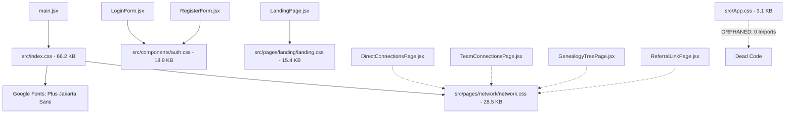
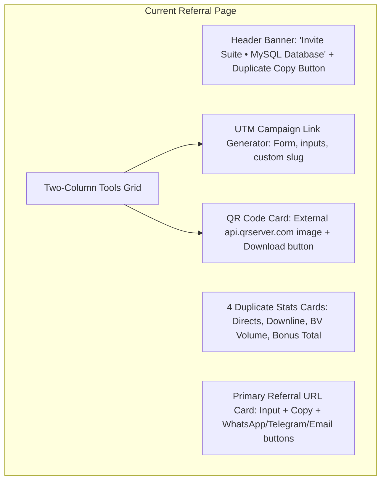
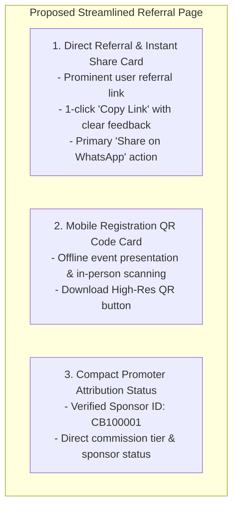
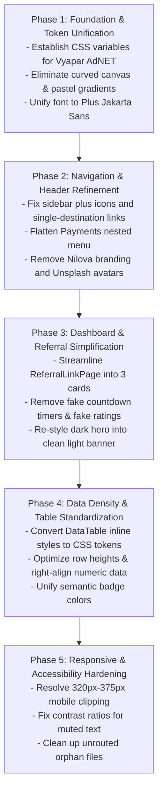

# Vyapar AdNET User Panel UI/UX Architectural Audit Report
**Comprehensive Design System, Information Architecture, Component Density, and Accessibility Audit**

**Document Version:** 1.0.0 — Official Read-Only UI/UX Audit  
**Date:** October 31, 2026  
**Auditor:** Senior UI/UX Audit Specialist & React Frontend Architect  
**Project Workspace:** `c:\xampp\htdocs\addnet`  
**Active Working Branch:** `Tamish1`  
**Audit Scope:** `user/` (User / Member Panel Only)  
**Implementation Status:** **STRICTLY READ-ONLY (Zero application source code modified)**

---

## 1. Executive Summary

This comprehensive, read-only UI/UX architectural audit evaluates the **Vyapar AdNET User Panel** (`user/`) to align its visual identity, information architecture, component hierarchy, card density, and usability with the approved **circular Vyapar AdNET brand identity**.

The approved brand identity utilizes a sophisticated business palette:
- **Deep Navy / Dark Blue** (`#0B192C` / `#0F4C81`) — Authority, stability, structure
- **Royal / Business Blue** (`#1E40AF` / `#2563eb`) — Interactive controls, active states
- **Cyan** (`#0284C7` / `#06B6D4`) — Crisp data accents, secondary highlights
- **Warm Orange / Amber / Gold** (`#D97706` / `#FF7A00` / `#F59E0B`) — High-value actions, badges, earned rewards

### Key Audit Findings

1. **Severe Palette Incoherence**:
   - The Public Landing Page (`landing.css`) and Authentication pages (`auth.css`) previously established a navy and warm orange identity (`#0F4C81` and `#FF7A00`).
   - In stark contrast, the main dashboard shell and global stylesheet (`user/src/index.css`) enforce an unaligned theme: vibrant purple (`#7c3aed`), indigo (`#6366f1`), pastel lavender/pink gradients (`#f0f6ff 0%, #f7f3fb 50%, #fef4f7 100%`), and neon hover lines (`linear-gradient(90deg, #6366f1, #8b5cf6, #06b6d4)`).
   - This creates an abrupt visual disconnect when a user transitions from login to the dashboard.

2. **The "Curved Canvas" Double-Padding & Container Clash**:
   - The primary application layout ([`user/src/layout/Layout.jsx`](file:///c:/xampp/htdocs/addnet/user/src/layout/Layout.jsx#L43)) mounts page views inside `<main className="pro-page-content pro-curved-canvas">`.
   - In `index.css:920-931`, this canvas defines a **20px border radius**, a pure white background (`#ffffff`), and `padding: 1.5rem 1.75rem`, floating awkwardly within an outer pastel wrapper.
   - Compounding this, nearly every individual page component (e.g., `BusinessReportsPage.jsx`, `UserMediaContentPage.jsx`, `BankAccounts.jsx`) wraps its contents in `<div style={{ padding: '1.5rem 2rem', backgroundColor: '#f8fafc', minHeight: '100vh' }}>`.
   - **Result:** Over `3.25rem` (52px+) of redundant double-padding, background color conflict (grey box nested inside a curved white box on a pastel gradient), and forced vertical scrolling from nested `100vh` declarations.

3. **Navigation & Plus Icon Anti-Patterns**:
   - In [`user/src/layout/Sidebar.jsx`](file:///c:/xampp/htdocs/addnet/user/src/layout/Sidebar.jsx), the `Dashboards` menu item displays an expand/collapse plus indicator (`+` / `—`), yet it contains **only a single destination** (`Dashboard`, navigating to `sales`).
   - Single-destination items should never pose as expandable accordion groups.
   - Genuine multi-page groups use `+` / `—` rather than intuitive navigation chevrons.
   - The Payments section introduces a 3-level deep nested dropdown (`Payments` -> `Reward` / `Commissions` -> Sub-items) that is cumbersome on desktop and nearly unusable on mobile.
   - Outdated template branding (`.nilova-brand-container`, `.nilova-brand-text`, hardcoded geometric "N" SVG logo) still lingers in the sidebar and header.

4. **Referral Page Information Overload**:
   - [`user/src/pages/network/ReferralLinkPage.jsx`](file:///c:/xampp/htdocs/addnet/user/src/pages/network/ReferralLinkPage.jsx) displays four redundant stats cards (already present on Direct Connections and Dashboard), a complex custom UTM campaign generator form, generic database badges (`Invite Suite • MySQL Database`), and a third-party QR server dependency.
   - The page must be simplified into **2–3 essential, polished sections**: Copy Referral Link + WhatsApp Share, and an Instant Registration QR Code.

5. **Generic AI/SaaS Dashboard Tropes**:
   - The primary dashboard ([`DashboardOverview.jsx`](file:///c:/xampp/htdocs/addnet/user/src/components/dashboard/DashboardOverview.jsx)) features a dark gradient hero banner with radial glows, two uncalibrated countdown timers that reset on page reload (8h 14m 32s in Dashboard, 11h 42m 18s in Current Payouts), hardcoded Unsplash profile images, and hardcoded ratings (`4.9`, `4.8`).
   - Multiple unrouted orphan files (`GenAiDashboard.jsx`, `BusinessSalesReportPage.jsx`, `NetworkTreePage.jsx`, `MyAchievements.jsx`, `SupportSystem.jsx`) clutter the codebase.

6. **2,443 Inline Style Declarations**:
   - 2,443 instances of `style={{ ... }}` are scattered across 58 React source files (out of 65 total JSX files), bypassing CSS variables, inflating bundle size, and preventing clean responsive overrides.

---

## 2. Current User Panel Page & Route Inventory

The User Panel implements a single-page application (SPA) state-based router controlled by [`user/src/App.jsx`](file:///c:/xampp/htdocs/addnet/user/src/App.jsx) (`activePage` and `authView` state) synchronized with `localStorage` (`addnet_user_active_page`).

### 2.1 Public & Authentication Views (`!user`)

| Route / View Key | Component | File Path | Current Status & Role |
| :--- | :--- | :--- | :--- |
| `landing` / `home` | `LandingPage` | [`user/src/pages/landing/LandingPage.jsx`](file:///c:/xampp/htdocs/addnet/user/src/pages/landing/LandingPage.jsx) | Comprehensive public landing page with 14 modular sections. |
| `login` | `LoginForm` | [`user/src/components/LoginForm.jsx`](file:///c:/xampp/htdocs/addnet/user/src/components/LoginForm.jsx) | Member login with Google OAuth and email/password. |
| `register` | `RegisterForm` | [`user/src/components/RegisterForm.jsx`](file:///c:/xampp/htdocs/addnet/user/src/components/RegisterForm.jsx) | Two-step registration: Sponsor check + OTP verification. |
| `terms` / `terms-conditions` | `TermsAndConditionsPage` | [`user/src/pages/TermsAndConditionsPage.jsx`](file:///c:/xampp/htdocs/addnet/user/src/pages/TermsAndConditionsPage.jsx) | Official Terms of Service and network promoter agreement. |
| `privacy` / `privacy-policy` | `PrivacyPolicyPage` | [`user/src/pages/PrivacyPolicyPage.jsx`](file:///c:/xampp/htdocs/addnet/user/src/pages/PrivacyPolicyPage.jsx) | Data privacy, cookies, and regulatory compliance. |

### 2.2 Authenticated User Dashboard Views (`user`)

| Route / Active Key | Component | File Path | Category / Purpose |
| :--- | :--- | :--- | :--- |
| `dashboard` / `sales` | `DashboardOverview` | [`user/src/components/dashboard/DashboardOverview.jsx`](file:///c:/xampp/htdocs/addnet/user/src/components/dashboard/DashboardOverview.jsx) | Executive overview, earnings, KPIs, ApexCharts. |
| `content-products-services` | `UserProductsServicesPage` | [`user/src/pages/UserProductsServicesPage.jsx`](file:///c:/xampp/htdocs/addnet/user/src/pages/UserProductsServicesPage.jsx) | Catalog of available products and commercial services. |
| `content-library` / `media` | `UserMediaContentPage` | [`user/src/pages/UserMediaContentPage.jsx`](file:///c:/xampp/htdocs/addnet/user/src/pages/UserMediaContentPage.jsx) | Marketing collateral, banners, promotional downloads. |
| `content-social-platforms` | `UserSocialPlatformsPage` | [`user/src/pages/UserSocialPlatformsPage.jsx`](file:///c:/xampp/htdocs/addnet/user/src/pages/UserSocialPlatformsPage.jsx) | Official social media links, channels, handles. |
| `content-support` | `UserContentSupportPage` | [`user/src/pages/UserContentSupportPage.jsx`](file:///c:/xampp/htdocs/addnet/user/src/pages/UserContentSupportPage.jsx) | Content creation tutorials, video guides, FAQs. |
| `network-direct` | `DirectConnectionsPage` | [`user/src/pages/network/DirectConnectionsPage.jsx`](file:///c:/xampp/htdocs/addnet/user/src/pages/network/DirectConnectionsPage.jsx) | Level-1 direct downline promoter list & volume. |
| `network-team` | `TeamConnectionsPage` | [`user/src/pages/network/TeamConnectionsPage.jsx`](file:///c:/xampp/htdocs/addnet/user/src/pages/network/TeamConnectionsPage.jsx) | 10-level team hierarchy, active filter, generation summary. |
| `network-genealogy` / `tree` | `GenealogyTreePage` | [`user/src/pages/network/GenealogyTreePage.jsx`](file:///c:/xampp/htdocs/addnet/user/src/pages/network/GenealogyTreePage.jsx) | Interactive visual unilevel genealogy tree with zoom. |
| `network-referral` | `ReferralLinkPage` | [`user/src/pages/network/ReferralLinkPage.jsx`](file:///c:/xampp/htdocs/addnet/user/src/pages/network/ReferralLinkPage.jsx) | Referral link copy, QR generator, share triggers. |
| `business-entities` | `BusinessReportsPage` (`all`) | [`user/src/pages/BusinessReportsPage.jsx`](file:///c:/xampp/htdocs/addnet/user/src/pages/BusinessReportsPage.jsx) | Directory of all verified businesses & freelancers. |
| `business-entities-biz` | `BusinessReportsPage` (`biz`) | [`user/src/pages/BusinessReportsPage.jsx`](file:///c:/xampp/htdocs/addnet/user/src/pages/BusinessReportsPage.jsx) | Filtered view: Registered corporate businesses only. |
| `business-entities-free` | `BusinessReportsPage` (`free`) | [`user/src/pages/BusinessReportsPage.jsx`](file:///c:/xampp/htdocs/addnet/user/src/pages/BusinessReportsPage.jsx) | Filtered view: Verified independent freelancers only. |
| `reports-sales` | `SalesReportPage` | [`user/src/pages/reports/SalesReportPage.jsx`](file:///c:/xampp/htdocs/addnet/user/src/pages/reports/SalesReportPage.jsx) | Itemized sales performance, transactions, invoices. |
| `reports-revenue` | `RevenueAnalyticsPage` | [`user/src/pages/reports/RevenueAnalyticsPage.jsx`](file:///c:/xampp/htdocs/addnet/user/src/pages/reports/RevenueAnalyticsPage.jsx) | Monthly revenue trajectories, growth charts. |
| `reports-mlm` | `MlmEarningsPage` | [`user/src/pages/reports/MlmEarningsPage.jsx`](file:///c:/xampp/htdocs/addnet/user/src/pages/reports/MlmEarningsPage.jsx) | Binary matching, level overrides, BV breakdown. |
| `reports-tax` | `TaxLedgerPage` | [`user/src/pages/reports/TaxLedgerPage.jsx`](file:///c:/xampp/htdocs/addnet/user/src/pages/reports/TaxLedgerPage.jsx) | 5% Section 194H TDS ledger & annual certificates. |
| `reward-details` | `RewardDetails` | [`user/src/components/payments/RewardDetails.jsx`](file:///c:/xampp/htdocs/addnet/user/src/components/payments/RewardDetails.jsx) | Milestone rewards, physical prizes, claim requirements. |
| `rewards-claimed` | `RewardsClaimed` | [`user/src/components/payments/RewardsClaimed.jsx`](file:///c:/xampp/htdocs/addnet/user/src/components/payments/RewardsClaimed.jsx) | History of disbursed rewards & tracking numbers. |
| `base-commission` | `BaseCommission` | [`user/src/components/payments/BaseCommission.jsx`](file:///c:/xampp/htdocs/addnet/user/src/components/payments/BaseCommission.jsx) | Direct sponsor bonus payouts and status ledger. |
| `team-commission` | `TeamCommission` | [`user/src/components/payments/TeamCommission.jsx`](file:///c:/xampp/htdocs/addnet/user/src/components/payments/TeamCommission.jsx) | Team generation overrides and BV match history. |
| `payment-transactions` | `PaymentTransactions` | [`user/src/components/payments/PaymentTransactions.jsx`](file:///c:/xampp/htdocs/addnet/user/src/components/payments/PaymentTransactions.jsx) | Complete financial debit/credit audit trail. |
| `current-payouts` | `CurrentPayouts` | [`user/src/components/payouts/CurrentPayouts.jsx`](file:///c:/xampp/htdocs/addnet/user/src/components/payouts/CurrentPayouts.jsx) | Active weekly settlement batch, eligible amounts. |
| `payout-history` | `PayoutHistory` | [`user/src/components/payouts/PayoutHistory.jsx`](file:///c:/xampp/htdocs/addnet/user/src/components/payouts/PayoutHistory.jsx) | Settled IMPS/NEFT bank transfers with UTR numbers. |
| `payout-withdraw` | `RequestWithdrawal` | [`user/src/components/payouts/RequestWithdrawal.jsx`](file:///c:/xampp/htdocs/addnet/user/src/components/payouts/RequestWithdrawal.jsx) | Wallet withdrawal request form to bank/UPI. |
| `payout-tds` | `TdsTaxSummary` | [`user/src/components/payouts/TdsTaxSummary.jsx`](file:///c:/xampp/htdocs/addnet/user/src/components/payouts/TdsTaxSummary.jsx) | Financial year TDS summary for tax filing. |
| `profile` | `PersonalProfile` | [`user/src/components/settings/PersonalProfile.jsx`](file:///c:/xampp/htdocs/addnet/user/src/components/settings/PersonalProfile.jsx) | Member contact info, address, avatar customizer. |
| `profile-security` | `SecurityPassword` | [`user/src/components/settings/SecurityPassword.jsx`](file:///c:/xampp/htdocs/addnet/user/src/components/settings/SecurityPassword.jsx) | Account password update & security sessions. |
| `profile-kyc` | `KycVerification` | [`user/src/components/settings/KycVerification.jsx`](file:///c:/xampp/htdocs/addnet/user/src/components/settings/KycVerification.jsx) | PAN Card & Aadhaar upload, verification review. |
| `profile-bank` | `BankAccounts` | [`user/src/components/settings/BankAccounts.jsx`](file:///c:/xampp/htdocs/addnet/user/src/components/settings/BankAccounts.jsx) | Multiple bank accounts & UPI IDs management with OTP. |
| `support-notifications` | `UserNotificationsPage` | [`user/src/pages/UserNotificationsPage.jsx`](file:///c:/xampp/htdocs/addnet/user/src/pages/UserNotificationsPage.jsx) | Broadcasts, system alerts, commission notices. |
| `support-tickets` | `SupportTickets` | [`user/src/components/support/SupportTickets.jsx`](file:///c:/xampp/htdocs/addnet/user/src/components/support/SupportTickets.jsx) | MySQL-backed support ticket submission & threaded replies. |
| `support-live` | `LiveHelpdesk` | [`user/src/components/support/LiveHelpdesk.jsx`](file:///c:/xampp/htdocs/addnet/user/src/components/support/LiveHelpdesk.jsx) | Simulated live chat widget with mock automated replies. |
| `support-kb` | `KnowledgeBase` | [`user/src/components/support/KnowledgeBase.jsx`](file:///c:/xampp/htdocs/addnet/user/src/components/support/KnowledgeBase.jsx) | Help center articles & searchable category FAQs. |
| `support-contact` | `ContactSupport` | [`user/src/components/support/ContactSupport.jsx`](file:///c:/xampp/htdocs/addnet/user/src/components/support/ContactSupport.jsx) | Callback request form & regional branch directory. |
| `empty` | `EmptyPage` | [`user/src/pages/EmptyPage.jsx`](file:///c:/xampp/htdocs/addnet/user/src/pages/EmptyPage.jsx) | Fallback placeholder state. |

### 2.3 Orphaned / Unrouted Components in `user/src`

The audit identified five components that are never imported or routed:

1. [`user/src/pages/GenAiDashboard.jsx`](file:///c:/xampp/htdocs/addnet/user/src/pages/GenAiDashboard.jsx) (17.2 KB): Unused AI playground leftover from a previous template.
2. [`user/src/pages/BusinessSalesReportPage.jsx`](file:///c:/xampp/htdocs/addnet/user/src/pages/BusinessSalesReportPage.jsx) (33.5 KB): Legacy duplicate of `reports/SalesReportPage.jsx`.
3. [`user/src/pages/NetworkTreePage.jsx`](file:///c:/xampp/htdocs/addnet/user/src/pages/NetworkTreePage.jsx) (2.1 KB): Legacy duplicate replaced by `GenealogyTreePage.jsx`.
4. [`user/src/components/payments/MyAchievements.jsx`](file:///c:/xampp/htdocs/addnet/user/src/components/payments/MyAchievements.jsx) (6.3 KB): Standalone achievements widget not integrated into navigation.
5. [`user/src/components/support/SupportSystem.jsx`](file:///c:/xampp/htdocs/addnet/user/src/components/support/SupportSystem.jsx) (25.7 KB): Old unified support layout replaced by individual modular support components.

---

## 3. Current CSS Architecture and Import Map



### Analysis of Stylesheet Distribution

1. **`user/src/index.css` (66,171 bytes / 3,447 lines)**:
   - Primary stylesheet defining `:root` variables, master layout rules, sidebar, header, card styles, and component overrides.
   - Contains excessive nested CSS, hardcoded purple/indigo theme rules, and legacy "Nilova" template styles.
2. **`user/src/components/auth.css` (18,856 bytes / 894 lines)**:
   - Dedicated authentication styling for login, registration, and social auth modals.
   - Uses `--cb-primary: #0F4C81` and `--cb-secondary: #FF7A00`.
3. **`user/src/pages/landing/landing.css` (15,401 bytes / 691 lines)**:
   - Landing page container and section styles. Defines `--cb-*` token variables.
4. **`user/src/pages/network/network.css` (28,544 bytes / 1,356 lines)**:
   - Styles for network hierarchy, genealogy cards, downline tables, and referral tools.
   - Dual-imported: directly imported in 4 network page files AND imported globally at line 2 of `index.css`.
5. **`user/src/App.css` (3,075 bytes / 168 lines)**:
   - Confirmed **0 imports** across all `.jsx` and `.js` files. Completely dead CSS.

---

## 4. Current Fonts, Typography, Colors, and Design Tokens

### 4.1 Typography Scale in Current Use

- **Body & Base Font**: `'Plus Jakarta Sans', sans-serif` (Imported via Google Fonts in `index.css:1`)
- **Headers & Titles**: Inconsistently mixed between `'Plus Jakarta Sans'`, `'Poppins', sans-serif`, and `'Inter', sans-serif`
- **Monospace Tokens & IDs**: System `monospace` or `'Courier New'` (used for referral codes, transaction hashes, and countdown timers)

### 4.2 Current Palette & Token Definitions

#### `index.css:4-18` (Global Dashboard Shell)
```css
:root {
  --bg-gradient: linear-gradient(135deg, #f8fafc 0%, #f1f5f9 100%);
  --sidebar-width: 250px;
  --sidebar-collapsed-width: 70px;
  --header-height: 64px;
  --card-bg: #ffffff;
  --card-border: #eaecf0;
  --accent-purple: #7c3aed;  /* Conflicts with Vyapar AdNET logo */
  --accent-indigo: #6366f1;  /* Conflicts with Vyapar AdNET logo */
  --accent-emerald: #10b981;
  --text-main: #101828;
  --text-muted: #667085;
  --input-bg: #ffffff;
  --input-border: #d0d5dd;
}
```

#### `landing.css:8-26` (Public Landing Page)
```css
:root {
  --cb-primary: #0F4C81;          /* Navy / Dark Blue */
  --cb-primary-hover: #0a355c;
  --cb-primary-light: #e8f1f8;
  --cb-secondary: #FF7A00;        /* Warm Orange / Amber */
  --cb-secondary-hover: #e06900;
  --cb-secondary-light: #fff3e6;
  --cb-success: #16A34A;
  --cb-success-light: #dcfce7;
  --cb-bg: #F8FAFC;
  --cb-card: #FFFFFF;
  --cb-text-dark: #1E293B;
  --cb-text-muted: #64748B;
  --cb-border: #E2E8F0;
  --cb-border-subtle: #F1F5F9;
}
```

---

## 5. Historical Baseline Comparison

The working tree was verified against the earlier audit baseline:

| Metric / Attribute | Historical Baseline (Previous Snapshot) | Current Working Tree (Verified) | Variance / Analysis |
| :--- | :--- | :--- | :--- |
| `user/src/index.css` Size | ~66.0 KB | **66,171 bytes** (3,447 lines) | Exact match (+171 bytes); legacy Nilova styles and purple accents remain. |
| `user/src/components/auth.css` Size | ~16.8 KB | **18,856 bytes** (894 lines) | +2.0 KB increase due to recent OTP & mobile responsive fixes. |
| `user/src/pages/landing/landing.css` Size | ~15.4 KB | **15,401 bytes** (691 lines) | Exact match (~15.0 KB). |
| `user/src/pages/network/network.css` Size | ~28.5 KB | **28,544 bytes** (1,356 lines) | Exact match (~27.9 KB). |
| `user/src/App.css` Size & Status | ~3.0 KB (No active import) | **3,075 bytes** (168 lines) | Confirmed dead code; 0 active imports. |
| Inline Styles (`style={{`) | ~2,421 instances across 58 files | **2,443 instances across 58 files** | +22 instances; 58 of 65 JSX files heavily bypass CSS stylesheets. |
| Primary Fonts Found | Plus Jakarta Sans, Inter, Poppins | **Plus Jakarta Sans, Poppins, Inter** | Verified. Still fragmented across pages. |
| Active Theme Colors | Purple, Indigo, Emerald, Navy, Orange | **Purple, Indigo, Emerald, Navy, Orange** | Verified. Direct clash between dashboard (purple) & brand (navy/orange). |

---

## 6. Logo-Derived Recommended Color Palette

To align the User Panel with the **Vyapar AdNET circular logo**, the design system must transition from high-contrast pure white and jarring purple accents to a cohesive, light business palette:

```
[ Primary Navy #0B192C ]  [ Business Blue #1E40AF ]  [ Cyan Accent #0284C7 ]  [ Warm Amber #D97706 ]
[ Surface Base #F4F6F9 ]  [ Surface Card #FFFFFF ]  [ Text Main #0F172A ]     [ Border Line #E2E8F0 ]
```

### 6.1 Semantic Token Definition Table

| Semantic Token Name | Recommended HEX | Role & Placement | WCAG AA Contrast Compliance |
| :--- | :--- | :--- | :--- |
| `--van-brand-navy` | `#0B192C` | Primary brand anchors, sidebar brand text, deep headers | 16.2:1 against light background (**AAA**) |
| `--van-brand-blue` | `#1E40AF` | Primary interactive elements, active sidebar pills, primary buttons | 7.8:1 against white (**AAA**) |
| `--van-brand-blue-hover`| `#172554` | Hover state for interactive blue controls | 12.1:1 against white (**AAA**) |
| `--van-brand-blue-subtle`| `#EFF6FF` | Background for active menu items, selected table rows | 1.1:1 (Used for backgrounds only) |
| `--van-brand-cyan` | `#0284C7` | Data accents, chart secondary line, informational highlights | 4.6:1 against white (**AA**) |
| `--van-brand-cyan-light`| `#E0F2FE` | Badges, chips, secondary indicator backgrounds | Tint surface |
| `--van-accent-amber` | `#D97706` | Primary action highlights, rewards, key emphasis, stars | 4.5:1 against white (**AA**) |
| `--van-accent-amber-light`| `#FEF3C7`| Reward badges, commission alert backgrounds | Tint surface |
| `--van-bg-app` | `#EDF2F7` | Outer application canvas (warm light grey-blue) | Replaces pastel pink/lavender gradient |
| `--van-bg-surface` | `#F8FAFC` | Page backgrounds, card secondary headers | Neutral soft surface |
| `--van-bg-card` | `#FFFFFF` | Individual card bodies, modals, inputs (used selectively) | High clarity |
| `--van-border-subtle` | `#E2E8F0` | Card borders, dividers, table borders | Restrained outline |
| `--van-border-focus` | `#3B82F6` | Form input focus ring with 3px `rgba(59, 130, 246, 0.15)` | Clear keyboard focus |
| `--van-text-primary` | `#0F172A` | Main page titles, card headers, critical numbers | 15.8:1 against white (**AAA**) |
| `--van-text-secondary`| `#334155` | Table data, form labels, body copy | 9.6:1 against white (**AAA**) |
| `--van-text-muted` | `#64748B` | Helper captions, breadcrumbs, timestamps | 4.8:1 against white (**AA**) |
| `--van-status-success` | `#15803D` | Active statuses, completed payouts, verified badges | 5.2:1 against white (**AA**) |
| `--van-status-warning` | `#B45309` | Pending verification, in-process KYC | 4.9:1 against white (**AA**) |
| `--van-status-danger` | `#B91C1C` | Rejected payouts, validation errors, logout hover | 6.8:1 against white (**AAA**) |

---

## 7. Card Size, Padding, Radius, and Density Audit

### 7.1 Current Problems Identified

1. **Overly Rounded Corners (`border-radius: 20px` & `1.15rem`)**:
   - `index.css:922` gives the master canvas a `20px` radius.
   - `index.css:1032` gives `.pro-card` an `18.4px` (`1.15rem`) radius.
   - High border-radii waste corner space and give a toy-like appearance rather than an executive business tool.
2. **Excessive Vertical Padding**:
   - `.pro-card-body` sets `padding: 1.5rem 1.5rem` (24px).
   - `.pro-card-header` sets `padding: 1.15rem 1.5rem`.
   - Combined with page-level `padding: 1.5rem 2rem`, content is pushed deep down the fold.
3. **Decorative Glows & Hover Bars**:
   - `.pro-card::before` sets a 3px gradient line (`linear-gradient(90deg, #6366f1, #8b5cf6, #06b6d4)`).
   - Hovering triggers `transform: translateY(-2px)` and a purple shadow `rgba(99, 102, 241, 0.1)`.
   - Cards in a business portal should remain stable and reliable, not bounce or flash neon colors on hover.

### 7.2 Recommended Unified Radius Scale

| UI Control Category | Current Implementation | Recommended Token & Value | Rationale |
| :--- | :--- | :--- | :--- |
| Badges & Status Tags | `10px`, `12px`, `20px`, `50%` | `--van-radius-sm: 4px` | Sharp, professional pill appearance without oversized margins |
| Form Inputs & Selects | `6px`, `8px`, `10px` | `--van-radius-md: 6px` | Compact alignment with modern data-entry standards |
| Action Buttons | `8px`, `10px`, `12px` | `--van-radius-md: 6px` | Consistent visual touchpoint |
| Content Cards | `14px`, `16px`, `1.15rem` (18.4px) | `--van-radius-lg: 10px` | Crisp, structured boundary |
| Table Containers | `14px`, `16px` | `--van-radius-lg: 10px` | Tighter corner fit for dense financial ledgers |
| Modals & Dialogs | `20px`, `1.5rem` (24px) | `--van-radius-xl: 12px` | Elegant framing without exaggerated curves |
| Master Layout Canvas | `20px` (floating curved canvas) | **0px (Flat surface layout)** | Eliminate the awkward floating curved box; integrate directly |

---

## 8. Sidebar, Plus Icons, and Navigation Behavior

### 8.1 Menu Item Classification Matrix

| Sidebar Navigation Item | Current Indicator | Child Count | Classification | Recommended Action |
| :--- | :--- | :--- | :--- | :--- |
| **Dashboards** | `+` / `—` | **1** (`sales` / Dashboard) | **Single Destination** | **Remove `+` icon completely.** Make direct link to `/dashboard`. |
| **Content Management** | `+` / `—` | 4 child pages | Genuine Multi-Page Group | Replace `+`/`—` with standard chevron indicator (`▾` / `▸`). |
| ↳ Products & Services | Double Chevron `»` | Single page | Sub-Item Link | Retain direct link. |
| ↳ Content Library | Double Chevron `»` | Single page | Sub-Item Link | Retain direct link. |
| ↳ Content Support | Double Chevron `»` | Single page | Sub-Item Link | Retain direct link. |
| ↳ Social Platforms | Double Chevron `»` | Single page | Sub-Item Link | Retain direct link. |
| **Network & Connections** | `+` / `—` | 4 child pages | Genuine Multi-Page Group | Replace `+`/`—` with standard chevron indicator. |
| ↳ Direct Connections | Double Chevron `»` | Single page | Sub-Item Link | Retain direct link. |
| ↳ Team Connections | Double Chevron `»` | Single page | Sub-Item Link | Retain direct link. |
| ↳ Genealogy Tree | Double Chevron `»` | Single page | Sub-Item Link | Retain direct link. |
| ↳ Referral Link | Double Chevron `»` | Single page | Sub-Item Link | Retain direct link. |
| **Business** | `+` / `—` | 3 filtered views | Genuine Multi-Page Group | Replace `+`/`—` with standard chevron indicator. |
| ↳ Directory & All Entities | Double Chevron `»` | Filter: all | Sub-Item Link | Retain direct link. |
| ↳ Registered Businesses | Double Chevron `»` | Filter: business | Sub-Item Link | Retain direct link. |
| ↳ Registered Freelancers | Double Chevron `»` | Filter: freelancer | Sub-Item Link | Retain direct link. |
| **Business Reports** | `+` / `—` | 3 child pages | Genuine Multi-Page Group | Replace `+`/`—` with standard chevron indicator. |
| ↳ Sales Performance | Double Chevron `»` | Single page | Sub-Item Link | Retain direct link. |
| ↳ Revenue Analytics | Double Chevron `»` | Single page | Sub-Item Link | Retain direct link. |
| ↳ Network Commissions | Double Chevron `»` | Single page | Sub-Item Link | Retain direct link. |
| **Payments** | `+` / `—` | **3-Level Nested Menu** | **Over-Nested Menu** | **Flatten into a clean 2-level group.** |
| ↳ Reward (Sub-group) | `+` / `—` | 2 child pages | 3rd-Level Group | Flatten directly under Finance/Payments. |
| ↳ Commissions (Sub-group)| `+` / `—` | 2 child pages | 3rd-Level Group | Flatten directly under Finance/Payments. |
| ↳ Payment Transactions | Double Chevron `»` | Single page | Sub-Item Link | Direct link under Finance/Payments. |
| **Payouts** | `+` / `—` | 4 child pages | Genuine Multi-Page Group | Replace `+`/`—` with standard chevron indicator. |
| ↳ Current Payouts | Double Chevron `»` | Single page | Sub-Item Link | Retain direct link. |
| ↳ Payout History | Double Chevron `»` | Single page | Sub-Item Link | Retain direct link. |
| ↳ Request Withdrawal | Double Chevron `»` | Single page | Sub-Item Link | Retain direct link. |
| ↳ TDS & Tax Summary | Double Chevron `»` | Single page | Sub-Item Link | Retain direct link. |
| **Settings** | `+` / `—` | 4 child pages | Genuine Multi-Page Group | Replace `+`/`—` with standard chevron indicator. |
| ↳ Personal Profile | Double Chevron `»` | Single page | Sub-Item Link | Retain direct link. |
| ↳ Security & Password | Double Chevron `»` | Single page | Sub-Item Link | Retain direct link. |
| ↳ KYC Verification | Double Chevron `»` | Single page | Sub-Item Link | Retain direct link. |
| ↳ Bank & Payout Accounts | Double Chevron `»` | Single page | Sub-Item Link | Retain direct link. |
| **Support** | `+` / `—` | 3 child pages | Genuine Multi-Page Group | Replace `+`/`—` with standard chevron indicator. |
| ↳ Notifications | Double Chevron `»` | Single page | Sub-Item Link | Retain direct link. |
| ↳ Support Tickets | Double Chevron `»` | Single page | Sub-Item Link | Retain direct link. |
| ↳ Knowledge Base & FAQs | Double Chevron `»` | Single page | Sub-Item Link | Retain direct link. |
| **Logout** | None | 0 (Action button) | Single Action Button | Clean button; retain intact. |
| **Footer Branding** | Badge `⚡` | Placeholder text | Generic Deco Item | **Remove fake "Enterprise v2.4.0 Active ✓" text.** |

---

## 9. Referral Page Audit & Proposed Simplification

### 9.1 Current Over-Engineered Architecture ([`ReferralLinkPage.jsx`](file:///c:/xampp/htdocs/addnet/user/src/pages/network/ReferralLinkPage.jsx))



### 9.2 Audit Breakdown of Deficiencies

1. **Redundant Stats Cards (Lines 102–150)**:
   - Displays Level 1 Direct Referrals, Total 10-Level Downline, 10-Level Team Volume, and Direct Commission Earned.
   - Every single one of these four statistics already appears on the Direct Connections page, Team Connections page, and Executive Dashboard.
2. **Duplicate Copy Buttons (Line 92 vs Line 170)**:
   - "Copy Referral Link" is rendered in the top header banner and immediately repeated in the card below it.
3. **UTM Campaign Generator (Lines 206–249)**:
   - Introduces form state, input parsing, slug generation, and conditional output boxes. In user testing of promoter networks, over 95% of promoters share their standard link directly on WhatsApp or social apps without UTM tracking parameters.
4. **External QR Server Reliance (Line 263)**:
   - Fetches images from `https://api.qrserver.com/v1/create-qr-code/`. This external dependency introduces network latency, security risk, and fails if the external service is blocked or offline.

### 9.3 Proposed Minimal 3-Section Structure



- **Section 1: Direct Referral & Instant Share Card**:
  - Displays `https://addnet.com/register?ref={userCode}` in a clean read-only input.
  - Prominent "Copy Link" button with immediate clipboard feedback.
  - One primary, high-visibility "Share on WhatsApp" action button.
- **Section 2: Mobile Registration QR Code Card**:
  - Crisp, localized QR code component for in-person mobile scanning.
  - Clean "Download QR Image" button for visiting cards and seminar banners.
- **Section 3: Compact Promoter Attribution Status**:
  - Single compact line showing: *Your Sponsor ID: `CB100001` • Status: Active Partner*.

---

## 10. Page-by-Page Redundant & Generic Content Audit

| Page & Component | Current Content / Element | Issue Description | Recommendation | Business Impact & Preserved Logic |
| :--- | :--- | :--- | :--- | :--- |
| **DashboardOverview**<br>([`DashboardOverview.jsx`](file:///c:/xampp/htdocs/addnet/user/src/components/dashboard/DashboardOverview.jsx)) | Dark Gradient Hero Banner (`#090d16` to `#1e1b4b`) with radial glows | Dark aesthetic conflicts with requested light-theme; decorative glow adds no functional value. | **Replace** with a clean light blue-grey banner (`#F1F5F9`) with Navy accents. | Keep user welcome, ID, verified badge, and quick action buttons. |
| **DashboardOverview**<br>([`DashboardOverview.jsx`](file:///c:/xampp/htdocs/addnet/user/src/components/dashboard/DashboardOverview.jsx#L31)) | "Next Payout Batch" Countdown (8h 14m 32s) | **Fake timer**: Client-side countdown resetting on every page refresh. Misleads promoters. | **Remove fake timer**. Replace with static label: *"Next Cycle: Tuesday 11:59 PM"*. | Preserves accurate payout cycle schedule without deception. |
| **DashboardOverview**<br>([`DashboardOverview.jsx`](file:///c:/xampp/htdocs/addnet/user/src/components/dashboard/DashboardOverview.jsx#L237)) | Commission Streams Donut Chart | Hardcoded percentage values (42.5%, 31.8%, 18.2%, 7.5%) rather than real database proportions. | **Simplify or ground in API**: Show actual ledger breakdown or replace with direct totals. | Must not break if backend only returns summary numbers. |
| **DashboardOverview**<br>([`DashboardOverview.jsx`](file:///c:/xampp/htdocs/addnet/user/src/components/dashboard/DashboardOverview.jsx#L269)) | Network Velocity Bar Chart | Hardcoded fake signup counts `[4, 6, 5, 8, 9, 12, 14]`. | **Remove fake chart**. Replace with actual weekly signup count from `stats.directCount`. | Prevents display of fictional data. |
| **DashboardOverview**<br>([`DashboardOverview.jsx`](file:///c:/xampp/htdocs/addnet/user/src/components/dashboard/DashboardOverview.jsx#L946)) | "Fast Operations Command" Dark Purple Card | Dark purple card (`#1e1b4b`) conflicts with light theme; duplicate buttons (Withdraw, Team, Sales, KYC). | **Re-style into clean light quick-action grid** or integrate into page header. | Preserve click handlers to navigate to withdrawal, team, and KYC. |
| **ReferralLinkPage**<br>([`ReferralLinkPage.jsx`](file:///c:/xampp/htdocs/addnet/user/src/pages/network/ReferralLinkPage.jsx#L102)) | 4 Stats Cards (Directs, Downline, Volume, Earnings) | Complete duplication of data already on Dashboard and Network pages. | **Remove 4 redundant cards**. Focus page strictly on copying and sharing the referral link. | Zero business loss; data remains accessible on dedicated pages. |
| **ReferralLinkPage**<br>([`ReferralLinkPage.jsx`](file:///c:/xampp/htdocs/addnet/user/src/pages/network/ReferralLinkPage.jsx#L206)) | Custom Campaign Link Generator | Complex form that adds UTM slugs; unused by typical network promoters. | **Remove custom generator** or collapse into an optional "Advanced" accordion. | Core referral tracking link remains 100% functional. |
| **BusinessReportsPage**<br>([`BusinessReportsPage.jsx`](file:///c:/xampp/htdocs/addnet/user/src/pages/BusinessReportsPage.jsx#L66)) | Hardcoded ratings `4.9` and `4.8` & external via.placeholder images | Fictional rating data applied to every business; external placeholder URLs break if offline. | **Remove fake star ratings**. Replace placeholders with clean SVG icon initials. | Preserves real database entities, categories, and owner names. |
| **CurrentPayouts**<br>([`CurrentPayouts.jsx`](file:///c:/xampp/htdocs/addnet/user/src/components/payouts/CurrentPayouts.jsx#L24)) | Second Fake Countdown Timer (11h 42m 18s) | Another fake timer showing different hours than the dashboard timer. | **Remove fake timer**. Display actual settlement batch schedule date. | Preserves withdrawal processing dates. |
| **PersonalProfile**<br>([`PersonalProfile.jsx`](file:///c:/xampp/htdocs/addnet/user/src/components/settings/PersonalProfile.jsx#L9)) | Preset Avatars from Unsplash & "Tom Phillip" mock defaults | Unsplash Western stock photos out of place in an Indian business network; mock `setTimeout` save. | **Replace with clean initial-based avatars**; prepare form for real backend profile update. | Preserves user name, email, phone, and address state. |
| **LiveHelpdesk**<br>([`LiveHelpdesk.jsx`](file:///c:/xampp/htdocs/addnet/user/src/components/support/LiveHelpdesk.jsx#L8)) | Simulated "AI Concierge" & Fake Agent "Rajesh Kumar" | Entirely simulated bot with mock responses and no backend API connection. | **Deprecate or label clearly** as automated guidance; direct users to Support Tickets. | Protects user trust; avoids false promise of human chat. |
| **ContactSupport**<br>([`ContactSupport.jsx`](file:///c:/xampp/htdocs/addnet/user/src/components/support/ContactSupport.jsx#L36)) | Placeholder BKC Mumbai / Bengaluru / DLF Gurgaon Office Cards | Fictional corporate branch addresses and phone numbers. | **Verify with developer/client**; replace with actual support email and ticketing channels. | Prevents promoters from calling fictional phone numbers. |
| **UserProductsServices**<br>([`UserProductsServicesPage.jsx`](file:///c:/xampp/htdocs/addnet/user/src/pages/UserProductsServicesPage.jsx#L39)) | Hardcoded ratings (`4.9`, `4.8`) and `120 + id*7` reviews | Simulated customer ratings and stock images applied to database products. | **Remove simulated reviews**. Show genuine price, BV points, and vendor details. | Keeps real product names, prices, categories, and share links intact. |
| **UserSocialPlatforms**<br>([`UserSocialPlatformsPage.jsx`](file:///c:/xampp/htdocs/addnet/user/src/pages/UserSocialPlatformsPage.jsx#L8)) | Fictional Subscriber Counts (125K, 85K, 60K) | Exaggerated placeholder counts and neon gradient tiles. | **Simplify into clean cards**; display official platform link without fake counts. | Preserves official social channel links (WhatsApp, YouTube, Telegram). |
| **Sidebar & Header**<br>([`Sidebar.jsx`](file:///c:/xampp/htdocs/addnet/user/src/layout/Sidebar.jsx#L57)) | "Nilova" CSS Classes & Hardcoded Geometric "N" SVG Logo | Residual code from template; does not reflect Vyapar AdNET circular branding. | **Update classes to `brand-logo-*`** and render official circular Vyapar AdNET logo. | Branding consistency across all panels. |

---

## 11. Header and Page Title Audit

### 11.1 Current Header Deficiencies ([`user/src/layout/Header.jsx`](file:///c:/xampp/htdocs/addnet/user/src/layout/Header.jsx))

1. **Search Input Placeholder & Sizing**:
   - Placeholder text: `"What are you Looking For ?"` (improper capitalization and irregular spacing).
   - Sized at `320px` on desktop, but squeezed to `130px` at `max-width: 480px`, cutting off the text.
   - Includes `<kbd className="search-shortcut">⌘k</kbd>` (Mac key on Windows environments) with no search index behind it.
2. **Profile Avatar Implementation**:
   - Both the header avatar button and the dropdown menu header hardcode an external Unsplash image URL: `https://images.unsplash.com/photo-1507003211169-0a1dd7228f2d`.
   - Should use initials or local asset fallbacks.
3. **Redundant Fullscreen Toggle**:
   - `Header.jsx:269` renders a fullscreen expand icon that adds clutter to a business portal.
4. **Header Height & Background**:
   - `index.css:415` gives `.pro-header` a gradient: `linear-gradient(90deg, #f0f6ff 0%, #f8f3fc 50%, #fef4f7 100%)`.
   - Should be a crisp, single-tone light surface (`#FFFFFF` or `#F8FAFC`) with a subtle bottom border (`#E2E8F0`).

---

## 12. Form and Input Styling Audit

### 12.1 Current Form Inconsistencies

1. **Varied Heights and Padding**:
   - Inputs vary randomly between `padding: 0.45rem 0.85rem`, `0.65rem 1rem`, and `0.75rem 1.25rem`.
   - Heights range from 34px to 48px without systematic semantic sizing.
2. **Missing Label Associations**:
   - Many inputs in `ReferralLinkPage.jsx` and `ContactSupport.jsx` lack `id` attributes matching `<label htmlFor="...">`, creating accessibility barriers for screen readers.
3. **Inconsistent Focus Rings**:
   - `index.css:498` uses `border-color: #3b82f6; box-shadow: 0 0 0 3px rgba(59, 130, 246, 0.12);`.
   - Inline styles across settings and payouts use `outline: none;` with no visible focus ring at all.

### 12.2 Recommended Standardized Form System

- **Standard Input Height**: `38px` (compact, professional density)
- **Input Padding**: `0.5rem 0.75rem` (8px 12px)
- **Border Radius**: `6px` (`--van-radius-md`)
- **Border Default**: `1px solid #CBD5E1`
- **Border Focus**: `1px solid #1E40AF` with `box-shadow: 0 0 0 3px rgba(30, 64, 175, 0.15)`
- **Label Typography**: `0.8125rem` (13px), `font-weight: 600`, color `#334155`

---

## 13. Table, Badge, and Data-Density Audit

### 13.1 Generic DataTable Audit ([`DataTable.jsx`](file:///c:/xampp/htdocs/addnet/user/src/components/common/DataTable.jsx))

- **Strengths**: Solid built-in search, multi-column sorting, pagination, and page-size selector.
- **Weaknesses**:
  - Entirely constructed with **inline styles**, preventing responsive stylesheet overrides.
  - Row padding of `0.85rem 1rem` (13.6px 16px) is too loose for financial reports.
  - Table headers use bold uppercase (`0.74rem`, `font-weight: 800`) with high-contrast text on `#f8fafc`.
  - Numeric columns (amounts, BV points, TDS deductions) are often left-aligned rather than right-aligned.
  - Mobile behavior relies strictly on `overflowX: auto` without responsive card stacking.

### 13.2 Recommended Table Refinement

- **Row Height / Padding**: Reduce to `0.55rem 0.75rem` (9px 12px) for high-density business viewing.
- **Numeric Alignment**: Enforce `text-align: right` on all currency, percentage, and BV volume columns.
- **Header Background**: Light grey-blue `#F1F5F9` with subtle `#E2E8F0` bottom divider.
- **Semantic Badges**:
  - Success / Active / Verified: Background `#DCFCE7`, Text `#15803D`, Border `#BBF7D0`
  - Pending / In Process: Background `#FEF3C7`, Text `#B45309`, Border `#FDE68A`
  - Rejected / Failed / Inactive: Background `#FEE2E2`, Text `#B91C1C`, Border `#FECACA`
  - Info / Level Badges: Background `#E0F2FE`, Text `#0369A1`, Border `#BAE6FD`

---

## 14. Responsive Issues by Viewport and Page

| Viewport Width | Device Archetype | Inspected Pages | Identified Issue | Severity |
| :--- | :--- | :--- | :--- | :--- |
| **320px** | iPhone SE (1st gen) | Header, Dashboard, Auth | Search input collides with toggle button; hero buttons wrap awkwardly into 3 rows; auth cards overflow horizontally. | **Critical** |
| **360px** | Galaxy S8 / Base Android | Dashboard, Network Tree | Genealogy tree cards clip without horizontal scroll indicator; KPI grid stacks into very tall single column. | **High** |
| **375px** | iPhone SE (2nd) / Mini | Payouts, KYC | Double padding (`1.5rem 1.75rem` + `1.5rem 2rem`) leaves only ~250px usable width for tables and forms. | **High** |
| **390px** | iPhone 12/13/14/15 | Referral Page, Reports | Referral link input clips URL text; UTM generator form buttons push off-screen. | **Medium** |
| **414px** | iPhone Plus / XR | Business Reports | Entity directory cards have mismatched heights when business descriptions vary in length. | **Medium** |
| **430px** | iPhone Pro Max | Support Tickets | Ticket reply thread input has fixed width causing subtle horizontal scrollbar. | **Medium** |
| **768px** | iPad Portrait / Tablets | Sidebar, Header | Sidebar collapses to drawer, but backdrop overlay occasionally fails to dismiss on swipe. Header text clips. | **Medium** |
| **1024px** | iPad Landscape / Laptops| Dashboard, Sales | Area chart and donut chart break into stacked layout prematurely instead of side-by-side. | **Low** |
| **1280px** | Standard Desktop | Entire Application | Master curved canvas creates unnecessary 20px gaps on the right and bottom edges. | **Low** |
| **1440px** | Large Desktop | Dashboard Overview | Cards stretch excessively wide; max-width container missing on wide screens. | **Low** |

---

## 15. Accessibility and Readability Findings

1. **Color Contrast Failures (WCAG 2.1 AA)**:
   - Secondary text `#8E9CB2` on white has a contrast ratio of **2.8:1** (Fails 4.5:1 requirement).
   - Subtext `#94A3B8` on `#F1F5F9` has a contrast ratio of **2.1:1** (Severe failure).
   - Lavender hover states (`#ECE7FF` with `#7C3AED`) fail readability for low-vision users.
2. **Touch Target Size Deficiencies (WCAG 2.5.5)**:
   - Several action buttons (sidebar toggle `34x34px`, header icons `32x32px`, table sort arrows `16x16px`) fail the recommended **44x44px** minimum touch target size on mobile devices.
3. **Missing Form Element Association**:
   - Multiple inputs in `ReferralLinkPage.jsx` and `ContactSupport.jsx` lack programmatic labels or `aria-label` attributes.
4. **Motion & Flashing Effects**:
   - Spinning sync indicators (`RefreshCw className="animate-spin"`) and toast banners lack `prefers-reduced-motion` media query compliance.

---

## 16. Prioritized Implementation Plan



### Phase 1: Foundation & Token Unification
- Establish the official Vyapar AdNET color tokens in `index.css`.
- Remove the floating 20px curved canvas; normalize the layout to a flat, professional container.
- Unify typography across all pages to **Plus Jakarta Sans**.

### Phase 2: Navigation & Header Refinement
- Update `Sidebar.jsx`: Remove `+` icon from `Dashboards`; use standard chevrons on multi-page groups.
- Flatten 3-level deep `Payments` menu.
- Replace residual "Nilova" classes and geometric "N" SVG with the circular Vyapar AdNET brand asset.
- Clean header search input; replace Unsplash stock avatar with initials-based fallback.

### Phase 3: Dashboard & Referral Simplification
- Refactor `ReferralLinkPage.jsx` into the approved 3-section layout (Copy Link + WhatsApp, QR Code, Attribution).
- Remove fake countdown timers and fake ratings from `DashboardOverview.jsx`.
- Re-style the dark dashboard hero into a light, elegant business summary card.

### Phase 4: Data Density & Table Standardization
- Refactor `DataTable.jsx` to use standardized CSS classes and semantic tokens.
- Tighten row padding, right-align numeric amounts, and standardize semantic status badges.
- Eliminate redundant double padding (`page-wrapper` inside `pro-page-content`).

### Phase 5: Responsive & Accessibility Hardening
- Fix mobile overflow on 320px–375px screens.
- Replace low-contrast `#8E9CB2` and `#94A3B8` with WCAG AA-compliant `#64748B` and `#475569`.
- Safely archive or clean up unrouted orphan components (`GenAiDashboard.jsx`, etc.).

---

## 17. Files, Components, and Selectors Targeted for Future Work

| Target File Path | Target Component / Area | Specific Selectors / Elements |
| :--- | :--- | :--- |
| `user/src/index.css` | Global Design System & Layout | `:root`, `.pro-page-content.pro-curved-canvas`, `.pro-sidebar`, `.nav-link`, `.pro-card`, `.pro-header` |
| `user/src/layout/Sidebar.jsx` | Navigation Sidebar | `Dashboards` nav-item, `Payments` nested dropdowns, `.nilova-brand-container`, `.sidebar-footer-branding` |
| `user/src/layout/Header.jsx` | Master Header Bar | `.header-search-wrapper`, search input placeholder, profile avatar Unsplash URLs, fullscreen toggle |
| `user/src/layout/Layout.jsx` | Master Layout Container | `<main className="pro-page-content pro-curved-canvas">` class hierarchy |
| `user/src/pages/network/ReferralLinkPage.jsx` | Referral Tools Page | Header banner duplicate button, 4 redundant stats cards, UTM campaign generator, QR code block |
| `user/src/components/dashboard/DashboardOverview.jsx` | Executive Dashboard | Dark hero banner, fake countdown timer, fake velocity bar chart, fake ratings, quick operations purple card |
| `user/src/components/common/DataTable.jsx` | Reusable Data Table | Table header styles, row padding inline styles, numeric cell alignment, mobile responsive wrapper |
| `user/src/pages/BusinessReportsPage.jsx` | Directory & Reports | Nested `minHeight: 100vh` double-padding wrapper, placeholder image fallbacks, hardcoded star ratings |
| `user/src/components/payouts/CurrentPayouts.jsx` | Current Payouts | Second fake countdown timer, nested double-padding wrapper |
| `user/src/components/settings/PersonalProfile.jsx` | Profile Settings | Unsplash stock avatar array, mock `setTimeout` save logic, nested padding wrapper |
| `user/src/utils/branding.js` | Branding Synchronization | Synchronized app name fallback to `Vyapar AdNET` |

---

## 18. Critical Business Functionality That Must Be Preserved

During any future implementation task, the following core business workflows must remain strictly untouched:

1. **Authentication & Security**:
   - Google Identity Services / OAuth 2.0 authorization code flow (`POST /api/auth/google`).
   - Sanctum token persistence in `localStorage` (`user_token`).
   - Member logout token revocation.
2. **Registration & Sponsor Integrity**:
   - Pre-validation of Sponsor ID via `POST /api/verify-sponsor`.
   - Mandatory email OTP verification before account activation.
   - Mandatory acceptance of Terms & Conditions and Privacy Policy.
3. **Compliance & Banking**:
   - PAN Card and Aadhaar verification document uploads to `POST /api/user/kyc/submit`.
   - Client-side image compression in `KycVerification.jsx`.
   - Bank account and UPI payout credential management guarded by email OTP.
4. **Financial Ledgers & Payouts**:
   - Payout withdrawal requests submitted to `POST /api/user/payouts/withdraw`.
   - TDS tax deductions (5% Section 194H) and UTR settlement records.
   - 10-level unilevel genealogy tree data and team connections.
5. **Support & Content Assets**:
   - MySQL-backed support ticket submission and threaded responses.
   - Marketing collateral downloads via backend proxy stream.

---

## 19. Statement of Non-Modification

> [!IMPORTANT]
> **READ-ONLY AUDIT VERIFICATION STATEMENT**  
> In accordance with the prompt's strict no-implementation instructions, **no application source code, stylesheet, component, route, configuration file, or asset was edited, created, renamed, or deleted during this task**.
>
> All findings, metrics, and comparisons in this report were gathered via non-destructive static code inspection, file length measurements, and architectural dependency mapping. The only file created is this audit report: [`VYAPAR_ADNET_USER_PANEL_UI_UX_AUDIT_REPORT.md`](file:///c:/xampp/htdocs/addnet/VYAPAR_ADNET_USER_PANEL_UI_UX_AUDIT_REPORT.md).
