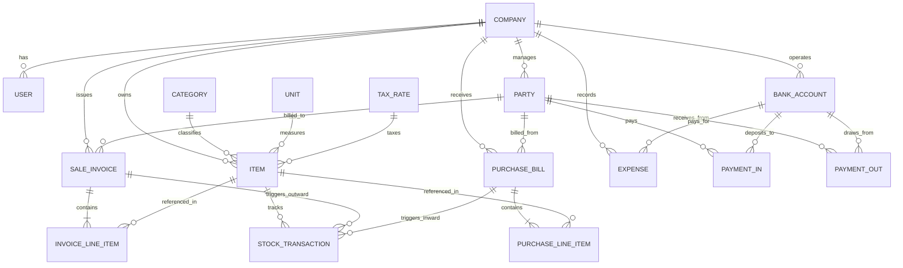

# Vyapar Desktop Application — Conceptual Data Relationship Model

**Document Version:** 1.0.0  
**Context:** Architectural blueprint for the development of the original `Vyapar Adnet` business management application.  
**Evidence Standard:** Every entity, attribute, and relationship is explicitly labeled with its evidence tier:
- `[Directly Evidenced]`: Visible on application forms, table columns, or modals.
- `[Inferred]`: Required to support observed calculations and workflows.
- `[Unverified]`: Industry standard accounting construct not directly visible.

---

## 1. Entity-Relationship Diagram (ERD)

---

## 2. Entity Dictionary & Field Specifications

### Entity 1: `COMPANY` / `BUSINESS`
Represents the tenant / legal business organization.
- **Attributes:**
  - `id`: UUID / Auto-increment Primary Key `[Inferred]`
  - `business_name`: String (e.g. `Enter Business Name`) `[Directly Evidenced]`
  - `phone_number`: String (10 digits) `[Directly Evidenced]`
  - `email_id`: String `[Directly Evidenced]`
  - `gstin`: String (15 alphanumeric) `[Directly Evidenced]`
  - `state_code`: String (2 digits) `[Directly Evidenced]`
  - `address`: Text `[Directly Evidenced]`
  - `logo_path`: String / Blob `[Directly Evidenced]`
  - `signature_path`: String / Blob `[Inferred]`
  - `created_at`: Timestamp `[Inferred]`

---

### Entity 2: `PARTY` (Customer & Supplier Master)
Unified directory for all external entities doing business with the company.
- **Attributes:**
  - `id`: Primary Key `[Inferred]`
  - `company_id`: Foreign Key → `COMPANY.id` `[Inferred]`
  - `party_name`: String (Mandatory) `[Directly Evidenced]`
  - `phone_number`: String (10 digits) `[Directly Evidenced]`
  - `gstin`: String (15 chars) `[Directly Evidenced]`
  - `gst_type`: Enum (`Unregistered`, `Regular`, `Composition`, `Consumer`) `[Directly Evidenced]`
  - `state`: String (Indian State / Union Territory) `[Directly Evidenced]`
  - `email_id`: String `[Directly Evidenced]`
  - `billing_address`: Text `[Directly Evidenced]`
  - `shipping_address`: Text `[Directly Evidenced]`
  - `opening_balance`: Decimal(12, 2) `[Directly Evidenced]`
  - `balance_type`: Enum (`To Receive` [Debit], `To Pay` [Credit]) `[Directly Evidenced]`
  - `as_of_date`: Date `[Directly Evidenced]`
  - `credit_limit`: Decimal(12, 2) (Optional) `[Directly Evidenced]`
  - `custom_fields`: JSON / Key-Value Map `[Directly Evidenced]`
- **Relationships:**
  - 1-to-Many with `SALE_INVOICE` `[Directly Evidenced]`
  - 1-to-Many with `PURCHASE_BILL` `[Inferred]`
  - 1-to-Many with `PAYMENT_IN` `[Inferred]`
  - 1-to-Many with `PAYMENT_OUT` `[Inferred]`

---

### Entity 3: `ITEM` (Products & Services Catalog)
Master catalog of goods sold, purchased, or manufactured.
- **Attributes:**
  - `id`: Primary Key `[Inferred]`
  - `company_id`: Foreign Key → `COMPANY.id` `[Inferred]`
  - `item_type`: Enum (`Product`, `Service`) `[Directly Evidenced]`
  - `item_name`: String (Mandatory) `[Directly Evidenced]`
  - `hsn_code`: String (4-8 digits) `[Directly Evidenced]`
  - `category_id`: Foreign Key → `CATEGORY.id` `[Directly Evidenced]`
  - `unit_id`: Foreign Key → `UNIT.id` `[Directly Evidenced]`
  - `item_code`: String (SKU / Barcode) `[Directly Evidenced]`
  - `image_path`: String `[Directly Evidenced]`
  - `sale_price`: Decimal(10, 2) `[Directly Evidenced]`
  - `sale_tax_included`: Boolean (With Tax vs Without Tax) `[Directly Evidenced]`
  - `discount_value`: Decimal(10, 2) `[Directly Evidenced]`
  - `discount_type`: Enum (`Percentage`, `Amount`) `[Directly Evidenced]`
  - `purchase_price`: Decimal(10, 2) `[Directly Evidenced]`
  - `purchase_tax_included`: Boolean `[Directly Evidenced]`
  - `tax_rate_id`: Foreign Key → `TAX_RATE.id` `[Directly Evidenced]`
  - `opening_stock_qty`: Decimal(10, 3) `[Directly Evidenced]`
  - `opening_stock_value`: Decimal(12, 2) `[Directly Evidenced]`
  - `as_of_date`: Date `[Directly Evidenced]`
  - `low_stock_limit`: Decimal(10, 3) `[Directly Evidenced]`
- **Relationships:**
  - Many-to-1 with `CATEGORY` `[Directly Evidenced]`
  - Many-to-1 with `UNIT` `[Directly Evidenced]`
  - Many-to-1 with `TAX_RATE` `[Directly Evidenced]`
  - 1-to-Many with `STOCK_TRANSACTION` `[Inferred]`

---

### Entity 4: `SALE_INVOICE` (Revenue Header)
Primary tax document for sales transactions.
- **Attributes:**
  - `id`: Primary Key `[Inferred]`
  - `company_id`: Foreign Key → `COMPANY.id` `[Inferred]`
  - `party_id`: Foreign Key → `PARTY.id` (Customer) `[Directly Evidenced]`
  - `invoice_number`: String (e.g. `01`, `INV-2026-001`) `[Directly Evidenced]`
  - `invoice_date`: Date `[Directly Evidenced]`
  - `due_date`: Date `[Inferred]`
  - `place_of_supply`: String (State Code) `[Inferred]`
  - `subtotal`: Decimal(12, 2) `[Directly Evidenced]`
  - `cgst_amount`: Decimal(10, 2) `[Directly Evidenced]`
  - `sgst_amount`: Decimal(10, 2) `[Directly Evidenced]`
  - `igst_amount`: Decimal(10, 2) `[Inferred]`
  - `round_off`: Decimal(4, 2) `[Inferred]`
  - `total_amount`: Decimal(12, 2) `[Directly Evidenced]`
  - `received_amount`: Decimal(12, 2) `[Directly Evidenced]`
  - `balance_due`: Decimal(12, 2) `[Directly Evidenced]`
  - `payment_status`: Enum (`Paid`, `Unpaid`, `Partial`) `[Directly Evidenced]`
  - `created_at`: Timestamp `[Inferred]`
- **Relationships:**
  - 1-to-Many with `INVOICE_LINE_ITEM` (Cascade delete on draft) `[Directly Evidenced]`
  - 1-to-Many with `STOCK_TRANSACTION` `[Inferred]`
  - 1-to-Many with `PAYMENT_IN` `[Inferred]`

---

### Entity 5: `INVOICE_LINE_ITEM` (Voucher Detail)
Individual line item rows inside an invoice.
- **Attributes:**
  - `id`: Primary Key `[Inferred]`
  - `invoice_id`: Foreign Key → `SALE_INVOICE.id` `[Directly Evidenced]`
  - `item_id`: Foreign Key → `ITEM.id` `[Directly Evidenced]`
  - `item_name`: String (Snapshot copy from item) `[Directly Evidenced]`
  - `hsn_code`: String `[Directly Evidenced]`
  - `quantity`: Decimal(10, 3) `[Directly Evidenced]`
  - `unit_price`: Decimal(10, 2) `[Directly Evidenced]`
  - `discount_amount`: Decimal(10, 2) `[Directly Evidenced]`
  - `taxable_value`: Decimal(10, 2) `[Directly Evidenced]`
  - `gst_rate`: Decimal(5, 2) (e.g. `18.00`) `[Directly Evidenced]`
  - `total_amount`: Decimal(10, 2) `[Directly Evidenced]`

---

### Entity 6: `STOCK_TRANSACTION` (Inventory Movement Ledger)
Atomic inventory journal recording every physical addition or deduction.
- **Attributes:**
  - `id`: Primary Key `[Inferred]`
  - `item_id`: Foreign Key → `ITEM.id` `[Inferred]`
  - `transaction_date`: Date `[Inferred]`
  - `voucher_type`: Enum (`OpeningStock`, `Sale`, `Purchase`, `SaleReturn`, `PurchaseReturn`, `Adjustment`) `[Inferred]`
  - `voucher_id`: UUID / Reference ID `[Inferred]`
  - `quantity_in`: Decimal(10, 3) `[Inferred]`
  - `quantity_out`: Decimal(10, 3) `[Inferred]`
  - `rate`: Decimal(10, 2) `[Inferred]`
  - `warehouse_id`: String (Godown identifier) `[Inferred]`

---

### Entity 7: `BANK_ACCOUNT` / `CASH_ACCOUNT`
Financial accounts holding business funds.
- **Attributes:**
  - `id`: Primary Key `[Inferred]`
  - `account_name`: String (e.g. `HDFC Current Account`, `Cash In Hand`) `[Directly Evidenced]`
  - `account_type`: Enum (`Bank`, `Cash`, `OD/CC`, `Loan`) `[Inferred]`
  - `account_number`: String `[Inferred]`
  - `ifsc_code`: String `[Inferred]`
  - `opening_balance`: Decimal(12, 2) `[Inferred]`
  - `current_balance`: Decimal(12, 2) `[Inferred]`

---

## 3. Relational Constraints & Business Invariants

1. **Foreign Key Integrity:** A `PARTY` with existing `SALE_INVOICE` or `PURCHASE_BILL` records cannot be deleted; it can only be marked inactive/archived.
2. **Stock Non-Negativity Option:** System can be configured to allow negative stock (for fast-paced retail where billing precedes purchase entry) or block billing if `Current Stock < Quantity`.
3. **Sequential Invoice Numbering:** `SALE_INVOICE.invoice_number` must be unique per `company_id` and financial year.
4. **GST Tax Symmetry:** Intra-state sales must ensure $\text{CGST Amount} = \text{SGST Amount}$ for all lines.
