# Vyapar Desktop Application — Complete Navigation Inventory

**Document Version:** 1.0.0  
**Application Audited:** Vyapar Desktop (Version 36.0.2 / Electron 42.8.1)  
**Evidence Standard:** Directly Observed (UI screenshots, active interaction logs) vs Inferred (industry standard accounting workflows)

---

## 1. Top Application Shell & Global Utilities

| Feature ID | Visible Label | Hierarchy / Position | Screen / Modal Opened | Purpose | Available Actions / Buttons | Status | Dependencies | Evidence Type |
|---|---|---|---|---|---|---|---|---|
| `SHELL-001` | Vyapar Logo | Top Header (Far Left) | None (Branding) | Identifies the software vendor and application edition | Static branding display | Accessible | None | Observed (`vyapar_pw.png`) |
| `SHELL-002` | `Company` | Top Menu Bar (1st item) | Company Switcher / Profile Dropdown | Allows selecting, creating, or switching active business companies | Select Company, Manage Companies, Create New Company | Accessible | Multi-company configuration | Observed (`vyapar_pw.png`) |
| `SHELL-003` | `Help` | Top Menu Bar (2nd item) | Help Menu Dropdown | Provides direct access to documentation, video tutorials, FAQ, and ticketing | Video Tutorials, User Guide, FAQ, Contact Support, Remote Assistance | Accessible | Internet connectivity | Observed (`vyapar_pw.png`) |
| `SHELL-004` | `Versions` | Top Menu Bar (3rd item) | Release Notes / Version Dialog | Displays installed desktop version, build changelog, and update check | Check for Updates, View Release Notes | Accessible | Electron updater service | Observed (`vyapar_pw.png`) |
| `SHELL-005` | `Shortcuts` | Top Menu Bar (4th item) | Keyboard Shortcuts Reference Modal | Cheat-sheet of all global desktop keyboard shortcuts | View Shortcuts list, Close | Accessible | None | Observed (`vyapar_pw.png`) |
| `SHELL-006` | `↻` (Reload) | Top Menu Bar (5th item) | None (Refreshes view) | Forces browser/renderer window to re-render visible state | Reload DOM / Reset view state | Accessible | None | Observed (`vyapar_pw.png`) |
| `SHELL-007` | Customer Support Phone | Top Header (Center) | Dial / External Link | Displays official toll-free/support numbers: `+91-9333911911`, `+917795687633` | Click to copy / view phone numbers | Accessible | Telephony | Observed (`vyapar_pw.png`) |
| `SHELL-008` | `Get Instant Online Support` | Top Header (Center Right) | Support Chat / Ticket Modal | Opens instant live support channel with support agents | Live Chat, Submit Ticket | Accessible | Internet connectivity | Observed (`vyapar_pw.png`) |
| `SHELL-009` | Window Controls (`_`, `□`, `✕`) | Top Header (Far Right) | Desktop Window Actions | Windows OS native minimize, maximize/restore, and terminate controls | Minimize, Maximize, Close Window | Accessible | Windows DWM | Observed (`vyapar_pw.png`) |
| `SHELL-010` | `• Enter Business Name` | Sub-Header / Quick Bar | Business Setup Modal / Inline Editor | One-click prompt allowing quick entry of legal business name without opening full settings | Text Input, Save, Dismiss | Accessible | Company settings entity | Observed (`vyapar_pw.png`) |

---

## 2. Left Primary Sidebar Navigation

Width: ~242px | Color Theme: Dark Navy Blue (`#131426` / `#1E202E`)

| Feature ID | Visible Label | Submenu / Hierarchy | Target View / Screen | Purpose & Visible Actions | Status | Evidence Type |
|---|---|---|---|---|---|---|
| `NAV-001` | `Open Anything (Ctrl+F)` | Top of Sidebar | Global Search & Command Palette | Fast search across parties, items, invoice numbers, settings, and commands | Accessible | Observed (`vyapar_pw.png`) |
| `NAV-002` | `<` (Sidebar Toggle) | Adjacent to Search | Sidebar Collapse / Expand | Toggles sidebar between full text mode and compact icon-only mode | Accessible | Observed (`05_after_close.png`) |
| `NAV-003` | `Home` | Root Item 1 | Dashboard / Main Onboarding View | High-level summary of receivables, payables, cash position, and first-time setup cards | Accessible | Observed (`vyapar_pw.png`) |
| `NAV-004` | `Parties` | Root Item 2 | Party Management Hub | Displays list of customers and suppliers, credit tracking, outstanding balances, and "+ Add Your First Party" CTA | Accessible | Observed (`vyapar_pw.png`) |
| `NAV-005` | `Items` | Root Item 3 | Item / Inventory Management Hub | Products & services catalog, stock levels, low-stock warnings, and categories | Accessible | Observed (`11_after_leave_confirmed.png`) |
| `NAV-005A`| `+` (Quick Add Item) | Inline on `Items` | "Add Item" Modal Dialog | Direct shortcut to open the item creation form without navigating away | Accessible | Observed (`11_after_leave_confirmed.png`) |
| `NAV-006` | `Sale` | Root Item 4 (Dropdown `v`) | Sale Transaction Submenu | Contains all revenue transaction types (Invoices, Estimates, Orders, Delivery Challans, Sale Returns) | Accessible | Observed (`vyapar_pw.png`) |
| `NAV-007` | `Purchase & Expense` | Root Item 5 (Dropdown `v`) | Inward Transaction Submenu | Contains Purchase Bills, Purchase Orders, Purchase Returns, and Operating Expense vouchers | Accessible | Observed (`vyapar_pw.png`) |
| `NAV-008` | `Grow Your Business` | Root Item 6 (Dropdown `v`) | Business Promotion & Marketing Hub | Marketing SMS, WhatsApp broadcast campaigns, Online Store setup, and UPI QR collections | Accessible | Observed (`vyapar_pw.png`) |
| `NAV-009` | `Cash & Bank` | Root Item 7 (Dropdown `v`) | Financial Accounts Submenu | Bank accounts ledger, Cash-in-hand accounts, Cheque tracking, and Inter-account transfers | Accessible | Observed (`vyapar_pw.png`) |
| `NAV-010` | `Reports` | Root Item 8 | Comprehensive Reporting Hub | All accounting, financial, stock, tax, and party balance reports | Accessible | Observed (`vyapar_pw.png`) |
| `NAV-011` | `Sync, Share & Backup` | Root Item 9 (Dropdown `v`) | Data Integrity Submenu | Auto-backup schedules, local backup exports, cloud drive synchronization, and multi-device pairing | Accessible | Observed (`vyapar_pw.png`) |
| `NAV-012` | `Utilities` | Root Item 10 (Dropdown `v`) | Utility Tools Submenu | Excel import/export, barcode generation, bulk price updater, recycle bin, verify data integrity | Accessible | Observed (`vyapar_pw.png`) |
| `NAV-013` | `Settings` | Root Item 11 | Application & Business Configuration | Company settings, GST configuration, print templates, invoice numbers, user permissions | Accessible | Observed (`vyapar_pw.png`) |
| `NAV-014` | `Plans & Pricing` | Root Item 12 | Subscription & License Management | Comparison of Basic, Silver, Gold tiers; renewal options, feature matrix | Accessible | Observed (`vyapar_pw.png`) |
| `NAV-015` | Trial Status Widget | Bottom Sidebar Card | License Expiry Card | Displays remaining trial days ("6 days Free Trial left") with horizontal visual progress bar | Accessible | Observed (`vyapar_pw.png`) |
| `NAV-016` | `Get Vyapar Premium ->` | Inside Trial Card | Upgrade / Checkout Modal | Direct conversion CTA to buy desktop multi-year or annual subscription | Accessible | Observed (`vyapar_pw.png`) |
| `NAV-017` | `[M] My Company >` | Bottom Sidebar Footer | Company Profile Quick View | Displays active company initials, trade name, and opens company switcher | Accessible | Observed (`vyapar_pw.png`) |

---

## 3. Submenu Hierarchy & Functional Mapping

```mermaid
flowchart TD
    Shell["Vyapar Desktop Shell"]
    Shell --> TopBar["Top Utility Bar"]
    Shell --> Sidebar["Left Navigation Bar"]
    Shell --> MainCanvas["Dynamic Work Area / Canvas"]

    TopBar --> TopMenu["Company | Help | Versions | Shortcuts | Reload"]
    TopBar --> Support["Customer Support (+91-9333911911)"]
    TopBar --> BizName["• Enter Business Name"]

    Sidebar --> Search["Open Anything (Ctrl+F)"]
    Sidebar --> Home["Home / Dashboard"]
    Sidebar --> Parties["Parties (Customers & Suppliers)"]
    Sidebar --> Items["Items (Products & Services)"]
    Sidebar --> Sale["Sale (Invoices, Estimates, Orders, Returns)"]
    Sidebar --> Pur["Purchase & Expense (Bills, Orders, Expenses)"]
    Sidebar --> Grow["Grow Your Business (Online Store, WhatsApp)"]
    Sidebar --> Bank["Cash & Bank (Bank Accounts, Cash, Cheques)"]
    Sidebar --> Reports["Reports (P&L, GST, Stock, Daybook)"]
    Sidebar --> Sync["Sync, Share & Backup"]
    Sidebar --> Util["Utilities (Import, Barcode, Audit)"]
    Sidebar --> Settings["Settings (General, Invoice, Print, GST)"]
    Sidebar --> Plan["Plans & Pricing / Trial Status"]
    Sidebar --> MyComp["My Company Profile"]
```

### Detailed Submenu Breakdown

#### `Sale` Submenu Structure
1. **Sale Invoices (`SALE-INV`)**: Primary tax/retail invoice creation and ledger.
2. **Estimate / Quotation (`SALE-EST`)**: Non-accounting quotes that can be converted to invoices in one click.
3. **Payment-In (`SALE-PAY`)**: Receipts recorded against customer invoices or opening balances.
4. **Sale Order (`SALE-ORD`)**: Booking confirmed orders before dispatch/billing.
5. **Delivery Challan (`SALE-DC`)**: Dispatch note for goods sent on approval or job work without invoice.
6. **Sale Return / Credit Note (`SALE-RET`)**: Reversal of sales and return of stock.

#### `Purchase & Expense` Submenu Structure
1. **Purchase Invoices (`PUR-INV`)**: Recording vendor bills and inward stock movements.
2. **Payment-Out (`PUR-PAY`)**: Payments recorded against supplier bills.
3. **Purchase Orders (`PUR-ORD`)**: Formal orders issued to vendors.
4. **Purchase Return / Debit Note (`PUR-RET`)**: Outward return of damaged/unsold stock to vendor.
5. **Expenses (`PUR-EXP`)**: Indirect business expenses (rent, electricity, tea, staff salary).

#### `Grow Your Business` Submenu Structure
1. **My Online Store (`GROW-STORE`)**: E-commerce catalog creation for mobile/web ordering.
2. **WhatsApp Marketing (`GROW-WA`)**: Sending promotional greetings, discount coupons, and payment reminders.
3. **Collect Payments (`GROW-UPI`)**: Dynamic UPI QR codes and payment links printed on invoices.
4. **Business Card Maker (`GROW-CARD`)**: Generating branded digital business cards.

#### `Cash & Bank` Submenu Structure
1. **Bank Accounts (`BANK-ACC`)**: Multi-bank account registration, ledger statements, and reconciliation.
2. **Cash In Hand (`BANK-CASH`)**: Physical cash drawer balance and petty cash tracking.
3. **Cheques (`BANK-CHQ`)**: Cheque register (received, deposited, cleared, bounced).
4. **Loan Accounts (`BANK-LOAN`)**: Commercial loan tracking and EMI repayment logs.

#### `Sync, Share & Backup` Submenu Structure
1. **Auto Backup to Google Drive (`SYNC-GDRIVE`)**: Automated cloud snapshot at application exit.
2. **Local Backup (`SYNC-LOCAL`)**: Manual export of full encrypted company database file (`.vbb`).
3. **Restore Backup (`SYNC-RESTORE`)**: Recovering company data from prior backup archives.
4. **Multi-Device Sync (`SYNC-CLOUD`)**: Real-time multi-terminal / mobile device synchronization.

#### `Utilities` Submenu Structure
1. **Import Items from Excel (`UTIL-IMP-ITM`)**: Spreadsheet template mapper for bulk inventory ingestion.
2. **Import Parties from Excel (`UTIL-IMP-PTY`)**: Bulk contact and ledger balance importer.
3. **Export to Tally (`UTIL-TALLY`)**: Generation of XML daybook and transactions for Tally ERP.
4. **Barcode Generator (`UTIL-BARCODE`)**: Generating and printing barcode/QR labels on thermal printers.
5. **Verify Data / Re-index (`UTIL-VERIFY`)**: Database integrity checker to repair index corruptions.
6. **Recycle Bin (`UTIL-TRASH`)**: Deleted invoices and records retention before permanent purge.

#### `Settings` Submenu Structure
1. **General Settings (`SETT-GEN`)**: Currency symbol, date format, decimal places.
2. **Company Settings (`SETT-COMP`)**: Trade name, legal address, GSTIN, CIN, PAN, state, logo, signature.
3. **Invoice Settings (`SETT-INV`)**: Prefix, starting invoice number, default terms & conditions, due date.
4. **Print / Template Settings (`SETT-PRINT`)**: Template theme selection (Stylish, Simple, Thermal), printer paper size (A4, A5, 2-inch, 3-inch).
5. **Taxes & GST (`SETT-TAX`)**: GST enable/disable, reverse charge, cess rates, composite dealer toggle.
6. **User Management & Passwords (`SETT-USER`)**: Multi-user roles (Admin, Biller, CA/Accountant) and screen permissions.
