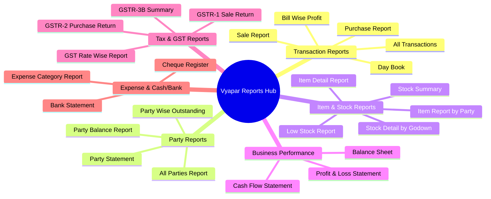

# Vyapar Desktop Application — Comprehensive Reports Inventory

**Document Version:** 1.0.0  
**Application Audited:** Vyapar Desktop (Version 36.0.2 / Electron 42.8.1)  
**Standard Followed:** Every report categorized with source modules, filters, summary totals, export capabilities, and schema columns.

---

## 1. Report Categories Overview

Vyapar organizes its reporting engine into 6 distinct analytical domains:

---

## 2. Detailed Report Catalog

### Category A: Transaction & Sales Reports

#### 1. Sale Report (`REP-SALE-001`)
- **Category:** Transaction Reports
- **Purpose:** Full audit log of all sale vouchers issued within a date range.
- **Supplying Modules:** `Sale` (Invoices, POS transactions).
- **Date Range Filters:** `Today`, `Yesterday`, `This Week`, `This Month`, `This Quarter`, `This Financial Year`, `Custom Date Range`.
- **Additional Filters:** Party Name (All / Specific), Payment Status (`All`, `Paid`, `Unpaid`, `Partial`), User/Salesman.
- **Visible Columns:**
  1. `Date` (DD-MM-YYYY)
  2. `Invoice No.`
  3. `Party Name`
  4. `Transaction Type` (Sale Invoice, POS Sale)
  5. `Payment Type` (Cash, Cheque, Bank Transfer, Credit)
  6. `Taxable Amount` (₹)
  7. `Tax Amount` (₹)
  8. `Total Amount` (₹)
  9. `Received Amount` (₹)
  10. `Balance Due` (₹)
- **Summary Totals:** Total Sales Count, Total Invoiced Value, Total Received, Total Outstanding.
- **Drill-Down:** Clicking any row opens the full Sale Invoice view/edit modal.
- **Export Formats:** `Excel` (`.xlsx`), `PDF`, `Print Preview`.

#### 2. Day Book (`REP-DAY-001`)
- **Category:** Transaction Reports
- **Purpose:** Chronological journal of all financial and stock events occurring on a single calendar date.
- **Supplying Modules:** `Sale`, `Purchase`, `Payment-In`, `Payment-Out`, `Expense`, `Bank Transfer`.
- **Date Filter:** Single Date Selector (Defaults to current system date).
- **Visible Columns:**
  1. `Time / Ref No.`
  2. `Entity / Account Name`
  3. `Transaction Type`
  4. `Money In (Debit ₹)`
  5. `Money Out (Credit ₹)`
- **Summary Totals:** Opening Cash/Bank Balance, Total Money In, Total Money Out, Closing Net Balance.
- **Drill-Down:** Directly navigates to the underlying voucher.
- **Export Formats:** `PDF`, `Excel`.

#### 3. All Transactions (`REP-TXN-001`)
- **Category:** Transaction Reports
- **Purpose:** Consolidated master journal of all transactions across all vouchers.
- **Supplying Modules:** Entire transaction database.
- **Filters:** Date Range, Transaction Type multi-select (Sales, Purchases, Payments, Expenses, Returns).
- **Columns:** Date, Type, Ref No., Party/Account, Amount, Status.

#### 4. Bill-Wise Profit (`REP-PRF-001`)
- **Category:** Transaction Reports / Performance
- **Purpose:** Real-time Gross Profit margin calculation for each individual sale invoice.
- **Formula:** $\text{Gross Profit} = \text{Invoice Sale Amount (excl. tax)} - \sum (\text{Line Item Qty} \times \text{Item Purchase Price})$.
- **Columns:** Invoice No., Date, Customer Name, Total Sale (₹), Cost of Goods Sold (₹), Gross Profit (₹), Margin %.

---

### Category B: Party & Ledger Reports

#### 5. Party Statement / Ledger (`REP-PTY-001`)
- **Category:** Party Reports
- **Purpose:** Detailed account statement showing debits, credits, and running balance for a specific customer or vendor.
- **Supplying Modules:** `Parties`, `Sale`, `Purchase`, `Payment-In`, `Payment-Out`.
- **Filters:** Select Party* (Mandatory searchable dropdown), Date Range.
- **Visible Columns:**
  1. `Date`
  2. `Transaction Details / Description`
  3. `Voucher Type` (Invoice, Payment, Return)
  4. `Voucher No.`
  5. `Debit (₹)` (Amount Billed)
  6. `Credit (₹)` (Amount Received/Paid)
  7. `Running Balance (₹)` (with `Dr` / `Cr` indicator)
- **Summary Header:** Opening Balance, Total Billed, Total Paid, Net Closing Balance Due.
- **Export & Share:** `Share via WhatsApp (PDF)`, `Email Statement`, `Print PDF`.

#### 6. Party Balance Summary (`REP-PTY-002`)
- **Category:** Party Reports
- **Purpose:** High-level list of all customers and suppliers with their net outstanding balances.
- **Filters:** Party Group/Category, Balance Filter (`All`, `Receivables Only`, `Payables Only`, `Zero Balance`).
- **Columns:** Party Name, Phone Number, Party Type (Customer/Supplier), Credit Limit, Receivable Balance (₹), Payable Balance (₹).
- **Summary Totals:** Total Receivables across all customers, Total Payables across all suppliers.

---

### Category C: Items & Inventory Reports

#### 7. Stock Summary Report (`REP-STK-001`)
- **Category:** Item Reports
- **Purpose:** Current physical stock holding, unit valuation, and inventory asset worth.
- **Supplying Modules:** `Items`, `Sale`, `Purchase`, `Stock Adjustments`.
- **Filters:** Category, Unit, Warehouse / Godown (if multi-godown enabled), Date.
- **Visible Columns:**
  1. `Item Name`
  2. `Item Code / SKU`
  3. `Category`
  4. `Opening Qty`
  5. `Inward Qty (Purchases + Returns)`
  6. `Outward Qty (Sales + Returns)`
  7. `Current Stock Quantity`
  8. `Unit` (PCS, KGS, etc.)
  9. `Stock Value (₹)` (Current Stock $\times$ Purchase Rate)
- **Summary Totals:** Total Unique Items, Total Physical Quantity, Total Inventory Asset Value (₹).
- **Export:** `Excel`, `PDF`.

#### 8. Low Stock Report (`REP-STK-002`)
- **Category:** Item Reports
- **Purpose:** Immediate reorder alert for products that have breached their minimum threshold.
- **Logic:** Filtered where $\text{Current Stock} \le \text{Low Stock Warning Limit}$.
- **Columns:** Item Name, Current Stock, Minimum Limit, Shortage Quantity, Preferred Supplier, Purchase Price.
- **Action Shortcut:** Direct `Create Purchase Order` button next to each item row.

---

### Category D: Tax & GST Statutory Reports

#### 9. GSTR-1 Report (`REP-GST-001`)
- **Category:** Tax Reports
- **Purpose:** Statutory sales return data formatted for Indian GST Portal upload.
- **Supplying Modules:** `Sale` (B2B, B2C Large, B2C Small, Credit Notes, HSN Summary).
- **Tax Breakdown Sections:**
  - `4A, 4B, 4C, 6B, 6C - B2B Invoices`: Invoices issued to parties with valid GSTIN.
  - `5A, 5B - B2C (Large) Invoices`: Inter-state sales > ₹ 2.5 Lakhs to unregistered buyers.
  - `7 - B2C (Others)`: Intra-state and small inter-state retail sales.
  - `9B - Credit / Debit Notes`: Sales returns and downward value adjustments.
  - `12 - HSN Summary`: Quantity and tax breakdown grouped by HSN code.
- **Export Options:** `JSON` (Direct GST Portal Schema Upload), `Excel (Govt Offline Tool format)`.

#### 10. GSTR-2 Report (`REP-GST-002`)
- **Category:** Tax Reports
- **Purpose:** Input Tax Credit (ITC) tracking on all inward purchase bills and expenses.
- **Columns:** Vendor GSTIN, Bill No., Bill Date, Taxable Value, Integrated Tax (IGST), Central Tax (CGST), State Tax (SGST), ITC Eligibility.

#### 11. GSTR-3B Summary (`REP-GST-003`)
- **Category:** Tax Reports
- **Purpose:** Monthly self-declaration tax calculation showing Outward Tax Liability minus Eligible Input Tax Credit (Net Cash Tax Payable).

---

### Category E: Business Financial Statements

#### 12. Profit & Loss Statement (`REP-ACC-001`)
- **Category:** Business Performance
- **Accounting Standard:** Accrual Basis / Cash Basis toggle.
- **Sections:**
  - **Trading Account:**
    - Gross Sales Revenue
    - Less: Sales Returns
    - Less: Cost of Goods Sold (Opening Stock + Purchases + Direct Expenses - Closing Stock)
    - **Gross Profit**
  - **Operating Account:**
    - Less: Indirect Operating Expenses (Rent, Salary, Utilities, Depreciation)
    - Add: Other Incomes (Interest, Discounts Received)
    - **Net Profit Before Tax**

#### 13. Cash Flow Statement (`REP-ACC-002`)
- **Category:** Business Performance
- **Purpose:** Tracks net liquidity inflow and outflow grouped into Operating, Investing, and Financing activities.
- **Metrics:** Cash from Operations, Cash from Vendor Payments, Net Cash Surplus / Deficit.
