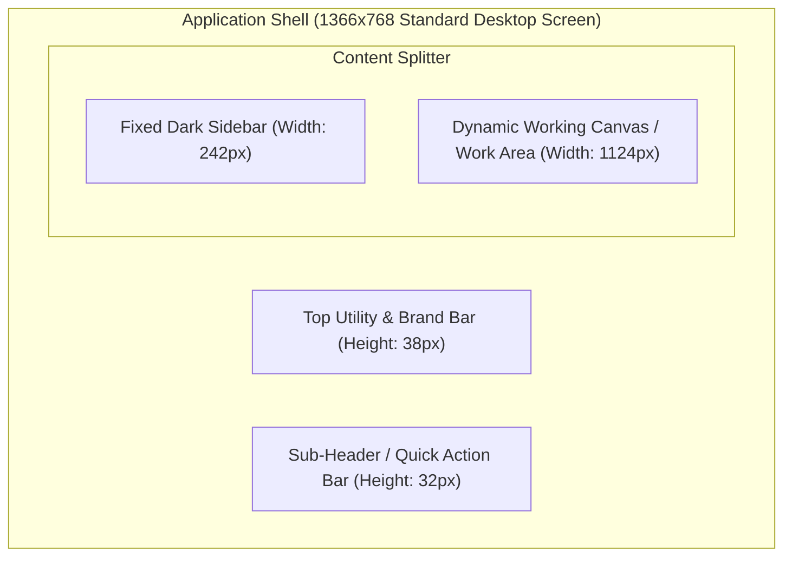

# Vyapar Desktop Application — UI/UX and Design System Audit

**Document Version:** 1.0.0  
**Application Audited:** Vyapar Desktop (Version 36.0.2 / Electron 42.8.1)  
**Standard Followed:** Visual and behavioral audit of layout, design tokens, form design, interaction patterns, modal overlays, usability gaps, and architectural insights.

---

## 1. Window Architecture and Layout Structure

Vyapar Desktop utilizes a classic desktop master-detail shell built on modern web technologies (Chromium/Electron) designed specifically for density and rapid keyboard data entry:

### Visual Layout Breakdown
1. **Top Application Bar (38px):**
   - Left: Vyapar 3-color flame logo, menu options (`Company`, `Help`, `Versions`, `Shortcuts`, `↻` Refresh).
   - Center: Customer support helpline numbers (+91-9333911911, +917795687633) with telephone icon, and `Get Instant Online Support` link.
   - Right: Native Windows window management controls (Minimize, Maximize, Close).
2. **Sub-Header / Breadcrumb Bar (32px):**
   - Displays `• Enter Business Name` with a red indicator bullet, acting as a permanent prompt to finalize legal business identity.
3. **Left Navigation Sidebar (242px width):**
   - High-contrast dark navy palette (`#131426` background).
   - "Open Anything (Ctrl+F)" omnibox search with a `<` collapse icon.
   - Vertical navigation list with icons, typography, and chevron indicators.
   - Dedicated subscription trial card and company profile selector docked at the bottom.
4. **Primary Working Canvas:**
   - Soft off-white / light slate background (`#F4F6F9`) that reduces eye strain during 8-10 hour retail billing sessions.
   - Center-staged cards, data tables, or side-by-side split screens.

---

## 2. Design System Tokens & Visual Language

### Color Palette

| Token Name | Hex Code | Visual Swatch | Observed Usage |
|---|---|---|---|
| **Sidebar Navy** | `#131426` | Dark Slate/Navy | Sidebar background, command bar |
| **Sidebar Hover/Active** | `#20253E` | Medium Navy | Active menu highlight, hover feedback |
| **Primary Blue** | `#1877F2` | Vivid Royal Blue | Primary CTA buttons (`Save`, `Create First Invoice`), focus outlines, active tabs |
| **Accent Red** | `#ED1C24` | Crimson Red | Mandatory asterisk (`*`), delete actions, leave confirmation button, trial alert |
| **Success Green** | `#22C55E` | Emerald Green | Balance display banner, paid status pill |
| **Warning Orange** | `#F59E0B` | Amber Orange | Sample invoice ribbon, low stock alerts, credit limit alerts |
| **Background Neutral** | `#F4F6F9` | Cool Light Grey | Main canvas backdrop |
| **Card White** | `#FFFFFF` | Pure White | Modal backgrounds, form cards, invoice paper preview |
| **Border Grey** | `#D1D5DB` | Light Neutral | Form input borders, line-item table grid lines |
| **Text Primary** | `#1E293B` | Dark Slate Charcoal | Form labels, table headers, document titles |
| **Text Muted** | `#64748B` | Slate Grey | Subtitles, placeholders, inactive tabs, helper text |

### Typography & Hierarchy
- **Font Stack:** System Sans-Serif (`Segoe UI`, `Roboto`, `-apple-system`, `sans-serif`).
- **Heading 1 (Modal Titles):** 18px Bold (`#1E293B`).
- **Section Headers (e.g. `Invoice Details :`):** 14px Semi-Bold (`#1E293B`).
- **Form Labels:** 12px Regular with red asterisk for mandatory fields (`Customer Name*`).
- **Input Text:** 13px Regular (`#1E293B`).
- **Numeric Values:** Monospace-aligned numerals for financial amounts to ensure neat decimal alignment.

---

## 3. Form Design and Interactive Controls

### Form Patterns Observed
1. **Floating Label / Compact Inputs:**
   - Input fields use subtle 1px border (`#D1D5DB`) with 4px border radius.
   - On focus, input borders transition to vivid blue (`#1877F2`) with 2px width and a soft halo shadow.
2. **Dual-Tab Modal Layouts:**
   - Modals use horizontal tabs (`GST & Address`, `Credit & Balance`, `Additional Fields` in Add Party; `Pricing`, `Stock` in Add Item).
   - Active tab features an underline bar (2px height in `#1877F2` or `#ED1C24`).
   - Inactive tabs use muted grey text (`#64748B`).
   - Feature discovery tags: New capabilities receive a small rounded red badge (e.g. `New` badge on `Credit & Balance`).
3. **Compound Inputs:**
   - **Discount Field:** Paired numeric box with adjacent dropdown toggle (`%` vs `₹`).
   - **Sale Price Field:** Numeric box with adjacent tax inclusion dropdown (`Without Tax` vs `With Tax`).
   - **Item Code Field:** Text input with an embedded button (`Assign Code`) that invokes an auto-increment generator.
4. **Action Button Groups:**
   - Primary and secondary actions are consistently docked in the bottom-right corner of modals.
   - `Save & New`: Outlined button with blue border, designed for high-speed continuous inventory/party entry without modal closing.
   - `Save`: Filled primary button, auto-closes modal upon successful database commit.

---

## 4. Modal and Dialog Behaviors

### 1. Centered Overlay Modals (e.g. Add Party, Add Item)
- **Overlay Backdrop:** Full-viewport semi-transparent dark grey backdrop (`rgba(0, 0, 0, 0.5)`).
- **Backdrop Clicks:** Non-dismissive by default to avoid accidental data loss.
- **Header Controls:** Dedicated gear icon for contextual settings and top-right `✕` button.
- **Escape Key:** Intercepted; if form is dirty, displays confirmation.

### 2. Live Sidecar Preview Pattern (First-Sale Experience)
- In the first-sale screen, the layout uses a **50/50 horizontal split**:
  - Left pane: Minimal 4-field data entry.
  - Right pane: Real-time rendering of the printed Tax Invoice.
- As the user types into Customer Name or Amount, the preview dynamically re-renders in real time without lag, providing instant visual confirmation.

### 3. Exit Confirmation Guard (Dirty State Protection)
- Modal dialog (`WF-GUARD-01`) interrupts navigation if unsaved data exists.
- Human-centric design: Features an illustrative icon, empathetic copy ("You are almost done with your first invoice / Are you sure you want to leave?"), an embedded tutorial link, and clear binary choice buttons.

---

## 5. Keyboard Navigation & Accessibility Audit

### Strengths
- **Global Search (`Ctrl+F`):** Rapid omnibox accessible from any screen.
- **Numeric Fields:** Auto-selects contents on tab focus, enabling instant overwriting without backspacing.
- **Keyboard Accelerators:** Built-in cheat sheet (`Shortcuts` in top bar) for rapid POS billing.

### Usability Gaps & Accessibility Findings (Areas for ChhotaBusiness Improvement)
1. **Screen Reader Support:** UI Automation elements inside Chromium are not consistently exposed as native Win32 accessibility controls; standard Windows Narrator struggles with line-item grids.
2. **Tab Trapping in Modals:** Pressing `Tab` from the last form field occasionally escapes to the background rather than cycling back to the first input.
3. **Color Contrast:** Inactive tabs (e.g. `Credit & Balance` when unfocused) use `#999999` text against `#FFFFFF` background, which yields a 2.8:1 contrast ratio, failing WCAG AA guidelines (requires 4.5:1).
4. **Touchscreen Density:** Buttons and row heights are optimized for precision mouse cursors (32px height); retail tablets / touch POS screens would suffer from misclicks.
