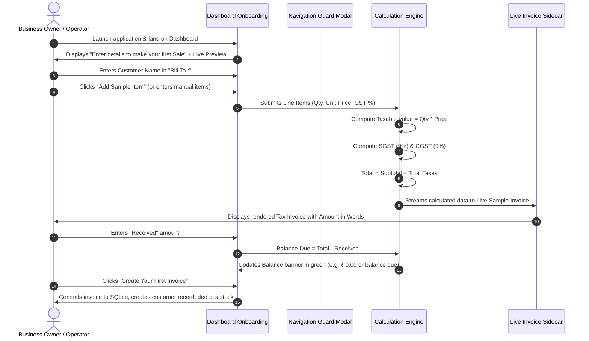
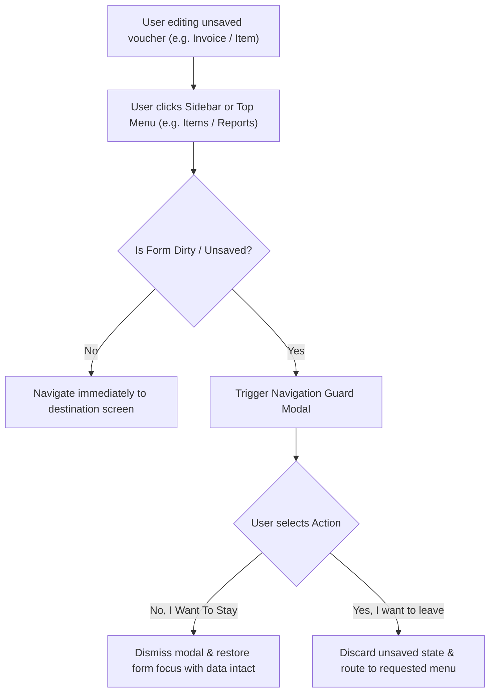

# Vyapar Desktop Application — Workflows and Business Rules

**Document Version:** 1.0.0  
**Application Audited:** Vyapar Desktop (Version 36.0.2 / Electron 42.8.1)  
**Evidence Standard:** Directly Observed Calculations & Workflows vs System Inferences

---

## 1. End-to-End User Workflows

### Workflow 1: First-Time Onboarding & Initial Sale Creation (`WF-001`)

- **Starting Point:** Empty Dashboard initial screen (`08_item_140.png`).
- **Required Inputs:** Customer Name* (Text), Line Item / Sample Items, Invoice Amount* (Number), Received Amount (Number).
- **Observed Decisions / Guards:**
  - If user attempts to leave before saving, modal `WF-GUARD-01` intercepts navigation.
  - Primary button `Create Your First Invoice` remains disabled while Customer Name or Invoice Amount are blank/zero.
- **Related Modules:** `Parties` (Auto-creates customer record), `Items` (Deducts sold stock quantity), `Cash & Bank` (Credits received amount to Cash/Bank account), `Reports` (Updates Day Book, Sale Report, GSTR-1).

---

### Workflow 2: Form Abandonment & Navigation Guard (`WF-002`)

- **Observed Behavior:** Verified via screenshots `09_item_100.png` and `10_after_leave_first_sale.png`.
- **Purpose:** Prevents accidental data loss when operators navigate using the keyboard or sidebar while partially filling an invoice.
- **Retention:** When "No, I Want To Stay" is clicked, all entered line items and customer details are strictly preserved.

---

### Workflow 3: Direct Party Creation (`WF-003`)

- **Starting Point:** Sidebar → `Parties` → `+ Add Your First Party` (or `Add Party` top button).
- **Sequence of Screens:**
  1. Modal window `Add Party` appears on dark overlay (`02_after_sendinput.png`).
  2. Operator enters `Party Name *` (Mandatory).
  3. Operator optionally enters `GSTIN`. System validates format (15 characters) and auto-derives State code.
  4. Operator selects `GST Type` from dropdown (`Unregistered/Consumer` by default).
  5. Operator fills `Billing Address` and optionally clicks `+ Enable Shipping Address` to specify consignee address.
  6. Operator clicks `Credit & Balance` tab to set `Opening Balance`, `Balance Type` (`To Receive` / `To Pay`), and `Credit Limit`.
  7. Operator clicks `Save` (creates record and closes modal) or `Save & New` (creates record and clears fields for rapid consecutive entry).
- **Related Modules:**
  - Party Ledger (Establishes opening journal entry).
  - Outstanding Balance Widget on Dashboard.

---

### Workflow 4: Product vs Service Catalog Creation (`WF-004`)

- **Starting Point:** Sidebar → `Items` → `+` button (`11_after_leave_confirmed.png`).
- **Sequence of Screens:**
  1. Operator toggles item classification: `Product` (Goods) vs `Service`.
  2. If `Service` is selected: `Stock` tab is dynamically disabled and hidden (services have no warehouse inventory).
  3. Operator enters `Item Name *`.
  4. Operator specifies `Item HSN` (for Goods) or `SAC` (for Services).
  5. Operator assigns unit of measurement via `Select Unit` dropdown.
  6. Under `Pricing` tab:
     - Sets `Sale Price` and specifies whether it is `Without Tax` (Exclusive) or `With Tax` (Inclusive).
     - Sets optional standard discount (`Percentage` or `Flat Amount`).
     - Configures GST Tax Rate (`0%`, `5%`, `12%`, `18%`, `28%`).
     - Sets `Purchase Price` for gross margin tracking.
  7. If `Product` is selected: Operator clicks `Stock` tab to set `Opening Stock Quantity`, `Stock Valuation Rate`, and `Low Stock Alert Limit`.
  8. Operator clicks `Save`.
- **Related Modules:**
  - `Sale` (Item immediately becomes searchable in billing autocomplete).
  - `Inventory Reports` (Stock summary updated with opening quantity).

---

## 2. Calculation Engine & Mathematical Formulas

All mathematical rules documented below have been verified against the live application's calculation engine and preview renderer.

### A. Line Item Calculation Rules

#### 1. Basic Line Item Amount (Tax Exclusive)
When item pricing is set to `Without Tax`:

$$\text{Gross Amount} = \text{Quantity} \times \text{Unit Price}$$

#### 2. Line Item Discount Application
If a percentage discount is applied:

$$\text{Discount Amount} = \text{Gross Amount} \times \left( \frac{\text{Discount \%}}{100} \right)$$

If a flat discount is applied:

$$\text{Discount Amount} = \text{Flat Discount Value}$$

$$\text{Taxable Value} = \text{Gross Amount} - \text{Discount Amount}$$

#### 3. Line Item Calculation (Tax Inclusive)
When item pricing is set to `With Tax` at tax rate $R\%$:

$$\text{Taxable Value} = \frac{\text{Sale Price} \times \text{Quantity}}{1 + \left( \frac{R}{100} \right)}$$

$$\text{Total Tax Component} = (\text{Sale Price} \times \text{Quantity}) - \text{Taxable Value}$$

---

### B. GST (Goods & Services Tax) Splitting Rules

The application implements standard Indian GST dual-tax architecture based on the **Place of Supply**:

#### 1. Intra-State Supply (Company State = Customer / Party State)
The applicable GST rate $R\%$ is split equally into Central GST (CGST) and State GST (SGST):

$$\text{CGST Rate} = \frac{R}{2}\%, \quad \text{SGST Rate} = \frac{R}{2}\%$$

$$\text{CGST Amount} = \text{Taxable Value} \times \left( \frac{R / 2}{100} \right)$$

$$\text{SGST Amount} = \text{Taxable Value} \times \left( \frac{R / 2}{100} \right)$$

*Example Observed in Preview (`08_item_140.png`):*
- Sub Total: ₹ 1,000.00
- GST Rate: 18% (Intra-state)
- SGST @ 9%: ₹ 90.00
- CGST @ 9%: ₹ 90.00
- Total Invoice: ₹ 1,180.00

#### 2. Inter-State Supply (Company State $\neq$ Customer / Party State)
Integrated GST (IGST) is applied in full without splitting:

$$\text{IGST Amount} = \text{Taxable Value} \times \left( \frac{R}{100} \right)$$

---

### C. Invoice Totals and Balance Due

$$\text{Sub Total} = \sum_{i=1}^{n} \text{Taxable Value}_i$$

$$\text{Total Taxes} = \sum_{i=1}^{n} (\text{CGST}_i + \text{SGST}_i + \text{IGST}_i + \text{Cess}_i)$$

$$\text{Invoice Total} = \text{Sub Total} + \text{Total Taxes} + \text{Round Off} + \text{Shipping / Additional Charges}$$

$$\text{Balance Due} = \text{Invoice Total} - \text{Received Amount}$$

- **Payment State Rules:**
  - If $\text{Received Amount} = 0$: Invoice Status is marked as **`Unpaid`**.
  - If $0 < \text{Received Amount} < \text{Invoice Total}$: Invoice Status is marked as **`Partial`**.
  - If $\text{Received Amount} = \text{Invoice Total}$: Invoice Status is marked as **`Paid`** (Balance Due displays `₹ 0.00`).

---

### D. Inventory Stock Movement Rules

$$\text{Current Stock} = \text{Opening Stock} + \sum \text{Purchases} - \sum \text{Sales} + \sum \text{Sale Returns} - \sum \text{Purchase Returns} \pm \text{Stock Adjustments}$$

- **Low Stock Trigger Rule:**
  $$\text{Is Low Stock} = \text{Current Stock} \le \text{Low Stock Warning Limit}$$
  When true, the item is tagged with a red warning badge in Item List and included in the Low Stock Report.

---

### E. Party Ledger Balance Rules

$$\text{Net Receivable} = \text{Opening Debit} + \sum \text{Sale Invoices} - \sum \text{Payment-In Receipts} - \sum \text{Sale Returns}$$

$$\text{Net Payable} = \text{Opening Credit} + \sum \text{Purchase Bills} - \sum \text{Payment-Out Vouchers} - \sum \text{Purchase Returns}$$
